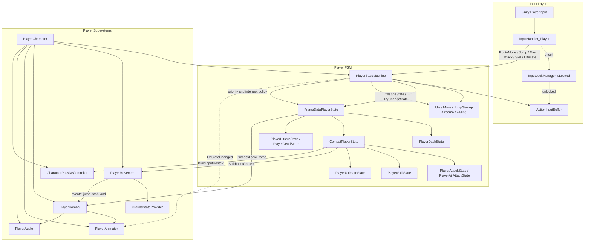
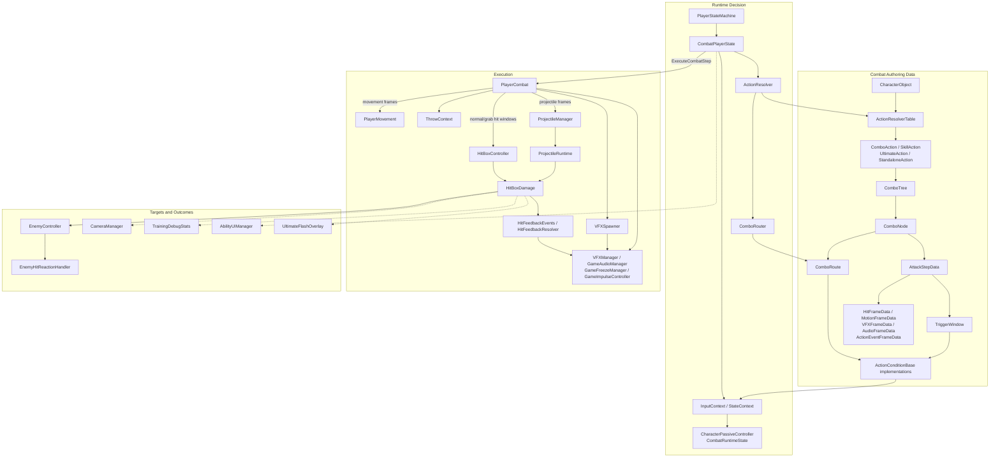
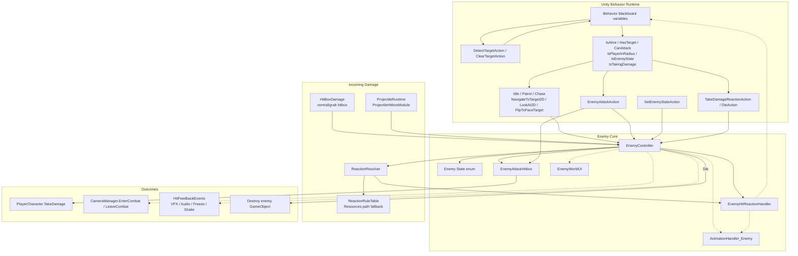
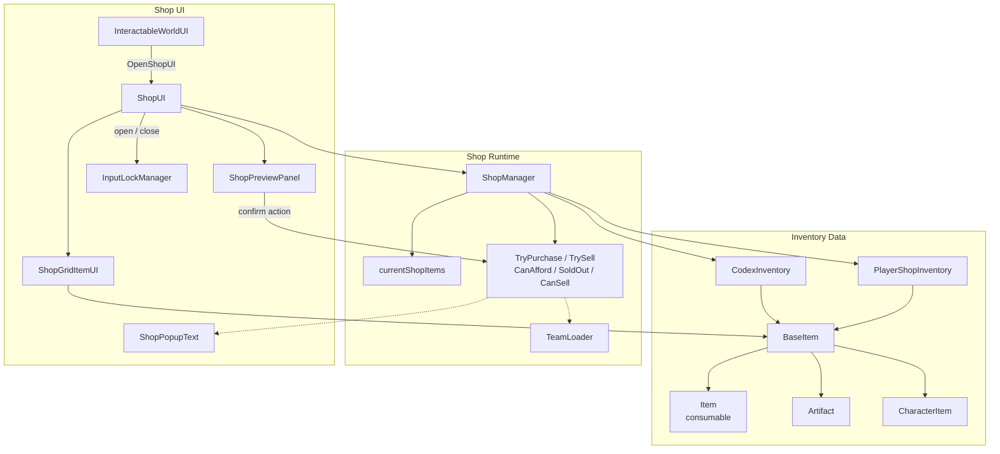
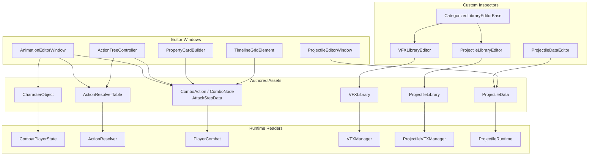

# Unity Game Architecture Review

This document maps the current custom gameplay architecture under `Assets/Project/Scripts`.
It excludes Asset Store packages, Unity packages, `Library`, `Temp`, generated cache files, and project settings.

Current script coverage:

| Subsystem | Script count | Review role |
| --- | ---: | --- |
| AIBehaviour | 2 | Enemy controller and hit reaction runtime. |
| Animation | 3 | Player/enemy animation adapters and animation event relay. |
| Behavior | 23 | Unity Behavior graph actions, conditions, and reactions. |
| Cameras | 1 | Cinemachine combat/explore camera coordinator. |
| Character | 23 | Character data, frame data, combo tree data, progression data. |
| Combat | 50 | Player combat executor, hitboxes, projectiles, feedback, managers. |
| Editor | 9 | Authoring windows and custom inspectors for combat data. |
| Inventory | 5 | Item and codex ScriptableObject data. |
| Parallax | 3 | Scene background parallax runtime. |
| Player | 24 | Player FSM, states, input buffer, movement policies, UI. |
| Shop | 6 | Shop inventory, shop runtime, and shop UI. |
| Systems | 4 | Team loading, player character facade, runtime bootstrap, sorting. |
| TeamBuilder | 5 | Team builder UI and drag/drop slot logic. |
| UI | 10 | HUD, skill tree UI, world UI, input locks, debug/admin UI. |

Legend:

- Solid arrows are direct runtime calls, serialized references, or ownership.
- Dotted arrows are event callbacks, global lookups, singleton access, or optional fallback paths.
- ScriptableObject nodes represent authored data that drives runtime behavior.

## 1. System Overview

The game is centered on a player facade (`PlayerCharacter`) that owns the active `CharacterObject` data and caches movement, combat, animation, audio, passive, and FSM subsystems. Most gameplay flows then branch into the player state machine, combat execution, enemy controller/reaction code, and UI/service managers.

```mermaid
flowchart TD
    subgraph UnityRuntime["Unity Scene Runtime"]
        UnityCallbacks["Unity callbacks\nAwake / Start / Update / FixedUpdate"]
        Prefabs["Scene objects and prefabs"]
        InputSystem["Unity Input System"]
        Physics2D["Physics2D collisions/triggers"]
        BehaviorGraph["Unity Behavior Graph"]
        Cinemachine["Cinemachine"]
    end

    subgraph PlayerCore["Player Core"]
        InputHandler["InputHandler_Player\n(PlayerInputHandler.cs)"]
        PlayerCharacter["PlayerCharacter"]
        PlayerFSM["PlayerStateMachine"]
        PlayerMovement["PlayerMovement"]
        PlayerCombat["PlayerCombat"]
        PlayerAnimator["PlayerAnimator"]
        PlayerAudio["PlayerAudio"]
        PassiveController["CharacterPassiveController"]
    end

    subgraph AuthoredData["Authored Data"]
        CharacterObject["CharacterObject"]
        MovementProfile["MovementProfile"]
        ActionResolverTable["ActionResolverTable"]
        ComboTree["ComboTree / ComboNode"]
        AttackStepData["AttackStepData\nHit / Motion / VFX / Audio / Events"]
        ProgressionData["CharacterProgressionDefinition"]
        Libraries["VFXLibrary / ProjectileLibrary\nReactionRuleTable"]
        InventoryData["CodexInventory / BaseItem\nCharacterItem / Artifact / Item"]
    end

    subgraph CombatRuntime["Combat Runtime"]
        CombatState["CombatPlayerState\nAttack / Skill / Ultimate"]
        ActionResolver["ActionResolver"]
        Hitboxes["HitBoxController / HitBoxDamage\nEnemyAttackHitbox"]
        Projectiles["ProjectileManager / ProjectileVFXManager\nProjectileRuntime"]
        Feedback["HitFeedbackEvents / HitFeedbackResolver\nVFXManager / GameAudioManager"]
        FreezeImpulse["GameFreezeManager / GameImpulseController\nCamera shake and hitstop"]
    end

    subgraph EnemyRuntime["Enemy Runtime"]
        EnemyController["EnemyController"]
        EnemyReaction["EnemyHitReactionHandler"]
        EnemyAnimation["AnimationHandler_Enemy"]
        EnemyBehaviorNodes["Behavior actions and conditions"]
        EnemyWorldUI["EnemyWorldUI"]
    end

    subgraph UIAndEconomy["UI, Team, Shop, Inventory"]
        InputLocks["InputLockManager"]
        HUD["PlayerHUD / TeamSwitchHUD\nAbilityUIManager"]
        SkillTreeUI["SkillTreeUI / SkillTreeController"]
        TeamLoader["TeamLoader"]
        TeamBuilder["TeamBuilderUI and slot/grid UI"]
        Shop["ShopManager / ShopUI\nShopPreviewPanel / ShopGridItemUI"]
        ShopInventory["PlayerShopInventory"]
    end

    subgraph WorldSystems["World Systems"]
        CameraManager["CameraManager"]
        EntitySorting["EntitySortingManager"]
        Parallax["ParallaxController / Background / Layer"]
        WorldInteract["InteractableWorldUI"]
        DebugTools["TrainingDebugHUD / AdminConsole\nTrainingDebugManager / Stats"]
    end

    UnityCallbacks --> Prefabs
    Prefabs --> PlayerCharacter
    InputSystem --> InputHandler
    InputHandler --> PlayerFSM
    PlayerCharacter --> PlayerFSM
    PlayerCharacter --> PlayerMovement
    PlayerCharacter --> PlayerCombat
    PlayerCharacter --> PlayerAnimator
    PlayerCharacter --> PlayerAudio
    PlayerCharacter --> PassiveController

    CharacterObject --> PlayerCharacter
    CharacterObject --> MovementProfile
    CharacterObject --> ActionResolverTable
    CharacterObject --> ProgressionData
    ActionResolverTable --> ComboTree
    ComboTree --> AttackStepData
    Libraries --> Feedback
    Libraries --> Projectiles
    InventoryData --> Shop

    PlayerFSM --> CombatState
    CombatState --> ActionResolver
    ActionResolver --> ActionResolverTable
    CombatState --> PlayerCombat
    PlayerCombat --> Hitboxes
    PlayerCombat --> Projectiles
    PlayerCombat --> Feedback
    PlayerCombat --> FreezeImpulse
    Physics2D --> Hitboxes
    Physics2D --> Projectiles

    BehaviorGraph --> EnemyBehaviorNodes
    EnemyBehaviorNodes --> EnemyController
    EnemyController --> EnemyReaction
    EnemyController --> EnemyAnimation
    EnemyController --> EnemyWorldUI
    Hitboxes --> EnemyController
    Projectiles --> EnemyController

    TeamBuilder --> TeamLoader
    TeamLoader --> PlayerCharacter
    TeamLoader -.-> HUD
    PlayerCharacter -.-> HUD
    PassiveController --> SkillTreeUI
    Shop --> ShopInventory
    ShopInventory --> TeamBuilder
    WorldInteract --> Shop
    Shop --> InputLocks
    TeamBuilder --> InputLocks

    PlayerCombat -.-> CameraManager
    EnemyController -.-> CameraManager
    CameraManager --> Cinemachine
    FreezeImpulse -.-> CameraManager
    EntitySorting -.-> PlayerCombat
    EntitySorting -.-> EnemyController
    Parallax -.-> UnityCallbacks
    DebugTools -.-> CombatRuntime
```

## 2. Player Runtime Flow

Input enters through `InputHandler_Player`, is blocked by `InputLockManager` when UI panels are open, and is routed into `PlayerStateMachine`. The FSM owns state transitions and delegates frame-data execution to concrete states. Movement remains in `FixedUpdate`, while frame-data combat states call into `PlayerCombat`.

## 3. Combat Flow

Combat is data-driven. `CharacterObject` points to an `ActionResolverTable`; the table owns normal, skill, ultimate, and standalone actions. Runtime states use `ActionResolver` to select and traverse combo nodes, then `PlayerCombat` executes hitboxes, projectiles, motion, action events, audio, VFX, feedback, and cooldown bookkeeping.

## 4. Enemy AI and Hit Reaction Flow

Enemy behavior is split between Unity Behavior graph nodes and `EnemyController`. Behavior nodes drive detection, chase, attack, patrol, evasion, reaction, and death. Player hitboxes and projectile hitboxes call into `EnemyController.TakeHit`, then deterministic reaction rules and `EnemyHitReactionHandler` control freeze, grab, juggle, knockback, recovery, and death cleanup.

## 5. Team, Character, and Progression Flow

`TeamLoader` is the runtime authority for active party order and per-character HP. `PlayerCharacter` applies the active `CharacterObject` into movement, animation, audio, passive progression, and HP. Team UI and switch HUD subscribe to `TeamLoader` and `PlayerCharacter` events.

```mermaid
flowchart TD
    subgraph Data["Character and Inventory Data"]
        CharacterItem["CharacterItem"]
        CharacterObject["CharacterObject"]
        CharacterStats["CharacterStats"]
        MovementProfile["MovementProfile"]
        DashData["DashData"]
        AudioData["PlayerAudioData"]
        ProgressionDefinition["CharacterProgressionDefinition"]
    end

    subgraph RuntimeTeam["Runtime Team"]
        TeamLoader["TeamLoader"]
        HPStore["Dictionary CharacterObject -> HP"]
        PlayerCharacter["PlayerCharacter"]
        StateMachine["PlayerStateMachine"]
        Movement["PlayerMovement"]
        Combat["PlayerCombat"]
        Animator["PlayerAnimator"]
        PlayerAudio["PlayerAudio"]
        Passive["CharacterPassiveController"]
        RuntimeState["CombatRuntimeState"]
    end

    subgraph UI["Team and Character UI"]
        TeamBuilder["TeamBuilderUI"]
        Grid["CharacterGridInventoryUI\nCharacterGridItemUI"]
        Slots["TeamSlotUI / ArtifactSlotUI"]
        TeamUI["TeamUI"]
        SwitchHUD["TeamSwitchHUD\nCharacterSwitchSlot"]
        PlayerHUD["PlayerHUD"]
        SkillTreeUI["SkillTreeUI\nSkillTreeNodeButton"]
    end

    CharacterItem --> CharacterObject
    CharacterObject --> CharacterStats
    CharacterObject --> MovementProfile
    CharacterObject --> DashData
    CharacterObject --> AudioData
    CharacterObject --> ProgressionDefinition

    TeamBuilder --> Grid
    TeamBuilder --> Slots
    Grid --> CharacterItem
    Slots --> CharacterItem
    TeamBuilder -->|SyncWithTeam| TeamLoader
    TeamUI --> TeamBuilder

    TeamLoader --> HPStore
    TeamLoader -->|SetCharacter| PlayerCharacter
    PlayerCharacter --> StateMachine
    PlayerCharacter --> Movement
    PlayerCharacter --> Combat
    PlayerCharacter --> Animator
    PlayerCharacter --> PlayerAudio
    PlayerCharacter --> Passive
    Passive --> RuntimeState

    PlayerCharacter -->|ApplyMovementData| MovementProfile
    PlayerCharacter -->|ApplyAnimationData| CharacterObject
    PlayerCharacter -->|InitializeAudio| AudioData
    Passive --> ProgressionDefinition

    TeamLoader -.->|OnTeamChanged| SwitchHUD
    TeamLoader -.->|OnCurrentCharacterChanged| SwitchHUD
    TeamLoader -.->|OnCharacterHealthUpdated| SwitchHUD
    PlayerCharacter -.->|OnHealthChanged / OnCharacterChanged| PlayerHUD
    Passive -.-> SkillTreeUI
```

## 6. Shop and Inventory Flow

The shop pulls sale candidates from `CodexInventory`, filters ownership through `PlayerShopInventory`, and updates UI slots. Buying/selling changes `PlayerShopInventory`; character sales are guarded by `TeamLoader` so active team members cannot be sold.

## 7. Manager and Singleton Flow

Managers are mostly scene components with global static access. Some persist across scenes with `DontDestroyOnLoad`; others are scene-scoped singletons or static helpers. This makes runtime wiring convenient, but creates boot-order and duplicate-instance review points.

```mermaid
flowchart TD
    subgraph PersistentManagers["Persistent Managers"]
        GameFreeze["GameFreezeManager.Instance\nDontDestroyOnLoad"]
        GameAudio["GameAudioManager.Instance\nDontDestroyOnLoad"]
        GameImpulse["GameImpulseController.Instance\nDontDestroyOnLoad fallback"]
    end

    subgraph SceneManagers["Scene Managers"]
        CameraManager["CameraManager.instance"]
        VFXManager["VFXManager.Instance"]
        ProjectileManager["ProjectileManager.Instance"]
        ProjectileVFXManager["ProjectileVFXManager.Instance"]
        HitFeedbackResolver["HitFeedbackResolver.Instance"]
        TrainingDebug["TrainingDebugManager / TrainingDebugStats"]
        ParallaxController["ParallaxController.Instance"]
        AbilityUI["AbilityUIManager.Instance"]
        UltimateOverlay["UltimateFlashOverlay.Instance"]
        ShopPopup["ShopPopupText.Instance"]
    end

    subgraph StaticHelpers["Static Helpers"]
        InputLock["InputLockManager\nstatic lock count"]
        EntitySorting["EntitySortingManager"]
        FeedbackEvents["HitFeedbackEvents\nProjectileFeedbackEvents"]
        ReactionRules["ReactionRuleTable.Load\nResources.Load"]
    end

    subgraph Consumers["Main Consumers"]
        PlayerCombat["PlayerCombat"]
        HitBoxDamage["HitBoxDamage"]
        ProjectileRuntime["ProjectileRuntime"]
        ProjectileVFX["ProjectileVFXManager"]
        CameraConsumer["CameraManager / CameraShakeController"]
        UIConsumers["ShopUI / TeamUI / HUD"]
        EnemyController["EnemyController"]
    end

    PlayerCombat -.-> GameFreeze
    PlayerCombat -.-> GameAudio
    PlayerCombat -.-> VFXManager
    PlayerCombat -.-> ProjectileManager
    HitBoxDamage -.-> GameFreeze
    HitBoxDamage -.-> CameraManager
    HitBoxDamage -.-> FeedbackEvents
    ProjectileRuntime -.-> CameraManager
    ProjectileVFX -.-> VFXManager
    ProjectileVFX -.-> GameAudio
    CameraConsumer -.-> GameImpulse
    UIConsumers -.-> InputLock
    EnemyController -.-> CameraManager
    EnemyController -.-> EntitySorting
    FeedbackEvents -.-> HitFeedbackResolver
    ReactionRules -.-> EnemyController

    GameImpulse -.-> CameraConsumer
    ProjectileManager --> ProjectileVFXManager
    ProjectileVFXManager --> ProjectileRuntime
```

## 8. Authoring Tools Flow

Editor scripts are not part of runtime gameplay, but they are important because they create and modify the data that runtime combat consumes. The authoring path centers on `CharacterObject`, `ActionResolverTable`, categorized VFX/projectile libraries, and custom UIElements controls.

## 9. Loopholes and Risks

| Severity | Area | Evidence | Risk | Suggested fix direction |
| --- | --- | --- | --- | --- |
| High | MonoBehaviour script binding | `Assets/Project/Scripts/Combat/PlayerInputHandler.cs:9` declares `InputHandler_Player`; `Assets/Project/Scripts/Animation/AnimetionEventRelay.cs:3` declares `AnimationEventRelay`. | Unity can compile this, but MonoBehaviour script assets are easier to lose or mis-attach when filename and class name diverge. Add Component search, prefab references, and future renames become fragile. | Rename the class or file so the MonoBehaviour class and `.cs` filename match. Do it through Unity or with a careful meta/prefab reference check. |
| High | Runtime debug input | `Assets/Project/Scripts/Combat/PlayerInputHandler.cs:62`, `:64`, `:66`, and `:68` unlock/reset skill nodes from number keys. | Debug progression shortcuts can ship into normal play and bypass intended skill/progression economy. | Gate with `#if UNITY_EDITOR || DEVELOPMENT_BUILD`, move to `AdminConsole`, or require a debug/training mode flag before accepting the keys. |
| Medium | Static input locks | `Assets/Project/Scripts/UI/InputLockManager.cs:11` stores a static `lockCount`; `:21`, `:34`, and `:57` mutate it. Shop and team panels call lock/unlock from UI paths. | If a panel closes through disable/destroy/scene transition without paired `Unlock`, gameplay input can stay permanently locked. If `ResetLocks` is missed on scene load, the stale static count persists. | Use disposable lock handles or owner tokens, release locks in `OnDisable`/`OnDestroy`, and call `ResetLocks` from a scene/bootstrap lifecycle point. |
| Medium | Scene-order and global service lookup | Examples include `Assets/Project/Scripts/Player/PlayerStateMachine.cs:79`, `Assets/Project/Scripts/Systems/TeamLoader.cs:55`, `Assets/Project/Scripts/Systems/TeamLoader.cs:545`, `Assets/Project/Scripts/Combat/GameImpulseController.cs:90`, and `Assets/Project/Scripts/Combat/GameImpulseController.cs:173`. | `FindFirstObjectByType` and static singletons hide missing references until runtime, can select the wrong object if duplicates exist, and make additive scenes harder to reason about. | Prefer explicit serialized references on prefabs/bootstrap objects, validate required services at scene load, and keep one scene bootstrap responsible for global managers. |
| Medium | Persistent manager lifecycle | `Assets/Project/Scripts/Combat/GameAudioManager.cs:20`, `Assets/Project/Scripts/Combat/GameFreezeManager.cs:41`, and `Assets/Project/Scripts/Combat/GameImpulseController.cs:163` use `DontDestroyOnLoad`; multiple managers expose static `Instance`. | Duplicate manager prefabs across scenes can destroy later instances with scene-specific configuration. Time scale/audio/impulse state can leak between scenes. | Centralize persistent managers in one bootstrap scene/prefab, add runtime duplicate warnings with source scene names, and reset transient state on scene load. |
| Medium | Reaction rule fallback | `Assets/Project/Scripts/Combat/ReactionRuleTable.cs:34` loads `Resources/Combat/ReactionRuleTable`; `Assets/Project/Scripts/Combat/ReactionResolver.cs:44` falls back into default rules when configured table is unavailable. | Missing or misnamed authored reaction data may silently change enemy reaction balance while appearing functional. | Log a warning once when the Resources table is missing, add boot validation for required combat assets, or inject the table through a serialized manager reference. |
| Medium | Team ownership boundary | `Assets/Project/Scripts/TeamBuilder/UI/TeamBuilderUI.cs:284` creates a runtime `CharacterItem` wrapper when a team character is not found in `PlayerShopInventory`; `Assets/Project/Scripts/TeamBuilder/UI/TeamBuilderUI.cs:346` syncs slot data back to `TeamLoader`. | This is useful for seeded starter teams, but it can also preserve/display characters that are not in inventory and blur ownership rules between shop, team builder, and gameplay. | Decide whether seeded characters are valid. If yes, document the bootstrap rule. If no, make `TeamBuilderUI` filter or repair team slots against owned `CharacterItem` data before syncing. |
| Low | Resources dependency visibility | `Assets/Project/Scripts/Combat/ReactionRuleTable.cs:27` caches the first Resources result through `ReactionRuleTable.Load`. | Once cached, asset replacement/migration issues are harder to detect in play mode, especially during iterative balancing. | Add a clear editor validation button or runtime debug HUD line showing which reaction table is active. |

## 10. Senior Review Checklist

- Confirm every scene has exactly one intended source for persistent managers and scene managers.
- Validate `PlayerCharacter` references are present before `TeamLoader`, HUD, and input routing begin.
- Run through combat startup, active, recovery, cancel, hitstop, ultimate freeze, and scene change paths.
- Test UI lock pairing for Shop, Team, Skill Tree, debug/admin panels, and scene transitions.
- Verify all `CharacterObject` assets have movement, action resolver, progression, metadata, and audio data expected by runtime.
- Verify `ActionResolverTable` standalone actions, combo routes, trigger windows, and cooldowns cannot bypass progression locks.
- Confirm projectile hit counts, grab ownership, and enemy reaction ownership behave correctly with multi-hit and multi-enemy cases.
- Check that shop selling cannot remove active team characters or leave the player with zero valid characters.
- Confirm editor authoring windows save data into the same ScriptableObject fields used by runtime.
- Add boot validation for required singletons, key ScriptableObjects, and manager/library references.
