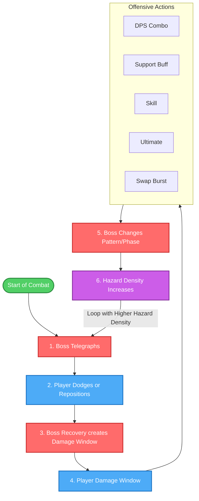

# Neo-JJK - Game Design Document

## Purpose

This document is the current design authority for **Neo-JJK**.

> **Runtime verification:** 2026-07-18. Design statements describe the intended player experience. Tables labeled **Current Prototype Truth** describe behavior verified in the Unity project. Planned systems are explicitly marked as targets or speculative.

`GDD_JJK.md` is a legacy plan. Keep it as historical reference, but do not use it as the active combat direction unless a human explicitly asks for legacy comparison work.

Neo-JJK has shifted away from action/fighting-game hybrid combat and into a simpler **2D side-scrolling action hack-and-slash rogue-lite**. The design target is fast, readable, flashy, and easy to build.

The most important production constraint is:

- **Low development effort**
- **Casual low skill floor**
- **Casual low skill ceiling**
- **Simple logic over clever systems**
- **VFX impact over animation complexity**

This Design aim for Casual Game with Low Floor. Low Ceiling. High Impact in Flashy visuals.

---

<!-- @tag:identity -->
# Project Identity

| Field | Direction |
| --- | --- |
| **Working Title** | **Neo-JJK** |
| **Genre** | **2D Side-Scrolling / Action / Hack-and-Slash / Rogue-lite** |
| **Core Fantasy** | Clear chaotic side-scrolling combat rooms with a small team of flashy characters, swapping them to spend skills, apply buffs, and burst enemies down. |
| **Player Promise** | Fast basic action, readable attacks, big VFX, simple upgrades, and easy team rotations. |
| **Game Design Philosophy** | **Casual low floor and low ceiling. fast-paced reward and execution.** |
| **Development Philosophy** | Highly Systematic and Architecture like senior programmer Clean Code. Prefer simple, reliable systems rather than hard-coded. The codebase should short and modular to prevent Bug. |
| **Platform Priority** | PC-Focus (Keyboard/Controller) |
| **Camera / Play Plane** | 2D side-scrolling combat plane. |
| **Tone** | Fast, flashy, supernatural, arcade-like, lightweight rogue-lite pressure. |
| **Story Intent** | "Shin" died and was transported into Death Game Cursed Realm by Spirit Waifu name "Blind" and discovered that all players contain a Cursed Technique called "Aura" that amplify their fighting spirit to fight Monster "Fiend". All of you are rival and your enemy is your time. No matter you died in Curse Realm you will respawn at the beginning but only  1 out of 50 Players can survive and brought back to life so if you are getting back behind, you will forget who you are and become a one of "Fiend". |

### Experience Pillars

1. **Fast-paced Combat Hack & Slash**
   - The gameplay prioritize **Moment-to-Moment Action and Flashy Visuals**.
   - **Simple Learning Curve** : No character reqiured much learn to mastery. High skill come from Team-Building focus

2. **Beat Them and Acquire Them**
   - **Defeat Bosses**: Defeating other players (bosses) in the Cursed Realm unlocks them as playable characters in your pool.
   - **Soul Shop**: Shop for selling what you get from previously run (like *Dead Cell*) such as Character, Artifact, Items etc and Purchase and recruit defeated players to build your team.

3. **Rogue-lite Mechanics**
   - **Soul System (Character Potential)**: Upgradable character progression that unlocks new combo routes, modifies passive loops, and changes skill utilities.
   - **Artifact System**: One-time-owned Soul Shop equipment that adds runtime stats to a deployed character.

---

<!-- @tag:visual-audio -->
# Visual, Mood, and Audio Direction

### Mood Board Keywords


- 2D side-scrolling dungeon action
- Flashy supernatural slashes and impacts
- Fast room clears
- Readable boss telegraphs
- Hollow Knight-like boss readability
- Dungeon Slasher / Skul-like action pacing

### Art Direction

Neo-JJK should prioritize readable silhouettes, large hit VFX, strong attack shapes, and simple enemy tells. Character animation can be short and economical as long as the VFX sells the hit.

Avoid animation requirements that demand precise martial-arts readability, frame-perfect cancel points, or long hand-authored combo strings.

### Combat Presentation Rules

- Use large slash arcs, burst circles, impact flashes, hit-stop, and camera shake to sell attacks.
- Keep enemy danger zones visually clear.
- Prefer simple wind-up, active, and recovery presentation over detailed frame-data logic.
- Boss attacks should telegraph through clear shapes, warning zones, projectiles, and arena patterns.

### Audio Direction

Sound should make combat easy to read:

- Basic hits need short, punchy feedback.
- Skills and ultimates need distinct charge/release sounds.
- Swap actions need a quick identity cue.
- Boss danger tells should be audible before the attack becomes active.

---

<!-- @tag:platform-input -->
# Platform and Input Philosophy

### Primary Rule

**PC Keyboard & Mouse is the current authoritative input model.** Gamepad parity remains a target, not a current claim: the action asset maps movement, Basic Attack, Dash, and Jump, but Skill, Ultimate, and direct team-slot selection still need complete controller bindings and navigation validation.

### PC Keyboard & Mouse Controls

| Input | Combat Verb | Description / Behavior |
| --- | --- | --- |
| **A / D** | Move Left / Right | Horizontal locomotion. Dash cancels can be directed by holding A or D. |
| **Space** | Jump | Double jump supported. Ground and double jumps use their authored startup as a brief commitment: directional input may buffer, but horizontal movement pauses until launch. |
| **LMB** | Basic Attack (BA) | Performs state-based basic attack chains. |
| **RMB** | Skill | Triggers character-specific skill. |
| **Shift** | Dash | Invincibility-frame dash. |
| **R** | Ultimate | Triggers the character's authored Ultimate. Both Aura Energy and any authored Ultimate cooldown must be ready. |
| **S + Space (on one-way platform)** | Drop down | Hold Down while pressing Jump to pass through the platform below. |
| **1, 2, 3** | Team Swap | Swaps active character to slot 1, 2, or 3. |

### Input Rules

1. **Action Buffer**: Attack, Skill, Ultimate, Dash, and Jump inputs each use a short **0.15-second** buffer. A buffered action is consumed only when the current state authorizes it; consuming an action clears the other pending buffered actions.
2. **Jump Priority**: If Jump and an attack/Skill are pressed together while grounded, Jump resolves first so the following action can use its air context. There is no global type-priority list beyond this safeguard and the state/action cancel rules.
3. **Team Swap**: Team slots 1–3 use a separate **0.35-second** buffer. A swap is valid only from grounded idle/move, during recovery, or within the final two authored frames before recovery begins. Switching clears pending inputs and starts the team cooldown; the current `Player.prefab` is tuned to **0.7 seconds**.

---

<!-- @tag:core-loop -->
# Core Game Loop


1. Choose a team, character loadout, or starting modifier.
2. Enter a side-scrolling combat room.
3. explore and clear enemies.
4. Pick a reward, potential, stat boost, or effect upgrade.
5. Continue through more rooms, events, elites, and bosses.
6. Win the run or fail, then return to the run start/hub flow.

### Moment-To-Moment Combat Loop

The active combat rhythm is:

1. Approach enemies and basic attack.
2. Use a character skill or ultimate when ready.
3. Swap to a buffer/support character.
4. Apply a buff, debuff, shield, heal, or setup effect.
5. Swap back to the DPS character.
6. Spend burst damage.
7. Dodge hazards and repeat.

This is similar to a simplified Genshin-style rotation:

**DPS -> spend skill/ult -> swap buffer/support -> apply buff -> swap DPS -> burst -> swap back -> repeat**

### Progression Cadence

- Run Scaling: Enemy health, speed, and aggression scale over time.
- Level Exploration: Explore more rooms as you progress into game and beat the new and more challenging bosses.
- Level Selection : Player can Choose Normal or Nightmare mode to exponential the difficulty and more punishing to player.

### Failure / Recovery Pattern

Players should fail because they mistimed dodges, stood in boss patterns, chose risky upgrades, or got overwhelmed by room pressure.

---

<!-- @tag:combat -->
# Combat Design
<!-- @tag:combat-scope -->

### Combat Action System


Every character has actions governed by distinct Wind-up (SF), Active (AF), and Recovery (RF) animation frames:

- **Basic Attack (BA)**: Simple Linear State Attack 2-3 State Hit like MMORPG. Fast and Loopable.
- **Skill**: Custom ability. Cancels BA. Cooldown-gated. A/D inputs steer/alter trajectory or form.
- **Ultimate (Ult)**: High-damage finisher. Cancels Skill. Requires the character's Aura Energy meter to reach the authored Ultimate cost.

Every authored combat action declares an **Input Context** (`Ground`, `Air`, or `Both`) and an **Output Context** (`MatchInput`, `Ground`, or `Air`):

- Input context is captured for each executing step and remains locked until that step reaches a legal chain boundary. Physical support changes do not interrupt the running step.
- At a legal next-step boundary, the FSM samples cause-aware Ground/Air state. A Ground step changes to Air only after genuine floor/platform support loss; authored positive-Y MotionData remains Ground-owned at every boundary. If context is unchanged, the resolver continues the current combo tree. If context changed, it ends that tree, selects the matching action conditions for the same input category, and starts the selected action's root step. If no action matches, combat ends into physical locomotion.
- A context-change re-route always starts at the selected root; root-route shortcuts and starting-depth overrides do not skip it.
- `MatchInput` always preserves the context captured when the executing step began. Ground/Air re-routing caused by genuine edge loss happens at a legal next-step resolver boundary; it does not rewrite the completed step's authored output. An explicit `Ground` or `Air` output still overrides the captured input on completion or accepted cancel.
- Authored MotionData is the sole action-motion authority. Normal locomotion gravity does not compete with MotionData during Startup, Active, Recovery, or Cancel.
- Natural completion or an accepted cancel commits the authored output before the next action, locomotion state, or team switch resolves.
- A `Ground` output snaps to valid ground and returns direct grounded control without an extra Landing lock or landing animation, including when authored MotionData left and re-contacted the floor before completion. When locomotion regains authority it forces the Grounded animation immediately instead of allowing a queued Landed/Fall transition to finish. If a physically airborne Ground/`MatchInput` action accepts a direct Jump cancel, that correction is silent and the Jump launches in the same transition without Landing/Falling or a second startup hold. Ordinary jumps retain their authored startup. An `Air` output first resolves Air; if the collider is already supported, the FSM then performs `Landing -> Idle/Move`.
- Physical contact remains observable by explicitly authored environmental triggers such as `Require Just Landed`, but it cannot change the running step's locked context by itself.
- The authored Cancel frame is the universal control/cancel boundary. Recovery remains part of the committed action unless its interrupt policy explicitly permits an earlier transition.
- Structural auto-chain has priority at both Recovery and Cancel boundaries. A Cancel window authored on the first Recovery frame cannot skip an `autoChainToNext` node.
- Dash is an explicit movement-action exception: Startup/Active own the dash curve, while a Ground Dash returns movement, facing, and locomotion animation on its first Recovery frame. Air Dash keeps horizontal locomotion locked during Recovery; neutral A/D holds vertical gravity at zero, and any A/D input releases normal falling.

Actions should avoid unnecessary position or gravity locks. Only authored movement actions such as Dash/Jump should override locomotion strongly enough to prevent normal control from behaving as expected.

### Basic Attack

- 2-3 hit loop maximum.
- Simple forward-facing hitboxes.
- Can be interrupted only if implementation remains simple.
- Damage and VFX matter more than animation depth.

### Skill

- One active skill per character.
- Cooldown-based.
- Should have obvious area, projectile, buff, shield, or movement purpose.
- Avoid alternate branches and strict timing.

### Ultimate

- Flashy burst action.
- High impact VFX.
- Aura Energy resource gate, with an optional authored action cooldown.
- Each Ultimate authors its own Aura Energy cost. The character's maximum Aura Energy equals its highest authored Ultimate cost.
- Cooldown Rate shortens authored Skill/Ultimate cooldowns. Aura Energy cost changes require an explicit character Potential/passive effect; generic CDR does not reduce AE cost.
- Should be easy to trigger and understand.

### Aura Energy

- Aura Energy is stored separately for each team character.
- Aura Energy is granted only after an attack confirms damage on an enemy. Starting or missing an action grants nothing.
- Every damaging hit independently rolls the character's Aura Energy Rate: Low 5%, Medium 10%, or High 15%.
- A successful chance roll grants a base 10 Aura Energy, multiplied by the character's Aura Energy Multiplier.
- Chance-based grants are limited by a configurable number of grants within a short time window so dense multi-hit actions cannot refill the meter without limit.
- A combat action may author one guaranteed `AE Reward`. It is claimed once by the first damaging hit from that action, across melee, projectile, and background-Ultimate delivery.
- Defeating an enemy does not provide a separate Aura Energy reward.

### Damage Resolution

- Combat actions may author a total action damage multiplier. Each hitbox uses a clamped 0-100% ratio of that total budget.
- Legacy actions without a total damage budget continue to use each hitbox ratio directly.
- Physical primary damage uses the Normal routine. Non-physical primary damage uses the Elemental routine.
- **Elemental Mastery** increases elemental damage. **Impact** increases primary Ultimate damage. Both Normal and Elemental primary damage use the standard defense, damage-reduction, and critical-hit resolution.
- Normal and Elemental primary damage can critically hit.
- Additional Damage from passives or artifacts is resolved as a separate damage event, can benefit from Elemental Mastery when elemental, and cannot critically hit.
- Melee hitboxes, projectiles, and background Ultimates use the same per-enemy damage and Aura Energy rules.

### Dodge / Dash

- Simple survival verb.
- Can include short invulnerability if easy to implement and tune.
- Should be readable and responsive.

### Swap

- Changes active character.
- May have cooldown if needed.
- May trigger a simple swap effect.

### Buff / Debuff

- Buffs, debuffs, shields, healing, lifesteal, status, and Additional Damage use the shared Runtime Effect pipeline.
- A character kit, Potential node, projectile, or Artifact authors the trigger, target, duration, values, stacking rule, removal policy, and presentation through a **Runtime Effect Recipe**. Reusable formula definitions supply the underlying behavior.
- Team/run effects live with `PlayerRunInventory`; enemy-local effects live with `RuntimeEffectReceiver`. This keeps effects active across character swaps without making the current player object the owner of permanent run state.
- Effects with different recipe identities do not merge just because they reuse the same formula. Stack limits and stack-scaled values are resolved from the authored recipe and unlocked Potential modifiers.
- Active timed effects must expose an icon and remaining duration on the HUD when presentation data is authored. Important defensive and status outcomes also require in-world VFX or animation feedback.

### Elemental Reaction

> Inspiration by Zenless Zone Zero Anomaly System

Each enemy has a separate gauge for every elemental type. Filling a gauge triggers that element's reaction; multiple elemental gauges and reactions can exist independently.

- **Elemental Gauge**: Base capacity is **20% of the enemy's Max HP**. A Weak element has 50% capacity and a Strong element has 150% capacity.
- **Building Gauge**: Gauge gain equals the hit's base damage multiplied by **(1 + Elemental Mastery%)**, then by **50%** for Basic Attacks, **100%** for Skills, or **200%** for Ultimates.
- **DOT**: Ash and Void apply a five-second DOT that ticks once per second for `30% ATK × (1 + Elemental Mastery%)`. Same-element DOTs do not stack; only a stronger replacement refreshes the DOT. Each tick also contributes 50% of its damage to that element's gauge.
- **Elemental Reaction**: When a gauge reaches capacity, it resets and starts that element's reaction for 20 seconds. While active, the enemy takes 50% more damage from that same element.

### Team-Combat Rules

Team combat is **rotation-based**, not combo-driven.

Characters are tools in a simple loop:

- DPS stays active and deals most damage.
- Buffer/support swaps in briefly.
- Buffer/support spends skill or ultimate.
- DPS returns to use stronger damage.

**Role Classification**:

- **Reaper**: Burst DPS; enters briefly to deliver high-value Skill/Ultimate damage.
- **Executioner**: Sustained DPS; owns the main on-field damage loop.
- **Herald**: Support/buffer; improves team damage, resources, or action access.
- **Arbiter**: Crowd-control/debuffer; controls space or weakens enemy defenses.
- **Warden**: Tank/defender; prevents damage through shielding or mitigation.
- **Keeper**: Healer/support; restores or stabilizes the team.

### Swap Rules

- **Team Swap Finish**: During an allowed action recovery/cancel window, swapping creates a background executor for the outgoing character's remaining action while the incoming character becomes active. The outgoing executor preserves the action's resolved stats, hitboxes, and motion, then disappears when the action ends.
- **No Input Inheritance**: A switch clears the active input buffer. The incoming character begins from its normal locomotion state rather than continuing the previous character's queued chain.
- **Availability**: Swapping is ground-only, respects the team swap cooldown, and cannot interrupt auto-chain steps, Dash/Jump, airborne states, hitstun, or death.
- **Optional** swap-in effect, such as small damage, shield, heal, buff, or particle burst depend on Character Passive or Artifact.

---

<!-- @tag:characters -->
# Character Design

### Character Stats


| Stats | Value | Description |
| --- | --- | --- |
| ATK | XX | Attack |
| DEF | XX | Defense |
| HP | XXX | Health |
|SPD | X | Speed |
| Elemental Mastery | XX% | Increases elemental damage and elemental gauge gain. |
| CRIT | XX% | Critical Rate |
| CRIT Dmg | XXX% | Critical Damage |
| Cooldown Rate | XX% | Shortens authored Skill and Ultimate cooldowns. |
| Impact | XX% | Increases primary Ultimate damage. |
| Damage Reduction | XX% | Reduces incoming damage after DEF mitigation. |
| Aura Energy Recharge | X.XX | Multiplier on Aura Energy gains; 1.00 is the standard rate. |

Artifact bonuses are added to a character's base stats when the team is deployed. Runtime HP, movement speed, damage, cooldown calculations, Aura Energy, HUD values, projectiles, and background Ultimates read the resolved runtime stats.

### Character Role


The runtime role enum is the same six-role taxonomy used by Team Builder and character inspection UI: **Reaper, Executioner, Herald, Arbiter, Warden, and Keeper**. A three-character team is not required to include one character from every broad category, but it should contain a clear damage plan, a setup or survival tool, and a reason to rotate rather than remain on one character indefinitely.

### Elemental Type


| Type | Description | Have DOT? | Effect |
| --- | --- | --- | --- |
| Memory | The one who still clings to something and doesn't want to lose | No | Enemy will unable to react for 8 seconds. |
| Echo | The one who is still searching for the meaning of something | No | When Elemental Reaction is removed, Deal Echo damage of that 20s accumulate damage / 2. |
| Ash | The one who still has something left to do | Yes | Inflict Ash damage based on Enemy's lost HP (Capped 8% of Enemy's Max HP) once. |
| Void | The one who tries to escape from something they don't want to face | Yes | Deal Explosive AOE Void damage of 150%ATK once. Enemy debuffed Confusion(attack randomly) for 15 seconds. if Enemy is Elite or Bosses, will decrease their Action Speed by 30% instead. |

---


### Character Level System

Character Level is run-scoped growth for each acquired character. It is separate from permanent Character Potential.

- Every character starts each run at **Lv.1**.
- A character also starts with the permanent Potential rank the player has already unlocked for that character.
- Character Level, current EXP, and unspent EXP Potions are removed when the run is lost or reset.
- The maximum Character Level is **Lv.30/30**.
- Characters gain EXP only from **EXP Potions**. Defeating monsters does not directly grant EXP.
- EXP Potions can be obtained from the **Soul Shop** and **Room Clear Rewards**.
- EXP Potions are consumed only through the Character Level System UI.
- When current EXP reaches or exceeds the current level EXP cap, the character levels up. Excess EXP carries into the next level.
- Leveling increases only the character's basic **ATK, DEF, and Max HP**.

---

### Character Potential System


#### Permanent Potential Upgrade

- Potential is the permanent character-progression system, comparable to a small constellation path.
- Each character has three tracks: **Skill**, **Ultimate**, and **Passive**. Each track has four sequential levels, for a maximum of **4/4 per track** and **12 upgrade nodes** per character.
- Duplicate characters convert into that character's permanent Potential Fragments. The player spends those fragments in the Character Potential panel to unlock the next node in a track.
- A node may modify stats, action behavior, cooldowns, Aura Energy, runtime effects, or conditional passives. Each track must be upgraded in order.

### Reward Categories

| Reward Type | Role | Intended Effect |
| --- | --- | --- |
| Stat Boost | Simple power growth | Increase damage, health, crit, defense, speed, or cooldown efficiency. |
| Skill Modifier | Light build identity | Change area, projectile count, duration, or status chance. |
| Team Modifier | Rotation support | Improve buffs, swap effects, energy gain, or support uptime. |
| Survival Modifier | Forgiveness | Add shield, heal, damage reduction, revive, or hazard resistance. |
| Economy Modifier | Run pacing | Increase currency, reward choices, rerolls, or upgrade quality. |

---

<!-- @tag: ui -->

# UX/UI Design

### Character Inspector System

- **Access**: [Safe Zone Only] Accessed through UI Icon and exited with a button. Disappears in Combat Zones.
- **Purpose**: Designed to show the whole information of a character.
- **Layout**: Contains a Character Slider Panel, Character Visual Panel, and Content Panel.
  - **Character Slider Panel**: For selecting characters; features a slider-like character icon selection matching standard gacha aesthetics.
  - **Character Visual Panel**: Emphasizes the character Icon, Name, Element, and Role based on the slider selection.
  - **Content Panel**: Populates based on the selected character and contains the following windows:
    - **Character Info Panel**: Current level, potential, all character stats, and 3 Artifact Slots.
    - **Character Skill Panel**: Icon and Information for Basic Attack, Skill, Ultimate, and Passive with embedded text (values change depending on unlocked Potential).
    - **Equipment Panel**: 3 Artifact Slots. Clicking an equipped Artifact shows an Artifact Preview Panel with [Ascend / Switch] buttons. Clicking Switch opens the InventoryGridItem filtered by Artifact type ("Click to Switch per slot"). Clicking Ascend enters the Artifact Ascend UI.
    - **Character Level Panel**: Displays current level, Level Slider bar, current EXP / max EXP, EXP Potion ItemGrid, and a Level-Up button. Clicking an EXP Potion previews how much it will increase the Character Level; clicking the level-up button confirms the decision.
    - **Character Potential Panel**: A full-screen view exited through a back button. It contains three tracks—Skill, Ultimate, and Passive—with four sequential levels each (12 nodes total). Clicking a node shows its preview, fragment cost, and upgrade button. Character Potential Fragments are required to unlock the next level in that track.

### Backpack System

- **Access**: [Safe Zone Only] Accessed through UI. Disappears in Combat Zones.
- **Layout**: Contains GridBox-like population and Preview.
- **InventoryGridItem**: Displays the amount, currently owned-by character (for Artifacts), Icon, and visual type (Artifact, Consumables, or Dupe Item).
- **Character Items**: Characters are NOT considered InventoryItems and won't show in the Backpack. Only Character Dupes (Soul Fragments) are considered Items.
- **ItemPreview**: A simple preview window showing the item Icon and text description.

### Team Builder & Team Lookup Flow

- **Safe Zone Rule**: Character Inspector / Backpack / TeamBuilder are ONLY accessible in Safe Zones (e.g. Shop Room). In Combat-Zones, their UI will disappear to improve player focus on exploration & combat. In Combat-Zone, only "Team Lookup" is available to view the team without modification.
- **TeamLookup / TeamBuilder** is a UI-Slot Team of 3 containing 3 Artifacts individually. It operates as a Grid-Box (Standard-Gacha Team Roster) accessible via UI Icon or TAB key.
- It aims for easy Lookup, Summarization, and modification of the current Build and Team. It displays Overall Information (Stats / Role / Character Basic Data like Name, Role, Element, Level, Potential, Equipment) with an Artifact Preview Window on Mouse Raycast to improve QOL.
- To Deploy Character/Artifact, the player clicks on the desired TeamSlot, bringing up the Character Inventory.
- Character Inventory consists of Grid-Like CharItems (Element, Level, and an "In-Team" text if already deployed). It features a Character Switch preview (current char in this slot -> selected char to that slot).
- **Drag & Drop** only works on the TeamSlotUI. Dragging causes the screen to fade to translucent black, highlighting available drop spots. (CharacterGridItem uses click-to-switch per slot, but characters in the TeamSlotUI are draggable).
- Only when entering TeamBuilder Mode (Safe Zone) can players Drag&Drop or Change Character/Artifact. The player must click **Deploy (Save)** for changes to be applied.
- In Combat Zone mode, loadout editing is locked while Team Lookup remains available.

### Combat HUD and Runtime Feedback

- The active HUD shows current HP, Skill cooldown, Ultimate cooldown, Aura Energy readiness, and any Potential-created follow-up window.
- Team portraits show per-character HP/AE state, authored Ultimate readiness, the shared swap cooldown, and whether a slot is currently unavailable.
- Runtime Effect icons currently show authored icon presentation and merged stack count. A remaining-duration display is not currently rendered; timed effects need a designer-approved duration/readiness cue before player-facing completion.
- The Training Debug HUD attributes accepted damage to the original source character, including delayed projectiles and outgoing-character switch actions. It displays total damage, team share, and max hit for every deployed team member.

---

<!-- @tag:progression -->
# Rogue-Lite Progression

   

### Soul Shop System

- **Shop Lore** : a opportunist devil that collect a dead soul on Cursed Realm and sell for high price.
- **Shop Rule** : The Soul Shop act as a safe haven for players. It is the only place where players can change, replace, or purchase their loadout (Character/Artifact) before venturing into the next Cursed Realm.  
- **Shop Environment** : A Whole Scene-Fixed Camera-Walkable-Background UI-driven rather than Overlay UI (Like Blazblue Entropy Effect). Player can walk Right off-screen to leave the Shop Scene.
- **Shop Algorithm**: The shop algorithm will randomize items on an Item Zone on the floor. It uses the pool of characters and artifacts the player has unlocked. When a player walks into an Item Zone, it shows Information / Price / Icon on the background layer. Player can press Click to Buy. All Item Zones are One-Time buy per shop entered. If the Artifact or Character that the player already owns populates as an Item Zone, it will become a Fragment (an Item for Upgrade) instead.
- **Shop Reroll**: Rerolling refreshes every world-space offer. Prices increase linearly by the shop's authored percentage per reroll; the current default is **+15% of base price per reroll**.
- **Sell Zone**: There is a Sell Zone that connects to the Player Inventory (Backpack System UI) where players can sell items for a cheap price.
- **Duplicate Progression**: Reacquiring an owned Character converts the duplicate into that character's permanent Potential Fragments. Reacquiring an owned Artifact converts the duplicate into that Artifact's Transcendence Fragments.
- **Current Implementation Note**: The shop acquisition flow performs duplicate conversion and persists the fragments in Meta Progression. Consumable Items remain repeatable purchases. Artifact Transcendence spending is still a future system.

### Utility Resource

| Entity | Description | Rogue-lite Reset |
| --- | --- | --- |
|Currency | The In-Game Utility Currency for **Soul Shop** | Lose |
| Character | The Characters that can use in the game. | Lose but upgraded are retain |
| Artifact | Equipment assigned to character loadouts. | Lose but upgraded are retain |
| EXP Potion | Consumable Character EXP used only from Character Inspector. | Lose |
| Fragment | Fragment-specific duplicate material used for Transcendence or Potential. | Retain |
| Items | The consumable items that can use during the Cursed Realm runs. | Lose |

P.S Lose but retain Upgrade mean you lose that Item/Character/Artifact if you die in Cursed Realm Run but if you able to buy again, they will come with latest of your unlocked upgrade(e.g Instead of new Fresh Potential Lv.0 they come with Potential Lv.5 and Artifacts also the same rule.)

---

<!-- @tag:items -->
## In-Game Items

### Artifacts

Artifacts are equipment that can be assigned to a character before deployment.
Each character has three Artifact slots. Equipped Artifact `bonusStats` are
added to that character's runtime stats. Artifact data can also author separate
Additional Damage effects, although neither of the two current Artifact assets
contains an Additional Damage effect.

Passive descriptions are currently display text unless the behavior is also represented by implemented stat bonuses or an authored runtime effect.

### Artifact Transcendence

Artifact Transcendence is the planned permanent Artifact upgrade system.

- **Implemented now**: an owned duplicate Artifact converts into that Artifact's specific Transcendence Fragments, which persist in Meta Progression.
- **Target design**: each Artifact has a maximum Transcendence Level of **+5/5**. The Artifact Transcendence UI will spend its fragments, improve numeric stats and authored passive effects, and restore the permanent level when the Artifact is acquired in later runs.
- **Not implemented yet**: permanent Transcendence levels, fragment-spending UI, upgrade costs, stat/passive scaling, and runtime restoration of a Transcendence level.

| Active Artifact Asset | Price | Implemented Runtime Bonuses | Displayed Passive Description |
| --- | ---: | --- | --- |
| **Blind's Boundless Ribbon** | 2000 | +35 Elemental Mastery, +15 Cooldown Rate, +0.15 Aura Energy Recharge | Damage resistance and swap-heal text are display-only. |
| **Fiend-Flesh Mask** | 6000 | -20% Max HP, +55% ATK, -40% DEF, +125 CRIT Damage, +10 Impact, -0.20 Aura Energy Recharge | Defeat-stack and dark-slash text are display-only. |

#### Planned Artifact Concepts

These speculative Artifacts remain part of the design direction. They are not claims about current runtime implementation; where a concept reuses an active Artifact name, its concept values do not override the active asset above.

| Artifact Name | Type / Role | Stats | Passive Effect | Description | Lore / World Setting |
| :--- | :--- | :--- | :--- | :--- | :--- |
| **Blind's Boundless Ribbon** | Support / Healing | +10% CDR, +10% SPD | **Spirit Guide:** Active characters receive 15% damage resistance. Swapping leaves a trail of energy healing the incoming character for 8% of their missing HP. | Stabilizes team health during rotations, reflecting Blind's protective yet eerie guidance. | *A strip of black silk from Blind's blindfold. "Follow my thread, or lose yourself to the fog."* |
| **Fiend-Flesh Mask** | Damage / Risk | +15% ATK, -5% DEF | **Monstrous Hunger:** Defeating an enemy increases DMG Mastery by 2% for 6s (up to 5 stacks). Max stacks release a small dark slash that staggers trash enemies. | High-impact offensive mask that rewards aggressive clearing but lowers defense. | *Carved from a freshly slain Fiend, who was once one of the 50 players left behind in the death game.* |
| **Soul-Merchant's Scales** | Economy / Status | +10% DMG Mastery, +15% Item Drop Rate | **Toll of the Dead:** Defeating Elites/Bosses yields 25% more Soul Fragments; rerolling the Soul Shop costs 10% less in-run currency. | Economy-boosting charm that allows players to upgrade character potentials faster. | *Used by the opportunist devil of the Soul Shop. "Everything has a price here, kid... even memories."* |
| **Broken Chrono-Relic** | Time Pressure | +15% CRIT Dmg | **Time Limit:** Gain +20% ATK on entering a room, decaying by 1% every 2s. Clearing before decay refunds 20% Ultimate cooldown. | Promotes rapid room clearing under the Cursed Realm's core "time limit" pressure. | *In the Cursed Realm, time is your ultimate executioner. Run faster, kill faster, or forget your name.* |
| **Aura-Resonating Shard** | Rotation / CC | +15% DMG Mastery | **Synergy Wave:** Swapping characters triggers an Aura burst dealing 100% ATK as damage and knocking back nearby enemies. | Directly leverages team-swap mechanics to turn character swaps into offensive tools. | *Clashing Auras from player swaps release shockwaves of raw fighting spirit that Fiends fear.* |
| **Rival's Broken Crest** | Boss Counter / Ult | +10% CRIT Rate, +10% ATK | **Cruel Competition:** Deal 20% more damage to Bosses. Defeating a boss instantly and fully charges the active character's Ultimate. | Tailored for boss encounters, turning rival players into ultimate battery sources. | *Only 1 of 50 players can return to the living world. If you do not break their crest, they will shatter yours.* |
| **Shroud of Deprivation** | Utility / CC Immunity | +15% DEF, +10% DMG Res | **Blind Faith:** Swapped-in characters are immune to crowd control effects (slow, freeze, stagger) for 3s. | Guarantees safe setup and execution of skills/ultimates upon entry. | *A dark wrap that blocks out sight. "The horrors of this place are easier to fight when you shut out the terror of seeing them."* |
| **Memory-Draining Urn** | Survival / Shield | +15% Max HP | **Amnesia Shield:** Landing 10 Basic Attacks grants a Shield equal to 8% Max HP (12s CD) which explodes for physical damage when broken/expired. | Converts sustained combat into defensive shielding and passive area damage. | *Urn catching fragments of forgotten pasts leaked during death and respawn, hardening them into armor.* |
| **Shin's Rusty Dagger** | Crisis / Low-HP | +10% ATK, +5% SPD | **Desperate Struggle:** Deal up to 30% more damage based on missing HP (scaling linearly below 50% HP). | High-risk, high-reward crisis multiplier that helps survive close-call encounters. | *Shin's starting blade. Useless against giant Fiends, yet his refusal to let go gave birth to his Aura.* |
| **Aura-Charged Shackle** | Cooldown / Rotation | +12% CDR, +10% Max HP | **Rebirth Chain:** Using an Ultimate reduces the skill cooldowns of all off-field characters by 4s. | Keeps off-field support skills running, accelerating team rotation setups. | *A heavy shackle chaining the team's souls. No matter how many deaths, it drags them back to start.* |
| **Blind's Whispering Bell** | Utility / Stealth | +10% CDR, +5% SPD | **Spirit Shroud:** Swapping in grants 2.5s stealth. Using a Skill/Ultimate breaks stealth early but deals +25% damage. | Grants temporary safety upon swap-in for tactical positioning. | *A silent bell. "Silence your Aura, Shin. If they cannot sense your spirit, they cannot target your heart."* |
| **Gravely-Wounded Band** | Risk / Life Steal | +20% CRIT Dmg, -10% Max HP | **Last Stand:** When HP falls below 30%, gain +25% CRIT Rate and +15% Life Steal on all Basic Attacks. | High-risk survival accessory that converts near-death situations into offensive comebacks. | *Bloodstained band of a player who fought with fractured limbs, stealing strength from Fiends' flesh.* |
| **Fiendish Tendril** | Crowd Control | +12% DMG Mastery, +5% DEF | **Vortex Grasp:** Landing a Skill pulls trash enemies toward the target point and inflicts 'Decay' (reducing enemy damage by 15% for 4s). | Adds crowd-control grouping to characters' skills, setting up targets for DPS burst. | *A writhing appendage harvested from a giant Fiend, twitching in response to living Aura.* |
| **Coin of the False Winner** | Economy / Risk | +25% Currency Gain, -15% DMG Res | **Double or Nothing:** Clearing a room without taking damage doubles currency. Taking damage reduces it by 50%. | High-stakes economy charm for players confident in their movement and dodging. | *Minted by the Soul Shop's devil. "Play perfectly, or pay the toll," shown by the crown and skull.* |
| **Shin's Cracked Hourglass** | Cooldown / Trigger | +15% CDR | **Temporal Paradox:** Every 30s, the next Skill used has its cooldown instantly reset. | Allows double-casting of character skills, adding massive burst potential to rotation loops. | *Shin watched the sand slip away, knowing delay meant forgetting. Smashed to bend time to his urgency.* |
| **Phantasmal Mirror** | Rotation / Clone | +10% ATK, +10% SPD | **Doppelganger:** Swapping leaves a spectral clone of the outgoing character that executes one final Basic Attack dealing 50% damage. | Enhances team rotation by maintaining a brief offensive presence from swapped-out characters. | *A mirror reflecting your Aura. In the Cursed Realm, your shadow is the only ally that won't betray you.* |
| **Crown of the Usurper** | Ultimate / Risk | +30% Ultimate Damage, -10% Max HP | **Blood Tithe:** Using an Ultimate consumes 10% current HP but grants +20% Ultimate CRIT Rate. | Sacrifices health to guarantee critical hits on high-impact ultimate animations. | *Worn by the 'King' of the 50 rivals who drained his team to power an ultimate, dying at the lobby gates.* |
| **Tether of the Damned** | Defensive / Support | +15% DEF, +10% DMG Res | **Shared Burden:** When an off-field character takes damage (e.g., from traps), the active character gains a Shield equal to 12% Max HP. | Mitigates environmental and trap damage by protecting the active character. | *A leash of Aura binding the party's souls. In this death game, your teammates are your shield.* |
| **Blind's Piercing Sight** | Precision / Flanking | +15% CRIT Rate | **Backstab:** Attacking enemies from behind increases CRIT Damage by 35% and ignores 15% DEF. | Rewards tactical flanking and positioning, especially during boss recovery windows. | *Blind senses weaknesses in Aura. "They have a blind spot, Shin. Strike there, and make it quick."* |
| **Soul-Eater's Goblet** | Survival / Healing | +15% Max HP | **Reap:** Defeating an Elite restores 15% active Max HP; defeating a Boss fully restores the entire team's HP. | Reliable sustain tool for long runs, ensuring recovery from high-threat encounters. | *A dark cup drinking the spilling Aura of dying rivals. Keeps the user's memories fresh and sweet.* |

### Current Implementation Replacements and Gaps

| Previous or Planned Behavior | Current Game State |
| --- | --- |
| Ultimate cooldown as the only readiness gate | Replaced by per-character Aura Energy. Maximum capacity is derived from the authored Ultimate cost; an Ultimate may also retain its own authored cooldown. |
| Aura Energy granted when an action starts, misses, or defeats an enemy | Replaced by confirmed-damage rewards: a per-hit chance reward plus one optional guaranteed action reward. |
| Independent hitbox damage values for multi-hit actions | Replaced by an optional total action damage budget distributed through per-hit ratios. |
| One shared damage formula | Replaced by Normal, Elemental, and non-critical Additional Damage routines. |
| Character base stats used directly during combat | Replaced by per-team-slot runtime stats built from the character plus equipped Artifact bonuses. |
| Team Builder edits immediately changing runtime state | Replaced by a session draft. Only confirmed Deploy writes the loadout to `TeamLoader`. |
| Character Level and EXP Potion progression | Implemented as run-scoped state: levels and EXP are owned by the run inventory, EXP Potions stack, the Character Level panel previews/commits consumption, and ATK/DEF/Max HP growth reaches runtime combat. |
| Artifact Transcendence and Artifact Fragments | Duplicate Artifact conversion and persistent Transcendence Fragment storage are implemented. Permanent levels, fragment spending, scaling, and restoration remain target design. |
| Artifact passive descriptions automatically executing | Not implemented generically. Only numeric `bonusStats` and explicitly authored Additional Damage effects affect combat. |
| The two active Artifact passive descriptions | Not authored as runtime effects in the current Artifact assets. |
| Finding Artifacts during Cursed Realm runs and losing them on run failure | Not implemented by this branch; current code covers Soul Shop ownership, loadout management, and deployment. |
| One-off buff/debuff assets owning formula, timing, stacking, and presentation | Replaced by Runtime Effect Recipes: kits and projectiles own application values/policy while reusable definitions own formula behavior. Legacy direct definitions remain supported during migration. |
| Unattributed delayed or off-field damage | Replaced by source-character attribution carried through projectiles and outgoing-character switch actions into enemy damage and Training Debug totals. |
| Unbounded stage edges and direct scene loading | Replaced in the active prototype by scene-local entrance/exit boundaries coordinated through a persistent transition manager. Full randomized run routing remains a target. |

---

<!-- @tag:enemies -->
## In-Game Enemies and Threats

### Trash Enemy

**Role:** Basic target for fast room-clearing.

**Design intent**

- Dies quickly.
- Teaches attack range and crowd control.
- Can stagger or knock back lightly.

**Counterplay**

- Basic attacks, skill area damage, and simple dodging.

### Ranged Enemy

**Role:** Forces movement and target priority.

**Design intent**

- Shoots readable projectiles.
- Stays behind melee enemies when possible.
- Low health, moderate danger.

**Counterplay**

- Dash through projectiles, close distance, or clear with area skills.

### Shield / Guard Enemy

**Role:** Slows down button-mashing without requiring complex counters.

**Design intent**

- Blocks or reduces frontal damage.
- Vulnerable after attacking or from behind.
- Should not require parry systems.

**Counterplay**

- Dodge around, use skill area damage, or swap into burst.

### Elite Enemy

**Role:** Adds mini-boss pressure inside rooms.

**Design intent**

- Has 2-3 clear attacks.
- Uses larger telegraphs than trash enemies.
- Drops stronger rewards.

**Counterplay**

- Respect telegraphs, dodge, burst during recovery.

### Hazard / Projectile Pattern

**Role:** Adds rogue-lite room pressure.

**Design intent**

- Creates simple Touhou-lite avoidance moments.
- Uses clear danger indicators.
- Does not require pixel-perfect dodging.

**Counterplay**

- Move, dash, reposition, kill the source.

---

<!-- @tag:bosses -->
## Boss Battle Direction


### Boss Fantasy

They should feel closer to **generic 2D action bosses**:

- Large body
- Strong silhouettes
- Clear attack tells
- Big area attacks
- Bullet/projectile patterns
- Phase changes
- Short punish windows
- High VFX spectacle

### Boss Design

Bosses should:

- Resist stagger-lock.
- Ignore real juggle logic.
- Use large readable AOE attacks.
- Use projectile or pattern pressure.
- Force dodging and repositioning.
- Give obvious openings after major attacks.

### Boss Encounter Loop Gameplay



---

<!-- @tag:inspirations -->
# Inspirations and Design Boundaries

### Primary Inspirations

<div style="display: grid; grid-template-columns: repeat(2, 1fr); gap: 8px; max-width: 800px;">
  <!-- Big Image (Spans both columns) -->
  <div style="grid-column: span 2;">
    
  </div>
  <!-- 2 Small Images -->
  <div>
    
  </div>
  <div>
    
  </div>
</div>

- **Dungeon Slasher** - fast side-scrolling action, room pressure, with character build mechanics.
- **Genshin Impact** - simplified team rotation model: DPS, support, buff, burst, repeat.
- **BlazBlue Entropy Effect** - fast side-scrolling action, room pressure, simple combat readability and rogue-lite mechanics.

---

<!-- @tag:tech-stack -->
## Project Stack & Architecture

### Technical Stack

| Area | Value |
|------|-------|
| Engine | Unity **6000.3.4f1** |
| Language | C# (.NET Standard 2.1) |
| Render Pipeline | URP **17.3.0** |
| Dimension | 2D side-scrolling |
| Input | Unity Input System **1.17.0** (`PlayerInput` component plus direct number-key team slots) |
| Camera | Cinemachine **3.1.6** (room framing, confiner boundaries, look-ahead, shake) |
| UI | Unity UI **2.0.0** + TextMeshPro |
| Physics | Physics2D (`Rigidbody2D`, triggers, `OverlapCircle`) |
| VFX | URP particle/VFX presentation, Shader Graph, reusable projectile/VFX libraries |
| AI | Unity Behavior **1.0.15** (enemy behavior nodes) |
| Version Control | Git + GitHub |
| Networking | None; single-player authority |
| Testing | Unity Test Framework **1.6.0**; five current EditMode regression fixtures plus Play Mode smoke checks documented in DevLogs |

### Architecture Pattern

**Custom FSM + ScriptableObject Data + Frame-Data Combat Engine (under simplification)**

| Layer | Responsibility |
|-------|---------------|
| `PlayerCharacter` (Facade) | Owns the active `CharacterObject` and connects movement, combat, animation, audio, passive controller, runtime effects, and FSM. |
| `PlayerStateMachine` + `ActionInputBuffer` | State-authorized locomotion/action transitions, time-based action buffers, captured action input context, committed action output context, and legal switch windows. |
| `FrameDataPlayerState` | Executes authored Startup, Active, Recovery, Cancel, and Done phases while states decide which buffered actions may interrupt. |
| `PlayerCombat` + `ActionResolver` | Resolves the current action/step, hitboxes, projectiles, cooldowns, damage attribution, and Aura Energy rewards. |
| `CharacterObject` + `CharacterKitDefinition` | Primary authored character data: stats, movement, actions, role/element, passive recipes, and Potential nodes. |
| `CharacterPassiveController` + Runtime Effect pipeline | Evaluates kit triggers/filters and applies recipe-driven stat, damage, status, healing, shield, and resource effects. |
| `TeamLoader` | Runtime authority for the three deployed slots, active index, HP/AE, effective stats, Artifacts, swap cooldown, and outgoing-action clone. |
| `PlayerRunInventory` / `PlayerMetaProgression` | Separate run-scoped ownership from permanent fragments and Potential levels. |
| `EnemyController` + Behavior Graph + `EnemyElementalState` | Enemy health/reactions, behavior nodes, elemental gauges, DOTs, and reaction state. |
| `SceneTransitionManager` + `SceneBoundaryController` | Persistent transition facade with scene-local entrance, exit, trigger, and Cinemachine confiner ownership. |

### Codebase Scale

| Subsystem | Scripts | Role |
|-----------|--------:|------|
| AIBehaviour | 2 | Enemy controller + hit reaction |
| Animation | 3 | Player / enemy animation adapters |
| Behavior | 23 | Unity Behavior action, condition, and reaction nodes |
| Cameras | 1 | Cinemachine coordinator |
| Character | 22 | Character/action/frame/progression authoring data |
| Combat | 79 | Resolution, effects, elements, feedback, projectiles, VFX/audio, movement/input |
| Core | 11 | Persistent root, scene transitions, boundaries, zone state |
| Editor | 15 | Character/action/projectile/VFX authoring and regression tests |
| Inventory | 6 | Item, Artifact, character-item, and codex data |
| Parallax | 3 | Background scrolling |
| Player | 27 | FSM, states, buffers, interrupt policy, combat HUD |
| Progression | 2 | Acquisition resolution and permanent meta progression |
| Shop | 7 | World-space offers, run inventory, selling, and shop UI |
| Systems | 4 | Player facade, TeamLoader, timing, entity sorting |
| TeamBuilder | 24 | Draft/deploy flow, inspector, equipment, level, and Potential panels |
| UI | 21 | HUD, world UI, runtime effects, feedback, input locks, debug |
| **Total** | **251** | Current `.cs` files under `Assets/Project/Scripts/` |

### Key ScriptableObjects

| SO Type | Purpose |
|---------|--------|
| `CharacterObject` | Character identity, stats, role/element, movement/audio, action table, kit, and level growth |
| `ActionResolverTable` | Ground/air Basic Attack, Skill, and Ultimate action routes |
| `AttackStepData` / `ActionFrameData` | Authored action phases plus hit, motion, VFX, audio, projectile, and event components |
| `CharacterKitDefinition` / Potential nodes | Base abilities, passive triggers, recipe applications, and three permanent 0–4 upgrade tracks |
| `MovementProfile` | Movement tuning: speed, jump, gravity |
| `RuntimeEffectDefinition` / `RuntimeEffectRecipe` | Reusable effect formula plus per-kit application policy, values, stacking, and presentation |
| `PlayerRunInventory` / `PlayerMetaProgression` | Run ownership/state and permanent fragment/Potential state |
| `CodexInventory` | Master Character, Artifact, and Item catalog |
| `ElementDatabase` / `EnemyElementalProfile` | Element presentation/DOT rules and enemy strength-based gauge capacity |
| `ReactionRuleTable` | Enemy hit-reaction selection rules |
| `ProjectileData` | Projectile configuration |

### Folder Convention

```text
Assets/Project/Scripts/
├── AIBehaviour/     # EnemyController, EnemyHitReactionHandler
├── Animation/       # PlayerAnimator, AnimationHandler_Enemy
├── Behavior/        # Unity Behavior tree nodes
│   ├── Actions/     # Chase, Patrol, Attack, Detect
│   ├── Conditions/  # IsAlive, HasTarget, CanAttack
│   └── Reactions/   # TakeDamage, Die
├── Cameras/         # CameraManager (Cinemachine)
├── Character/       # CharacterObject, action/frame data, stats, kit definitions
├── Combat/          # Resolution, runtime effects, elements, hitboxes, projectiles, VFX/audio
├── Core/            # Persistent root, scene transition, room boundary, zone state
├── Editor/          # Authoring windows, inspectors, and EditMode tests
├── Inventory/       # BaseItem, CharacterItem, Artifact, CodexInventory
├── Parallax/        # ParallaxController, Background, Layer
├── Player/          # PlayerStateMachine, action buffer, states, ability/team HUD
├── Progression/     # Duplicate acquisition and permanent meta progression
├── Shop/            # ShopManager, PlayerRunInventory, world-space shop UI
├── Systems/         # PlayerCharacter, TeamLoader, EntitySortingManager
├── TeamBuilder/     # Draft/deploy, roster, equipment, level, Potential, inspector UI
└── UI/              # Player/world HUD, runtime effects, feedback, helpers, debug
```

---

<!-- @tag:prototype-truth -->
## Current Prototype Truth

> Current design-aligned runtime snapshot. This section distinguishes functioning systems from remaining design targets.

### Runtime Shape

| Subsystem | State | Neo-JJK Action |
|-----------|-------|----------------|
| PlayerStateMachine | Working FSM with 0.15s action buffers, 0.35s team-slot buffer, ground/air action context, and a two-frame pre-recovery switch allowance | **Keep** — use authored action routes without adding execution-heavy aerial-combo requirements. |
| PlayerCombat | Frame-data action executor with hitboxes, projectiles, Aura Energy, damage attribution, cooldowns, and passive/runtime-effect hooks | **Keep** — author readable core actions and validate feedback before adding more backend mechanics. |
| Character content | Eight `CharacterObject` assets; six have substantial kit/Potential authoring and two remain prototype placeholders | **Content pass** — bring each release character to one coherent Basic loop, Skill, Ultimate, passive, and readable role. |
| Enemy AI (25 scripts) | Unity Behavior Graph: patrol, chase, attack, react, die | **Keep** — good foundation for simple enemy FSM |
| Team System | `TeamLoader` manages three deployed slots, per-character HP/AE/effective stats, Artifacts, shared switch cooldown, and outgoing-action clones | **Keep** — retain the readable recovery-window swap finish and explicit slot availability feedback. |
| Runtime Effects / Progression | Recipe-driven buffs, debuffs, shields, heals, statuses, Additional Damage, stack rules, Character Level, and 12-node Potential persistence are functional | **Consolidate content** — migrate legacy definitions gradually and playtest kit readability. |
| Shop / Inventory | World-space typed offers, linear-price rerolls, selling, stackable consumables, duplicate conversion, run saves, and permanent fragments are functional | **Keep** — finish run-loss/reset rules and Artifact Transcendence spending separately. |
| Scene / Camera | Persistent transitions coordinate scene-local boundaries, intro sealing, exit unlocking, confiner expansion, and a rightward exit cue in the two active build scenes | **Extend** — reuse the boundary contract for authored combat/reward/boss rooms. |
| UI | Team draft/deploy, Inspector, Level, Potential, Equipment, shop, combat ability/team HUD, runtime effects, and training contribution feedback exist | **Polish** — final layout, accessibility, and controller navigation need human visual/feel review. |
| Parallax (3 scripts) | Background parallax scrolling | **Keep** — fits 2D side-scrolling |
| Editor Tools | Animation/action authoring, projectile/VFX libraries, property drawers, and focused regression tests | **Keep** — use the tools to reduce content-authoring risk rather than expanding system scope. |

### What Works Well

- ScriptableObject-driven character data pipeline.
- Unity Behavior Graph for enemy AI.
- Cinemachine camera integration.
- Team loading and character switching.
- Shop / inventory with ownership tracking.
- Input System integration (modern API).
- VFX / audio feedback pipeline.

### Current Authored Roster Snapshot

| Character Asset | Element | Runtime Role | Content Status |
| --- | --- | --- | --- |
| Main | Void | Arbiter | Active authored kit with Skill, Ultimate, passive, runtime effects, and Potential data. |
| Kyo | Ash | Herald | Active authored kit with team support effects and Potential data. |
| Rugal | Memory | Executioner | Active authored sustained-damage kit and Potential data. |
| Shermie | Echo | Warden | Active defensive/control kit with shield/heal effects and Potential data. |
| Goenitz | Echo | Reaper | Active burst/critical kit with projectile and runtime-effect authoring. |
| Orochi | Void | Reaper | Active burst kit with Void Additional Damage, stack rules, and Potential data. |
| Krizalid | Ash | Executioner | Prototype character data; ability IDs, level growth, and Potential content are not release-ready. |
| Kula | Echo | Herald | Prototype character data; movement, complete actions, level growth, and Potential content are not release-ready. |

---

<!-- @tag:scene-roles -->
## Scene Flow

**Target run flow:** `MainMenu → Lobby → CombatRoom → RewardRoom / Shop → BossRoom → Result → Lobby`

**Current playable prototype:** `Test_Playground ⇄ Test_Shop`

| Scene / Role | Status | Purpose |
|-------|--------|---------|
| `Test_Playground` | **Implemented prototype** | Combat/training room with entrance sealing, locked exit, unlock cue, team combat, and damage-contribution HUD. |
| `Test_Shop` | **Implemented prototype** | Walkable Soul Shop/Team Builder scene with a locked exit exposed through the shared transition contract. |
| `MainMenu` | **Target** | Title screen, settings, save slot. |
| `Lobby` | **Target** | Walkable hub for run preparation and long-term progression. |
| `CombatRoom` | **Target contract proven** | Side-scrolling room-clear using the implemented entrance/exit boundary rules. |
| `RewardRoom` | **Target** | Upgrade choice, heal, event, or shop encounter. |
| `BossRoom` | **Target** | Pattern-based boss fight. |
| `Result` | **Target** | Run win/fail summary and return to Lobby. |

### Implemented Room Boundary Contract

1. A room loads with the exit logically locked and its right boundary/confiner closed.
2. `PlayerIntroState` may enter from outside the left playable edge; finishing or cleaning up Intro seals the entrance.
3. A room-clear source calls the shared exit-availability API. Unlocking moves the wall, expands the confiner, and plays a short additive rightward camera cue.
4. The player walks through the authored `TransitionTrigger`; repeated unlock calls are idempotent.
5. Scene-local controllers own walls and confiners. The persistent `SceneTransitionManager` coordinates loading and exposes the stable API.

### Rogue-lite (Speculative) System

- The Rogue-lite flow is **Room-Driven**. Players must clear/beat all enemies and survive to proceed. It operates as a simple A -> B expedition.
- Once the player clears the room, the exit unlocks and the GameManager generates a randomized Room and Reward for the player to choose from (3 Choices).
- Every third room cleared opens a **Shop Path** for the player to stop by. If the player chooses not to enter the Shop, the shop path disappears and requires another 3 room clears to appear again.
- Inside the Combat Room, the game will generate a pattern of biome and Monster Waves.
- The Reward System provides randomized choices but fixed amounts (Currency / Item / Artifact). These randomized drops are pulled from the CodexInventory and scale based on Difficulty.

---

<!-- @tag:architecture -->
## Target Architecture Direction

### Architecture Principles

1. **Simple combat verbs first**
   Build basic attack, skill, ultimate, dodge, and swap before adding any extra mechanics.

2. **Data-driven enough, not data-driven forever**
   Character stats, cooldowns, VFX references, enemy stats, and upgrades should be authorable data when practical. Do not build a giant toolchain before the game loop works.

3. **Presentation reacts to gameplay**
   VFX, SFX, animation, camera shake, damage numbers, and hit-stop should respond to simple gameplay events.

4. **Cooldowns and modifiers over combos**
   Complexity should live in stats and simple effects, not in input timing or combo state.

5. **Readable boss patterns**
   Boss logic should be pattern/phase based, not fighting-game AI based.

6. **Amateur-friendly maintenance**
   A future tired developer should understand a feature quickly.

---

<!-- @tag:roadmap -->
## 6-Month Development Roadmap

> 12 × 2-week sprints. End-of-sprint = playable build + thesis note.
> Direction: Refactor fighting-game prototype → Neo-JJK hack-and-slash rogue-lite.
>
> **Status note (2026-07-18):** The original month order is retained for planning history. Current work has landed out of sequence; use the status column and **Current Prototype Truth** as the authority for what exists now.

### Phase Overview

| Month | Phase | Current Status | Remaining Focus |
|-------|-------|----------------|-----------------|
| 1 | **Strip & Stabilize** | **Partial** | Legacy complexity and class/file inconsistencies remain; current systems compile and are actively refactored. |
| 2 | **Combat Core** | **Functional, tuning** | Core actions, elements, Aura Energy, feedback, projectiles, and effects work; simplify character kits and complete feel tests. |
| 3 | **Team & Swap** | **Functional** | Three-slot runtime state, outgoing-action swap finish, cooldown/readiness HUD, and loadout deployment work; tune clarity and feel. |
| 4 | **Rogue-Lite Loop** | **Partial** | Soul Shop, run inventory, levels, Potential, duplicates, and two-scene transitions work; room generation, reward choice, and full reset flow remain. |
| 5 | **Boss & Content** | **Early content** | Eight character assets exist at mixed readiness; enemy foundation exists; authored release rooms and boss loop remain. |
| 6 | **Polish & Thesis** | **Not gated** | Accessibility, controller navigation, full-run QA, performance targets, release build, and thesis evidence remain. |

---

### Month 1 — Strip & Stabilize

#### Sprint 1: Audit + Architecture Cleanup (Weeks 1–2)

**Goal:** Map every fighting-game system, tag for removal.

- Fix filename / class mismatches (`PlayerInputHandler` ↔ `InputHandler_Player`, `AnimetionEventRelay` ↔ `AnimationEventRelay`)
- Gate debug shortcuts behind `#if UNITY_EDITOR`
- Fix `InputLockManager` — disposable lock handles
- Add Assembly Definitions per subsystem folder
- Create `_Deprecated/` folder for removed fighting-game scripts
- Document surviving vs. deprecated combat scripts

**Accept:** Project compiles with .asmdef. Debug inputs gated. Lock system safe.

#### Sprint 2: Simplify Combat & Retain Infrastructure (Weeks 3–4)

**Goal:** Retain Editor tools / ActionResolver, but adapt logic for simple Hack & Slash needs.

- Adapt `ActionResolver` — remove complex branching, support simple linear BA chain (2-3 hits)
- Implement FSM ground <-> air overriding and establish gravity policy
- Retain `AnimationEditor` and `ProjectileEditor` — leverage existing good player infrastructure
- Retain `ThrowContext` and grab hitbox logic in `HitBoxDamage` for potential future use
- Simplify `FrameDataPlayerState` — keep wind-up / active / recovery, drop 60 fps tick precision
- Simplify `ReactionResolver` — keep hit-stop + knockback only
- Remove `ComboRoute` branching, `TriggerWindow` timing
- Reduce `PlayerCombat.cs` and `CombatPlayerState.cs` file sizes where possible

**Accept:** Player has 2-3 hit BA loop, one skill, one ultimate. Editors and grabs are retained and functional. FSM overriding in place.

---

### Month 2 — Combat Core

#### Sprint 3: Simple Combat Loop (Weeks 5–6)

**Goal:** Lock core action verbs — BA, Skill, Ultimate, Dodge.

- BA: 2-3 hit forward-facing loop, fast, loopable
- Skill: 1 active per character, cooldown-gated, A / D steers direction
- Ultimate: flashy burst, gated by the character's full Aura Energy cost
- Dodge / Dash: i-frame dash, simple survival verb
- Hit detection: `OverlapCircle` / `OverlapBox`, `NonAlloc` variants
- Damage formula: resolved through the pure `CombatFormula` utility, including routine, defense, damage reduction, critical, Elemental Mastery, and Impact rules.

**Accept:** One character fights one enemy. All 4 verbs responsive. No legacy routing.

#### Sprint 4: Game Feel + Feedback (Weeks 7–8)

**Goal:** Make simple combat feel impactful.

- Hit-stop on all landed hits (`GameFreezeManager` — already works)
- Camera shake tiered by attack weight (`CameraManager` — already works)
- Slow-mo on ultimate activation
- VFX: slash arcs, burst circles, impact flashes per attack
- SFX: punchy hit feedback, skill / ult charge-release sounds
- Damage numbers — world-space popup, crit colour
- Enemy stagger / knockback visual (animation only, no state machine)
- Screen flash on ultimate hit (`UltimateFlashOverlay` — already works)

**Accept:** Combat feels juicy. Every input → immediate visual + audio response.

---

### Month 3 — Team & Swap

#### Sprint 5: Team Rotation (Weeks 9–10)

**Goal:** 2-3 character team with simple swap.

- `TeamLoader`: manage 3-character party (simplify existing)
- Swap keys 1 / 2 / 3: ground-only, recovery-window character change with a team swap cooldown
- Swap animation: clone-in new, old continues last action then fades
- Per-character resources: Skill cooldown and Ultimate Aura Energy are tracked independently
- Per-character HP via `TeamLoader` (already works)
- Input buffer clears on switch; the incoming character starts from its normal locomotion state

**Accept:** Player swaps 3 characters mid-combat. Cooldowns per-character. Swap responsive.

#### Sprint 6: HUD + Team UI (Weeks 11–12)

**Goal:** Combat HUD showing team state.

- Active character HP bar + skill cooldown + ultimate charge
- Team portraits with HP and cooldown state
- Swap cooldown indicator (if applicable)
- Enemy HP bar (world-space, `EnemyWorldUI` — already works)
- Damage feedback / combo counter (minimal)
- Pause menu with settings

**Accept:** All combat info visible at a glance. HUD clean and readable.

---

### Month 4 — Rogue-Lite Loop

#### Sprint 7: Room Flow + Scene Pipeline (Weeks 13–14)

**Goal:** Room-to-room progression flow.

- Scene flow: MainMenu → Lobby → CombatRoom → RewardRoom → BossRoom → Result
- Lobby: walkable hub with Soul Shop NPC and team builder (Blazblue Entropy Effect style)
- CombatRoom: spawn wave → clear → reward transition
- Room clear condition: all enemies defeated
- Room scaling: enemy HP / speed / aggression increase per room
- Room selection from authored room prefabs

**Accept:** Player enters lobby, starts run, clears 3+ rooms, reaches boss or fails.

#### Sprint 8: Rewards + Soul Shop (Weeks 15–16)

**Goal:** Rogue-lite reward choices and persistent shop.

- Post-room reward: pick 1 of 3 upgrades
- Upgrade types: stat boost, skill modifier, team modifier, survival, economy
- Soul Shop: spend currency on characters / artifacts
- Soul Fragments (retained on death) + in-run currency (lost on death)
- Shop reroll with increasing price
- Character Potential: duplicate character → permanent fragments → one of three sequential tracks, each capped at 4/4.

**Accept:** Upgrades change run feel. Shop provides between-run progression.

---

### Month 5 — Boss & Content

#### Sprint 9: Boss Pattern System (Weeks 17–18)

**Goal:** Pattern-based boss with clear telegraphs.

- Boss controller: phase-based pattern sequencer
- Phase 1: slow melee + telegraph AoE
- Phase 2: add ranged projectile patterns
- Phase 3: faster patterns, shorter windows, higher density
- Boss resists stagger-lock (super armor during attacks)
- Clear danger indicators: ground markers, charge-up VFX
- Damage windows after major attack recovery

**Accept:** Boss feels like Hollow Knight — telegraph → dodge → punish → repeat.

#### Sprint 10: Content Expansion (Weeks 19–20)

**Goal:** Scale content after the loop works.

- 3–5 playable characters with distinct kits (range, damage type, role)
- 3+ enemy archetypes: trash, ranged, shield, elite
- 5+ room layouts with varying compositions
- 10+ upgrades across all reward categories
- 3+ artifacts with runtime stat bonuses; passive descriptions require separately authored runtime effects
- Difficulty scaling per room depth

**Accept:** Runs feel varied. Characters differ. Upgrades create build identity.

---

### Month 6 — Polish & Thesis

#### Sprint 11: Polish Pass (Weeks 21–22)

**Goal:** Visual and audio polish.

- Unique skill / ult VFX per character
- Combat SFX library, boss phase music
- UI polish: smooth transitions, responsive feedback
- Camera polish: smooth follow, boss intro cinematic
- Performance: ≥ 60 FPS at 1080p, NonAlloc physics, VFX pooling
- Bug-fixing pass

**Accept:** Polished and responsive. No GC spikes. Stable framerate.

#### Sprint 12: QA + Thesis Delivery (Weeks 23–24)

**Goal:** Ship thesis-quality build.

- Full playthrough: lobby → run → boss → result → repeat
- Unit tests: damage calculator, cooldown system, upgrade application
- Integration tests: team swap, room transitions, shop transactions
- Thesis write-up: architecture docs, design rationale, results
- Clean release build for submission

**Accept:** Thesis submitted. Build runs clean. Systems verified.

---

### Milestone Gates

| Gate | Criteria | Current Assessment |
|------|----------|--------------------|
| M1 — Clean Slate | Fighting-game DNA removed, simple combat compiles | **Partial** — compilation/runtime foundation exists; legacy complexity remains. |
| M2 — Combat Lock | BA / Skill / Ult / Dodge feels good with one character | **Mechanically met; feel approval pending.** |
| M3 — Team Works | 3-character swap with HUD and cooldowns | **Mechanically met; human clarity/feel pass pending.** |
| M4 — Loop Runs | Full room → reward → boss flow with Soul Shop | **Not met** — shop and transition foundation exist, full run does not. |
| M5 — Content Ready | Multiple release-ready characters, enemies, upgrades, bosses | **Not met** — mixed-readiness character assets and enemy foundation only. |
| M6 — Ship | Polished, tested, thesis submitted | **Not met.** |

---

## Final Instruction To Contributors

Neo-JJK is **not** a fighting game. The target is a **fast 2D hack-and-slash rogue-lite** with simple team rotation, flashy VFX, and low implementation burden.

When in doubt: choose simple over complex, VFX over animation depth, rogue-lite stat growth over combo expression. Build what an amateur dev can finish.
