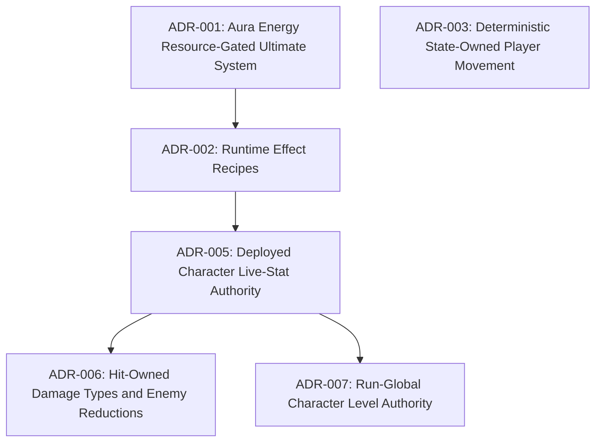

# Architecture Decision Records Index

> Last updated: 2026-08-05

## Dependency Order

_Update this diagram as ADRs are added. Show which decisions depend on others._

## ADR Registry

| # | Title | Status | Phase | Current Note |
|---|-------|--------|-------|-------------|
| [001](001-aura-energy-resource-gated-ultimate.md) | Aura Energy Resource-Gated Ultimate System | **Accepted** | Phase 1 | Refactored Ultimate cooldowns to Aura Energy |
| [002](002-runtime-effect-recipes.md) | Runtime Effect Recipes | **Accepted** | Phase 2 | Splits reusable formulas from kit-owned application recipes |
| [003](003-deterministic-player-state-owned-movement.md) | Deterministic State-Owned Player Movement | **Accepted** | Phase 1 | Implementation approved; awaiting human E2E feel approval |
| [005](005-deployed-character-live-stat-authority.md) | Deployed Character Live-Stat Authority | **Accepted** | Phase 2 | Runtime-only deployed records and explicit formula read policy |
| [006](006-hit-owned-damage-types-and-enemy-reductions.md) | Hit-Owned Damage Types and Enemy Reductions | **Accepted** | Phase 2 | Approved with standalone per-element DOT configuration |
| [007](007-run-global-character-level-authority.md) | Run-Global Character Level Authority | **Accepted** | Phase 2 | One run level feeds ADR-005 deployed stat records; individual EXP path is legacy |

## Phase Mapping

| GDD Phase | ADRs | Current Status |
|-----------|------|----------------|
| **Phase 1** — Stabilize Prototype | ADR-{NNN} | {status} |
| **Phase 2** — Split Core Runtime | ADR-{NNN} | {status} |
| **Phase 3** — Data-Drive Content | ADR-{NNN} | {status} |

## How to Use

1. **Before making an architecture decision** → Check this index for existing decisions
2. **To create a new ADR** → Copy `_TEMPLATE.md` → Name it `{NNN}-{kebab-case-title}.md`
3. **After creating** → Add a row to the registry table above
4. **When superseding** → Update the old ADR's status to `Superseded by ADR-{NNN}`
