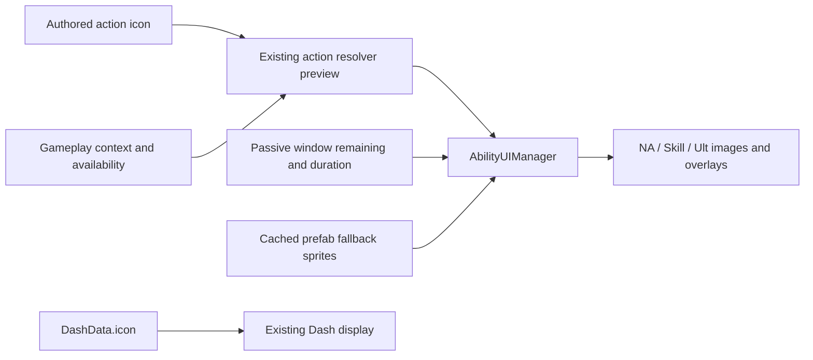

# Action-window icon architecture

Implements the requester-approved `action-window-icons-design-spec.md`.
GDD @tag:ui owns HUD requirements; @tag:combat and @tag:platform-input keep
gameplay routing, resources and timing authoritative.

## Responsibilities and interfaces

| Existing class/asset | Proposed change |
| --- | --- |
| CombatAction in Character/ComboNode.cs | Add optional public Sprite icon, inherited by Combo/Skill/Ultimate/Standalone actions. |
| Character/CharacterMetaData.cs | Add an optional compact team-swap icon beside the portrait. |
| Editor/UI/PropertyCardBuilder.cs | Expose Action Icon Sprite field beside Action Name with existing Undo and dirty handling. |
| PlayerCharacter / ActionResolver | Reuse TryResolveActionForContext and IsActionAvailable; no gameplay changes. |
| Player/UI/AbilityUIManager.cs | Cache original slot sprites; replace them only while the selected resolver action has an active timed window and matches the current context. |
| Character/DashData.cs | Store an optional Dash HUD Sprite with the character's movement data. |
| Player/UI/AbilityUIManager.cs | Bind DashData.icon to the existing Dash Image and use an explicit fallback Sprite if the NA/Skill/Ult Image starts without its prefab sprite. |
| Editor/UI/PropertyCardBuilder.cs | Expose DashData.icon using the existing Sprite ObjectField and dirty/undo flow. |
| Player/UI/CharacterSwitchSlot.cs | Prefer CharacterMetaData.icon for team portraits, then use the metadata portrait. |
| CharacterPassiveController | Reuse TryGetActionAvailabilityWindow for the selected action; no UI timers or window writes. |
| Prefab/CombatUI/Player_UI.prefab | Wire NA's existing icon and follow-up overlay (create only if absent); preserve existing dirty prefab contents and Dash references. |

## Selection and data flow

1. Capture each assigned Image's prefab sprite before any icon replacement. For
   NA/Skill/Ult, use an explicitly serialized fallback if an Image starts with no
   runtime sprite, preventing null cache entries from erasing the slot.
2. Resolve the highest-priority action in the current Ground/Air and input context.
   Show its general icon when its resolver conditions match, even if cooldown, AE or
   another availability gate dims the icon. If no action matches, restore prefab art.
3. A temporary action's icon and window cue use the same selected action identity and
   category; the timed overlay only appears while its gameplay window is active.
4. Missing Sprite always resolves to the cached slot art. Existing context-free
   action data continues to provide cooldown visibility without selecting an icon.
5. A temporary action's window cue uses the same selected action identity/category
   as its icon, via TryGetActionAvailabilityWindow. Add equivalent NA handling.
   Fill the authored icon silhouette with the existing window tint rather than
   hiding the picture behind a solid rectangle.
6. Keep existing Skill/Ult cooldown and AE displays, ready/rejection feedback and
   movement-owned Dash display. Rebinding refreshes pictures and window state
   silently. HUD preview never commits a resource or extends a window.

The input category determines the slot. EffectiveActionType remains interrupt/flash
metadata, so a Skill-routed Ultimate-type action appears on Skill.
DashData.icon supplies the character's Dash picture; when unassigned, Dash keeps its
existing prefab picture. Movement continues to own availability and cooldown. Team
swap portraits use CharacterMetaData.icon with the existing portrait as fallback.

## Validation and boundaries

Extend the existing ability tests for icon authoring and actual resolver selection:
normal vs. temporary replacement, priorities, expiry/consumption, unavailable
resources/cooldown/AE, Ground/Air, character swap, missing art and silent rebind.
Check prefab references, Unity compile/console and manual training-scene readability.
Keep existing authored timings. No dependencies, CI/build settings, secrets, new
action catalog, executor or asset migration. No new ADR is needed for adding
presentation metadata to the existing data/view ownership.

Apricha approved this architecture and implementation in chat on 2026-10-30. On
2026-10-31, Apricha explicitly requested the DashData icon source and Dash slot
binding, plus the play-mode fallback repair described in the task card.
