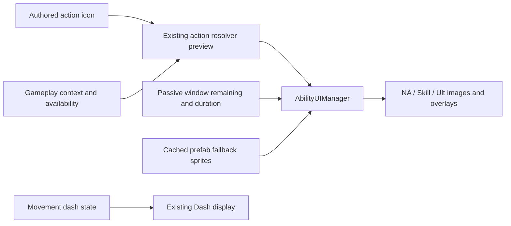

# Action-window icon architecture

Implements the requester-approved `action-window-icons-design-spec.md`.
GDD @tag:ui owns HUD requirements; @tag:combat and @tag:platform-input keep
gameplay routing, resources and timing authoritative.

## Responsibilities and interfaces

| Existing class/asset | Proposed change |
| --- | --- |
| CombatAction in Character/ComboNode.cs | Add optional public Sprite icon, inherited by Combo/Skill/Ultimate/Standalone actions. |
| Editor/UI/PropertyCardBuilder.cs | Expose Action Icon Sprite field beside Action Name with existing Undo and dirty handling. |
| PlayerCharacter / ActionResolver | Reuse TryResolveActionForContext and IsActionAvailable; no gameplay changes. |
| Player/UI/AbilityUIManager.cs | Cache original slot sprites once; bind selected-action icons for Normal/Skill/Ultimate; add normalAttackIcon and normalAttackFollowUpOverlay references; update NA readiness/window cue. |
| CharacterPassiveController | Reuse TryGetActionAvailabilityWindow for the selected action; no UI timers or window writes. |
| Prefab/CombatUI/Player_UI.prefab | Wire NA's existing icon and follow-up overlay (create only if absent); preserve existing dirty prefab contents and Dash references. |

## Selection and data flow

1. Capture each assigned Image's prefab sprite before any icon replacement.
2. For each combat input, resolve with current context and availability to get its
   highest-priority executable action; temporary window gates are evaluated by the
   existing resolver. Read its Sprite without changing the action or resolver session.
3. If no executable action exists, use the matching ordinary action for the current
   context for dimmed display; use existing context-free fallback data for cooldown
   visibility when needed. Missing Sprite always resolves to the cached slot art.
4. A temporary action's window cue uses the same selected action identity/category
   as its icon, via TryGetActionAvailabilityWindow. Add equivalent NA handling.
   Fill the authored icon silhouette with the existing window tint rather than
   hiding the picture behind a solid rectangle.
5. Keep existing Skill/Ult cooldown and AE displays, ready/rejection feedback and
   movement-owned Dash display. Rebinding refreshes pictures and window state
   silently. HUD preview never commits a resource or extends a window.

The input category determines the slot. EffectiveActionType remains interrupt/flash
metadata, so a Skill-routed Ultimate-type action appears on Skill.
Dash keeps its prefab picture and needs no new resolver data.

## Validation and boundaries

Extend the existing ability tests for icon authoring and actual resolver selection:
normal vs. temporary replacement, priorities, expiry/consumption, unavailable
resources/cooldown/AE, Ground/Air, character swap, missing art and silent rebind.
Check prefab references, Unity compile/console and manual training-scene readability.
Keep existing authored timings. No dependencies, CI/build settings, secrets, new
action catalog, executor or asset migration. No new ADR is needed for adding
presentation metadata to the existing data/view ownership.

Apricha approved this architecture and implementation in chat on 2026-10-30.
