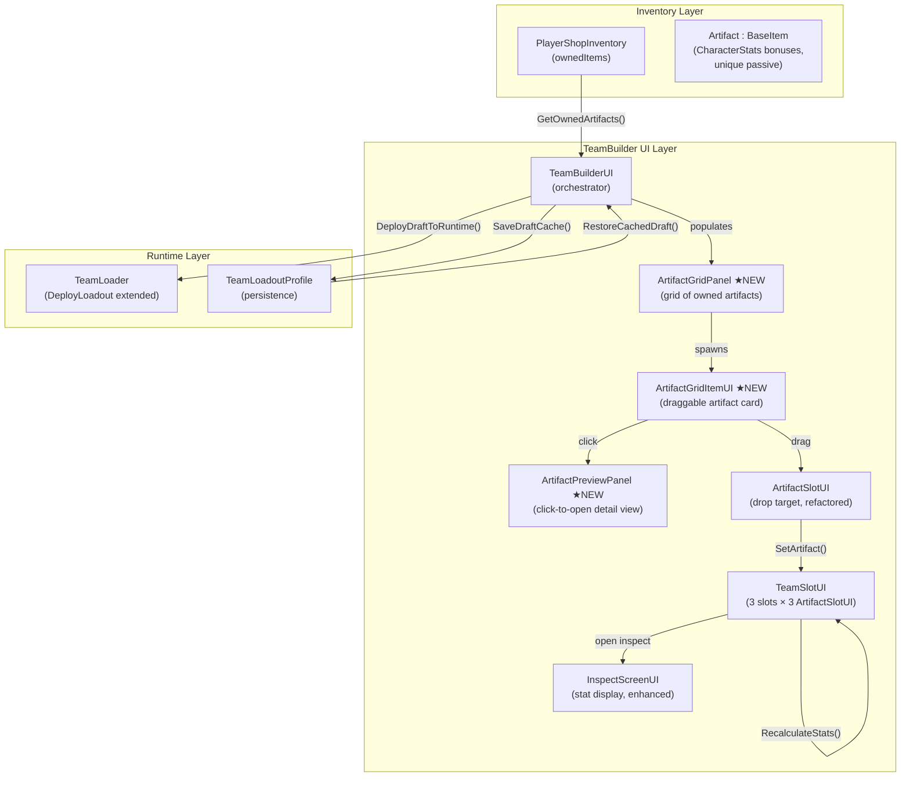
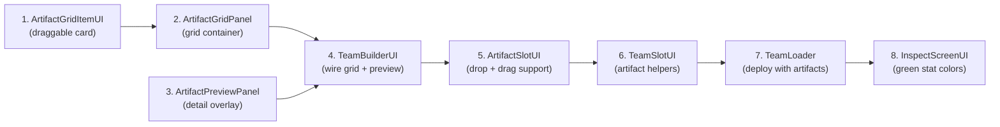

# Architecture Plan: Complete Artifact Build System

> **Produced by:** 🏗️ Architect Agent
> **Input:** `artifact-build-system-design-spec.md`
> **Task Card:** `artifact-build-system-task-card.md`
> **GDD Source:** `@tag:progression` — Artifact System
> **Date:** 2026-06-05

---

## 1. System Diagram



---

## 2. Interface Definitions

No new interfaces are needed. The existing patterns use direct references and Unity event callbacks, which is appropriate for this UI-heavy feature. The key contracts are documented as method signatures below.

### ArtifactGridPanel (public API)

```csharp
public class ArtifactGridPanel : MonoBehaviour
{
    // Called by TeamBuilderUI during panel open/refresh
    public void Init(TeamBuilderUI builder, Canvas rootCanvas);
    public void PopulateGrid(List<Artifact> artifacts);
    public void RefreshEquippedStates();
    public void ClearGrid();

    // Event: artifact card clicked (for preview panel)
    public event System.Action<Artifact> OnArtifactClicked;
}
```

### ArtifactGridItemUI (public API)

```csharp
public class ArtifactGridItemUI : MonoBehaviour, IBeginDragHandler, IDragHandler, IEndDragHandler, IPointerClickHandler
{
    public Artifact ArtifactData { get; }
    public void Init(Artifact artifact, Canvas rootCanvas, bool isEquipped);
    public void SetEquippedState(bool isEquipped);
}
```

### ArtifactPreviewPanel (public API)

```csharp
public class ArtifactPreviewPanel : MonoBehaviour
{
    // Prefab reference for dynamic stat display
    public GameObject statItemPrefab;
    public Transform statItemContainer; // Grid Layout parent

    public void Open(Artifact artifact);
    public void Close();
    public bool IsOpen { get; }
}
```

### ArtifactSlotUI (extended API)

```csharp
// Existing methods kept, OnDrop implemented, new highlight methods added
public class ArtifactSlotUI : MonoBehaviour, IDropHandler, IPointerClickHandler
{
    // Existing
    public void Init(TeamSlotUI parent);
    public void SetArtifact(Artifact artifact);
    public void ClearArtifact();
    public Artifact GetArtifact();

    // New: drag-drop highlight
    public void SetDropHighlight(bool highlighted);
}
```

---

## 3. Class Responsibility Table

| Class | Responsibility | Depends On | Owned State |
|-------|---------------|------------|-------------|
| `ArtifactGridPanel` ★NEW | Spawns artifact cards in a scrollable grid; toggled by Artifact Button | `TeamBuilderUI`, `ArtifactGridItemUI` prefab | `List<ArtifactGridItemUI> spawnedItems` |
| `ArtifactGridItemUI` ★NEW | Displays one artifact card; supports drag-and-drop; fires click event for preview | `Artifact` data, `Canvas` for ghost parenting | `Artifact artifactData`, `bool isEquipped`, drag ghost `Transform` |
| `ArtifactPreviewPanel` ★NEW | Overlay showing icon, passive, lore. Dynamically spawns `StatItem` for non-zero stats | `Artifact` data, `StatItem` prefab | `Artifact currentArtifact`, dynamic UI children |
| `ArtifactSlotUI` MODIFIED | Drop target for artifact drags; implements `OnDrop()` properly | `TeamSlotUI` parent | `Artifact currentArtifact` (existing) |
| `TeamSlotUI` MODIFIED | Handles artifact slot-to-slot drag events; exposes artifact slot drop validation | `ArtifactSlotUI[]`, `TeamBuilderUI` | Character + artifact state (existing) |
| `TeamBuilderUI` MODIFIED | Orchestrates grid panel (toggled via Artifact Button), preview panel, deploy | `ArtifactGridPanel`, `ArtifactPreviewPanel`, `TeamLoader` | Draft artifact cache (existing) |
| `InspectScreenUI` MODIFIED | Shows artifact bonuses dynamically. Green `+` for > 0, Red `-` for < 0 | `CharacterItem`, `Artifact[]` | Display state only |
| `TeamLoader` MODIFIED | Accepts artifact data in `DeployLoadout()`; stores equipped artifacts at runtime | `CharacterObject[]`, `Artifact[][]` | `Artifact[][] equippedArtifacts` (new) |
| `TeamLoadoutProfile` NO CHANGE | Already persists `Artifact[3]` per slot — no changes needed | — | — |

---

## 4. Data Flow

### 4.1 Artifact Grid Population

```
TeamBuilderUI (Artifact Button Clicked)
  → Toggles ArtifactGridPanel open (closes other panels if needed)
  → PlayerShopInventory.ownedItems
    → TeamBuilderUI.GetOwnedArtifacts()  [existing, filters for Artifact]
      → ArtifactGridPanel.PopulateGrid(List<Artifact>)
        → For each artifact: Instantiate ArtifactGridItemUI
          → Check if artifact is equipped on any team slot
            → ArtifactGridItemUI.SetEquippedState(isEquipped)
```

### 4.2 Drag-and-Drop Equip

```
ArtifactGridItemUI.OnBeginDrag()
  → Create drag ghost (floating artifact icon)
  → ArtifactGridItemUI dims to 20% alpha

ArtifactGridItemUI.OnDrag()
  → Ghost follows cursor

ArtifactSlotUI.OnDrop(eventData)
  → Extract ArtifactGridItemUI from eventData.pointerDrag
  → Get artifact = draggedItem.ArtifactData
  → Check uniqueness: TeamBuilderUI.FindSlotWithArtifact(artifact)
    → If equipped elsewhere: auto-unequip from that slot first
  → If target slot has existing artifact: old artifact freed
  → ArtifactSlotUI.SetArtifact(newArtifact)
    → TeamSlotUI.RecalculateStats()  [triggers stat tween animation]
  → TeamBuilderUI.OnSlotChanged()
    → ArtifactGridPanel.RefreshEquippedStates()
```

### 4.3 Slot-to-Slot Artifact Drag

```
ArtifactSlotUI gains IBeginDragHandler, IDragHandler, IEndDragHandler
  → OnBeginDrag: create ghost from current artifact icon
  → OnDrag: ghost follows cursor
  → Target ArtifactSlotUI.OnDrop(eventData)
    → Extract source ArtifactSlotUI from eventData.pointerDrag
    → Swap artifacts between source and target slots
    → Both parents RecalculateStats()
  → OnEndDrag outside valid target:
    → Remove artifact from slot (return to grid)
    → ParentSlot.RecalculateStats()
```

### 4.4 Right-Click Remove

```
ArtifactSlotUI.OnPointerClick(eventData)
  → If RightClick AND currentArtifact != null:
    → ClearArtifact()
    → ParentSlot.RecalculateStats()
    → TeamBuilderUI.OnSlotChanged()
      → ArtifactGridPanel.RefreshEquippedStates()
  → If LeftClick: (existing click-cycle behavior removed, replaced by drag)
    → No action (drag is the primary equip method now)
```

### 4.5 Preview Panel

```
ArtifactGridItemUI.OnPointerClick(eventData)
  → ArtifactGridPanel.OnArtifactClicked?.Invoke(artifact)
    → TeamBuilderUI handles event
      → ArtifactPreviewPanel.Open(artifact)

ArtifactPreviewPanel displays stats:
  → Clear existing StatItem children in Grid Layout container
  → Check each stat field in artifact.bonusStats (using a helper method or reflection)
  → For each non-zero stat (e.g., DEF != 0):
    → Instantiate StatItem prefab
    → Set stat name text (e.g., "DEF")
    → If value > 0: set text to "+Value" with green color
    → If value < 0: set text to "-Value" with red color

ArtifactPreviewPanel detects outside click:
  → Update() checks for mouse click outside panel RectTransform via raycast
    → ArtifactPreviewPanel.Close()
```

### 4.6 Deploy to Runtime (Gap Fix)

```
TeamBuilderUI.DeployDraftToRuntime()
  → CharacterObject[] teamData = BuildDraftTeamData()
  → Artifact[][] artifactData = BuildDraftArtifactData()  [existing method]
  → TeamLoader.DeployLoadout(teamData, preferredIndex, artifactData)  ★NEW OVERLOAD
    → TeamLoader stores equippedArtifacts internally
    → Clears HP/AE, reloads character (existing behavior preserved)
```

---

## 5. Authority Decisions

| Decision | Choice | Rationale |
|----------|--------|-----------|
| **Artifact Stat Model** | Use `CharacterStats` struct | Replaces flat `bonusATK/DEF/HP` in `Artifact` SO. Allows artifacts to modify *any* stat (including speed, crit, etc.) and allows negative values for tradeoffs. |
| **Preview/Inspect Stat Display** | Dynamic generation | Only show stats that have a non-zero value. Generates `StatItem` dynamically to avoid cluttering the UI with `+0` lines. Uses Green (+) and Red (-) for clarity. |
| **Artifact uniqueness enforcement** | `TeamBuilderUI` (orchestrator level) | Only TeamBuilderUI has visibility across all 3 slots' artifacts. ArtifactSlotUI cannot know what other slots have. |
| **Stat recalculation authority** | `TeamSlotUI.RecalculateStats()` (existing) | Already works correctly — sums all 3 ArtifactSlotUI bonuses. Needs to be updated to sum the new `CharacterStats` structure. |
| **Equipped state tracking** | `TeamBuilderUI` via scanning all slots | No separate "equipped" registry. TeamBuilderUI already scans slots for character-in-team checks — same pattern for artifacts. |
| **Preview panel dismiss** | `ArtifactPreviewPanel` self-managed via Update() raycast | The panel owns its own dismiss logic. TeamBuilderUI doesn't need to track panel state. |
| **Artifact persistence** | `TeamLoadoutProfile` (existing ScriptableObject) | Already saves `Artifact[3]` per slot. No changes needed. |
| **Runtime artifact storage** | `TeamLoader` (new field: `Artifact[][] equippedArtifacts`) | TeamLoader is the authoritative runtime team state owner. Artifact data belongs here alongside `CharacterObject[] team`. |
| **Grid panel vs character grid** | Toggled by separate Artifact Button | The grid item types differ (Artifact vs CharacterItem). An Artifact Button in TeamBuilderUI explicitly toggles this panel. |
| **Click-cycle removal** | Remove click-cycle from `ArtifactSlotUI.OnPointerClick()` | Design spec replaces click-cycle with drag-and-drop. Right-click becomes "remove." Left-click on grid items opens preview. |

---

## 6. Affected Systems

### New Scripts (3 files)

| File | Location | Lines (est.) |
|------|----------|-------------|
| `ArtifactGridPanel.cs` | `Assets/Project/Scripts/TeamBuilder/UI/` | ~100 |
| `ArtifactGridItemUI.cs` | `Assets/Project/Scripts/TeamBuilder/UI/` | ~200 |
| `ArtifactPreviewPanel.cs` | `Assets/Project/Scripts/TeamBuilder/UI/` | ~150 |

### Modified Scripts (6 files)

| File | Changes |
|------|---------|
| [ArtifactSlotUI.cs](file:///c:/Users/Apricha/Documents/GitHub/Thesis_/Assets/Project/Scripts/TeamBuilder/UI/ArtifactSlotUI.cs) | Implement `OnDrop()` for artifact drag-drop; add `IBeginDragHandler`, `IDragHandler`, `IEndDragHandler` for slot-to-slot drag; add `SetDropHighlight()`; replace left-click cycle with no-op (right-click = remove); add drag ghost support |
| [TeamSlotUI.cs](file:///c:/Users/Apricha/Documents/GitHub/Thesis_/Assets/Project/Scripts/TeamBuilder/UI/TeamSlotUI.cs) | Update `RecalculateStats()` to sum the full `CharacterStats` from artifacts; handle artifact slot drag events |
| [TeamBuilderUI.cs](file:///c:/Users/Apricha/Documents/GitHub/Thesis_/Assets/Project/Scripts/TeamBuilder/UI/TeamBuilderUI.cs) | Add "Artifact Button" toggle logic; wire grid and preview panels; pass artifact data to TeamLoader |
| [TeamLoader.cs](file:///c:/Users/Apricha/Documents/GitHub/Thesis_/Assets/Project/Scripts/Systems/TeamLoader.cs) | Add `Artifact[][] equippedArtifacts` field; add `DeployLoadout()` overload |
| [Artifact.cs](file:///c:/Users/Apricha/Documents/GitHub/Thesis_/Assets/Project/Scripts/Inventory/Items/Artifact.cs) | Replace `bonusATK/DEF/HP` with a `CharacterStats bonusStats` field and a `string passiveDescription` |
| [InspectScreenUI.cs](file:///c:/Users/Apricha/Documents/GitHub/Thesis_/Assets/Project/Scripts/TeamBuilder/UI/InspectScreenUI.cs) | Show dynamic non-zero stats. Use `<color=#4ADE80>` (green +) for > 0, `<color=#EF4444>` (red -) for < 0. Hide `(+0)` when no artifact bonus. |

### Unmodified (confirmed no changes needed)

| File | Reason |
|------|--------|
| [TeamLoadoutProfile.cs](file:///c:/Users/Apricha/Documents/GitHub/Thesis_/Assets/Project/Scripts/TeamBuilder/UI/TeamLoadoutProfile.cs) | Already saves `Artifact[3]` per slot correctly |
| [BaseItem.cs](file:///c:/Users/Apricha/Documents/GitHub/Thesis_/Assets/Project/Scripts/Inventory/Items/BaseItem.cs) | No changes needed |
| [CharacterStats.cs](file:///c:/Users/Apricha/Documents/GitHub/Thesis_/Assets/Project/Scripts/Character/CharacterStats.cs) | No changes needed |
| [PlayerShopInventory.cs](file:///c:/Users/Apricha/Documents/GitHub/Thesis_/Assets/Project/Scripts/Shop/PlayerShopInventory.cs) | Already stores artifacts in `ownedItems` |
| [CharacterGridInventoryUI.cs](file:///c:/Users/Apricha/Documents/GitHub/Thesis_/Assets/Project/Scripts/TeamBuilder/UI/CharacterGridInventoryUI.cs) | Separate panel, not modified |
| [CharacterGridItemUI.cs](file:///c:/Users/Apricha/Documents/GitHub/Thesis_/Assets/Project/Scripts/TeamBuilder/UI/CharacterGridItemUI.cs) | Reference pattern only; not modified |

### ADRs Affected

- **None superseded.** ADR-001 (Aura Energy Ultimate) is unrelated.
- **No new ADR needed.** This feature follows existing codebase patterns (ScriptableObject data, MonoBehaviour UI, Unity EventSystems drag-drop). No architectural decision changes are introduced.

---

## 7. Implementation Order

The implementation should follow this dependency order:



**Rationale**: Build the data display layer first (grid items, grid panel), then the interaction layer (preview, drop targets), then the integration layer (TeamBuilderUI wiring, deploy pipeline), and finally polish (stat colors).

---

## 8. Prefab / Scene Requirements

### New Prefab Required

| Prefab | Contents |
|--------|----------|
| `ArtifactGridItem.prefab` | RectTransform + Image (icon) + TMP_Text (name) + Image (equipped badge) + CanvasGroup + `ArtifactGridItemUI` component |
| `StatItem.prefab` | RectTransform + horizontal layout + TMP_Text (Stat Name) + TMP_Text (Bonus Value) |

### Existing Prefabs to Modify (in Unity Editor — cannot be automated)

| Prefab / Scene Object | Change |
|----------------------|--------|
| TeamBuilder Panel | Add `ArtifactGridPanel` component + grid scroll view + grid parent Transform + Artifact toggle button |
| TeamBuilder Panel | Add `ArtifactPreviewPanel` component + overlay panel with Grid Layout Group for `StatItem` prefabs |

> [!IMPORTANT]
> Prefab and scene hierarchy changes require manual Unity Editor work. The implementation agent will create all scripts, but the user must wire the prefab references in the Inspector. The implementation agent should provide clear wiring instructions.

---

## 9. Risk Assessment

| Risk | Likelihood | Impact | Mitigation |
|------|-----------|--------|------------|
| Drop target too small for artifact sub-slots | Medium | Player frustration | Use expanded `RectTransform` hit area (padding) on `ArtifactSlotUI`; consider adding a larger invisible raycast target |
| Same artifact on multiple characters | Low (enforced) | Data corruption | `TeamBuilderUI.FindSlotWithArtifact()` enforces uniqueness before every equip |
| Artifact data lost on deploy | Low (if implemented) | Silent stat loss | Extend `DeployLoadout()` to accept artifacts; add debug assertion if artifacts are null |
| Grid performance with many artifacts | Low (≤20 expected) | Frame spike on open | Batch instantiation; pool if needed in future |
| Drag ghost z-order issues | Low | Visual glitch | Parent ghost to root Canvas (existing pattern from `CharacterGridItemUI`) |
