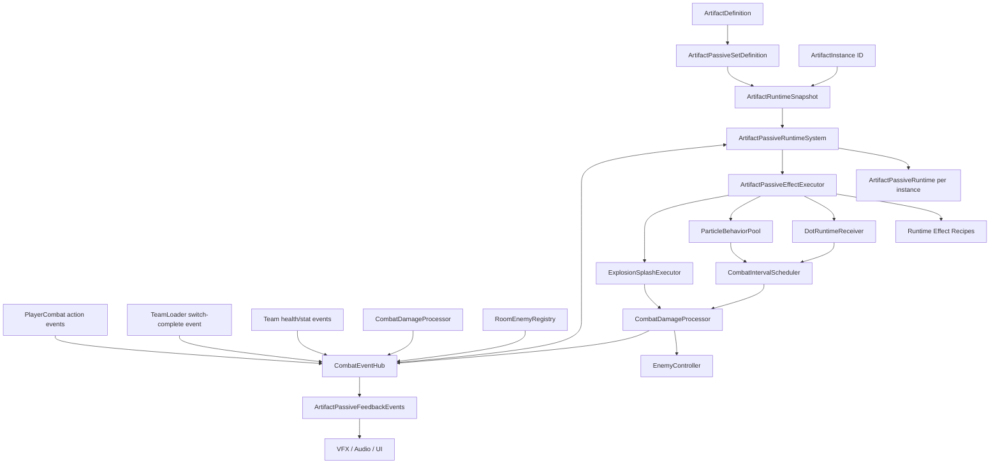

# Architecture Plan: Artifact Passive Phase 1

## 1. Architecture Outcome

Phase 1 introduces a data-driven Artifact passive runtime without placing more Artifact-specific
branches in `CharacterPassiveController`, `TeamLoader`, `HitBoxDamage`, or `ProjectileRuntime`.
The architecture makes four orthogonal decisions explicit:

| Concern | Authority |
| --- | --- |
| Formula | Existing `DamageDelivery` plus ADR-008 resolver. |
| Damage type | Existing hit-owned `ElementType` plus ADR-006 reductions. |
| Origin/presentation | Damage tags such as Artifact, Particle, Explosion, and Splash. |
| Chain eligibility | Explicit proc/side-effect policy plus root/parent provenance. |

The resulting pipeline supports DOT application/ticks, Particle gameplay volumes, and Explosion
Splash without converting either Particle or Explosion into a projectile or damage delivery.

## 2. Existing Decisions and Compatibility

This plan extends rather than replaces:

- **ADR-002:** Artifact rules apply reusable `RuntimeEffectRecipe` data.
- **ADR-004:** Shields and future target-owned channels continue to merge by target/channel.
- **ADR-005:** Active and off-field formulas resolve through deployed character records or an
  explicitly captured snapshot.
- **ADR-006:** The hit owns `ElementType`; enemies own matching reductions.
- **ADR-008:** Primary, DOT, and Additional remain the only damage deliveries.
- **ADR-009:** Artifact instances are persistent identity; deployed snapshots are runtime combat
  inputs.

Compatibility requirements:

- Keep `ArtifactDefinition.additionalDamageEffects` operational during Phase-1 migration.
- Keep existing Character Potential passive behavior operational through
  `CharacterPassiveController`.
- Add default provenance/policy values so existing `DamageRequest` callers preserve current behavior.
- Do not change `ProjectileData` to host Particle behavior.
- Preserve elemental DOT behavior while routing its state through the target-owned DOT authority
  incrementally.
- Preserve existing `OnCurrentCharacterChanged` for UI; add a structured switch-complete event for
  gameplay rules.

## 3. System Diagram



## 4. Authority Decisions

| Decision | Choice | Rationale |
| --- | --- | --- |
| Authored passive content | `ArtifactPassiveSetDefinition` referenced by `ArtifactDefinition`. | Reusable immutable content stays separate from acquired copies. |
| Per-copy state | `ArtifactPassiveRuntime` keyed by Artifact instance ID. | Duplicate definitions cannot share cooldowns, counters, or armed state. |
| Runtime owner | `ArtifactPassiveRuntimeSystem`, a run-scoped service adjacent to `TeamLoader`. | Avoids growing `TeamLoader` or the active-character `CharacterPassiveController`. |
| Event transport | `CombatEventHub` publishes typed events but owns no passive state. | State changes remain traceable without making a global god object. |
| DOT state | Target-owned `DotRuntimeReceiver`. | Duration, cadence, stacking, and cleanup belong to the affected target. |
| Interval time | One allocation-free `CombatIntervalScheduler` with registered tickables. | Avoids an empty `Update()` on every receiver and Particle. |
| Particle world state | Pooled `ParticleBehaviorRuntime`. | Gameplay volume, lifetime, and tracked targets are independent of presentation/projectiles. |
| Explosion | Stateless `ExplosionSplashExecutor` fan-out. | Explosion describes target distribution, not formula or damage type. |
| Source stats | ADR-005 `LiveOnResolve` or captured `SnapshotOnApply`, authored per response. | Off-field and removed-source behavior remains deterministic. |
| Persistence | Equipment persists; Phase-1 combat state is transient. | Prevents save coupling to Particles, marks, and sub-second timers. |
| Scene transitions | Instance cooldown/counter state survives while deployed; world/target state clears. | Prevents transition-based cooldown abuse while avoiding invalid scene references. |
| Presentation | Event consumers react to state; they do not own it. | UI/VFX cannot change combat truth. |

## 5. Authored Data Contracts

The following snippets describe contract shape, not implementation-complete code.

```csharp
public sealed class ArtifactDefinition : BaseItem
{
    public bool isEquippable;
    public string passiveDescription;
    public ArtifactPassiveSetDefinition passiveSet;

    // Compatibility until authored Additional Damage content migrates.
    public List<AdditionalDamageEffectDefinition> additionalDamageEffects;
}
```

```csharp
[CreateAssetMenu(menuName = "Game/Artifacts/Passive Set")]
public sealed class ArtifactPassiveSetDefinition : ScriptableObject
{
    public string stableId;
    public List<ArtifactPassiveRuleDefinition> rules;
}

[Serializable]
public sealed class ArtifactPassiveRuleDefinition
{
    public string ruleId;
    public ArtifactPassiveTrigger trigger;
    public CombatEventFilter filter;
    public ArtifactPassiveConditionSet conditions;
    [SerializeReference] public List<ArtifactPassiveResponseDefinition> responses;
    public ArtifactPassiveFeedbackDefinition feedback;
}
```

`ruleId` is unique inside its passive set and immutable after release. Runtime keys combine the
Artifact instance ID with a compiled rule index; hot paths do not build strings.

```csharp
public enum ArtifactPassiveTrigger
{
    ActionStarted,
    DamageResolved,
    CriticalHitResolved,
    CharacterSwitchCompleted,
    CharacterHealthChanged,
    IntervalElapsed
}

[Flags]
public enum CombatDamageTag
{
    None = 0,
    Artifact = 1 << 0,
    Particle = 1 << 1,
    Explosion = 1 << 2,
    Splash = 1 << 3,
    DotApplication = 1 << 4,
    DotTick = 1 << 5
}
```

The Phase-1 trigger enum includes only events required by the approved nine Artifacts. Later phases
extend it through reviewed contracts rather than adding per-Artifact callbacks.

### Response Families

`ArtifactPassiveResponseDefinition` is an abstract serialized definition with focused subclasses:

- `ApplyRuntimeEffectResponseDefinition`
- `RemoveRuntimeEffectResponseDefinition`
- `ModifyArtifactStateResponseDefinition`
- `ApplyDotResponseDefinition`
- `SpawnParticleResponseDefinition`
- `ExplosionSplashResponseDefinition`
- `InfuseDamageTypeResponseDefinition`
- `HealTeamFromResolvedDamageResponseDefinition`

Each response is immutable authored data. Execution is delegated to a matching small executor; the
base type does not contain every possible field.

### Runtime State

```csharp
public sealed class ArtifactPassiveRuntime
{
    public string InstanceId { get; }
    public CharacterObject Wearer { get; }
    public ArtifactRuntimeSnapshot Artifact { get; }
    public IReadOnlyList<ArtifactRuleRuntimeState> Rules { get; }
}

public struct ArtifactRuleRuntimeState
{
    public float cooldownReadyAt;
    public float expiresAt;
    public int stacks;
    public bool armed;
    public uint activationSequence;
}
```

The runtime system creates fixed rule-state arrays on Deploy. It indexes active rules by trigger so
ordinary events inspect only relevant rules. No ScriptableObject stores mutable runtime fields.

## 6. Structured Event Contracts

```csharp
public interface ICombatEventHub
{
    event Action<ActionStartedEvent> ActionStarted;
    event Action<DamageResolvedEvent> DamageResolved;
    event Action<CharacterSwitchCompletedEvent> CharacterSwitchCompleted;
    event Action<CharacterHealthChangedEvent> CharacterHealthChanged;
}
```

Events are value types where practical and contain stable object references/IDs already available
from runtime state. Publishing an event never allocates a collection.

### Action Event

```csharp
public readonly struct ActionStartedEvent
{
    public readonly CharacterObject sourceCharacter;
    public readonly AttackCategory category;
    public readonly string actionId;
    public readonly string actionName;
    public readonly AttackStepData stepData;
}
```

This event fires after the action is accepted and its resource/cooldown gate succeeds. It does not
fire from a failed input attempt.

### Switch Event

```csharp
public readonly struct CharacterSwitchCompletedEvent
{
    public readonly CharacterObject outgoingCharacter;
    public readonly CharacterObject incomingCharacter;
    public readonly int outgoingSlotIndex;
    public readonly int incomingSlotIndex;
    public readonly Vector2 worldPosition;
}
```

`TeamLoader.SwitchToIndex` publishes exactly once after the successful runtime character change and
ground resolution. Compatibility UI reloads do not publish this event.

### Damage Provenance and Policy

```csharp
public readonly struct DamageProvenance
{
    public readonly ulong eventId;
    public readonly ulong rootEventId;
    public readonly ulong parentEventId;
    public readonly byte procDepth;
    public readonly string sourceArtifactInstanceId;
    public readonly CombatDamageTag tags;
}

[Flags]
public enum DamageProcPolicy
{
    None = 0,
    PublishResolvedEvent = 1 << 0,
    PublishKillEvent = 1 << 1,
    TriggerOrdinaryOnHit = 1 << 2,
    TriggerArtifactRules = 1 << 3,
    GrantAuraEnergy = 1 << 4,
    ApplyElementDot = 1 << 5,
    ApplyHitReaction = 1 << 6
}
```

```csharp
public readonly struct DamageResolvedEvent
{
    public readonly DamageProvenance provenance;
    public readonly DamageDescriptor descriptor;
    public readonly DamageProcPolicy acceptedPolicy;
    public readonly CharacterObject sourceCharacter;
    public readonly ArtifactRuntimeSnapshot sourceArtifact;
    public readonly EnemyController target;
    public readonly AttackCategory category;
    public readonly string actionId;
    public readonly float baseDamage;
    public readonly int damageDealt;
    public readonly bool isCriticalHit;
    public readonly bool killedTarget;
    public readonly Vector2 hitPosition;
}
```

Rules:

- Existing Primary callers receive a compatibility default matching current on-hit, Aura Energy,
  elemental DOT, and reaction behavior.
- Existing Additional and DOT callers receive terminal defaults consistent with ADR-008.
- Every accepted positive damage event may publish `DamageResolved` for attribution/debugging.
- Whether Artifact rules may react is explicit and independent of delivery.
- A hard maximum proc depth rejects malformed chains and emits a development diagnostic; normal
  Phase-1 child events are terminal before reaching it.
- Event IDs come from a monotonic run-scoped counter, not random GUID allocation in the hot path.

## 7. DOT Architecture

### Two-Stage Contract

```text
Eligible event
  → ApplyDotResponse resolves application condition and damage basis
  → DotApplicationRequest captures source/provenance/stats
  → target DotRuntimeReceiver applies stacking policy
  → CombatIntervalScheduler reaches next tick
  → DotTickRoutine builds terminal DamageRequest
  → CombatDamageProcessor resolves DOT formula
  → DamageResolved event reports tick/kill without ordinary proc chaining
```

```csharp
public readonly struct DotApplicationRequest
{
    public readonly DotEffectDefinition definition;
    public readonly CharacterObject sourceCharacter;
    public readonly ArtifactRuntimeSnapshot sourceArtifact;
    public readonly CharacterStats sourceStatsSnapshot;
    public readonly DamageProvenance provenance;
    public readonly float snapshottedBaseDamage;
}

public interface IDotRuntimeReceiver
{
    DotApplyResult Apply(in DotApplicationRequest request);
    bool Remove(in DotRuntimeKey key);
}
```

`DotEffectDefinition` owns:

- Stable DOT ID and presentation.
- Element type and critical policy.
- Duration, cadence, first-tick policy, and final-partial-tick policy.
- Damage basis: fixed, source stat ratio, triggering damage ratio, or precomputed snapshot.
- Stacking policy: strongest/equal-refresh, refresh, independent-by-source, or capped stacks.
- Source-stat policy from ADR-005.
- Tick routine reference.

For Phase 1:

- A04 Mark Bleed snapshots `50%` of the confirmed wearer Skill damage as its authored basis.
- A04 Claw Bleed snapshots `30%` of wearer ATK.
- Elemental DOT uses an adapter that preserves existing strongest-replace/equal-refresh behavior.
- DOT ticks carry `DotTick | Artifact` tags and terminal proc policy.

`EnemyDamageTypeState` retains type reduction responsibility. Its existing active DOT list is
incrementally replaced by delegation to `DotRuntimeReceiver` only after regression parity tests.

## 8. Particle Architecture

### Data Layers

```csharp
public sealed class ParticleBehaviorDefinition : ScriptableObject
{
    public string stableId;
    public GameObject runtimePrefab;
    public ParticleAnchorPolicy anchorPolicy;
    public ParticleVolumeDefinition volume;
    public ParticleCompatibilityPolicy compatibility;
    public float lifetime;
    public float pulseInterval;
    [SerializeReference] public List<ParticleEffectDefinition> effects;
}
```

| Layer | Responsibility |
| --- | --- |
| `ParticleBehaviorDefinition` | Lifetime, cadence, volume, anchor, and effect list. |
| `ParticleEffectDefinition` | Damage, Runtime Effect, heal aggregation, or other pulse response. |
| `ParticleCompatibilityPolicy` | Target teams/layers, owner inclusion, enter/stay/exit rules, re-entry, target cap, and scene behavior. |
| ParticleSystem/VFX prefab | Presentation only; never selects gameplay targets. |

### Runtime

`ParticleBehaviorPool` rents a `ParticleBehaviorRuntime` initialized from a `ParticleSpawnRequest`.
The runtime:

- Holds a source-character reference, source Artifact snapshot, captured stats, anchor, expiry, and
  next-pulse timestamp.
- Uses a gameplay collider tracker or non-alloc Physics2D overlap query defined by compatibility.
- Resolves each `EnemyController` once even if it owns multiple colliders.
- Accumulates actual accepted damage for A03 healing after all targets resolve.
- Registers with `CombatIntervalScheduler` only while active.
- Returns to the pool on expiry, source policy failure, anchor death, room exit, or scene unload.
- Clears every collection/reference/timer and stops presentation before pool return.

`ProjectileData`, projectile traversal, projectile replacement, projectile hit count, and projectile
VFX managers are not dependencies.

### Phase-1 Particle Policies

| Artifact | Anchor | Valid targets | Pulse response |
| --- | --- | --- | --- |
| A03 Throne Barrier | Wearer transform | Enemies for damage; wearer for mitigation; allies for heal | Additional damage, damage aggregation, team heal. |
| A06 Wrath of Demon | First eligible enemy | Enemies inside | Incoming-damage Runtime Effect plus Additional damage. |
| A09 Thunder Strike | Trigger target position | Eligible enemies in authored strike volume | One terminal Additional Lightning hit. |

## 9. Explosion Splash Architecture

Explosion Splash is a response/executor, not an enum member of `DamageDelivery`.

```csharp
public readonly struct ExplosionSplashRequest
{
    public readonly ExplosionSplashDefinition definition;
    public readonly DamageResolvedEvent parentEvent;
    public readonly CharacterObject sourceCharacter;
    public readonly ArtifactRuntimeSnapshot sourceArtifact;
    public readonly Vector2 center;
    public readonly DamageDescriptor descriptor;
    public readonly float childBaseDamage;
    public readonly DamageProcPolicy childPolicy;
}
```

`ExplosionSplashExecutor`:

1. Rents a caller-owned/non-alloc overlap buffer.
2. Resolves unique, alive `EnemyController` targets.
3. Applies compatibility filters and optional original-target exclusion.
4. Uses stable spatial/instance ordering when a target cap truncates results.
5. Builds one child request per accepted target.
6. Copies root ID, sets parent ID, increments proc depth, and adds Explosion/Splash tags.
7. Preserves the requested delivery and element.
8. Returns the scratch buffer without retaining scene objects.

A04 uses the executor to select splash targets, then applies Bleed through `DotRuntimeReceiver`.
The Explosion itself does not invent an Explosion formula and cannot hit the same enemy twice.

## 10. Runtime Effect Integration

Phase 1 reuses existing Runtime Effect Recipes for:

- A02 stacking ATK buff.
- A03 incoming damage reduction.
- A05 DEF reduction and DOT-taken modifier.
- A06 increased incoming damage.
- A07 ATK/Crit buff.
- A08 threshold benefit/penalty.
- A09 Focus Crit Damage.
- A01 Toxic damage-type infusion through one new reusable formula definition.
- A04 Mark Injury and Claw presentation/state where target/character Runtime Effect ownership helps.

Required reusable additions:

- `DamageTypeInfusionRuntimeEffectDefinition` modifies `ElementType` before outgoing resolution while
  preserving delivery.
- DOT-taken filtering accepts delivery `Dot` independently from element.
- Multi-stat recipe containers remain composition; no new “ATK-related” magic stat enum is added.

Artifact runtime state remains responsible for trigger cooldowns/counters/armed flags. Runtime
Effects remain responsible for target-owned duration, stacks, stat mutation, and presentation.

## 11. Phase-1 Rule Mapping

| ID | Trigger | Conditions/state | Responses |
| --- | --- | --- | --- |
| A07 | Switch completed | Outgoing is wearer; cooldown ready | Apply incoming-character stat recipes. |
| A08 | Health changed | Evaluate two approved thresholds | Reconcile benefit/penalty recipes. |
| A05 | Switch completed | Incoming is wearer | Query room registry; apply Affliction stack. |
| A01 | Action started | Source is wearer; Ultimate; cooldown ready | Apply Toxic infusion recipe to allies. |
| A02 | Damage resolved | Source wearer; Particle tag; positive pulse aggregate | Add/refresh ally ATK stack. |
| A03 | Action started | Source wearer; Skill; cooldown ready | Spawn self-following Particle. |
| A06 | Damage resolved | Source wearer; Skill; first deterministic target | Spawn enemy-following Particle. |
| A09 | Critical damage resolved | Primary eligible hit; not child; not armed | Add Focus, arm at six, consume on next confirmed hit. |
| A04 | Damage resolved | Skill application or marked-target eligible hit | Apply Mark, Explosion Splash, Bleed, and Claw. |

This order is also the implementation/content-validation order.

## 12. Room and Target Registry

Add a scene-scoped `RoomEnemyRegistry`:

- `EnemyController` registers on enable/initialization and unregisters on disable/death.
- Registry entries include active `RoomData` or scene identity.
- Query fills a caller-owned list rather than returning a new collection.
- A05 queries living enemies in the current combat room at the switch-complete instant.
- Enemies spawned after that instant are not backfilled.
- No passive uses `FindObjectsByType`, `FindGameObjectsWithTag`, or a scene-wide Physics2D query.

The registry is not enemy AI authority and does not own HP, spawn, or death state.

## 13. Lifecycle and Failure Policy

### Deploy

1. `TeamLoader` finishes rebuilding `DeployedCharacterRuntime` snapshots.
2. It passes deployed snapshot/slot records to `ArtifactPassiveRuntimeSystem.ReconcileDeployment`.
3. Existing instance runtimes with unchanged wearer/slot remain; removed/moved/new instances are
   deterministically removed/rebuilt according to Deploy semantics.
4. All trigger indexes are rebuilt once.

### Scene Change

- `ArtifactPassiveRuntimeSystem` retains instance cooldowns, counters, and armed flags while
  deployment is unchanged.
- `RoomEnemyRegistry`, active Particles, target marks, DOTs, and target Runtime Effects clear with
  scene ownership.
- On the new scene, HP conditions re-evaluate from current TeamLoader resources.

### Source Missing

- Already-applied damage uses its captured snapshot.
- New source-dependent triggers stop if the Artifact instance is no longer deployed.
- World Particles follow their authored source-loss rule; Phase-1 wearer/target-following fields end
  when their required anchor is unavailable.

### Invalid Data

- Duplicate passive set IDs, duplicate rule IDs, missing response definitions, invalid durations,
  missing VFX prefabs, or unsupported trigger/response combinations fail editor validation.
- Runtime skips invalid content once and logs one stable diagnostic; it does not spam per event.

## 14. Performance Policy

- Compile rules into fixed runtime arrays on Deploy.
- Maintain one rule list per trigger type.
- Use structs/read-only event payloads and caller-owned buffers.
- Avoid LINQ, closures, string construction, reflection, and asset loading in combat hot paths.
- Pool Particle runtimes, target buffers, and transient feedback objects.
- Use one registered-tick scheduler; inactive receivers do not poll.
- Cache component and service references before combat.
- Profile the nine-Artifact stress configuration against the existing 60 FPS and zero-gameplay-GC
  targets; static review alone is insufficient evidence.

## 15. Class Responsibility Table

| Class | Responsibility | Depends On | Owned state |
| --- | --- | --- | --- |
| `ArtifactPassiveSetDefinition` | Immutable authored rule collection | Artifact rule definitions | Authored data only |
| `ArtifactPassiveRuntimeSystem` | Reconcile deployed instances, subscribe to events, route relevant rules | TeamLoader, event hub, effect executor | Per-instance runtimes and trigger indexes |
| `ArtifactPassiveRuntime` | Runtime identity and fixed rule-state array for one instance | Runtime snapshot | Cooldowns, stacks, armed flags |
| `ArtifactPassiveEffectExecutor` | Dispatch focused response executors | Runtime Effects, DOT, Particle, Splash services | No durable state |
| `CombatEventHub` | Publish normalized typed combat/team events | Existing producers | Event sequence counter only |
| `CombatIntervalScheduler` | Tick registered interval work | Gameplay time | Active tickable list |
| `DotRuntimeReceiver` | Own target DOT lifecycle and stacking | Scheduler, damage processor | Active DOT instances |
| `ParticleBehaviorDefinition` | Author Particle gameplay and compatibility | Particle effects/prefab | Authored data only |
| `ParticleBehaviorRuntime` | Execute one pooled Particle volume | Scheduler, target registry/query, effect executor | Source, anchor, tracked targets, timers |
| `ParticleBehaviorPool` | Rent/reset/return Particle runtimes | Particle prefab catalog | Pool storage |
| `ExplosionSplashExecutor` | Resolve unique targets and submit child operations | Physics2D/registry, damage processor | Reusable scratch buffers only |
| `RoomEnemyRegistry` | Track alive enemies by current room | Enemy lifecycle, ZoneState | Registered enemy references |
| `ArtifactPassiveFeedbackEvents` | Broadcast presentation-only activations/state changes | Runtime system | No combat truth |

## 16. Existing Files Requiring Modification

### Artifact and Deployment

- `Assets/Project/Scripts/Inventory/Items/ArtifactDefinition.cs`
- `Assets/Project/Scripts/Combat/ArtifactRuntimeSnapshot.cs`
- `Assets/Project/Scripts/Combat/DeployedCharacterRuntime.cs`
- `Assets/Project/Scripts/Systems/TeamLoader.cs`

### Damage and Runtime Effects

- `Assets/Project/Scripts/Combat/DamageContracts.cs`
- `Assets/Project/Scripts/Combat/CombatDamageProcessor.cs`
- `Assets/Project/Scripts/Combat/CombatDamageResolver.cs`
- `Assets/Project/Scripts/Combat/RuntimeEffectDefinition.cs`
- `Assets/Project/Scripts/Combat/RuntimeEffectRecipe.cs`
- `Assets/Project/Scripts/Combat/RuntimeEffectReceiver.cs`
- `Assets/Project/Scripts/Shop/PlayerRunInventory.cs`
- `Assets/Project/Scripts/Combat/Elements/EnemyDamageTypeState.cs`
- `Assets/Project/Scripts/AIBehaviour/EnemyController.cs`

### Event Producers and Feedback

- `Assets/Project/Scripts/Combat/PlayerCombat.cs`
- `Assets/Project/Scripts/Systems/PlayerCharacter.cs`
- Existing VFX/audio/UI consumers selected during implementation after scene/prefab inspection.

`ProjectileData.cs` and `ProjectileRuntime.cs` require no Particle behavior fields. They may only
receive compatibility adaptations if the shared damage provenance contract changes a constructor or
request-building call site.

## 17. New Runtime Files

Target folder layout:

```text
Assets/Project/Scripts/Combat/Events/
  CombatEventHub.cs
  CombatEventContracts.cs

Assets/Project/Scripts/Combat/Artifacts/
  ArtifactPassiveSetDefinition.cs
  ArtifactPassiveRuleDefinition.cs
  ArtifactPassiveRuntime.cs
  ArtifactPassiveRuntimeSystem.cs
  ArtifactPassiveEffectExecutor.cs
  ArtifactPassiveFeedbackEvents.cs
  Responses/

Assets/Project/Scripts/Combat/Dots/
  DotEffectDefinition.cs
  DotApplicationContracts.cs
  DotRuntimeReceiver.cs
  DotTickRoutine.cs

Assets/Project/Scripts/Combat/Particles/
  ParticleBehaviorDefinition.cs
  ParticleCompatibilityPolicy.cs
  ParticleBehaviorRuntime.cs
  ParticleBehaviorPool.cs
  ParticleEffectDefinition.cs

Assets/Project/Scripts/Combat/AreaEffects/
  ExplosionSplashDefinition.cs
  ExplosionSplashExecutor.cs

Assets/Project/Scripts/Combat/Timing/
  CombatIntervalScheduler.cs

Assets/Project/Scripts/Combat/Targets/
  RoomEnemyRegistry.cs
```

Editor validation/property drawers and EditMode tests live under existing Editor folders rather than
runtime assemblies.

## 18. Implementation Slices

Each slice is independently reviewable and keeps current gameplay operational.

1. **Preflight and asset gate**
   - Restore or approve migration of all nine tracked Artifact assets/meta files.
   - Validate ADR-009 definition IDs and references.
2. **Contracts and regression fixtures**
   - Add provenance/tags/policy, structured event contracts, and compatibility defaults.
   - Prove existing Primary/DOT/Additional formulas and side effects are unchanged.
3. **Per-instance passive runtime**
   - Add passive set data, deployment reconciliation, event indexes, and editor validation.
   - Author A07, A08, and A05.
4. **Generic DOT authority**
   - Add target-owned DOT receiver/scheduler and elemental DOT adapter tests.
5. **Particle runtime**
   - Add behavior/effect/compatibility data, pool, tracking, and pulse aggregation.
   - Author A01, A02, A03, and A06.
6. **Explosion and chained safety**
   - Add Splash executor, causal chain policy, and deduplication.
   - Author A09, then A04 as the final acceptance content.
7. **Feedback and authoring validation**
   - Wire VFX/audio/UI events with no state ownership.
   - Validate all nine definitions in the Unity Inspector.
8. **QA and profiling**
   - Run EditMode/PlayMode regressions and the nine-Artifact stress scene.
   - Produce the test plan and DevLog before PR review.

No feature branch, gameplay code, scene/prefab edit, or asset migration begins before architecture
approval.

## 19. Test Architecture

### EditMode

- Rule compilation and duplicate ID validation.
- Independent duplicate-instance cooldown/stack state.
- Damage delivery/type/tag/policy orthogonality.
- Root/parent ID and proc-depth propagation.
- DOT damage bases and stacking policies.
- Explosion target deduplication and descriptor inheritance.
- HP boundary behavior at below/equal/above 66% and 90%.
- A09 six-stack arm/consume behavior.

### PlayMode

- Successful versus failed switch events.
- Room registry spawn/death/scene cleanup.
- Self- and enemy-following Particle lifecycle.
- A03 aggregate damage-to-healing behavior.
- Source switch/off-field and source removal fallback.
- A04 Mark → Splash → Bleed → Claw with recursion attempts.
- Scene transition persistence for instance state and cleanup for world state.

### Regression

- Current Character Potential triggers and Additional Damage effects.
- Projectile hit attribution and outgoing switch-clone actions.
- Elemental DOT strongest-replace/equal-refresh cadence.
- Runtime Effect shield/state-channel behavior.
- Aura Energy only from eligible existing Primary events.
- World text, enemy HP, and Training Debug consume the same final damage result.

## 20. Risk Register

| Risk | Severity | Mitigation |
| --- | --- | --- |
| Shared mutable definition state leaks between duplicate Artifacts | Blocker | Runtime arrays keyed by instance ID; no mutable SO fields. |
| Secondary event recursion | Blocker | Explicit proc policy, root/parent IDs, terminal defaults, depth guard. |
| Existing Artifact assets remain deleted | Blocker for implementation | ADR-009 preflight restoration/migration gate. |
| Toxic changes delivery instead of type | High | Pre-resolve infusion contract and orthogonality tests. |
| Particle AOE multiplies A02 stacks/healing unexpectedly | High | Pulse aggregate event and one-stack-per-pulse rule. |
| DOT refactor changes elemental cadence | High | Adapter and existing cadence regression tests before delegation. |
| TeamLoader/CharacterPassiveController grows further | High | Separate runtime service; existing classes only publish/reconcile. |
| Physics overlap allocates or duplicates multi-collider targets | Medium | Non-alloc buffers, deduplication, pooling, profiler acceptance. |
| Scene transitions retain invalid target references | Medium | Scene-scoped registries/world state plus explicit cleanup. |
| Nine simultaneous effects become unreadable | Medium | Feedback priority, restrained tick feedback, readability playtest. |

## 21. Architecture Acceptance Checks

- `DamageDelivery` remains exactly Primary, Dot, and Additional.
- Particle and Explosion identity is represented through behavior/tag data.
- All Phase-1 mutable state is instance-owned or target-owned, never definition-owned.
- Existing damage callers preserve behavior through compatibility defaults.
- DOT application and tick execution are independently authored/testable.
- Particle runtime has no `ProjectileData` dependency.
- Explosion fan-out preserves formula/type and cannot duplicate targets.
- Off-field source formulas follow ADR-005.
- Runtime Effect ownership follows ADR-002/004.
- Deploy and scene lifecycle rules are deterministic.
- No new dependency, package, build setting, or CI change is required.
- The prior nine Artifact assets are intentionally retired. Phase 1 creates nine replacement
  definitions with IDs `ART-P1-001` through `ART-P1-009` using the approved GDD identity mapping.

## Human Architecture Checkpoint

Approved by the project owner on 2026-08-18:

1. Per-instance `ArtifactPassiveRuntimeSystem` authority.
2. Typed `CombatEventHub` and damage provenance/proc policy.
3. Target-owned generic DOT receiver and one interval scheduler.
4. Projectile-independent Particle behavior/effect/compatibility runtime.
5. Explosion Splash as spatial fan-out preserving delivery/type.
6. Transient-state scene/save lifecycle.
7. The phased migration and legacy Artifact asset preflight gate.

ADR-010 is accepted. The project owner approved intentional replacement and the final Phase-1
definition-ID mapping on 2026-08-18, so implementation may proceed. Material architecture changes
return to this checkpoint.
