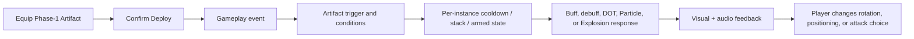

# Design Spec: Artifact Passive Phase 1

## 1. Player Goal and Context

The player equips Artifacts to change how the three-character team fights rather than receiving
only passive stat increases. Phase 1 tests nine interconnected build fantasies:

- Rotate characters to apply team buffs and room debuffs.
- Build Darkness or Bleed DOT around rapid hits and Particles.
- Establish safe or hostile Particle zones.
- Trade health-state safety for Crit power.
- Build Crit stacks into a visible Thunder Strike payoff.

The values from the source CSV are **starting values for functional playtesting**. Phase 1 proves
clarity, correctness, attribution, and interaction safety before final balance tuning.

## 2. Shared Language and Rules

### Target Terms

| Term | Meaning |
| --- | --- |
| `Self` / wearer | Character that owns the equipped Artifact instance. |
| Allies | Other deployed characters, excluding the wearer. |
| Team | Wearer plus all deployed allies. |
| Active | Character currently controlled by the player. |
| Off-field | Deployed character that is not currently active. |

### Runtime Rules

- Cooldowns belong to one Artifact instance and start only after a successful activation.
- Duplicate copies of one Artifact definition maintain independent state.
- Timers use gameplay time and pause with gameplay.
- Per-instance cooldowns and counters survive scene transitions while the Artifact remains deployed;
  target-bound marks and world Particles do not.
- Deploying a changed loadout clears removed instances and creates fresh runtime state for newly
  deployed instances.
- Damage-bearing DOTs and Particles snapshot wearer stats when applied or spawned.
- Ordinary buffs, debuffs, heals, and shields follow their Runtime Effect Recipe snapshot policy.
- DOT ticks are terminal by default: they may report damage and kills but cannot reapply DOT,
  retrigger Mark Injury, grant Aura Energy, or start another ordinary on-hit chain.
- Particle is a source tag and area behavior. It does not imply a damage formula.
- Explosion Splash is a spatial fan-out event. It preserves the authored parent delivery and damage
  type unless the response explicitly overrides them.
- Default Explosion children are terminal and hit each enemy at most once.

## 3. Phase-1 Passive Specifications

### Definition Identity Mapping

The first nine planned GDD Artifact identities are used in source order. Their Phase-1 gameplay is
the approved CSV behavior below; the older speculative passive text does not override this test build.

| Build ID | Definition ID | Player-facing name |
| --- | --- | --- |
| `P1-A01` | `ART-P1-001` | Blind's Boundless Ribbon |
| `P1-A02` | `ART-P1-002` | Fiend-Flesh Mask |
| `P1-A03` | `ART-P1-003` | Soul-Merchant's Scales |
| `P1-A04` | `ART-P1-004` | Broken Chrono-Relic |
| `P1-A05` | `ART-P1-005` | Aura-Resonating Shard |
| `P1-A06` | `ART-P1-006` | Rival's Broken Crest |
| `P1-A07` | `ART-P1-007` | Shroud of Deprivation |
| `P1-A08` | `ART-P1-008` | Memory-Draining Urn |
| `P1-A09` | `ART-P1-009` | Shin's Rusty Dagger |

### P1-A01 — Toxic Infusion

**Trigger:** The wearer successfully starts an Ultimate.

**Effect:** Other deployed allies receive Toxic for 10 seconds. The Artifact has a 20-second
per-instance cooldown.

**Toxic:** Qualifying damage produced by the affected ally, including Particle damage, changes its
damage type to Darkness. Delivery remains Primary, DOT, or Additional as originally authored.
Toxic does not alter healing, shield, self-damage, or environmental damage.

**Player decision:** Use the wearer as an Ultimate-triggered enabler, then rotate to allies whose
rapid hits or Particles exploit Darkness and DOT synergies.

### P1-A02 — Particle Support Stacks

**Trigger:** A Particle pulse owned by the wearer confirms positive damage against at least one
enemy.

**Effect:** Allies receive one stack of a 3-second `+3% ATK` buff, maximum ten stacks. One Particle
pulse grants at most one stack regardless of target count; a new stack refreshes the shared
duration.

**Eligibility:** Only events tagged Particle qualify. Projectile, direct Primary, DOT tick, and
Explosion-only events do not qualify unless the originating event is also tagged Particle.

**Player decision:** Maintain Particle uptime to build and retain a short team damage window.

### P1-A03 — Throne Barrier

**Trigger:** The wearer successfully starts a Skill.

**Effect:** Spawn a wearer-following Throne Barrier Particle for 10 seconds. The Artifact has a
20-second per-instance cooldown.

**While inside the barrier:**

- The wearer receives `10%` reduced incoming damage.
- Every 2 seconds, each eligible enemy inside receives Additional damage equal to `50%` of the
  wearer's snapshotted ATK.
- After the pulse resolves, each ally heals for `50%` of the total confirmed damage dealt by that
  pulse. A pulse that deals no positive damage produces no healing.

This multi-target healing behavior is intentionally accepted as a starting value and must be
stress-tested before balance lock.

### P1-A04 — Mark Injury, Explosion Bleed, and Claw

**Trigger:** A wearer-owned Skill confirms positive damage against an enemy.

**Mark Injury:** Apply Mark Injury to that enemy for 10 seconds. The application has a 14-second
per-instance cooldown. The cooldown is wearer-wide, so a multi-target Skill marks only the first
eligible target resolved by deterministic hit order.

**Marked-hit response:** The first eligible non-DOT confirmed hit from a different action against the marked target triggers
an Explosion Splash centered on that target, dealing instant AoE damage equal to `50%` of the wearer's confirmed triggering Skill damage.
Every enemy hit by the splash also receives a 3-second Bleed DOT based on `30%` of the Artifact wearer's snapshotted ATK.
The hit consumes Mark Injury.

**Claw:** The deployed character whose eligible hit consumed Mark Injury receives Claw for 5
seconds. While Claw is active, each eligible confirmed non-DOT hit has a `50%` chance to apply a
5-second Bleed DOT based on `30%` of the Artifact wearer's snapshotted ATK.

**Terminal rules:** Explosion children, Bleed ticks, Claw-applied Bleed, and subsequent hits belonging
to the same initiating Skill action cannot consume Mark Injury or trigger Claw again from their own damage.

### P1-A05 — Affliction Rotation Debuff

**Trigger:** A successful switch completes into the wearer.

**Effect:** Apply one Affliction stack to every living enemy registered in the current combat room.
Affliction has a maximum of ten stacks. Each stack applies `-3% DEF` and `+2% DOT damage taken`.
Reapplication refreshes the authored duration if one is later added; Phase 1 otherwise keeps the
stacks until the enemy dies or leaves the room.

Enemies spawned after the switch event are not retroactively affected. Failed switches, forced
character reloads, and selecting the already-active wearer do not trigger the Artifact.

### P1-A06 — Wrath of Demon

**Trigger:** A wearer-owned Skill confirms positive damage against an enemy.

**Effect:** Spawn an enemy-following Wrath of Demon Particle for 5 seconds around the first eligible
target. The Artifact has a 10-second per-instance cooldown.

**While an enemy is inside:**

- It receives `+10%` incoming damage through a reusable Runtime Effect Recipe.
- Every 2 seconds it receives Additional damage equal to `200%` of the wearer's snapshotted ATK.

If the anchor target dies, despawns, or leaves the room, the Particle ends. Other enemies may enter
the volume and receive its effects while it remains active.

### P1-A07 — Switch-Out Offensive Support

**Trigger:** A successful switch completes away from the wearer.

**Effect:** The incoming character receives `+10% ATK`, `+10% Crit Rate`, and `+10% Crit Damage` for
10 seconds. The Artifact has a 20-second per-instance cooldown.

The buff is applied only to the actual incoming character. Forced reloads and failed switches do
not activate it.

### P1-A08 — Cursed Crit Threshold

This passive has no cooldown and re-evaluates only when the wearer's HP or effective Max HP changes.

| HP state | Applied effects |
| --- | --- |
| Above 90% | `-10%` to eligible stats. |
| 66% through 90%, inclusive | `+17% Crit Rate`, `+26% Crit Damage`, and the `-10%` eligible-stat penalty. |
| Below 66% | `+17% Crit Rate` and `+26% Crit Damage`; the penalty is removed. |

The penalty affects ATK, DEF, Speed, Crit Rate, Crit Damage, Cooldown Mastery, Aura Energy Recharge,
DOT Mastery, Damage Increase, and Additional Damage Increase. It does not modify current HP or Max
HP, preventing the condition from feeding back into its own threshold.

Boundary checks use the exact current-HP/effective-Max-HP ratio. Healing or damage that crosses a
boundary updates the state once and broadcasts one feedback event.

### P1-A09 — Focus and Thunder Strike

**Focus trigger:** Each eligible confirmed Critical Primary hit by the wearer grants one Focus stack.
Focus has a maximum of six stacks and each stack grants `+5% Crit Damage`.

**Arming:** Reaching six stacks consumes all Focus and arms Thunder Strike. While armed, further
Crits do not build Focus.

**Consumption:** The next eligible confirmed Primary attack hit creates Thunder Strike. Missing an
attack does not consume the armed state. A multi-hit attack consumes it on the first confirmed hit.
The Artifact then enters its 2-second per-instance cooldown.

**Thunder Strike:** A target-centered Particle hit deals non-critical Additional Lightning damage
using this starting formula:

`2.5 × wearer ATK × (1 + 0.30 × wearer Crit Damage percentage)`

Thunder Strike damage itself cannot grant Focus or arm another Thunder Strike.

## 4. Interaction Flow

## 5. Feedback Loops

Exact VFX counts, intensity, mix levels, and animation durations remain a human game-feel tuning
checkpoint. No unapproved numeric feedback value is introduced here.

| Trigger | Visual | Audio | UI |
| --- | --- | --- | --- |
| Passive ready/activated | Brief Artifact-colored owner pulse | Short identity stinger | Artifact icon pulse; cooldown begins |
| Toxic | Darkness tint on affected attack/Particle | Low infused hit layer | Toxic status icon with remaining duration |
| Particle field | Clear gameplay boundary distinct from decorative particles | Persistent low-volume loop | Owner-colored edge/marker |
| DOT application | One application burst; ticks use lower-intensity feedback | Application cue plus quiet tick variants | DOT icon/stack state on target where supported |
| Explosion Splash | Radial burst scaled above ordinary hit feedback | Distinct impact layer | No repeated UI popup beyond damage text |
| Focus | Small Crit-linked charge pip | Rising charge layer | Six-pip Focus display or Artifact icon counter |
| Thunder armed | Persistent but restrained charge cue | Ready stinger | Armed state replaces Focus count |
| HP threshold transition | One curse/benefit pulse only when crossing | Short positive/negative cue | Artifact icon changes state |

Repeated Particle and DOT sounds need variation and priority limits so nine Artifacts do not create
audio or visual noise soup.

## 6. State and Lifecycle Rules

| Property | Rule |
| --- | --- |
| Entry | Only a confirmed, eligible structured event may activate a rule. |
| Exit | Duration expiry, target death/despawn, room exit, Artifact removal, or explicit consumption. |
| Interruptibility | Character hitstun does not cancel already-applied DOTs or spawned Particles; undeploy removes Artifact-owned transient state. |
| Chaining | Child damage carries its root event and obeys terminal/proc rules. |
| Resource cost | Only authored cooldowns, stacks, and armed-state consumption; no hidden Aura Energy cost. |
| Scene transition | World Particles and target marks end; deployed-instance cooldowns/counters remain until redeploy or run reset. |
| Pause | All combat timers pause. |
| Save/load | Inventory/equipment persists through ADR-009; active combat-transient state does not. |

## 7. Edge and Abuse Cases

- Duplicate definition instances cannot share stacks, cooldowns, or armed state.
- AOE and multi-collider targets cannot multiply one-pulse triggers accidentally.
- One attack killing the anchor target still reports its confirmed result before cleanup.
- A source switching off-field keeps attribution through its deployed runtime snapshot.
- Source removal falls back to its captured stat snapshot for already-applied DOT/Particle damage.
- Healing uses actual confirmed damage after mitigation; zero or immune damage yields no healing.
- Overkill does not inflate healing beyond the damage actually accepted by the target.
- Explosion and Particle overlap queries deduplicate targets.
- Scene unload and pool return clear target sets, timers, source references, and VFX state.
- A08 applies exactly one state at each boundary and cannot oscillate because Max HP is excluded.
- A09 consumes one armed state even if the triggering attack uses multiple hitboxes in one step.
- Mark Injury cannot be consumed by its own Bleed tick or Explosion child.
- Affliction applies only to the current room registry at the switch-complete moment.

## 8. Five-Component Evaluation

| Component | Phase-1 requirement |
| --- | --- |
| Clarity | Distinguish direct hit, Particle pulse, DOT application/tick, Explosion, status, stack, and ready-state feedback. |
| Motivation | Each Artifact changes rotation, target choice, positioning, or health-risk decisions rather than adding only static power. |
| Response | Triggers resolve from confirmed actions/hits; misses do not consume hit-dependent states. |
| Satisfaction | Major activations use at least visual and audio feedback; repeated ticks remain restrained. |
| Fit | Darkness, Bleed, demonic zones, curses, and team rotation use the game's flashy but readable combat language. |

## 9. Playtest Scenarios

### New Player

- Equip one Artifact at a time in the training room.
- Pass when a new player can predict its next activation in at least eight of ten opportunities
  within two minutes.

### Stress

- Equip nine Phase-1 Artifacts across three characters.
- Maintain overlapping Throne Barrier, Wrath of Demon, Toxic, Affliction, Claw, and Thunder Strike.
- Pass when event counts remain deterministic, frame pacing remains within the existing PC target,
  and no recursive chain or per-frame allocation appears.

### Skill

- Test whether deliberate swapping, health management, Particle positioning, and saving an armed
  Thunder Strike improve results over random play.

### Abuse

- Attempt to reset cooldowns by scene transition, failed switch, forced character reload, repeated
  multi-collider overlap, and equipping duplicate definitions.
- Attempt Mark Injury → Explosion → DOT → Mark Injury recursion.

### Readability

- Observe combat without reading damage numbers.
- Pass when the observer can distinguish Toxic conversion, Particle field ownership, DOT ticks,
  Explosion Splash, Focus build-up, and Thunder armed state.

## 10. Tuning Priority

1. Fix incorrect or ambiguous trigger feedback.
2. Fix response latency, missed-hit consumption, or rotation-state errors.
3. Reduce visual/audio noise.
4. Correct proc safety and target attribution.
5. Only then tune damage, healing, duration, cooldown, and stack values.

## 11. GDD Alignment

- `@tag:combat` — preserves orthogonal delivery/type rules and terminal secondary behavior.
- `@tag:items` — converts Artifact passive descriptions into authored runtime behavior.
- `@tag:progression` — strengthens modular loadout expression and team rotation.
- Primary platform remains PC keyboard/mouse and controller; Artifacts add no new input.

## Human Design Checkpoint

Approved by the project owner on 2026-08-17. Architecture may proceed without changing the above
behavior. Any material change to trigger meaning, target scope, or chain eligibility returns to this
checkpoint.
