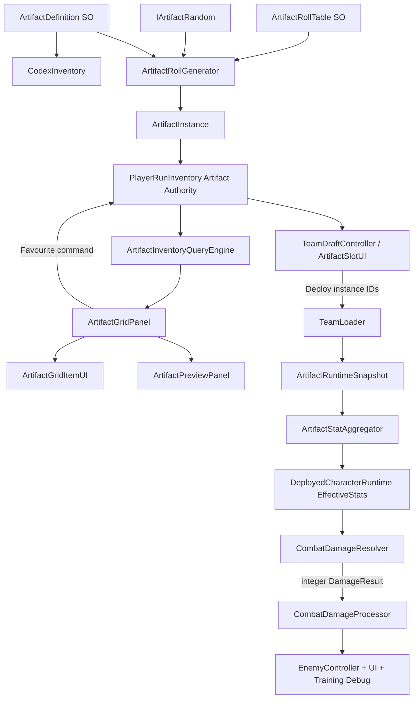

# Architecture Plan: Artifact Random Rolls and Inventory Discovery

> **Design:** `artifact-random-roll-inventory-design-spec.md`  
> **Existing decisions:** ADR-005 deployed live-stat authority, ADR-008 unified player damage delivery  
> **Date:** 2026-08-17

## 1. Current State and Constraints

The current `Artifact` ScriptableObject combines reusable content identity with one fixed `CharacterStats bonusStats` object. `PlayerRunInventory.ownedItems` treats non-stackable ScriptableObjects as unique references, `InventoryAcquisitionResolver` converts a repeated Artifact definition into Meta Progression fragments, and team/loadout saves store Artifact definition IDs.

This cannot represent two copies of the same Artifact with different rolls. The refactor must separate:

- Reusable authored definition data.
- Owned per-acquisition instance data.
- Draft/equipped instance references.
- Immutable deployed runtime snapshots.

The implementation must preserve the nine current Artifact assets and every serialized reference. It must not rewrite unrelated dirty assets or reset current saves.

## 2. Architecture Decisions

| Decision | Choice | Rationale |
| --- | --- | --- |
| Definition authority | `ArtifactDefinition` ScriptableObject | Shared icon/name/price/passive data remains authored once. |
| Instance authority | `PlayerRunInventory` owns serialized `ArtifactInstance` records | Roll, Favourite, acquisition order, and ownership are run state. |
| Equipment identity | Slots store `ArtifactInstanceRef` / instance ID | Definition IDs cannot distinguish duplicates. |
| Runtime authority | `TeamLoader` builds immutable `ArtifactRuntimeSnapshot` records on Deploy | Preserves ADR-005 and prevents inventory/UI mutation from changing deployed combat before Deploy. |
| Random generation | Pure `ArtifactRollGenerator` with injected RNG and `ArtifactRollTable` | Deterministic tests and no Unity-global RNG coupling. |
| Numeric persistence | Quantized integer units; catalog supplies scale | Exactly preserves integer/2-decimal rolls across JSON and avoids float save drift. |
| Roll quality | Derived, never serialized | Prevents stale quality after catalog balance changes and keeps rarity out of the model. |
| Query ownership | Pure `ArtifactInventoryQueryEngine`; UI owns transient query state | Sorting/filtering cannot mutate inventory. |
| Favourite authority | Boolean on `ArtifactInstance`, mutated through inventory API | Favourite persists and is independent of UI mode. |
| Favourite Mode | `ArtifactGridPanel` owns transient mode state | Presentation interaction state does not leak into persistent inventory. |
| Final damage | Resolver calculates in float and returns one final integer | Decimal stats survive all formulas; processor, HP, UI, and debug consume the same integer. |
| Save migration | Versioned v2 → v3 migration with dry-run report and v2 backup retained | Duplicate-safe persistence without destructive reset. |
| Legacy Artifact fragments | Player Meta save v1 → v2 filters only Artifact Transcendence stacks | Character Potential data remains unchanged. |

## 3. System Diagram



## 4. Data Contracts

The following definitions describe contract shape, not final implementation syntax.

```csharp
public enum ArtifactStatKind
{
    FlatMaxHP = 0,
    FlatAttack = 1,
    FlatDefense = 2,
    MaxHPPercent = 10,
    AttackPercent = 11,
    DefensePercent = 12,
    CooldownMastery = 20,
    CritRate = 21,
    CritDamage = 22,
    AuraEnergyRecharge = 23,
    DotMastery = 24,
    DamageIncrease = 25,
    AdditionalDamageIncrease = 26,
    LegacySystemSpeed = 100
}

public enum ArtifactRollSource
{
    Generated = 0,
    ImportedLegacy = 1
}

[Serializable]
public struct ArtifactRoll
{
    public ArtifactStatKind statKind;
    public int valueUnits;
    public ArtifactRollSource source;
}

[Serializable]
public sealed class ArtifactInstance
{
    public string instanceId;
    public string definitionId;
    public List<ArtifactRoll> rolls;
    public bool isFavourite;
    public bool isNew;
    public long acquisitionOrder;
    public int generationSeed;
}

[Serializable]
public struct ArtifactInstanceRef
{
    public string instanceId;
}
```

`ArtifactDefinition` is the renamed existing `Artifact` ScriptableObject and retains the existing script/meta GUID during implementation so all nine assets keep their references. It owns only reusable authored content:

```csharp
public sealed class ArtifactDefinition : BaseItem
{
    public bool isEquippable;
    public string passiveDescription;
    public List<AdditionalDamageEffectDefinition> additionalDamageEffects;
}
```

`ArtifactRollTable` owns generation metadata:

```csharp
[Serializable]
public struct ArtifactStatRollDefinition
{
    public ArtifactStatKind statKind;
    public int minimumUnits;
    public int maximumUnits;
    public int valueScale;          // 1 for flat, 100 for two decimals
    public float selectionWeight;
    public bool randomEligible;
}

[Serializable]
public struct ArtifactAmountBand
{
    public float normalizedMin;
    public float normalizedMax;
    public float weight;
}

public sealed class ArtifactRollTable : ScriptableObject
{
    public IReadOnlyList<ArtifactStatRollDefinition> Stats { get; }
    public IReadOnlyList<ArtifactAmountBand> AmountBands { get; }
    public int RollStatLineCount(float percentile01);
}
```

The table uses explicit stat IDs and validates unique entries, positive scale, inclusive min/max, non-negative weights, exactly one random-eligible entry per random stat type, and no random-eligible SPD.

## 5. Service Interfaces

```csharp
public interface IArtifactRandom
{
    float Next01();
    int NextInt(int minInclusive, int maxExclusive);
}

public interface IArtifactRollGenerator
{
    ArtifactInstance Generate(
        ArtifactDefinition definition,
        long acquisitionOrder,
        int seed);
}

public interface IArtifactInventory
{
    IReadOnlyList<ArtifactInstance> Instances { get; }
    bool TryGet(string instanceId, out ArtifactInstance instance);
    bool TryAdd(ArtifactInstance instance);
    bool TryRemove(string instanceId);
    bool TrySetFavourite(string instanceId, bool favourite);
    event Action ArtifactsChanged;
    event Action<string, bool> FavouriteChanged;
}

public interface IArtifactDefinitionResolver
{
    bool TryResolve(string definitionId, out ArtifactDefinition definition);
}
```

`PlayerRunInventory` implements/exposes the inventory API but delegates indexing and validation to a small `ArtifactInventoryState` helper. It maintains a nonserialized `Dictionary<string, ArtifactInstance>` rebuilt after load. Duplicate or empty instance IDs fail validation and appear in the migration report.

## 6. Generation and Quality Flow

```text
Acquire ArtifactDefinition
  → Allocate stable acquisitionOrder and generationSeed
  → Roll line count from 100/50/35/15 cumulative table
  → For each line:
      weighted stat selection with replacement
      weighted amount-band selection
      uniform units inside selected inclusive band
  → Allocate instance GUID
  → Add and save ArtifactInstance
  → Return instance ID in AcquisitionResult
  → Reveal reads saved instance; it never rerolls
```

Quality is calculated on demand:

```csharp
bool TryGetLineQuality(in ArtifactRoll roll, out float quality01);
bool TryGetAverageQuality(ArtifactInstance instance, out float quality01);
```

- Generated quality uses quantized units and the current catalog range.
- Imported values outside the range return `false` / UI `—`.
- Imported values inside the range may still display `Imported`; they do not contribute to average quality, matching the approved design.
- Quality sorting places unavailable values after available values and then uses acquisition order plus instance ID as deterministic tie-breaks.

## 7. Stat Aggregation

`ArtifactStatAggregator` replaces all direct reads of `Artifact.bonusStats`.

```csharp
public static void Apply(
    CharacterStats destination,
    CharacterStats cleanBase,
    IReadOnlyList<ArtifactRuntimeSnapshot> artifacts);

public static void ApplyRoll(
    CharacterStats destination,
    CharacterStats cleanBase,
    in ArtifactRoll roll,
    ArtifactRollTable table);
```

Mapping rules:

- Flat HP/ATK/DEF add `valueUnits` directly.
- HP%/ATK%/DEF% add `cleanBase × percentagePoints / 100`.
- CM/CR/CD/AER/DM/DI/ADI add percentage points directly.
- `LegacySystemSpeed` adds exact migrated speed and is never generated or shown in buildable-stat filters.
- Duplicate lines and multiple equipped instances add independently.
- Aggregation is allocation-free and does not mutate instance data.

Every existing stat path in `TeamBuilderUI`, `InspectScreenUI`, `PlayerRunInventory`, and `TeamLoader` calls this same aggregator.

## 8. Runtime Snapshot and Passive Flow

```csharp
public sealed class ArtifactRuntimeSnapshot
{
    public string InstanceId { get; }
    public ArtifactDefinition Definition { get; }
    public IReadOnlyList<ArtifactRoll> Rolls { get; }
}
```

On Deploy:

1. `TeamDraftController` submits `ArtifactInstanceRef[][]`.
2. `PlayerRunInventory` verifies each referenced instance exists and is not assigned to another slot.
3. `TeamLoader` resolves definition and copies rolls into runtime snapshots.
4. `ArtifactStatAggregator` builds effective stats.
5. `DeployedCharacterRuntime` retains the snapshots and increments `StatsRevision`.
6. `CharacterPassiveController` reads `snapshot.Definition.additionalDamageEffects`.

Inventory Favourite changes never rebuild deployed stats. Loadout edits only affect runtime after the existing Deploy confirmation.

## 9. Sorting, Filtering, and Favourite Mode

```csharp
public enum ArtifactSortMode
{
    FavouriteFirst,
    StatLineCount,
    AverageRollQuality,
    SelectedStatTotal,
    Newest,
    Oldest,
    DefinitionName,
    EquippedFirst,
    UnequippedFirst
}

public struct ArtifactInventoryQuery
{
    public ArtifactSortMode sortMode;
    public bool descending;
    public string searchText;
    public int minimumLineCount;
    public int maximumLineCount;
    public ulong requiredStatMask;
    public bool matchAllStats;
    public OptionalBool favourite;
    public OptionalBool equipped;
    public OptionalBool isNew;
    public ArtifactStatKind selectedSortStat;
}
```

`ArtifactInventoryQueryEngine.Execute` accepts source instances, definition resolver, equipped-instance set, query, and a caller-owned result list. It clears/fills the result without instantiating cards. Stable ordering uses acquisition order and instance ID.

`ArtifactGridPanel` owns:

- Current query state.
- Current result buffer.
- Normal versus Favourite Mode.
- Pooled grid cells.

During Favourite Mode, card clicks call `TrySetFavourite`; preview and drag callbacks are suppressed. Exit occurs on toggle, Back/Escape, panel close, tab change, or scene transition. Favourite state saves immediately.

## 10. Acquisition and Shop Changes

`InventoryAcquisitionResolver` splits its current combined unique path:

- `CharacterItem`: retain unique ownership and duplicate-to-Character-Potential-fragment behavior.
- `ArtifactDefinition`: always generate/add a new `ArtifactInstance`; never call `PlayerMetaProgression.AddFragments`.
- Consumables: retain stack behavior.

`AcquisitionResult` adds an Artifact instance ID/reference while retaining the definition for display:

```csharp
public string ArtifactInstanceId { get; }
public ArtifactDefinition ArtifactDefinition { get; }
```

Existing Shop sell behavior becomes instance-based. Selling is not a new Recycle feature: the existing Sell Zone passes an instance ID, verifies it is not equipped, removes that instance, and uses its definition's price policy.

## 11. Save Contracts and Versioned Migration

### Player Run Save v3

```csharp
[Serializable]
internal sealed class SavedArtifactInstanceRecord
{
    public string instanceId;
    public string definitionId;
    public List<ArtifactRoll> rolls;
    public bool isFavourite;
    public bool isNew;
    public long acquisitionOrder;
    public int generationSeed;
}

[Serializable]
internal sealed class SavedRunTeamSlotRecordV3
{
    public string characterId;
    public string[] artifactInstanceIds;
}
```

The v3 save contains `artifactInstances` separately from general `items`. Artifact definitions no longer appear as unique owned `BaseItem` records.

### v2 → v3 Runtime Migration

1. Read the current v2 payload without overwriting it.
2. Resolve every Artifact definition ID in `items` and `teamSlots.artifactIds`.
3. Create one imported instance per logically owned legacy definition because v2 prohibited duplicates.
4. Convert every nonzero `bonusStats` value through the audited legacy map.
5. Reuse the same instance ID for owned and equipped references to that definition.
6. Preserve unknown/unresolved IDs in a migration diagnostic; do not silently discard them.
7. Validate all slot instance IDs against the new collection.
8. Write v3 only after validation succeeds, then read v3 back and compare counts/checksums.
9. Keep the v2 key as rollback input during the migration release; do not clear it automatically.

### Player Meta Save v2

The Meta migrator reads existing fragment records, keeps Character Potential stacks/progress, reports Artifact Transcendence quantities, and omits only those Artifact stacks from v2. The implementation removes Artifact fragment APIs only after migration tests pass.

## 12. Editor Asset Migration

Create `ArtifactInstanceAssetMigrator` with Dry Run and Apply actions.

Dry Run must report:

- All nine Artifact definitions and stable IDs.
- Name/icon/description/price/isEquippable/passive/Additional Damage preservation.
- Exact nonzero `bonusStats`, including `a_4` hidden SPD -1.
- Every reference from Codex, inventories, profiles, prefabs, scenes, and ScriptableObjects.
- Values outside new generation ranges.
- Duplicate/missing definition IDs and unresolved references.
- Planned imported instances for authored bootstrap/loadout references.

Apply must:

- Rename `Artifact` to `ArtifactDefinition` while preserving the script `.meta` GUID.
- Transfer legacy stats into imported instance records for each owned/equipped legacy reference.
- Preserve definition content and all references.
- Use `FormerlySerializedAs`/`MovedFrom` only during migration.
- Save assets only after a clean dry run and explicit human execution.
- Remove `bonusStats` and compatibility adapters only after a second clean validation report.

The migrator never randomly rerolls existing values and never grants unowned definitions merely because they exist in the Codex.

## 13. Integer Damage Contract

`CombatDamageResolver` keeps float intermediates through build multipliers, critical multiplier, outgoing modifiers, mitigation, and elemental reduction. It quantizes only the final non-negative value.

```csharp
public readonly struct DamageResult
{
    public int Damage { get; }
    public bool IsCriticalHit { get; }
    // existing attribution and accepted-side-effect fields
}
```

`CombatDamageProcessor`, `EnemyController`, world text, notifications, and Training Debug use `DamageResult.Damage` directly. No caller applies `CeilToInt`, `FloorToInt`, or a second rounding operation. DOT replacement strength retains its separate pre-quantized comparison value.

## 14. Class Responsibility Table

| Class | Responsibility | Depends On | Owned state |
| --- | --- | --- | --- |
| `ArtifactDefinition` | Reusable Artifact content | `BaseItem`, effect definitions | Authored metadata/passives |
| `ArtifactInstance` | Per-acquisition Artifact state | Definition ID, rolls | Rolls/Favourite/new/order/seed |
| `ArtifactRollTable` | Generation ranges/weights/format | ScriptableObject | Authored roll configuration |
| `ArtifactRollGenerator` | Pure deterministic instance generation | Table, RNG | None |
| `ArtifactRollQuality` | Derived line/average quality | Table | None |
| `ArtifactInventoryState` | Validate/index instance collection | Instances | Serialized list + runtime index |
| `PlayerRunInventory` | Persistent run authority and save boundary | Artifact inventory, character state | Run data |
| `ArtifactInventoryQueryEngine` | Pure sorting/filtering | Instances, definition resolver | None |
| `ArtifactStatAggregator` | Apply roll semantics once | Stats, table | None |
| `ArtifactRuntimeSnapshot` | Immutable deployed Artifact data | Definition, copied rolls | Runtime snapshot |
| `TeamLoader` | Deploy snapshots and effective stats | Run inventory, aggregator | Deployed runtime authority |
| `ArtifactGridPanel` | Query presentation and Favourite Mode | Query engine, inventory API | Transient UI state/result buffer |
| `ArtifactGridItemUI` | Render one instance and forward intent | Definition + instance view model | Bound instance ID |
| `ArtifactPreviewPanel` | Render definition, rolls, quality | Resolver, quality service | Selected instance ID |
| `ArtifactInstanceAssetMigrator` | Dry-run/apply asset migration | AssetDatabase, serialized data | Migration report only |

## 15. Affected Files

### New Runtime Files

- `Inventory/Items/ArtifactDefinition.cs` (rename preserving current meta GUID)
- `Inventory/Artifacts/ArtifactInstance.cs`
- `Inventory/Artifacts/ArtifactRoll.cs`
- `Inventory/Artifacts/ArtifactRollTable.cs`
- `Inventory/Artifacts/ArtifactRollGenerator.cs`
- `Inventory/Artifacts/ArtifactRollQuality.cs`
- `Inventory/Artifacts/ArtifactInventoryState.cs`
- `Inventory/Artifacts/ArtifactInventoryQueryEngine.cs`
- `Inventory/Artifacts/ArtifactStatAggregator.cs`
- `Combat/ArtifactRuntimeSnapshot.cs`

### New Editor/Test Files

- `Editor/ArtifactInstanceAssetMigrator.cs`
- `Editor/Tests/ArtifactRollGeneratorTests.cs`
- `Editor/Tests/ArtifactInventoryMigrationTests.cs`
- `Editor/Tests/ArtifactInventoryQueryTests.cs`
- `Editor/Tests/ArtifactStatAggregationTests.cs`
- `Editor/Tests/IntegerDamageResultTests.cs`

### Existing Files Requiring Modification

- `Inventory/CodexInventory.cs`
- `Progression/InventoryAcquisitionResolver.cs`
- `Progression/PlayerMetaProgression.cs`
- `Shop/PlayerRunInventory.cs`
- `Shop/ShopManager.cs` and Shop UI entry/preview scripts
- `Systems/TeamLoader.cs`
- `Combat/DeployedCharacterRuntime.cs`
- `Combat/CharacterPassiveController.cs`
- `Combat/DamageContracts.cs`
- `Combat/CombatDamageResolver.cs`
- `Combat/CombatDamageProcessor.cs`
- `AIBehaviour/EnemyController.cs`
- `TeamBuilder/UI/TeamDraftController.cs`
- `TeamBuilder/UI/TeamLoadoutProfile.cs`
- `TeamBuilder/UI/TeamBuilderUI.cs`
- `TeamBuilder/UI/TeamSlotUI.cs`
- `TeamBuilder/UI/ArtifactSlotUI.cs`
- `TeamBuilder/UI/ArtifactGridPanel.cs`
- `TeamBuilder/UI/ArtifactGridItemUI.cs`
- `TeamBuilder/UI/ArtifactPreviewPanel.cs`
- `TeamBuilder/UI/InventoryBuilderPanel.cs`
- `TeamBuilder/UI/InspectScreenUI.cs`
- UI/stat formatting and Training Debug consumers that currently round damage independently
- Nine Artifact assets plus inventory/profile/prefab/scene references identified by the migrator

## 16. Implementation Slices

1. Add generator/catalog/instance/query/stat unit tests around existing behavior; no runtime wiring.
2. Add definition/instance contracts and Artifact inventory state beside legacy ownership.
3. Add v3 save DTOs and dry-run v2 migration tests without writing saves.
4. Add Editor dry-run asset/reference migrator and review its report.
5. Migrate acquisition to generate instances; keep legacy read adapter temporarily.
6. Migrate Team draft, slots, Deploy, runtime snapshots, passives, and stat resolution to instance IDs.
7. Migrate grid/preview to instance view models, then add sorting/filtering/Favourite Mode.
8. Migrate Shop sell paths to instance IDs and remove Artifact fragment conversion.
9. Quantize final damage once and update every consumer/test.
10. Apply asset/save migrations, validate, then remove `bonusStats`, definition-ID equipment, Artifact fragments, and compatibility adapters.
11. Update GDD, ADR registry, test plan, and DevLog after approval and verification.

## 17. Architecture Acceptance Checks

- Same-definition instances remain distinct through acquire, save/load, favourite, equip, Deploy, runtime, and sell.
- Identical seeded generation produces identical rolls and quality.
- Generated values stay within approved inclusive quantized ranges.
- No Artifact rarity field, enum, label, color, or serialized value exists.
- All stat resolution paths use `ArtifactStatAggregator`.
- All damage consumers receive the same final integer with no second rounding.
- Dry-run migration accounts for all nine definitions, all current values, and every serialized reference.
- v2 save remains available if v3 validation fails.
- Character Potential fragments/progress are byte-for-byte equivalent after Meta migration.
- Hot query/sort and combat paths introduce no per-hit GC allocations.

## Human Architecture Checkpoint

Approve this definition/instance authority, v3 save migration, imported legacy-roll handling, and integer `DamageResult` contract before implementation. A new ADR should be drafted as ADR-009 after approval.
