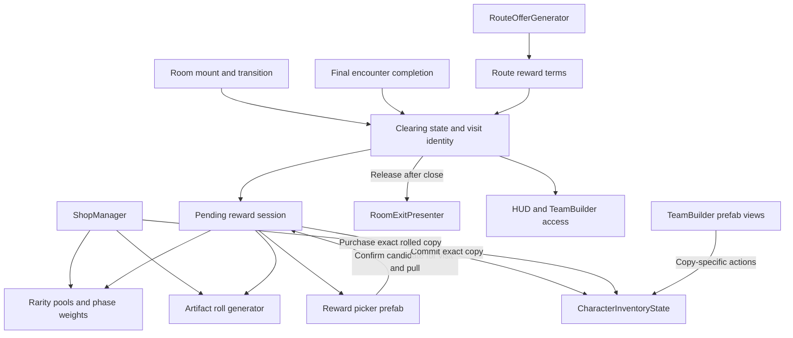

# Artifact rarity and room reward architecture

**Status** · Approved for implementation, 2026-11-05

Build on the [approved design](artifact-rarity-and-rewards-design-spec.md), [Artifact definition and instance authority](../ADRs/009-artifact-definition-instance-authority.md), and [Artifact passive authority](../ADRs/010-artifact-passive-event-and-secondary-effect-authority.md).

## Interfaces and authority

Names below are provisional contracts. Keep one owner per kind of mutable state and use serialized configuration for balance values.

| Owner | Proposed contract | State and dependencies |
| --- | --- | --- |
| `ArtifactDefinition` and `ArtifactRollTable` | Definition exposes rarity and optional fixed stat modifier. Table resolves a generation profile from rarity. | Definition owns passive, icon and price. Table keeps canonical stat units and ranges. Phase weights and eligibility are authored separately from amount bands. |
| `ArtifactRollGenerator` and inventory | Generator prepares a roll payload from definition, profile and seed. Inventory validates and inserts a prepared copy with a stable ID and assigns acquisition metadata. | Candidates are transient data. Inventory remains the owner of acquired instances, their ordering, balances and change events. Existing grant callers delegate through the same path. |
| `RouteOfferGenerator` | Produce immutable reward terms with total Soul, pull count, rarity profile and seed for patterned routes. | Read `RouteOfferTables` when building the offer. Both route preview and clear payout consume the selected offer's terms. Preserve explicit legacy payout handling for other routes. |
| Clearing-state provider | Publish a read-only snapshot containing room identity, visit token and clearing phase, plus a change event. | Keep the existing provider asset and script binding through migration. The transition and encounter flow are its writers. Layout identity and presentation metadata remain available independently. |
| Room reward session | Publish a pending draw and handle `Confirm(visit, pull, candidateId)` and acknowledgement of the matching close animation. | A run-scoped, in-memory session retains the current candidate set, confirmed selection, pull index and clear payout latch. A view can rebind to its snapshot. Only the current visit may advance it. |
| Reward picker and TeamBuilder | Bind serialized prefab references and forward user intents. | Presentation owns focus, reveal and dismissal animation. TeamBuilder checks draft assignments, inventory checks owned and equipped state, and the settings layer owns the discard preference. |

## Rarity, acquisition and stats

- Add an explicit unassigned rarity for deserialization. Migrate the nine `ART-P1-*` definitions to SSR with their IDs and asset GUIDs intact. Validate the old assets and indexes before activating the new pools. Flag other unassigned shop candidates for content review. Older snapshots resolve rarity through definition IDs, which keeps their instance format and their rolled values intact.
- Sample rarity, then eligible definitions within the chosen tier. Validate unique stable IDs, positive total weights, distinct reward choices and source eligibility up front. Keep the reserved opening R slot and use phase weights for other slots and rerolls. Route profiles never include SSR. Keep the non-Artifact shop sampling and price surcharge on their current paths.
- Route generated and shop acquired copies through the same seeded roll logic. For shop Artifacts, validate affordability and the candidate first, then debit Soul and insert the copy together before publishing inventory changes. This avoids the current generic purchase order exposing the item before Soul is spent. Roll Quality reads the stored values against the canonical stat ranges.
- Route fixed R bonuses through the common stat aggregation entry point using the same definition lookup as the equipped instance. Apply them once per equipped copy alongside the rolls, with ATK, DEF and HP scaling from the same clean base. Update callers in `TeamLoader`, `CharacterInventoryState`, `TeamBuilderUI`, `InspectScreenUI` and `CharacterLevelPanel` together. Keep fixed bonuses out of random quality and roll-line filters.
- Give SR variants their own definition IDs and passive configuration. During authoring, settle unresolved tuning against the brief, live SSR behavior and the approved comparison tests. Verify existing typed events can express cast-level conversion, off-field healing and the crit-clears-Sharp order before extending the passive runtime. Preserve the existing SSR effects and stack identities.

## Room lifecycle and reward sequencing

1. **Resolve on mount.** `SceneTransitionManager` and `GameRunManager` begin a new visit and lock access before the new layout publishes readiness. Advance a visit token even when consecutive rooms share a scene. Resolve encounter intent from the mounted stage, matching active offer and authored encounter sources used by `CombatStageController` and `RoomWaveManager`. Explicitly empty rooms become accessible after entry setup. Invalid encounter data stays gated and reports the bad configuration.
2. **Complete the room once.** `RoomWaveManager` reports the final clear only after the encounter and chamber sequence end. Validate the visit, stage the selected reward terms and prepare the first draw before exposing a patterned payout. Separate the `RunEndController` room-clear count from its legacy currency side effect for patterned routes. Apply the advertised total exactly once. Preserve boss handoff and existing non-patterned rewards. Training and abandonment follow their existing run boundaries.
3. **Present and commit.** While reward-pending, block gameplay input and exit use through the room access policy and existing input-lock ownership, including controller input. Inspect which existing input and pause mechanisms compose with `UIBlockPlayerClick`, since the modal also needs keyboard and controller isolation. Animate the view in unscaled time. The session accepts one confirm for the current visit and pull. If insertion fails, the same candidates remain selectable for retry. If it succeeds, mark the pull committed before starting close motion. Duplicate confirms return the existing outcome. The next pull waits for a matching close acknowledgement. View recreation can replay the close or settle an already committed pull without granting again.
4. **Release and advance.** With no pending draws, publish accessible and invoke the appropriate exit and offer-preparation path exactly once. Keep boss sequencing and the empty-room offer path distinct from ordinary post-combat exit release. Clear the consumed active offer at handoff after copying its terms. Reject stale callbacks from prior visits and dispose modal input ownership on scene replacement or run end.

Publish access changes only on transitions. Migrate TeamBuilder, Inspect, training override, HUD, UI and boundary interaction together. Camera framing and room music keep using room and encounter presentation context. First introduce lifecycle data on the existing serialized provider, then switch consumers and remove obsolete `ZoneMode` access fields after scene, prefab and resource reference validation. Check direct lobby loads, scene loads and in-scene layout swaps.

### Resume and failure boundary

The current supported cross-session checkpoint is the boss-lobby snapshot. Ordinary run inventory persistence is disabled in the inspected branch. Keep the draw session in memory and restore it when the picker view is recreated within the same visit. A restart follows the existing checkpoint semantics. The checkpoint contains acquired Artifacts and Soul through the existing inventory snapshot. No new save format or partial-room resume is required. If partial-room resume is later requested, the candidate payloads, visit/pull progress and currency commit marker must share a checkpoint boundary with inventory.

Preflight the reward prefab, eligible pools and inventory before publishing a patterned clear payout. Keep access gated and offer recovery through the run's existing retry or return flow if runtime dependencies fail. For a missing view after commit, retain the committed marker and resume from it when the view returns. Check stale transition callbacks and verify that close motion can finish even when gameplay is paused.

## Unity MCP and TeamBuilder

- After architecture approval, verify the Unity MCP connection targets this project and inspect editor state, project UI packages, sprite references and the current EventSystem before authoring. The current tool inventory did not expose Unity MCP authoring tools. Prefab work requires that connection to be available.
- Use Unity MCP to update `TeamArtifactInventoryCard.prefab` and the authored toolbar in `TeamCanvas.prefab`, and save the picker, reward card, item context menu and confirmation as uGUI prefabs. Wire serialized TMP, images, focus targets, buttons, toggles and animation controls. Reuse project pixel sprites. Remove the Artifact toolbar's runtime fallback hierarchy after normal entry points are wired and validated.
- Bind a context menu to the exact instance ID. Revalidate the active access state, current inventory and draft references when the player confirms discard. A draft reference or equipped copy blocks deletion. On success, refresh the list and restore sensible focus. Save the app-level opt-out only after the checked confirm succeeds. Keep Favourite and New changes routed through existing inventory APIs.

## Implementation order and verification

| Slice | Main files and regression focus |
| --- | --- |
| Catalog, stats and shop | `ArtifactDefinition`, `ArtifactRollTable`, `ArtifactRollGenerator`, `ArtifactStatAggregator`, `ShopManager`, `CharacterInventoryState`. Extend Artifact instance tests for per-tier seed reproducibility, old snapshots, fixed bonus parity and spend-once purchase. Check non-Artifact shop behavior. |
| Clearing and payout | `ZoneStateProvider`, `SceneTransitionManager`, `GameRunManager`, `RoomWaveManager`, `RouteReward`, `RouteOfferGenerator`, `RouteOfferTables`, `RunEndController`, `RoomExitPresenter`. Check empty, invalid, final-wave, multi-chamber, boss, training and same-scene visits. Verify that patterned payouts match the route card and an Artifact-only clear pays zero Soul. |
| Picker and TeamBuilder | `ArtifactGridItemUI`, `ArtifactGridPanel`, `TeamBuilderUI`, prefab bindings and the new reward presenter. Play Mode checks for zero through three pulls, interrupted animation, duplicate confirm, exact rolls granted, mixed payouts, stale input, draft/equipped discard guards and controller navigation. Check real resolution scaling, wrapping, icon contrast and close animations. |

At the architecture gate, confirm that visit-scoped rewards follow the existing boss-lobby checkpoint boundary. Record the clearing and reward authority decision in a draft ADR after approval. The two existing Artifact ADRs still govern inventory and passive runtime ownership.
