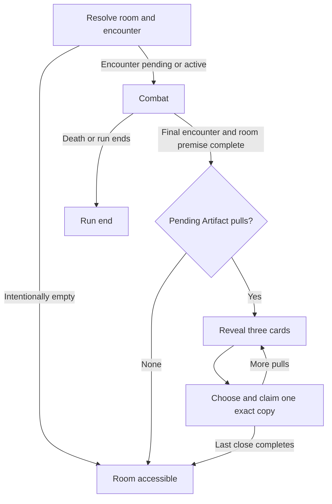

# Artifact rarity, room rewards and TeamBuilder

**Status** · Approved for architecture planning, 2026-11-05

## Player experience

The first Artifact purchase is an affordable choice such as a little more Attack or faster Aura gain. Before committing to a Hard route, the player can see whether clearing it will pay Soul, let them choose equipment, or do both. After the final encounter, each pull presents three fully rolled copies for comparison. The player takes one copy per pull, then can inspect or equip it in the room they just cleared. Later, they can save Soul for a premium passive that changes their rotation.

The direct request governs rarity, encounter access, and prefab authoring. The attached text supplies candidate R/SR content and the screenshots guide the icon-led tile and three-card reveal. This proposal revises the GDD's current rarity-free and Favourite Mode descriptions under `@tag:items` and `@tag: ui`. The stat definitions and ranges come from `@tag:characters` and `@tag:items`. [GDD](../../1_Inputs_Templates/GDD_Neo-JJK.md#artifacts)

## Rarity and pacing

Treat rarity as a property of the reusable definition and numeric Roll Quality as a property of the acquired copy. A three-star frame communicates the passive tier. Quality still expresses how far the randomized values landed within the existing per-stat ranges, on a 0–100 scale. The fixed passive contributes to combat stats or passive behavior independently of the randomized roll score.

**Starting values for a balance pass.** Assume the three phases follow the existing biome index. Confirm that shops and Hard routes occur where the intended phase unlocks can be felt. Reserve one R Artifact offer in the first shop's opening stock. Apply phase weights to the other Artifact slots and to rerolls, then choose a definition within the selected tier. Combat rolls rarity once per pull, then draws three distinct definitions of that rarity. This keeps the tier odds independent of card count. Filter eligibility before sampling. A missing eligible pool should produce a content validation error and a recoverable runtime path with no partial or hidden award.

| Phase | Shop odds per Artifact slot, R / SR / SSR | Hard pull odds, R / SR / SSR |
| --- | --- | --- |
| Early | 90 / 10 / 0% | 100 / 0 / 0% |
| Middle | 55 / 45 / 0% | 70 / 30 / 0% |
| Late | 25 / 45 / 30% | 35 / 65 / 0% |

| Tier | Identity | Starting base price in Soul | Starting rolled lines | Starting weights across the five existing amount bands, low to high |
| --- | --- | ---: | --- | --- |
| R · ★ · white | One fixed +5% stat passive | 250–450 | One | 70 / 25 / 5 / 0 / 0% |
| SR · ★★ · green | Narrower event-driven passive or a support variant | 650–1,200 | One or two, 65 / 35% | 35 / 30 / 20 / 10 / 5% |
| SSR · ★★★ · purple | Existing nine passives, shop purchase only | 1,800–4,250 | Existing late-biome line weights, 15 / 20 / 35 / 30% for one through four | Existing late-biome bands, 5 / 10 / 25 / 35 / 25% |

Use the GDD's existing eligible stat ranges, random stat selection, and existing stat units. For this starting pass, rarity chooses the roll profile and biome chooses rarity availability. Keep the shop's existing reroll surcharge. Set starting prices per definition within the tier bands after checking Soul at the actual shop stops. Current Phase-1 asset prices span 500–4,250 Soul, so lower-priced SSRs need deliberate repricing. Keep `ART-P1-001` through `ART-P1-009`, their current passive assets, acquired rolls, stable instance IDs, and legacy quality display. New R and SR definitions get distinct IDs even when they share art or a name family with an SSR. [Roll table](../../../Assets/Project/Resources/ItemSO/Artifacts/ArtifactRollTable.asset) · [Definition and instance authority](../ADRs/009-artifact-definition-instance-authority.md)

### One-star catalog proposal

The ten names and icon directions below are proposed. Pick from existing pixel sprites or sprite sub-assets during Unity authoring. Each passive uses the wearer's stats and is active while equipped. ATK, DEF and HP scale the clean character base. The remaining entries add five percentage points to the named stat using existing stat semantics. Keep the one randomized line separate in the card display, even when it matches the fixed bonus.

| Proposed Artifact | Fixed passive | Icon direction |
| --- | --- | --- |
| Rusted Oath Ring | +5% Attack | Iron ring with a chipped edge |
| Cracked Ward Plate | +5% Defense | Dented shield fragment |
| Hemlock Bead | +5% Max HP | Red bead on knotted cord |
| Faded Hourglass | +5% Cooldown Mastery | Glass with a few grains of sand |
| Needle of Intent | +5% Crit Rate | Silver needle with a bright tip |
| Chipped Execution Seal | +5% Crit Damage | Cracked red wax seal |
| Ash-Stained Censer | +5% DOT Mastery | Censer with a wisp of ash |
| Severed Fang | +5% Damage Increase | Broken fang |
| Echo Bell | +5% Additional Damage Increase | Small bell with a split rim |
| Spent Aura Coil | +5% Aura Energy Recharge | Copper coil with a faint aura |

DOT Mastery follows the project's current non-Physical damage rules. Apply fixed bonuses through the same character stat calculation used by deploy and its preview. The current stat aggregator reads instance rolls, so the fixed definition bonus needs an explicit shared path that counts it once. [Stat aggregator](../../../Assets/Project/Scripts/Inventory/Artifacts/ArtifactStatAggregator.cs)

### Two-star catalog from the brief

Plan for **eight SR entries** initially. Fiend-Flesh Mask and Memory-Draining Urn are among the nine existing SSRs, and neither has an SR entry in the brief. Protection of Joseph is a new SR. Treat the listed numbers as brief-supplied starting values. Where an SR changes the actual trigger or payoff, validate it as a variant against the current SSR in play.

| SR | Draft effect from the brief |
| --- | --- |
| Blind's Boundless Ribbon | On Ultimate, 35% chance to convert its damage to Darkness. Proposed interpretation is one check per cast covering eligible Ultimate damage. Confirm with a multi-hit test. |
| Soul-Merchant's Scales | On Skill, summon a wearer-following Throne Barrier that deals 50% ATK every 2 s. Confirm duration and any mitigation separately from the SSR. |
| Broken Chrono-Relic | Skill damage marks an enemy. The next eligible hit consumes the mark and triggers a Bleed explosion. Cooldown 14 s. Confirm eligible hits, mark lifetime and Bleed strength. |
| Aura-Resonating Shard | Switch into the wearer to apply Encroach to every living room enemy. Each stack applies −3% DEF, up to 10 stacks. Check swap spam, stacking scope and expiry. |
| Rival's Broken Crest | Skill damage applies Wrath of Demon for 200% ATK Additional damage every 2 s. Cooldown 10 s. Confirm duration, target scope and tick count. |
| Shroud of Deprivation | Switch away from the wearer to grant the incoming character +10% ATK, Crit Rate and Crit Damage for 10 s. Cooldown 20 s. |
| Shin's Rusty Dagger | Hits grant Sharp for +5% Crit Rate per stack, up to five. A crit clears Sharp. Use its own stack key and check that the triggering hit cannot consume and immediately re-add the same stack. |
| Protection of Joseph | On Skill, heal all living allies, including off-field allies, for 50% of the wearer's ATK every 1 s for 5 s. Cooldown 120 s. Proposed first tick after 1 s. Check source attribution, max-HP cap and run teardown. |

The authored SSR Ribbon grants Toxic to allies and the SSR dagger uses Focus, so SR variants must have separate descriptions and passive parameters. Reuse typed events and existing effect recipes where they match the behavior. Check repeated-hit eligibility and stacking across multiple copies before signing off the tuned effects. [Existing passive designs](artifact-passive-phase-1-design-spec.md) · [Passive authority](../ADRs/010-artifact-passive-event-and-secondary-effect-authority.md)

## Hard routes and reward flow

**Starting values.** Use Hard as the combat drop source in all three phases, with SR first entering the Hard pool in the middle phase. Use the existing authored Hard route payout of 180–280 Soul as the baseline for the mixed route. The route preview advertises the total guaranteed Soul and the number of Artifact picks.

| Hard reward pattern | Starting share | Artifact pulls | Total room-clear Soul |
| --- | ---: | ---: | ---: |
| Artifact only | 25% | 2 | 0 |
| Mixed | 50% | 1 | 180–280 |
| Soul only | 25% | 0 | 300–400 |

The room reward must account for both the legacy route payout and the separate room-clear Soul in `RunEndController`. Use one total for preview and payout on patterned routes and keep room-clear counting independent. Keep existing payouts for routes outside the new pattern table. The checked-in route table currently disables the old Artifact grants. [Route table](../../../Assets/Project/Resources/MapSO/RouteOfferTables.asset) · [Room completion](../../../Assets/Project/Scripts/Core/ZoneState/RoomWaveManager.cs) · [Base clear payout](../../../Assets/Project/Scripts/Core/RunEndController.cs)

- Replace the access decision based on authored `CombatZone` / `SafeZone` with proposed clearing states for resolving, combat, reward pending, and accessible. Pre-trigger combat and gaps between waves or chambers remain combat. An authored combat encounter that fails to resolve is a content error and stays gated. A deliberately empty room opens after room setup and transition settle.
- Resolve encounter presence from the runtime sources already used by room setup, including generated route encounters, staged combat chambers and authored fallback or boss encounters. Keep room identity and kind available for lobby, shop, boss flow, camera and music. A cleared combat room becoming accessible should retain its room presentation.
- On final room clear, take the reward attached to that visit. The room flow owns the count, route progression and exit release. The modal owns presentation and choice input. The reward state blocks travel, TeamBuilder mutation and gameplay actions. A room without pulls can open directly. Boss, training, quit and defeat retain their own flows, with no draft rewards unless explicitly authored for that route.
- Prepare three candidate copies per pull before reveal. Bind icon, name, stars, passive, concrete rolled stats and numeric quality from those copies. An explicit confirm grants the highlighted copy, with no cost to claim. Start the next pull only after selection feedback. An authored count of three can use the same queue.
- Prevent click-through from the last combat input, double confirmation, and exit interaction while the panel closes. A dismissed or recreated view resumes the same pending cards. Key the transaction to the room visit and pull index so duplicate callbacks and supported resume paths cannot reroll or duplicate Soul or Artifacts. Validate failure recovery for a missing prefab or inventory. Keep the pending choice available if a commit fails. A run-ending transition tears down the modal without committing a new selection.
- At the architecture gate, inventory persistence and reward checkpoints need a compatibility decision for supported resumes. Verify shared-scene room changes, transition ordering, boundary unlocks, boss cinematic handoff, access policy for TeamBuilder/Inspect/HUD, and the training override. Preserve serialized bindings through staged migration before retiring the old mode fields. [Current zone provider](../../../Assets/Project/Scripts/Core/ZoneState/ZoneStateProvider.cs)

## TeamBuilder and prefab motion

Use the first reference for icon-first inventory tile hierarchy and the second for a centered, three-card choice. Match the project's pixel UI style. Start with the existing `TeamArtifactInventoryCard`, `TeamCanvas` and `RoomChoiceCard` styles. Inspect their sprite and TMP references in Unity when choosing the actual frames and badges.

| Surface | Prefab and interaction direction |
| --- | --- |
| Artifact grid item | Large Artifact icon, distinct white/green/purple backing and border, and a row of rarity stars. Place the yellow Favourite star in its own corner, separate from rarity. Use a small sparkle or marker for New. The name uses bounded TMP auto-sizing and wraps within its allocated area. Long names and detailed descriptions remain readable in preview. |
| Context menu | Right-click opens a clamped, anchored menu for that exact instance. Show Favourite or Unfavourite and Discard. Outside click and Escape close it and restore focus. Controller uses a contextual action on the focused card. Opening the menu preserves the pending equip destination. Primary click keeps the existing preview/equip flow. |
| Discard dialog | Show the selected copy, a clear permanent-removal prompt, Cancel, Discard and a `Do not show it again` toggle. Default focus goes to Cancel. Equipped or draft-assigned copies require unequipping first. Revalidate the exact instance before deletion, then refresh selection, counts and filters. No Soul payout. Write the opt-out to PlayerPrefs after a successful, explicitly confirmed discard with the toggle selected. Cancel, stale targets and failed mutations leave the setting alone. |
| Reward picker | Author an overlay, dimmer, three card views, focus/highlight treatment, confirm control and pull indicator. Cards show icon, stars, name, passive, the exact rolled lines and numeric quality. Use pointer hover/click and controller focus to inspect, with a separate confirm action. Reveal cards in a short stagger with a light sound, give the chosen card a clear lock-in pulse and sound, then fade or slide out before the next pull or room access. Allow skipping reveal motion into selection and keep confirm gated until selection is active. |
| Menu and confirmation feedback | Animate open and close with a short pixel-framed scale/fade. Use confirm and dismiss sounds. On discard, clear the removed tile and hand focus to a neighbouring visible card or to the grid when empty. |

Author the updated tile and toolbar plus the reward picker/card, context menu and confirmation panel as serialized **uGUI prefabs using Unity MCP**. Use `RectTransform`, `Image`, `CanvasGroup`, TMP, `Button`, `Toggle` and the existing EventSystem. Build and save the hierarchy in Unity and use authored animation clips or existing motion components. Runtime may bind and instantiate saved prefabs and drive their states. The current Artifact grid generates a fallback query toolbar in code. Replace that path for the reworked surface with authored references. Keep the Favourite filter while retiring Favourite Mode. Existing inventory removal rejects equipped copies, so add draft-reference validation at the TeamBuilder boundary. Verify keyboard/mouse and gamepad focus, long strings, screen corners and scaled resolutions in Play Mode. Unity MCP authoring is scheduled after plan approval. [Artifact grid](../../../Assets/Project/Scripts/TeamBuilder/UI/ArtifactGridPanel.cs) · [Current tile prefab](../../../Assets/Project/Prefab/UI/TeamArtifactInventoryCard.prefab) · [Room choice card](../../../Assets/Project/Prefab/UI/RoomChoiceCard.prefab)

## Save observation

Source inspection shows that boss-lobby checkpoints serialize the run snapshot to JSON text in PlayerPrefs, with slot-related keys managed by `SaveSlotStore`. The regular cross-session run inventory write is disabled by `PersistRunInventoryAcrossSessions` in the current source. An authored `PlayerRunInventory` bootstrap asset is also present. The reported inventory appearing on a second device has an unverified cause. In a separate diagnostic pass, compare the same build and slot on a clean profile with an unmistakable in-run inventory change. Compare the first launch contents with the authored bootstrap inventory. The proposed discard opt-out is an app-level preference. [Inventory persistence](../../../Assets/Project/Scripts/Shop/CharacterInventoryState.cs) · [Save slots](../../../Assets/Project/Scripts/Save/SaveSlotStore.cs)

## Review and playtest

After design review, plan the work in order. First define rarity, catalog entries and shop rolls around the existing instance model. Next migrate room access and route reward accounting, then integrate the draw queue with the authored picker. Finally update TeamBuilder prefabs and inventory actions, and playtest the combined flow on real routes and legacy saves.

| Check | Passing outcome | Tuning direction if it fails |
| --- | --- | --- |
| Clarity and onboarding | A first-time player correctly predicts the advertised Soul and pick count, identifies rarity without color alone, and explains the difference between a fixed passive and a rolled line. | Change labels, star placement or card grouping before changing the economy. |
| Motivation and pacing | Across seeded runs and representative teams, the first shop offers an affordable R, SR is an occasional early stretch or a middle-phase build decision, and an SSR is a viable late saving target. Compare early room clear time and burst with the current build under equal player input. Early high-roll and multi-copy builds should stop trivializing the intended encounter. | Lower early offensive upside or SR access if burst is still too high. Lower R prices or increase currency-route value if the first shop consistently offers no feasible purchase. |
| Skill and choice | An experienced player can articulate when to prefer a passive, a specific rolled stat or more Soul, and no Hard pattern wins across every team and phase tested. | Move Soul or pull weights between patterns after confirming the previews are understood. |
| Response and stress | Rapid input, repeated room-clear events, interruption, reload at a supported checkpoint, and zero through three pulls never duplicate grants, silently consume a pick, or open exits early. Test no encounter, bad encounter data, multi-chamber, boss and training. | Fix ownership and input gating before motion tuning. |
| Satisfaction, fit and readability | Reveal and confirmation each give visual and audio feedback. A repeat player can finish quickly, and an observer can tell which card was chosen and when the room becomes accessible. Long names, menu bounds and selection remain readable with mouse and controller. | Shorten reveal cadence, improve focus feedback, or rebalance contrast while preserving text size. |
| Discard and compatibility | Two copies of the same definition can differ in badges, rolls and selection. Cancel preserves the copy, confirm removes only the target, opt-out survives relaunch, and equipped/draft copies are guarded. Pre-rarity saves load with their existing IDs, stats and loadouts. | Fix instance lookup, guards and save compatibility before allowing discard outside test runs. |

The design review should confirm the phase mapping, eight-entry SR launch scope, and the open SR effect parameters before architecture. Then validate economy with actual Soul at shop stops and playtest the reveal cadence before fixing production weights or motion timings.
