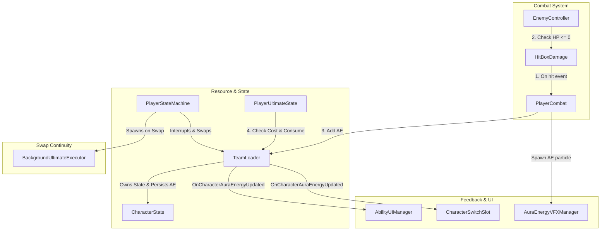

# Architecture Plan: Refactor Ultimate System to Aura Energy

This document details the software architecture, interfaces, and data flow for refactoring the player Ultimate ability from a time-based cooldown system to an **Aura Energy (AE)** resource-gated system.

---

## 1. System Diagram



---

## 2. Interface Definitions

### A. Core Aura Energy Management (`ITeamEnergySystem.cs`)
```csharp
using System;

public interface ITeamEnergySystem
{
    /// <summary>Gets current Aura Energy of the character.</summary>
    float GetCharacterCurrentAE(CharacterObject character);

    /// <summary>Gets max Aura Energy of the character.</summary>
    float GetCharacterMaxAE(CharacterObject character);

    /// <summary>Sets current Aura Energy directly.</summary>
    void SetCharacterCurrentAE(CharacterObject character, float value);

    /// <summary>Adds AE to the character, capped at Max AE.</summary>
    void AddCharacterAE(CharacterObject character, float amount);

    /// <summary>Gets the dynamic Ultimate cost scaled by Cooldown Reduction (CDR).</summary>
    float GetUltimateCost(CharacterObject character);

    /// <summary>Fires when character energy values change. (character, currentAE, maxAE)</summary>
    event Action<CharacterObject, float, float> OnCharacterAuraEnergyUpdated;
}
```

### B. Background Execution (`BackgroundUltimateExecutor.cs`)
```csharp
using UnityEngine;
using CombatCore;

public class BackgroundUltimateExecutor : MonoBehaviour
{
    private AttackStepData ultimateStep;
    private int currentFrame;
    private int facingDirection;
    private CharacterStats castingStats;
    private GameObject visualClone;

    /// <summary>Initializes and starts the background ultimate simulation.</summary>
    public void Initialize(AttackStepData step, int startFrame, int facing, CharacterStats stats, Sprite characterSprite, RuntimeAnimatorController animatorController);
    
    /// <summary>Runs the deterministic physics and frame ticking logic.</summary>
    private void FixedUpdate();

    /// <summary>Processes hitboxes, spawns VFX, and applies damage formulas.</summary>
    private void ProcessLogicFrame(int frame, ActionPhase phase);

    /// <summary>Cleans up the executor and destroys the clone GameObject.</summary>
    private void Terminate();
}
```

---

## 3. Class Responsibility Table

| Class | Responsibility | Depends On | Owned State |
|-------|---------------|------------|-------------|
| `TeamLoader` | Persists individual character AE. Implements `ITeamEnergySystem`. | `CharacterObject`, `CharacterStats` | Current AE per character (`Dictionary`) |
| `HitBoxDamage` | Resolves hits deterministically; notifies player combat. | `EnemyController`, `PlayerCombat` | Hit target tracking per activation |
| `PlayerCombat` | Dispatches hit notification to TeamLoader. Triggers VFX. | `TeamLoader`, `PlayerCharacter` | Current active attack step and category |
| `PlayerUltimateState` | Validates AE cost before transition. Consumes AE on Active phase. | `TeamLoader`, `PlayerCharacter` | Casting state and active ultimate step |
| `AbilityUIManager` | Binds active character AE. Updates fill, glow, chime. | `TeamLoader`, `PlayerCharacter` | Last known AE value (for chime trigger) |
| `CharacterSwitchSlot` | Displays benched characters' simplified AE fill meters. | `TeamLoader`, `CharacterObject` | Bound character reference |
| `BackgroundUltimateExecutor` | Simulates and finishes active frames of swapped-out character. | `HitBoxDamage`, `AttackStepData` | Current frame and visual state |
| `CharacterStats` | Defines progression stats for maximum AE and AE generation multiplier. | None | Max AE, AE multiplier, CDR |

---

## 4. Data Flow

### A. AE Gain Flow
1. **Hit Event:** `HitBoxDamage.ProcessHit(EnemyController enemy)` detects a collision.
2. **Defeat Evaluation:** Checks enemy health status before and after impact.
3. **Probability Resolution:** 
   - Enemy Defeated: 100% chance to generate AE.
   - Enemy Survived: 20% chance to generate AE.
4. **Calculations:** Energy amount = `10f * auraEnergyMultiplier`.
5. **State Update:** `TeamLoader.AddCharacterAE()` updates state and raises `OnCharacterAuraEnergyUpdated`.
6. **VFX & UI:** Spark trail flies to HUD; fill meters scale and update.

### B. Team Swap during Ultimate
1. **Swap Request:** Player presses a character swap key while active character is in `PlayerUltimateState`.
2. **Spawn Executor:** FSM detects current state is `PlayerUltimateState`. Spawns `BackgroundUltimateExecutor` at player position.
3. **Visual Transfer:** Copies current sprite, animator state, and facing direction to executor.
4. **Logic Transfer:** Transfers current frame, remaining active frames, hitboxes, and stats to executor.
5. **Active Character Swapped:** Active character is immediately replaced on the main Player GameObject.
6. **Background Resolution:** Executor runs its own frame ticking, deals damage, and destroys itself when done.

---

## 5. Authority Decisions

| Decision | Choice | Rationale |
|----------|--------|-----------|
| **AE State Ownership** | Persistent `TeamLoader` | Keeps AE preserved during character swaps; prevents memory loss on despawn. |
| **Ultimate Cost Scaling** | `Base Cost (100) * (1.0 - Min(0.5, CDR * 0.5))` | Translates Cooldown Reduction into a dynamic cost mitigation mechanic. |
| **Energy Cap Upgrades** | Dynamic scaling from `CharacterStats` | Adapts HUD fills seamlessly to progressive upgrades without code modifications. |
| **Cast Consumption Phase** | First frame of the **Active Phase** | Ensures AE is not consumed if interrupted during the Startup (wind-up) phase. |
| **Super Armor & i-frames** | Active phase frames | Grants physical reaction immunity and invincibility during damage delivery. |

---

## 6. Affected Systems

- **`Assets/Project/Scripts/Character/CharacterStats.cs`**
  - Add `public float maxAuraEnergy = 100f;`
  - Add `public float auraEnergyMultiplier = 1f;`
- **`Assets/Project/Scripts/Systems/TeamLoader.cs`**
  - Implement `ITeamEnergySystem`.
  - Maintain runtime dictionary of current AE values.
  - Implement dynamic Ultimate cost evaluation based on CDR.
- **`Assets/Project/Scripts/Systems/PlayerCharacter.cs`**
  - Add flags `IsUltimateInvulnerable` and `HasSuperArmor`.
  - Update `TakeDamage` to check these flags to skip hitstun or damage.
- **`Assets/Project/Scripts/Combat/HitBoxDamage.cs`**
  - Modify hit resolution to calculate and report kills/hits to player combat.
- **`Assets/Project/Scripts/Combat/PlayerCombat.cs`**
  - Implement `NotifyEnemyHit(EnemyController enemy, bool wasDefeated)`.
  - Trigger particle VFX spawning toward UI HUD coordinates.
- **`Assets/Project/Scripts/Player/States/PlayerUltimateState.cs`**
  - Replace cooldown checks with AE cost validations.
  - Consume AE and apply i-frame/Super Armor flags on entering Active phase.
  - Clear i-frame/Super Armor flags on Exit.
- **`Assets/Project/Scripts/Player/UI/AbilityUIManager.cs`**
  - Adapt circular ultimate meter to represent AE fill relative to max AE.
  - Bind to `OnCharacterAuraEnergyUpdated` to update fill, ready glow, and ready chime.
- **`Assets/Project/Scripts/Player/UI/CharacterSwitchSlot.cs`**
  - Bind benched character fill meter to `OnCharacterAuraEnergyUpdated`.
- **`Assets/Project/Scripts/Combat/BackgroundUltimateExecutor.cs` (New)**
  - Create to manage background rendering and combat ticks for swapped-out characters.

---

## 7. ADR Link

All architecture decisions and trade-offs are documented under **[ADR-001](../ADRs/001-aura-energy-resource-gated-ultimate.md)**.
