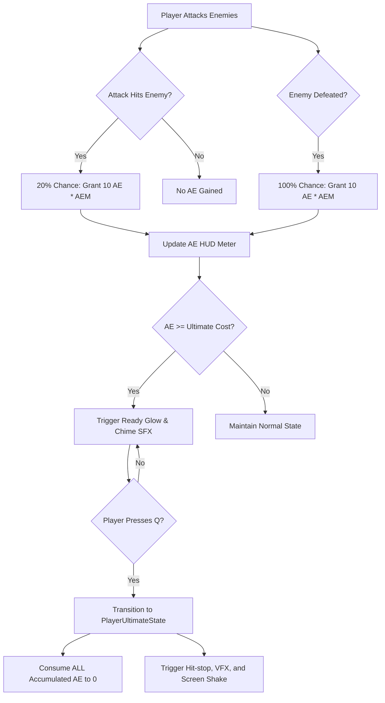

# Design Spec: Refactor Ultimate System to Aura Energy

This specification documents the transition of the Ultimate ability from a time-based cooldown system to an **Aura Energy (AE)** resource-gated system, as defined in the task card.

---

## 1. Player Experience Description

- **Visuals:**
  - The player sees a circular HUD fill meter (filling bottom-to-top) for their active character's Aura Energy.
  - Backup (benched) characters have smaller, simplified circular meters on their HUD portraits.
  - Hitting or defeating enemies releases glowing blue-white energy particles that fly to the HUD portrait.
  - When Aura Energy reaches the cost threshold, the meter flashes and begins pulsing with a vibrant glow.
  - Activating the Ultimate desaturates the screen, triggers a screen freeze (hit-stop), and releases a massive VFX shockwave.

- **Audio:**
  - Hitting enemies triggers low-pitched metallic suction whooshes as energy particles are absorbed.
  - Reaching maximum capacity triggers a bright, high-pitched crystal chime signaling readiness.
  - Activating the Ultimate plays a heavy sub-bass drop followed by a crisp, high-impact elemental explosion.

- **Feel (Juice):**
  - Gaining energy feels active, responsive, and directly tied to aggression rather than waiting on timers.
  - Pressing the Ultimate key feels like releasing stored kinetic potential, creating a brief moment of immense weight.

---

## 2. Interaction Flow

> [!NOTE]
> The Ultimate Cost is calculated as `Base Cost (100 AE) * (1.0 - Math.Min(0.50f, CDR * 0.50f))`.
> This means a character with 100% CDR (Cooldown Reduction Mastery) gets a maximum 50% cost reduction, casting at 50 AE.

---

## 3. Feedback Loops

| Trigger | Visual | Audio | Timing |
|:---|:---|:---|:---|
| **AE Gained (Hit/Kill)** | Spark trail flies from enemy to HUD portrait; meter scales up slightly. | Low metallic suction whoosh. | 0.25s linear travel. |
| **Ultimate Ready Threshold** | Portrait border glows golden-blue; progress circle pulses with energy flames. | Clear crystal chime (non-diegetic). | Infinite 1.2s pulse loop. |
| **Ultimate Cast (Q)** | Screen color desaturates; screen shake starts; weapon VFX slash expands; camera zooms in. | Heavy sub-bass drop followed by a sharp explosion slash. | 0.15s hitstop; 0.4s shake. |
| **Failed Cast (Not Ready)** | Circular HUD meter flashes red twice. | Dull reject buzz sound. | 0.2s duration. |

---

## 4. Juice Specification

## Juice Spec: Aura Energy Ultimate System

### Visual Feedback
- Screen shake: intensity 0.35, duration 0.4s, curve Sine Out (on Ultimate trigger)
- Screen flash: desaturation overlay, duration 0.15s, fast fade-in, slow fade-out
- Particle effects: 15-particle radial emitter, cyan/gold color gradient, lifespan 0.3s
- UI animation: Spring-damping scale bounce on energy gain; ready pulse at scale 1.05 (1Hz)
- Camera: Zoom-in (field of view 60 to 50, speed 0.1s) returning to normal over 0.5s recovery

### Audio Feedback
- SFX: Pitch-modulated energy suction (1.0 to 1.2 pitch), crystal chime at 0dB, sub-bass drop (40-60Hz)
- Music: Temporary background volume ducking (-6dB) during 0.15s hitstop

### Physical Feedback
- Haptics: AE Gain (rumble, 0.05s, 0.1 intensity); AE Ready (heartbeat thump, 0.15s, 0.3 intensity); Ultimate Cast (heavy rumble, 0.5s, 0.9 intensity)

### Timing
- Input buffer: 12 frames (prioritized input caching)
- Coyote time: N/A (FSM delegates to underlying movement states)
- Hitstop: 9 frames (0.15s at 60 FPS) on active hit frames
- Recovery: 24 frames (0.4s) before normal combat inputs resume

### Reference
- Similar to: *Blazblue Entropy Effect* ultimate burst presentation
- Mood: High-impact, explosive, tactile, arcade-like reward loops

---

## 5. Edge Cases

- **Spamming input before AE is ready:**
  - The input buffer discards the input if AE is below the calculated cost.
  - The HUD meter flashes red and plays a reject buzz to prompt player correction.
- **Team Swap Cancel mid-Ultimate:**
  - The casting character finishes their Ultimate action in the background, consuming their AE, then de-spawns.
  - The swapped-in character immediately takes the field, inheriting the input buffer state with their own individual AE meter.
- **Interruption during Ultimate activation:**
  - The FSM grants **Super Armor + Invulnerability (i-frames)** during active frames of the Ultimate.
  - If a specific enemy attack interrupts the wind-up state, the Ultimate is cancelled and AE is **not** consumed.
- **Low Framerates:**
  - AE chance checks must run on hit events, not update ticks, preventing framerate-dependent energy generation.
- **Benched character upgrades:**
  - When team-wide progression upgrades increase the Max AE cap, benched characters are updated dynamically in memory.
  - If a benched character has 100/100 AE, and an upgrade increases Max AE to 120, their HUD portrait reflects 100/120 AE.

---

## 6. GDD Alignment Check

- **Fulfills Section:** `@tag:combat` (Ultimate pacing, UI indicators, and swap rules).
- **Fulfills Section:** `@tag:platform-input` (PC Keyboard & Mouse as authoritative input, Q to cast Ultimate, 12-frame buffer).
- **Experience Pillars Alignment:**
  - *Fast-paced Hack & Slash:* Replaces passive cooldown waiting with aggressive combat-driven rewards.
  - *Rogue-lite Mechanics:* Connects character stats (CDR, AEM, Max AE) directly to progression and Soul Shop upgrades.

---

## 7. Playtest Checkpoints

- **Playtest Objective:** Assess the visual readability and pacing of the AE acquisition loop.
- **What to look for:**
  - Verify if the 20% hit chance feels rewarding or if it requires a pseudo-random distribution to feel consistent.
  - Confirm the ready chime and glow are noticeable during high-density combat scenes.
  - Ensure swapping characters does not lose, corrupt, or cross-wire individual character AE stats.
- **What to listen for:**
  - Ensure the "Ultimate Ready" chime clearly cuts through the ambient track and impact effects.
  - Verify that the volume ducking on cast properly isolates the bass drop and impact explosion sounds.
