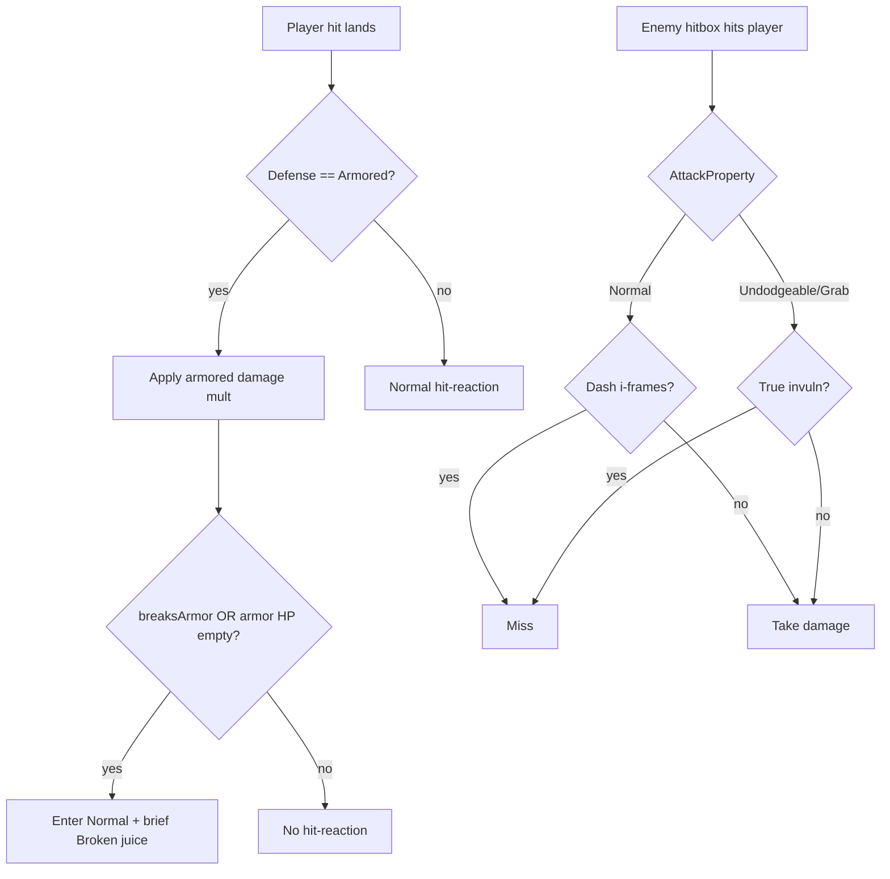

# Design Spec: BBEE-Style Trash Enemy Defense

GDD: `@tag:bosses` (readable tells) + content archetype goals (trash / shield)

## Player Experience

Rooms mix **juggle trash** with occasional **armored walls**. Most swings are dash-dodgeable. Rare swings show a stronger tell and ignore dash i-frames, teaching jump / reposition / true invuln.

Loop for armored trash: **chip or armor-break hit → stagger opens → clear**.

## Interaction Flow

## Juice

- Armored: orange sprite tint while active
- Break: short white flash (existing flash pipeline)
- Undodgeable telegraph: purple warning icon tint

## Edge Cases

- Bosses with `ignoreHitReactions` keep working; trash armor is separate opt-in
- `startArmored = false` (default) = legacy trash feel
- Separate damage / DOT still applies HP without forcing break unless configured later
- Grab property uses same gate as Undodgeable for MVP (no separate grab absorb yet)

## Out of Scope

Boss scripted Break, phase gimmicks, new prefab content authoring.
