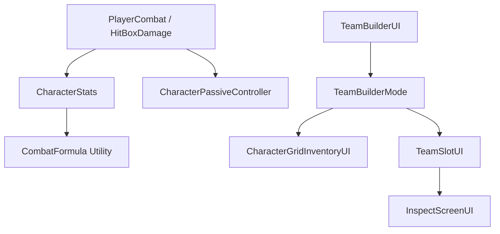

# Architecture Plan: Combat Stats and UI Refactoring

## 1. System Diagram


## 2. Interface Definitions
```csharp
public static class CombatFormula
{
    public static float CalculateOutgoingDamage(float baseAttack, float actionMultiplier, float critRate, float critDmg, float skillMastery, float dmgMastery, bool isSkillOrUlt);
    public static float CalculateIncomingDamage(float incomingDamage, float defense, float damageRes);
}

public enum TeamBuilderMode
{
    SafeZone, // Interactive (Team Builder)
    CombatZone // Read-Only (Normal Team Data)
}
```

## 3. Class Responsibility Table
| Class | Responsibility | Depends On | Owned State |
|-------|---------------|------------|-------------|
| `CharacterStats` | Data struct holding 9 combat stats. | None | Stats values |
| `PlayerCharacter` / `EnemyController` | Facade for character data; reads stats into runtime fields. | `CharacterStats` | Runtime HP |
| `HitBoxDamage` / `PlayerCombat` | Executes damage calculation utilizing attacker/defender stats. | `CharacterStats`, `CombatFormula` | Hit states |
| `TeamBuilderUI` | Manages UI modes (SafeZone vs CombatZone) and triggers pause. | `TeamLoader`, `InputManager` | Current UI Mode |
| `InspectScreenUI` (New) | Displays detailed stats, passives, and potentials when a slot is clicked. | `CharacterObject` | Selection state |

## 4. Data Flow
**Damage Calculation Flow**:
```text
Combat Action Triggered 
  → Fetch Attacker Stats (ATK, CRIT, Mastery) 
  → CombatFormula.CalculateOutgoingDamage() 
  → Pass output to Target `TakeDamage()` 
  → Target invokes CombatFormula.CalculateIncomingDamage() (using DEF & DMG Res) 
  → Final HP reduced.
```

**UI Mode Flow**:
```text
Toggle UI Input 
  → Check Current Zone (Safe vs Combat) 
  → Set TeamBuilderMode in TeamBuilderUI 
  → Freeze Time (Time.timeScale = 0) & Duck Audio 
  → Update TeamSlotUI lock states & hide/show Grid 
  → Swap Input Action Map to UI.
```

## 5. Authority Decisions
| Decision | Choice | Rationale |
|----------|--------|-----------|
| State ownership | `CharacterStats` (SO) / `PlayerCharacter` (Runtime) | Base stats live in data, current HP/buffs live on the runtime instance. |
| UI Mode Switching | `TeamBuilderUI` Controller | The root UI component should dictate the interactability of its children (slots/grid). |
| Damage Calculation | Shared `CombatFormula` class | Keeps math consistent between Player and Enemy, preventing divergent logic. |

## 6. Affected Systems
- **Scripts Needing Modification**:
  - `CharacterStats.cs`: Add new stats fields (SPD, CDR, CRIT, CRIT dmg, SKILL Mastery, DMG Mastery, DMG Res).
  - `PlayerCharacter.cs`: Adapt to new stats, pass SPD to `PlayerMovement`.
  - `PlayerCombat.cs` / `HitBoxDamage.cs`: Implement new damage formula.
  - `TeamBuilderUI.cs`: Add Mode logic, pausing, audio ducking.
  - `TeamSlotUI.cs`: Handle locked state wiggles and click-to-inspect.
- **Scripts Needing Creation**:
  - `InspectScreenUI.cs`: Manages the new 3-panel detailed view.
  - `CombatFormula.cs`: Centralizes math calculations.
