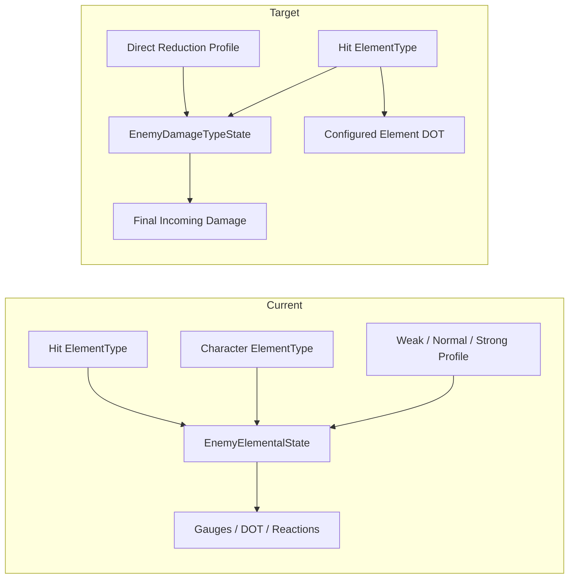

# Impact Analysis: Damage-Type Resistance Simplification

## One-Sentence Goal

Replace character affinity and enemy gauge/reaction state with hit-owned damage
types and a stateless, explicit enemy reduction lookup.

## Current and Target Architecture

## Recommended Authority Decisions

| Decision | Choice | Rationale |
| --- | --- | --- |
| Damage-type authority | The hit payload owns `ElementType`. | Preserves authored hit behavior and supports the later type rename. |
| Resistance authority | Enemy profile owns static per-type values. | Keeps enemy tuning data-driven and inspectable. |
| Runtime component | Rename `EnemyElementalState` to `EnemyDamageTypeState`, preserving its `.meta` GUID. | Keeps direct reduction and active DOT debuffs together while removing gauges/reactions; minimizes prefab breakage. |
| Physical mapping | `ElementType.None` maps to Physical reduction. | Preserves the enum until the later hit-damage-type migration. |
| Mitigation order | Base damage → DEF → general Damage Reduction → type reduction → runtime incoming modifiers. | Keeps existing DEF behavior and makes the new profile a distinct layer. |
| Elemental Mastery | Keep hit-based scaling for non-Physical damage. | The request removes character affinity, not hit damage typing. |
| Dynamic resistance debuffs | Migrate them to the existing damage-input/runtime-effect pipeline if retained. | Gauge state should not survive merely to host modifiers. |

## Class Responsibility Table

| Class | Current Responsibility | Target Responsibility |
| --- | --- | --- |
| `CharacterObject` | Character identity, role, stats, and elemental affinity. | Character identity, role, and stats only. |
| `HitboxBase` / `HitReactionData` | Authored/resolved hit damage type. | Unchanged. |
| `EnemyElementalProfile` | Strength, resistance, and outgoing mastery by element. | Direct incoming reduction for Physical and each retained hit type. |
| `EnemyElementalState` | Gauges, DOTs, reactions, static resistance, and runtime element modifiers. | Replaced by `EnemyDamageTypeState`, containing profile lookup, runtime reduction modifiers, and standalone DOT debuffs only. |
| `EnemyController` | Applies resolved damage and delegates elemental modifiers. | Delegates one type-reduction pass; no gauge/reaction API. |
| `HitBoxDamage` | Resolves primary/additional damage and feeds elemental state. | Resolves damage and applies type reduction; no gauge/reaction recording. |
| `EnemyAttackHitbox` | Modifies enemy outgoing damage against character affinity. | Deals authored enemy attack damage without character-affinity lookup. |
| Character/team/shop UI | Displays character affinity and role. | Displays role only; hit damage types remain in skill/damage UI. |
| `CharacterPassiveController` | Applies gauge/resistance/mastery modifiers and affinity-target filters. | Removes gauge modifiers and affinity-target filters; retained damage-type debuffs use runtime damage input. |

## Planned File Operations

### Preserve and Modify

- `Assets/Project/Scripts/Combat/Elements/ElementType.cs`
- `Assets/Project/Scripts/Combat/Elements/ElementDatabase.cs`
- `Assets/Project/Scripts/Combat/Elements/ElementDefinition.cs`
- `Assets/Project/Scripts/Combat/Elements/EnemyElementalProfile.cs`
- `Assets/Project/Scripts/AIBehaviour/EnemyController.cs`
- `Assets/Project/Scripts/Combat/HitBoxDamage.cs`
- `Assets/Project/Scripts/Combat/EnemyAttackHitbox.cs`
- `Assets/Project/Scripts/Character/CharacterObject.cs`
- `Assets/Project/Scripts/Character/CharacterProgressionDefinition.cs`
- `Assets/Project/Scripts/Combat/CharacterPassiveController.cs`
- `Assets/Project/Scripts/Systems/TeamLoader.cs`
- Character/shop/team UI scripts that display `CharacterObject.elementType`
- Kyo's `CharacterObject_Kyo.asset`
- `EnemyElementalProfile_Dummy.asset`
- `EnemyCore.prefab`

### Rename While Preserving `.meta`

- `EnemyElementalState.cs` → `EnemyDamageTypeState.cs`

### Delete After Approval

- `ElementalGauge.cs`
- `IElementalReaction.cs`
- `ElementalReactionFactory.cs`
- `MemoryReaction.cs`
- `EchoReaction.cs`
- `AshReaction.cs`
- `VoidReaction.cs`

The matching `.meta` files must be removed with each deleted script. No deletion
occurs before the human checkpoint.

## Serialized-Data Impact

- Seven active character assets currently serialize a top-level `elementType`.
- Two Kyo runtime effects actively use `filterByTargetElement`.
- One Kyo node actively authors an Ash gauge-build modifier.
- One enemy profile asset currently uses the legacy resistance-list schema.
- `EnemyCore.prefab` contains the only discovered `EnemyElementalState`
  component reference; its profile is currently null.
- Hitbox/action/runtime-effect `elementType` fields remain untouched.

## Migration Sequence

1. Add regression tests for DEF plus type reduction and for absence of reactions.
2. Introduce direct profile reductions and `EnemyDamageTypeState`.
3. Update primary, additional, and background damage paths to use one reduction pass.
4. Replace gauge-driven DOT with `ElementDefinition`-configured standalone DOT.
5. Remove all gauge/reaction calls and runtime state.
6. Remove character affinity and affinity-target filters from code/UI.
7. Apply the approved Kyo content migration.
8. Remove obsolete reaction scripts and serialized profile fields.
9. Update GDD and tests.
10. Compile in Unity, inspect console, and validate prefabs/assets for missing scripts.

## Regression Surface

- Melee, projectile, background-Ultimate, and Additional Damage paths.
- Runtime effects that ignore DEF, damage resistance, or elemental modifiers.
- Damage-number type/color resolution.
- Character grid, shop grid, team slots, Potential panel, and visual panel.
- Enemy attacks against players.
- Kyo team buffs and skill upgrades.
- Serialized prefab and ScriptableObject references.

## Approved Human Decisions

1. Reduction values are percentage points in the `0–95` range and apply after
   DEF/general Damage Reduction.
2. Former Ash-only Kyo ally effects become all-ally effects.
3. Gauges and reactions are removed.
4. DOT remains independent of gauges and is configured per `ElementDefinition`;
   Memory, Echo, Ash, and Void all apply DOT.
