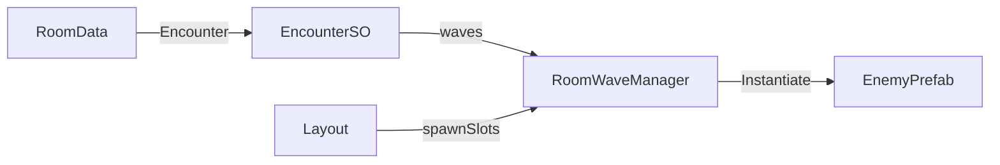

# Architecture Plan: EncounterSO + Layout Spawn Slots

## Decision

- `EncounterSO` owns wave composition (`enemyPrefab` + `spawnSlotIndex`).
- `RoomData.Encounter` references the encounter for that room.
- Layout keeps `Transform[] spawnSlots` on `RoomWaveManager` (`Spawn_0..N` / `BossSpawnPoint`).
- If Encounter is null, keep Inspector `waves` as migration fallback.

## System diagram

## Responsibilities

| Class | Responsibility |
|-------|----------------|
| `EncounterSO` | Authored waves and inter-wave delay |
| `RoomData` | Optional encounter reference |
| `RoomWaveManager` | Trigger, resolve source, spawn, clear / boss flow |
| Layout prefab | World positions via spawn slot Transforms |

## Data flow

1. Layout mounts → `RoomLayoutHost.ActiveRoom` set
2. Player hits encounter trigger → `StartEncounter`
3. Resolve Encounter from ActiveRoom
4. Build runtime spawn list (slot index → Transform)
5. Existing clear / boss path unchanged

## Files modified / added

- Add `Assets/Project/Scripts/Core/ZoneState/EncounterSO.cs`
- Modify `RoomData.cs`, `RoomWaveManager.cs`
- Add `Assets/Project/Resources/EncounterSO/*.asset`
- Wire RoomData + clear layout Inspector waves / set spawnSlots
- ADR 007
