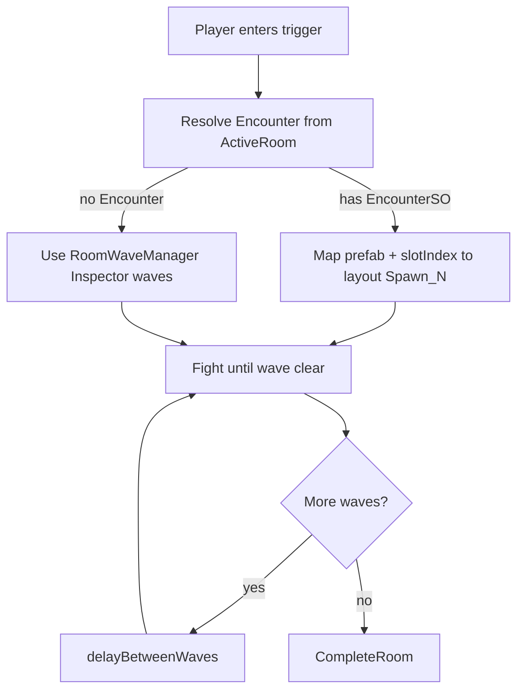

# Design Spec: Data-Driven Encounter Spawn

## Player experience

Entering a combat room still feels the same: walk into the encounter trigger → enemies appear at familiar positions → clear wave → short pause → next wave → room clear unlocks exits (or boss death flow).

What changes for creators: enemy composition lives on an Encounter asset per room, so tuning waves does not require digging into layout prefab wave arrays.

## Interaction flow

## Juice

No new combat juice. Existing clear / boss death presentation unchanged.

## Edge cases

- Missing or out-of-range `spawnSlotIndex` → skip entry + warn
- Prefab without `EnemyController` → skip + warn
- Empty Encounter waves → treat as immediate clear (same as empty Inspector waves)
- No `ActiveRoom` (orphan layout) → Inspector fallback

## GDD alignment

Supports CombatRoom spawn → clear contract with authored Monster Waves. Random generation remains future work.
