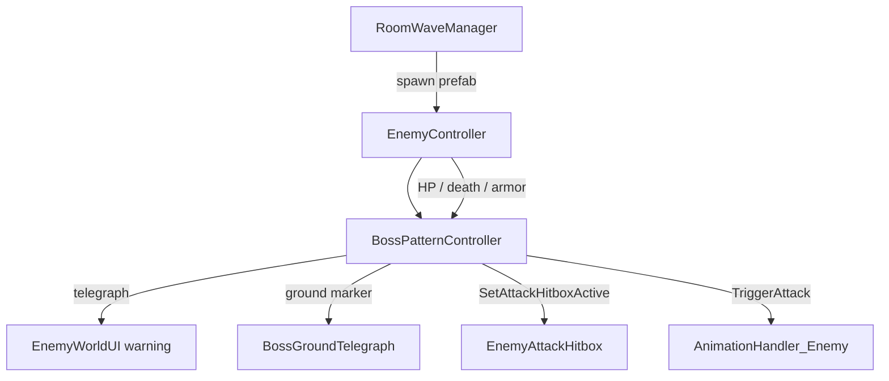

# Architecture Plan: Executioner Boss MVP

## Decision

Boss AI is driven by a dedicated **`BossPatternController`** on the boss prefab.
Trash enemies keep Unity Behavior Graph unchanged.

Boss disables `BehaviorGraphAgent` while the pattern controller owns detect / chase / patterns.

## System Diagram

## Responsibilities

| Class | Responsibility |
|-------|----------------|
| `EnemyController` | HP, damage, death, hitbox toggle, warning, `ignoreHitReactions` |
| `BossPatternController` | Phase, pattern pick, chase, telegraph/active/recovery coroutines |
| `BossGroundTelegraph` | World-space landing marker for Jump Smash |
| `EnemyAttackHitbox` | Apply `attackDamage` to player (unchanged) |
| `RoomWaveManager` | Spawn boss prefab as one wave (unchanged) |

## Data Flow

1. Room trigger → spawn boss → `BossPatternController` starts loop
2. Acquire Player tag target → chase if out of cleave range
3. Pick pattern by phase + distance
4. Armored telegraph → active hitbox window → recovery (or phase-2 chain)
5. On HP ≤ 50% flip to phase 2
6. On death: cleanup + existing `EnemyController.Die`

## Existing Scripts Modified

- `EnemyController.cs` — add `ignoreHitReactions` gate for boss armored windows
- `AnimationHandler_Enemy.cs` — optional pattern triggers with Attack fallback

## Prefab Contract

Duplicate `EnemyCore` → `Boss_Executioner`:

- Stats: HP 800, ATK 150, DEF 500, `isEliteOrBoss`
- Add `BossPatternController` + `BossGroundTelegraph`
- Disable or leave BehaviorGraphAgent (controller disables it at runtime)
- Size body collider larger; cleave / smash / charge hitbox refs optional
