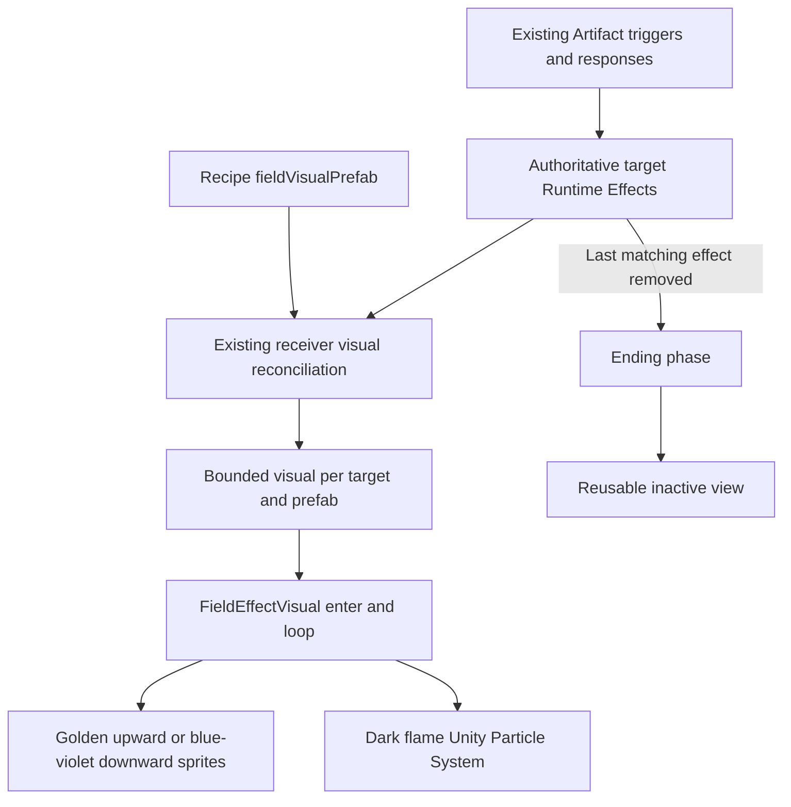

# Architecture Plan: Field Effect Visual Feedback

## Scope and Existing Authority

Implement the revised design using the existing Runtime Effect field visual slots. Keep combat, stat formulas, Artifact triggers, recipients, stacking, and durations unchanged. This is a presentation extension of ADR-002, ADR-004, and ADR-010, with no replacement gameplay authority or new dependency.

Current `RuntimeEffectReceiver` owns visuals per effect instance. `SyncVisuals` reconciles a supplied list, and `EnsureVisual` instantiates `presentation.fieldVisualPrefab`. `DestroyVisual` currently destroys immediately. Player presentation uses the receiver's existing synchronization of deployed effects; enemy effects use local state. Reuse these paths rather than deriving target state from wearer-only Artifact activation notifications.

## Proposed Data Flow



## Class Responsibilities

| Class / asset | Responsibility | Owned state |
| --- | --- | --- |
| Existing `RuntimeEffectReceiver` | Resolve prefab from actual effect; retain existing instance-to-view associations; reuse new field views by prefab; release only after last same-prefab owner is removed. | Presentation ownership and bounded reusable views on that receiver; no new effect state. |
| New `FieldEffectVisual` | Cache target sprite/renderer references, size and sort the view, run enter/loop/ending, support restarting an ending view, and clear on teardown. | Visual phase, elapsed animation time, cached renderers/particle systems. |
| New `FieldEffectVisualAssetCreator` editor utility | Bake shared procedural chevron/flame textures, materials, and three prefabs; assign only the four requested recipe presentation fields. | Editor authoring only. |
| Existing `ArtifactPhase1AssetCreator` | Preserve the authored field visual assignments when recreating Phase-1 content. | Existing content authoring; no gameplay changes. |
| Three field visual prefabs | Inspector-tunable styles, colors, geometry, particle settings, phase durations, and opacity. | Presentation settings only. |

Keep the existing prefab behavior for visuals without the new component. Only the new field views opt into phased release and shared presentation footprint.

## Lifecycle Contract

Proposed `FieldEffectVisual` operations:

```csharp
void Begin(Transform target, SpriteRenderer referenceSprite);
void End();
void ClearImmediately();
bool IsFinished { get; }
```

- `Begin`: enter from inactive, or resume the same bounded view from ending. Refreshing a retained effect does not restart the entry burst.
- `End`: cease chevron generation/looping; for dark flames call `StopEmitting`, allowing already-live particles to finish. Do not delay gameplay expiry.
- `ClearImmediately`: stop and clear particles and cancel visual animation for death, disable, destruction, or scene teardown.
- Same-style view reuse is keyed by prefab within a receiver. Effect identities, stacks, and timers stay independent in their existing containers. Bounded dictionaries/lists are reused and never rebuilt every animation frame.
- On disable, clear visible views without changing active effects. On re-enable or character swap, reconcile the actual current effect list through existing synchronization.
- Preserve compatibility with legacy visuals that rely on `OnDestroy`; they continue their existing destruction path.

## Rendering and Animation

- Chevron prefab: three small procedural sprites with golden glow and short trails, or blue-violet downward equivalents. Shared baked assets avoid runtime texture/material creation per target. Animate with cached renderers and scaled time in an active coroutine, not effect-list polling.
- Flame prefab: Unity `ParticleSystem`, using a baked tapered flame texture with charcoal body and violet rim. Use local simulation to follow the target and sprite-relative sizing, a bounded emission rate, size/color-over-lifetime, and modest curl. Keep maximum live count and lifetime from the design's starting values.
- Use an alpha-blended material compatible with the installed URP 2D renderer. Inspect the actual project shader/material before asset creation; create separate field materials rather than changing the existing enemy-lifecycle material.
- Cache the target sprite renderer once on binding. Follow existing sorting layers and the sprite's current bounds so player skin changes and enemy scale do not cause excessive coverage. Keep vertical travel independent of facing flips.
- No camera bloom, scene lighting changes, VFX Graph requirement, animation controller edits, or new packages.
- Pool the three new views within their target receiver, reuse them on refresh/reapplication, and destroy them with the receiver. Flame emission and render animation run only while active or ending. Profile crowd behavior before claiming a performance budget.

Unity's [StopEmitting API](https://docs.unity3d.com/6000.0/Documentation/ScriptReference/ParticleSystemStopBehavior.StopEmitting.html) stops new particles while existing ones finish their lifetime. The installed project already uses `ParticleSystem`, particle modules, and sprite-relative renderer sorting in `EnemyLifecycleVFX`; no package installation is required.

## Artifact Wiring

| Recipe identity | Field prefab | Recipients and lifetime authority |
| --- | --- | --- |
| `P1-A01-TOXIC` | `FieldDarkFlame` | Saved `Allies` targeting, including wearer; 10s authored gameplay duration. |
| `P1-A02-ATK` | `FieldPowerUp` | Existing ally ATK effects; saved 4s refreshed stacking buff. |
| `P1-A05-AFFLICTION` | `FieldPowerDown` | Existing affected room enemies; indefinite until gameplay removal/teardown. |
| `P1-A07-SUPPORT` | `FieldPowerUp` | Existing incoming-character support; 10s authored gameplay duration. |

Do not attach another duration loop to `ArtifactPassiveFeedbackEvents.Activated`: it reports the activating runtime/rule, whereas these loops belong to actual recipients. Existing Artifact trigger execution already supplies the sequence entry via effect application.

## Intended Files

- Modify `Assets/Project/Scripts/Combat/RuntimeEffectReceiver.cs` for opt-in phased view release/reuse and lifecycle cleanup.
- Create `Assets/Project/Scripts/Combat/FieldEffectVisual.cs`.
- Create `Assets/Project/Scripts/Editor/FieldEffectVisualAssetCreator.cs`.
- Modify `Assets/Project/Scripts/Editor/ArtifactPhase1AssetCreator.cs` to retain recipe visual assignments.
- Add three prefabs and shared textures/materials under `Assets/Project/Resources/FieldEffects/`.
- Modify presentation fields only in the four Phase1 PassiveSet assets for Ribbon, Mask, Shard, and Shroud.
- Add focused lifecycle tests under `Assets/Project/Scripts/Editor/Tests/` and the feature test plan/DevLog.
- Inspect player synchronization during implementation; change it only if a verified lifecycle gap prevents current effects from being restored on enable/swap, and document that correction.

## Validation

1. Compile in the connected Unity Editor and check console errors.
2. Test two same-style effect owners, removal of one owner, final removal, refresh at maximum stacks, and reapply during ending.
3. Verify particle emission stops on normal expiry; remaining live flames fade, while disable/death clears them immediately.
4. Run relevant existing Artifact/runtime-effect tests without changing gameplay numbers.
5. Preview every style on both target types, then trigger all four actual Artifact sequences and verify visible recipients across swaps.
6. Check pause, facing flips, sprite changes, scaled enemies, scene unload, and repeated enable/disable.
7. Compare console and gameplay state before/after; record actual results and limitations. In-game visual feel remains the final human review.

## Checkpoint

Approved by the project owner with “LGTM” in chat on 2026-10-14. Implementation may proceed. Existing ADR authorities are preserved; no new gameplay architecture ADR is proposed for this presentation-only extension.

## Implementation Findings

- Player visual synchronization previously depended on a populated HUD status-icon container. The receiver now subscribes directly to existing team, character, and inventory effect events; the HUD remains a compatible caller.
- Saved Ribbon content used the legacy infusion response rather than the template's recipe. The targeted asset authoring utility migrates it to the existing supported infusion recipe, preserving its actual `Allies` target, damage type, and duration. A Toxic icon is also authored.
- Mask's saved recipe duration is 4s, despite the generator/trigger condition mentioning 3s. No duration or stat values were changed by the visual integration.
- Body collider bounds are preferred when available because several imported sprites contain large transparent margins. Cached renderer bounds remain the fallback; the isolated preview uses visible sprite footprints because preview scenes do not simulate body colliders.
- Chevron rendering uses the installed URP 2D unlit sprite shader. Dark particles use a separate simple alpha-blended URP material/shader. This avoids scene lighting changes and preserves 2D sprite batching compatibility.
