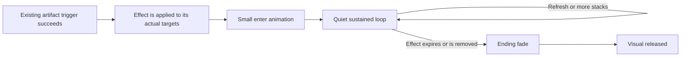

# Design Spec: Field Effect Visual Feedback

## Player Experience

Small moving shapes beside a combatant reveal whether they have gained power, lost power, or received Toxic. The sprite, enemy attacks, and impact feedback remain visually dominant. On 2026-10-14 the owner revised the direction to mimic the attached Genshin-style chevrons more closely and use Unity particles for dark flames. This replaces the initial faint-arrow/plum-wisp proposal; the original request for modest visual emphasis still governs density and sprite coverage.

Proposal storyboard: [field-effect-visual-feedback-storyboard.png](field-effect-visual-feedback-storyboard.png). This is a static design illustration, not an in-game screenshot or tested implementation.

## Current State and Design Authority

The four Artifact passives already exist. At intake, three saved Artifact recipes had empty `presentation.fieldVisualPrefab` slots; Ribbon still used a legacy infusion response. `RuntimeEffectReceiver` created field visuals and removed them immediately. Ending animation was therefore a new presentation requirement.

Implementation inspection found differences between saved content and its authoring template: Ribbon's saved target is `Allies` (including wearer), and Mask's saved recipe lasts 4s although its trigger condition/template mentions 3s. This visual feature preserves the saved targets and duration. Ribbon is migrated to the already-supported infusion recipe with the same target, element, and 10s duration, so its gameplay and visual share effect state.

GDD `@tag:combat` places presentation in Runtime Effect Recipes and retains team/run effects across swaps. GDD `@tag:items` explicitly defers implemented Phase-1 behavior to the approved Phase-1 design. Follow that design and the inspected assets rather than historical speculative passive descriptions.

ASSUMPTION: “Fiend Flesh Mark” refers to the existing Fiend-Flesh Mask (`ART-P1-002`).
IMPACT: Its ally ATK buff receives power-up feedback.
IF WRONG: The intended different Artifact needs identification before that integration.
VALIDATE: Owner can correct the name at this design checkpoint.

## Interaction Flow

## Visual Styles

All new numeric values below are **starting values**, subject to the readability tests below. Existing gameplay durations remain unchanged.

| Style | Enter | Loop | Ending |
| --- | --- | --- | --- |
| Power up / ATK up | Three golden chevrons with pointed tips, a bright center, soft amber halo, and short vertical trails emerge beside the lower torso over 0.22s. | Staggered upward travel resembling the reference; each chevron fades at the top and reappears low. Starting cycle: 1.3s. | Existing chevrons rise slightly farther and fade over 0.25s; no new ones appear. |
| Power down / DEF down | Three blue-violet chevrons use the same glow/trail treatment, flipped downward, entering beside the upper torso over 0.22s. | Staggered downward travel, the visual opposite of power-up. Starting cycle: 1.3s. | Chevrons drift downward and dissolve over 0.25s. |
| Dark aura / Toxic | A small burst of black-purple flame particles kindles around the feet and outer lower-body contour over 0.3s. | Unity Particle System emits sparse, tapered flames that rise, curl, shrink, and fade. Charcoal cores with violet rims remain readable against dark backgrounds. Starting particle lifetime: 0.45s; total live-particle cap: 12 per target. | Stop emission; existing flames shrink and fade naturally within their remaining lifetime, up to 0.45s. |

Starting loop opacity: 0.65 for chevron centers and 0.4 for dark flame bodies; the soft halo remains lower opacity. The golden center briefly brightens on entry. Size is proportional to target sprite bounds, with a clamp to keep boss visuals restrained. Keep flame emission primarily behind and at the sides of the lower body. No opaque fill across the face/torso. Keep shape and movement direction distinct so color is not the sole signal.

Use normal alpha blending for the dark flame body so it can appear dark; keep any brighter violet edge subtle. The brighter arrow appearance is local to the small chevrons and does not require scene-wide bloom. Procedural flame and chevron textures are permitted by the owner's initial request.

## Artifact Sequences

| Artifact / existing identity | Existing trigger and target | New visual sequence |
| --- | --- | --- |
| Blind's Boundless Ribbon / `ART-P1-001` | Wearer starts Ultimate; saved `Allies` target grants Toxic to the team, including wearer, for 10s. | Dark flames appear on actual affected visible allies. Off-field recipients retain their effect; their flames are shown when they become visible while Toxic is still active. Stop emission and fade on expiry/removal. |
| Fiend-Flesh Mask / `ART-P1-002` | Wearer's damaging Particle pulse gives allies a stacking ATK buff; saved recipe duration is 4s, maximum 10 stacks. | Power-up enters on affected visible allies. Further valid pulses refresh the same bounded visual rather than adding another three arrows per stack. End when the last relevant buff is gone. |
| Aura-Resonating Shard / `ART-P1-005` | Switching into wearer applies stacking Affliction to living room enemies. Existing recipe is indefinite, maximum 10 stacks. | Power-down enters on each actually affected enemy and continues while Affliction exists. Further stacks keep density bounded. Removal plays ending; enemy death cleans up immediately. Do not give it an invented fixed duration or apply it to later spawns that did not receive Affliction. |
| Shroud of Deprivation / `ART-P1-007` | Switching away from wearer gives incoming character ATK/Crit support for 10s. | Power-up enters on the incoming recipient and follows that character's active effect lifetime. Do not place the support visual on the outgoing wearer. |

Gameplay conditions and cooldowns remain those in existing content. A failed trigger produces no effect visual. Normal rolled Artifact stats do not automatically imply an active field effect.

## State and Lifecycle Rules

- Entry requires a successfully applied effect on a visible target.
- Sustain follows authoritative effect presence. Timers must not be duplicated in the visual.
- Refresh/stack events keep the active loop; they do not replay a large enter burst.
- Same-style effects share a bounded visual footprint; removing one cannot end it while another matching effect remains.
- Opposite styles can coexist with separated side positions. Toxic occupies the lower/back area.
- Pause freezes animation. Hitstun and attacking do not cancel an otherwise active effect.
- A character swap immediately clears old-recipient tails on the shared player object, then shows effects actually carried by the incoming character. Off-field effects retain existing gameplay lifetimes.
- On normal expiry or explicit removal, the ending animation can complete without delaying gameplay removal.
- Disable, death, destroyed target, scene unload, and full run teardown clean up immediately instead of leaving detached loops.
- Reapplication during an ending phase must return to an active bounded visual without leaving a second ending instance behind.
- Visuals use no gameplay resources, colliders, damage, or input locks.

## Feedback and Experience Filter

| Component | Evaluation |
| --- | --- |
| Clarity | Upward versus downward motion distinguishes buff/debuff; flame silhouettes distinguish Toxic. Enter/ending communicate onset and removal. |
| Motivation | Existing combat stat/infusion outcomes give the visual meaning; no new progression mechanic. |
| Response | Effects follow existing combat events and never delay input or resolution. |
| Satisfaction | Compact onset motion complements existing hits/actions and status HUD presentation. |
| Fit | Golden glow/trail chevrons follow the owner's reference; dark particle flames express Toxic while restrained density preserves the 2D combat silhouette. |

Retain existing action, hit, and status-HUD feedback. This request adds visual feedback; new audio assets and repetitive loop sounds are not proposed. Verify the existing HUD/action feedback as the complementary channel rather than treating new audio as a prerequisite.

## Readability and Tuning Test

Starting values above are accepted only after these checks:

1. New player / observer: identify power-up, power-down, and Toxic in at least 8 of 10 short demonstrations without instruction. If missed, strengthen direction/shape contrast before increasing brightness.
2. Crowd test: show all styles on a player and multiple enemies while attacks run. Character silhouette and attack telegraphs must remain identifiable in all observed moments. If obscured, reduce opacity, footprint, then count.
3. Entry/end test: an observer distinguishes onset and removal in at least 8 of 10 demonstrations. If missed, lengthen the phase slightly or increase travel; if distracting, lower peak opacity.
4. Stress: refresh stacks to their existing cap, rapidly swap, pause, reapply during ending, and destroy targets. No accumulating arrows/flames, leaks, stale recipients, or visual gameplay locks. Particle count never exceeds its cap; stopping emission lets live flames finish, while teardown clears them immediately.
5. Skill / abuse: skilled players use status visibility to select attacks and swaps; visual presence cannot change damage, stacking, cooldowns, or target eligibility.
6. Both targets: apply each style to a player and an enemy, including scaled sprites and facing changes. Travel stays vertical and sprite coverage stays restrained.

## Alignment and Checkpoint

Fulfills GDD `@tag:combat` and `@tag:items` using existing Phase-1 behaviors. Requires no new inputs on keyboard/mouse or controller.

The owner authorized the revised style direction in chat on 2026-10-14: mimic the Genshin reference and replace the dark aura with dark flames using Unity particles. Starting values still require final in-game feel review. The architecture plan is the next checkpoint under the implement-feature workflow Step 4. Runtime integration and compilation have not been performed in this design stage.
