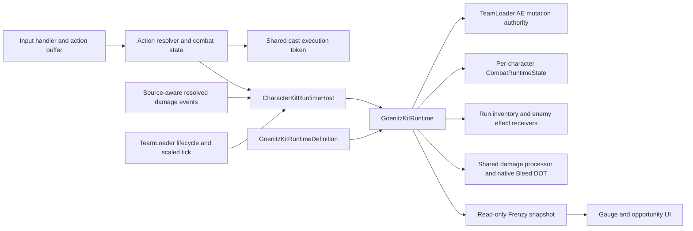

# Goenitz Kit Architecture Plan

Date: 2026-11-03. This is a proposed implementation contract, not implemented code. Design is approved by the user's LGTM and subsequent corrections. Approval of this plan and proposed ADR-020 is the remaining pre-implementation checkpoint.

## 1. Resulting Behavior

- Existing per-character AE is the only Frenzy fuel: 3 consumed per scaled combat second, also off-field; only classified kill extensions may add AE while active.
- Frenzy, its shared stat/Bleed package, Shin readiness and shared evasion have one source lifetime. Ending the mode removes those benefits immediately.
- Blizzard is a separate self recipe: one stack, 15 seconds, refresh on Goenitz Ultimate or limit-break use at Ultimate Lv.3, existing +10% package plus +10 ADI. It can outlast Frenzy and is not removed on damage.
- Kill reward is a separate self recipe: +3% clean-base ATK per stack, max 10, Forever, removed on actual damage. It persists through mode exit, swaps and room changes. Only Goenitz's kills qualify; Ultimate category is no longer required. At cap, eligible kills still restore 6 AE.
- Any Frenzy actor's positive primary hits apply the same +15% damage-taken debuff for 20 seconds at Goenitz Ultimate Lv.2. Recipient upgrades do not control this gate; the originating Goenitz's unlocked Potential does.

## 2. System Diagram and State Ownership



| Owner | Existing responsibility | Proposed addition / owned state |
|---|---|---|
| `CharacterObject` / kit definition | Immutable authored kit and Potential data | Optional runtime-definition reference; no mutable combat state. |
| `TeamLoader` | Per-character AE API, deployment, runtime stats, inventory reconciliation | Own/dispose one small runtime host; forward lifecycle and tick. Remain the only normal gameplay AE mutation authority. |
| `CharacterKitRuntimeHost` (new plain C#) | None | Registry of opted-in per-character runtimes, event subscriptions, lifecycle forwarding and read-only lookup. No damage formulas or AE balance. |
| `GoenitzKitRuntime` (new plain C#) | None | Mode activation/drain phase, source/recipient bindings, mode epoch, confirmed-hit/crit/kill trigger policy, recipe application, and snapshot publication. No second AE quantity or permanent ATK counter. |
| `CharacterInventoryState` | Run character AE storage and target-owned recipes | Continue owning Frenzy stats, independent Blizzard and persistent ATK-stack instances; expose recipe-based defense contribution. |
| `CombatRuntimeState` | Per-character tags and counters | Canonical Frenzy and recipient membership tags; no independently expiring mode tag. |
| `CombatActionExecutionToken` (new) | None | One reference per accepted cast, shared across steps/projectiles/background execution; one-use pre-consumption mode eligibility. No field-session restriction on legitimate off-field damage. |
| `CombatExecutionContext` | Per-step hit/field-session context | Reference the shared cast token; keep existing field-session and QTE semantics intact. |
| `CombatDamageProcessor` | Shared damage formulas and delivery | Preserve source/execution provenance; supply confirmed-hit observation before ordinary AE grant; normalized event remains the kill source. |
| Runtime Effect formulas | Target stat/damage/status/shield calculations | Reuse stat, damage-taken and Additional formulas; add focused defense contribution and explicit native-DOT flag for authored Additional packets. |
| `AbilityUIManager`, standby slot and effect UI | Presentation of existing state | Read mode snapshots for white gauge pulse and remaining lifetime; never tick, extend or end the mode themselves. |

The host is not a replacement Character Potential engine. Existing authored passives continue through their established path. Only opted-in Goenitz custom kit rules move to its runtime, and migrated triggers must be removed from the old nodes to prevent double execution.

## 3. Proposed Contracts

The following types/methods describe planned APIs; they do not already exist.

```csharp
public abstract class CharacterKitRuntimeDefinition : ScriptableObject
{
    public abstract ICharacterKitRuntime CreateRuntime(CharacterObject owner, TeamLoader team);
}

public interface ICharacterKitRuntime : IDisposable
{
    void Tick(float scaledCombatDelta);
    void Reconcile();
    void OnCastAccepted(CombatActionExecutionToken cast, CombatAction action);
    void OnActionActive(CombatActionExecutionToken cast, CombatAction action);
    void OnPositivePrimaryHit(in DamageRequest request, in DamageResult result, float damageDealt);
    void OnDamageResolved(in DamageResolvedEvent result);
    bool BlocksOrdinaryAuraEnergyGain { get; }
}

public enum AuraEnergyChangeReason
{
    Ordinary,
    ActionCost,
    ModeDrain,
    ModeKillExtension
}

// Preserve the existing overload as Ordinary for all existing callers.
public void AddCharacterAE(CharacterObject character, float amount,
                           AuraEnergyChangeReason reason);
```

`GoenitzKitRuntimeDefinition` authors action IDs, canonical tag IDs, Potential gates, drain interval/amount, extension amount, shared-recipe roles, stat/Blizzard/kill/debuff recipes, one-shot Bleed recipes and outside-mode EX crit reward. There are no hardcoded checks for `char_5_goenitz` in global combat code. Unconfigured characters incur only the empty-registry lookup and retain their existing behavior.

`CombatActionExecutionToken` is created at the existing `PlayerCombat.BeginResolvedAction` new-action boundary, alongside the AE reward claim. Reuse it at later combo steps, in `ProjectileSpawnContext` and when making a team-switch background executor. The current `CombatExecutionContext` is recreated per step and cannot itself serve as cast identity. Add backward-compatible optional token data to action-start events rather than breaking current subscribers.

The remembered eligibility payload identifies the mode owner and its epoch. It is consumed once by the originating cast's next confirmed positive primary damage result. It is not a timed follow-up window and is not rearmed by every step. Source reset/removal invalidates the epoch; no object on a shared SO stores it.

## 4. AE and Mode Lifecycle

1. The authored hold Ultimate remains a zero-cost action. Positive AE and Ultimate Lv.1 are entry prerequisites; already-active mode blocks re-entry.
2. On a newly accepted root cast, grant Blizzard once when Ultimate Lv.3 is unlocked and the action is Goenitz's normal Ultimate, Shin or limit-break. This preserves the old action-start trigger intent while eliminating per-step refreshes. A canceled startup may retain this already-earned Blizzard; it does not enter Frenzy.
3. At the transformation's authored Active/activation commit, start one mode epoch, set the owner tag and reconcile recipes/recipients. First drain is one scaled second later.
4. Feed `Time.deltaTime` from TeamLoader's existing update into the host. Accumulate and catch up whole one-second ticks; zero delta causes no work. No coroutines or per-ally drain loops. Debuff/Blizzard use the existing inventory timed-recipe clock.
5. Negative AE writes always work. A positive ordinary add is refused while the recipient's runtime blocks it. The existing unqualified Add overload defaults to Ordinary, covering native, guaranteed, QTE, team and Artifact gain callers. Administrative Training/load setters remain explicit state-setting paths rather than reward generation.
6. Apply drain and ordinary action costs through the same TeamLoader setter/event path. Observe zero AE and remove Frenzy tag/recipes/recipient membership immediately in a mutation batch. Use a reentrancy guard, not a second state owner.
7. Remember live Frenzy on an accepted consuming Ultimate before Shin removes it or Yamidokoku spends AE. The actual 70 AE check/spend timing stays in PlayerUltimateState. Shin exits the state while keeping unspent AE.
8. A remembered next primary lethal result can award the +3% ATK stack and restore 6 AE, resuming the mode if necessary. A nonlethal result consumes only that one-use memory. Live-mode kills qualify independently of attack category. Teammates never receive or produce this kill reward for Goenitz.
9. Saturate the ATK recipe at 10, but grant the extension independently; reaching the stack cap must not disable duration restoration. Clamp AE at the existing 70 maximum, with no overflow reserve. Preserve the current drain phase on an active-mode extension; a resumed mode schedules a fresh first tick.
10. Reconcile on deployment/Potential changes and cleanup on source death/reset/world teardown. Mode-related cleanup must not delete the independent ATK recipe. That recipe stays in run inventory across room changes and undeploy/redeploy until damage or run reset. Dispose event subscriptions on host shutdown; never let disposed objects receive later combat events.

### Damage ordering and kill accounting

- Place the positive-primary-hit observation in `ApplyResolved` after actual damage is known and before source passive/runtime callbacks and native AE grants. Capture Frenzy membership and remembered eligibility once for that result. This allows the Lv.2 debuff to affect subsequent packets, not retroactively amplify the primary that triggered it.
- Consume remembered eligibility on that primary result before producing its extra packets. A kill on that remembered primary grants once; the same result must not receive both live and remembered rewards.
- Process live-mode kills from normalized `DamageResolvedEvent`, including source-attributed Additional and native DOT damage, without checking `TriggerArtifactRules` or Ultimate category. Respect positive damage and accepted kill-publishing policy; those events are not permission to retrigger all on-hit effects.
- Give the new runtime a before-ordinary-reward hook so a remembered primary kill can restore/re-enter mode before its ordinary AE gain is evaluated. Do not depend on subscriber order on the final event, which is currently published after native AE grants.
- Deduplicate the kill reward by the victim's lifetime identity, not event ID alone: nested damage can report different event IDs for one dead victim. Use an enemy life/spawn generation when pooled enemies are reused. Reuse an existing life identity if present; otherwise add a transient spawn-generation token to the enemy lifecycle and bound the cache to active/retired encounter lives.
- Additional damage that kills while Frenzy remains active qualifies; an Additional/DOT kill after mode exit does not inherit a blanket remembered flag from the entire cast. This preserves the approved next-primary-hit limit.

## 5. Recipe and Trigger Mapping

| Recipe / effect | Duration and ownership | Trigger and arithmetic |
|---|---|---|
| Blood Frenzy stats | Owner and eligible teammates, persistent while source-bound; removed by mode runtime | DI/DM/ADI +25 points. One identified instance per recipient. |
| Blood Frenzy attack Bleed | Authored Additional-damage recipe, dispatched by source-aware primary-hit policy while membership is live | 50% attacking actor ATK, noncritical; explicit native Bleed DOT flag. No ordinary on-hit/AE recursion. |
| Frenzy evasion | Separate defense recipe, teammates only at Passive Lv.4, source-bound without its own timer | Add 0.35 to final local evasion chance, clamp once. Base Goenitz 0.35 remains local. |
| Frenzy vulnerability | Enemy-local damage-modifier recipe; 20-second timer; persists after mode exit | Any live Frenzy actor's positive primary hit at source Ultimate Lv.2; incoming damage taken +15, one refreshing logical debuff across all recipients. |
| Blizzard | Self, 15 seconds, one refreshed stack, not removed on damage | Ultimate Lv.3, once per accepted configured cast; preserve existing stat arithmetic, add ADI +10. Keep separate from the Frenzy container. |
| Frenzy kill ATK | Self, Forever, max 10, removeOnOwnerDamaged | Goenitz kill eligibility; `AddTargetStatRatio`, BaseValue Attack, 0.03 per stack. No CR/CD. |
| EX critical Bleed | One-shot Additional recipe | Confirmed EX primary crit: 70% Goenitz current ATK; ordinary +5 AE only outside Frenzy. |
| Shin Bleed | One-shot Additional recipe, execution-bound application guard | 500% Goenitz current ATK on the accepted finisher's first positive hit per victim. Does not need mode to remain live after consumption. |
| Physical resistance shred | Existing enemy reduction definition or equivalently scoped recipe | Goenitz crit at Passive Lv.1: permanent -15 Physical reduction, no stacking. Retire the old all-damage amplification substitute. |

For Blizzard preserve Attack/HP/Defense/speed Multiply 1.1; DM/CR/CD/CM/DI Add 10; Recharge Multiply 1.1; add ADI Add 10. The existing zero-base Recharge behavior is documented rather than silently changed. CR is clamped by existing critical resolution; no new damage formula is introduced.

For actor-owned Bleed, the mode owner and damage actor are distinct. Shared stat recipe source remains Goenitz for lifetime. The hit dispatcher executes the authored Bleed recipe against an explicit context whose damage source/stats are the actual attacking actor. Do not pass through `BindDamageContextToInstance` in a way that replaces the actor with Goenitz. The resulting request must carry actor, cast token and provenance forward.

Extend the existing Additional formula parameters with an opt-in native-DOT flag, default false for legacy recipes. Set explicit `PublishResolvedEvent | PublishKillEvent | ApplyElementDot` and the intended reaction policy for these Bleed packets, excluding ordinary on-hit/AE/Artifact recursion. Default Additional policy currently omits ApplyElementDot: merely passing `true` to Apply does not enable native DOT.

Add a focused `DefensiveRuntimeEffectDefinition` and recipe defense parameters rather than a new buildable stat. Inventory/receiver expose the aggregate recipe contribution; `TryEvadeIncomingDamage` adds it to the existing local maximum and clamps once. Removal is based on linked mode presence, not a periodically refreshed timed buff.

## 6. Input, Availability and Projectile Authoring

- Add optional Skill-specific press/hold fields on `SkillAction`, held state on `InputContext`/buffer, and gesture dispatch on PlayerInputHandler/FSM. Keep the working Ultimate enum/serialized fields unchanged. Characters with no available hold Skill retain immediate press behavior. For Goenitz Lv.1+, use the approved starting threshold 0.35 seconds; clear pending input on focus loss, pause, lock, switch and consumption.
- Add an explicit `consumeRequiredTagsOnUse` authoring flag to action modifiers. Preserve legacy implicit consumption by default. Frenzy-only prerequisites set it false; the stage-4 one-use readiness remains consumable. Eligibility checks and opportunistic UI do not mutate state.
- Author Shin as high-priority press Ultimate gated by live Frenzy plus Lv.3. Its availability ends with Frenzy. Hold Ultimate cannot refresh Frenzy, and consuming Shin must not leave a separate 20-second window behind.
- Preserve Yamidokoku cost 70/cooldown 18 and maximum AE derivation. Normal Skill 3 seconds, EX 7 seconds. Per-action cooldown semantics remain unchanged; do not invent a shared cooldown group.
- Create `goenitz_limit-break.anim` from the existing ordered sprites using current action-frame conventions. Reuse the present red projectile clip and current editor-authored controller changes. Do not replace modified working-copy assets with HEAD copies.
- Author separate normal/EX and upgraded projectile variants with explicit total damage allocation. Preserve normal/red visual identity; EX base lifetime is 10 seconds. Shared damage helpers calculate the stated action budgets; dummy tests sum all legal hit phases including Yamidokoku's 800% and 300% portions.
- Add an opt-in seconds-based projectile hit cadence, defaulting to legacy behavior for unmodified assets. Author Goenitz's relevant variants with seconds derived from `FrameDataConstants.LOGIC_FPS` (60), not raw render Updates. Skip hit/area processing on frozen zero-delta ticks and preserve per-enemy hit count. Avoid changing every existing projectile's authored cadence in this kit task.

## 7. Implementation Files and Incremental Delivery

All paths below start at `Assets/Project/Scripts/` unless indicated otherwise.

| Slice | New/changed files | Verification gate |
|---|---|---|
| 1. Scoped runtime ownership | New runtime-definition/interface + `CharacterKitRuntimeHost`, `GoenitzKitRuntimeDefinition`, `GoenitzKitRuntime`; optional reference in `Character/CharacterProgressionDefinition.cs`; lifecycle forwarding in `Systems/TeamLoader.cs` | Unconfigured roster has no new behavior; run/Training/reset disposes subscriptions; no mutable SO state. |
| 2. Cast and hit identity | New `Combat/CombatActionExecutionToken.cs`; `CombatExecutionContext.cs`, `PlayerCombat.cs`, `PlayerTeamSwitchState.cs`, event contracts and source propagation; `CombatDamageProcessor.cs` pre-reward observation | One cast survives steps/swap/background; unrelated hits do not consume memory; no duplicate kills; QTE field-session tests pass. |
| 3. AE mode and recipes | TeamLoader AE overload and mode snapshots; existing inventory/receiver/formula files; new defense formula + recipe parameter fields | 70-to-zero schedule, blocked ordinary gains, +6 extension at stack cap, exact recipe lifetimes and recipient ATK ownership. |
| 4. Hold Skill and state gates | `Character/ComboNode.cs`, `Combat/InputContext.cs`, `ActionResolver.cs`, `Player/ActionInputBuffer.cs`, `Combat/PlayerInputHandler.cs`, player FSM/Skill state/context builders, action-modifier authoring/drawers | Tap/hold boundary tests and existing hold Ultimate/input regressions. |
| 5. Goenitz authoring | Character/resolver/new profile assets, normal/EX/projectile upgrades, new limit-break clip, controller registration, kit presentation and node patches; opt-in projectile cadence in `ProjectileData.cs` / `ProjectileRuntime.cs` | Asset references valid; level-by-level gates; delivered damage budgets; 30/60/144 FPS and freeze tests. |
| 6. Presentation and QA | `Player/UI/AbilityUIManager.cs`, `CharacterSwitchSlot.cs`, effect timing view adapter, focused Editor tests/manual Training scenarios | White gauge pulse restores tint, correct shared duration, independent Blizzard timer/permanent ATK stack UI, no stale effects after reset. |

Exact placement of editor integration follows the current inspector pattern. Do not modify CI/build/dependencies/secrets or scene composition to wire this host. Use TeamLoader's existing lifetime; no new persistent root GameObject is required.

## 8. Required Validation and Review

- Execute the design spec's AE, damage, input, off-field, resistance and reset scenarios after implementation. Add meaningful focused tests for the new authorities and boundary ordering; do not mirror private implementation details.
- Prove distinct lifetimes: Frenzy-linked Shin/evasion disappear together; Blizzard remains until its 15-second expiry; ATK stacks remain after both expire and clear only on actual damage/run reset.
- Demonstrate Goenitz normal/Skill/dash/Additional/DOT live-mode kills; teammate kills award nothing. Verify stacks stop at 10/+30% clean-base ATK while extensions continue.
- For Lv.2, two differently built allies must both refresh one +15%/20-second debuff, with their own source damage and Bleed ATK preserved. Non-Frenzy actors and terminal DOT do not reapply it.
- Verify accepted-cast Blizzard applies once across Yamidokoku/Shin multi-step and background execution; canceled startup does not enter Frenzy. Preserve HP policy when the HP buff applies/expires through the existing stat authority.
- Run existing damage-type, runtime-effect, hold-Ultimate, QTE/team-switch, Training isolation and responsive movement checks affected by the diff. Compile/import and inspect console after scripts/assets are complete.
- This plan has only been checked against inspected code and documentation contracts. No implementation tests, Unity compilation or playtests are claimed yet.

## 9. Architecture Decision and Checkpoint

Proposed ADR-020 extends accepted AE/recipe/deployed-stat/damage/event authorities with a source-scoped character-kit runtime. It does not supersede those ADRs or turn Artifact runtime into Character Potential ownership.

Approval requested: the runtime host/definition boundary, cast-scoped one-hit memory, centralized AE reason filtering, three independent recipe lifetimes, source-aware hit/kill handling, and the bounded shared-system changes above. The repository's selected workflow requires architecture approval before gameplay implementation. No second design approval is requested for the already confirmed kit revisions.
