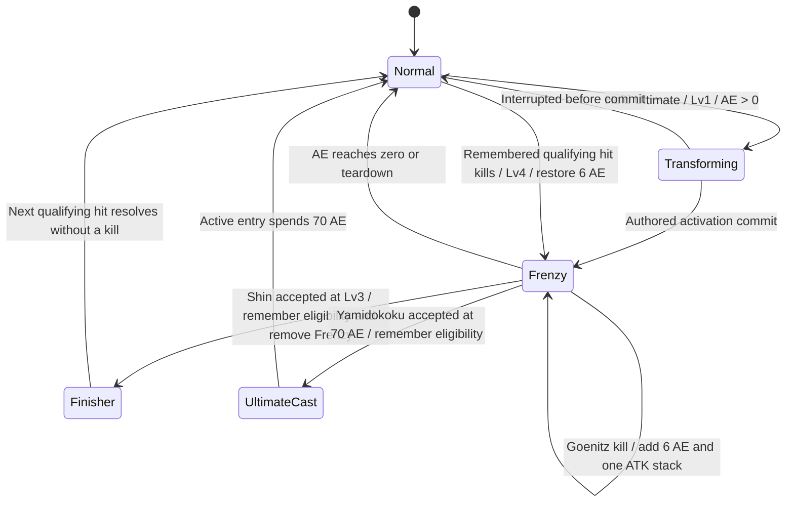

# Goenitz Blood Frenzy Kit: Design and Implementation Investigation

Date: 2026-11-03. Evidence is the current checkout, not historical plans. No gameplay scripts, assets, animations, or project configuration have been changed in this investigation.

Concurrent asset edits appeared during the session, including Goenitz's resolver/Attack9 animation, red projectile animation/controller registration, sprite import metadata and Test_Playground. They were read as current working-copy evidence and left untouched. Re-read the final asset versions before implementation rather than restoring an earlier snapshot.

## 1. Player Experience and Confirmed Direction

The player builds Goenitz's existing AE gauge, then holds Ultimate to enter Blood Frenzy. AE becomes remaining mode fuel: it drains on-field and off-field, cannot be replenished by ordinary attacks while the mode is active, and can be restored only by the Ultimate Lv.4 kill extension. The player chooses between maintaining Frenzy, spending a full gauge on Yamidokoku, or consuming the state for Shin: Yaotome. Passive Lv.3 lets teammates share the remaining mode lifetime.

Design approved by the user with "LGTM" on 2026-11-03, amended by the clarifications below. The revised Lv.2/Lv.3/Lv.4 rules supersede the earlier Ultimate-only trigger and +5% ATK/CR/CD proposal.

The user's follow-up answers establish these rules:

- Frenzy consumes 3 AE every second, including while Goenitz is swapped out.
- Allies share Goenitz's lifetime; they do not receive independent Frenzy timers fueled by their own AE.
- All ordinary Goenitz AE generation is blocked during Frenzy, including EX Yonokaze's +5 AE per crit. Only a classified extension reward may restore 6 AE.
- Yamidokoku keeps its existing 70 AE gate and cost. It can be quick-cast at 70 before a drain tick; below 70 it is unavailable. Spending the gauge also spends the mode's remaining fuel.
- Frenzy eligibility is remembered until the next damage hit resolves, allowing a qualifying kill after an Ultimate spends/removes the state to award its reward.
- Ultimate Lv.4 now rewards Goenitz's kills during Blood Frenzy, regardless of attack category: +3% ATK per stack, maximum 10 stacks, plus the retained +6 AE extension. Teammate kills do not award either reward.
- ATK kill stacks have no timer and survive Frenzy ending; only taking a damaging hit removes them during the run. They no longer grant CR or CD.
- Ultimate Lv.2 now applies its +15% damage-taken debuff for 20 seconds whenever a Blood-Frenzy-affected actor confirms a hit, whether Goenitz or an ally. Ultimate category is not required.
- Ultimate Lv.3 also grants self Blizzard when Goenitz uses Ultimate or limit-break: one refreshed stack lasting 15 seconds, retaining the existing stat package and adding +10 ADI. It is independent of Frenzy lifetime.
- Shin's availability and shared evasion duration are tied to Blood Frenzy, without independent fixed follow-up/evasion timers.
- The 70% / 50% / 500% ATK Bleed amounts are **one-shot damage**, not per-tick damage budgets. The original Bleed SO can supply its ordinary DOT afterward.
- All requested Echo damage and Echo resistance shred migrate to Physical damage and Physical resistance shred.

## 2. Requested Kit Matrix

| Track | Level | Intended behavior |
|---|---|---|
| Skill | Base | Yonokaze: 3-second cooldown, tornado, 350% ATK; requested critical clause retained. |
| Skill | 1 | Hold Skill unlocks EX Yonokaze: 7-second cooldown, 250% ATK homing red tornado, 10-second base lifespan, `goe_ex-skill` caster animation; each confirmed primary crit causes 70% ATK one-shot Bleed damage and grants 5 AE outside Frenzy. |
| Skill | 2 | CR +17%, persistent self stat increase while unlocked, replacing the old post-Skill timed buff. |
| Skill | 3 | CD +43%, with the same persistent interpretation. |
| Skill | 4 | Both normal and EX tornadoes get larger coverage, longer lifespan and more hits. Normal variant has an existing upgraded asset; EX needs its own upgraded variant. |
| Ultimate | Base | Yamidokoku: 18-second cooldown, 800% + 300% ATK, 70 AE cost, requested critical clause. |
| Ultimate | 1 | Hold Ultimate plays a new `goenitz_limit-break` clip and enters Blood Frenzy with zero entry AE cost. Both runtime tag and Runtime Effect Recipe must represent the state. |
| Ultimate | Frenzy | DI, DM and ADI +25 percentage points; qualifying attacks add 50% ATK one-shot Bleed damage. AE drain funds duration. |
| Ultimate | 2 | Confirmed hits by Goenitz or any ally currently affected by Blood Frenzy apply +15% damage taken for 20 seconds, refreshing one debuff. Any action category qualifies. |
| Ultimate | 3 | Frenzy-only Shin: Yaotome: 850% ATK, requested critical clause, consumes Frenzy and deals 500% ATK one-shot Bleed damage. Goenitz's Ultimate/limit-break use also grants Blizzard: one refreshed 15-second self buff. |
| Ultimate | 4 | Goenitz's kills during Frenzy grant +3% ATK per stack, max 10, and restore 6 AE. Stacks are permanent until a damaging hit; neither CR nor CD is included. The next resolved hit can use remembered pre-consumption Frenzy eligibility. |
| Passive | Base | 35% incoming-attack evasion. |
| Passive | 1 | Critical hits permanently reduce the target's Physical resistance by 15 percentage points; non-stacking behavior preserves the existing description's intent. |
| Passive | 2 | Frenzy enables Attack2-2; dashing through enemies deals 100% ATK Physical damage; the first damaging action after dash adds 4% enemy MaxHP Physical damage; the next normal starts at stage 4. |
| Passive | 3 | Share Blood Frenzy with allies for Goenitz's remaining lifetime: DI/DM/ADI and the attack-triggered Bleed effect. |
| Passive | 4 | Teammates affected by Frenzy receive +35 percentage points evasion, clamped once; duration is exactly source Frenzy lifetime. |

## 3. Existing-System Evidence and Gaps

Paths below are relative to `Assets/Project/` unless prefixed with `Docs_JJK`.

| Evidence | Current behavior | Rework implication |
|---|---|---|
| `Scripts/Systems/TeamLoader.cs:1132-1188,2581-2599` | AE is stored per character in run inventory; writes clamp to max; max equals highest authored Ultimate cost, or a fallback if all costs are zero. | Keep the authored 70 cost so the existing gauge remains 70. A free transformation must not change max AE to a fallback value. |
| `Scripts/Player/States/PlayerUltimateState.cs:143-153,246-263` | Resolves the exact action cost, checks affordability, and subtracts that cost on Active entry. | Zero-cost transformation and Shin already fit action cost authoring. Yamidokoku must continue subtracting 70. No blanket Ultimate cost waiver. |
| `Scripts/Character/ComboNode.cs:158-188`; `Combat/InputContext.cs`; `Combat/ActionResolver.cs:488-490` | Hold/press selection is implemented only for Ultimate. Skill has cooldown data but no hold selector or held context. | EX Skill requires input support beyond adding an asset row. |
| `Scripts/Combat/PlayerInputHandler.cs:160-172,190-270`; `Player/ActionInputBuffer.cs` | Skill routes directly on press; Ultimate handles pending press, hold threshold, release, input lock and focus cancellation. | Match existing hold gesture semantics for Skill and preserve immediate press behavior for characters without a hold action. |
| `Character/Hero/test_15_goenitz/CharacterObject_Goenitz.asset:400-930` | Skill Lv.1 gives CR +17% for 5 seconds; Lv.2 gives CD +43% for 5 seconds; Lv.3 changes multiplier to 450%; Lv.4 replaces the normal projectile. | Replace the old progression mapping and its UI patches; do not retain those old timed effects alongside the new bonuses. |
| `.../ActionResolverTable_char_5_goenitz.asset:64-129` | One Skill action; Yamidokoku has an 8.5 action multiplier despite text saying 800% + 300%, cooldown 18, cost 70. | Verify real hit budgets; changing descriptions alone does not implement the requested total. |
| `.../CharacterObject_Goenitz.asset:1199-1303`; resolver table `:130-160` | Shin is gated by Ultimate Lv.3 and `goenitz_followup_ultimate_window`; Yamidokoku end grants that tag for 20 seconds. | Replace this separate window with Frenzy eligibility and ensure consumption occurs exactly once. |
| Resolver table `:5425-5430` | Attack2-2 is already routed by `goenitz.limit-break`, but this investigation found no producer for that tag in the current Goenitz kit. | Rebind route to the canonical Frenzy state plus Passive Lv.2; avoid multiple disconnected mode tags. |
| `.../CharacterObject_Goenitz.asset:2158-2215,2248-2388` | Dash-through actually authors 250% ATK Physical damage; post-dash 4% MaxHP bonus is Physical and capped at 500% ATK, with a 10-second ready tag; stage-4 start sits at Passive Lv.3. | Move the package to Lv.2, gate on Frenzy, set dash damage to 100%, and explicitly decide whether to preserve the existing cap/window. Old UI copy disagrees with authored dash values. |
| `.../CharacterObject_Goenitz.asset:2433-2470`; `Combat/CharacterPassiveController.cs:1020-1055` | Old Lv.4 sets self evasion to 65%; defense evaluation chooses the highest local evasion chance. | Replace old self upgrade. Shared additive evasion cannot be expressed merely by putting a stat recipe on another character; there is no evasion stat/formula in the inspected Runtime Effect model. |
| `.../CharacterObject_Goenitz.asset:1977-2050` | Passive Lv.1's recipe is named Echo resistance reduction but actually applies incoming damage taken +15 with no element filter. | Migrate to actual Physical type resistance -15, not renamed general damage amplification. |
| `Scripts/Combat/Elements/ElementType.cs`; `.../EnemyDamageTypeState.cs:65-97` | Physical is `ElementType.None`; the other values are Lightning, Bleed, Darkness and Particle. Runtime reduction modifiers can target Physical. | Reuse Physical; do not add an Echo enum or mass-migrate unrelated characters. |
| `Scripts/Combat/ProjectileHitboxModule.cs:156-185`; `CombatDamageProcessor.cs:236-270` | After swap, projectile stats still follow the source deployed character, but its active `CharacterPassiveController` is cleared. Direct passive hit/crit/kill triggers are then unavailable; runtime recipe hit dispatch remains source-aware. | EX crit AE and kill handling must use source-correct execution context, including off-field hits. Do not accidentally award the active teammate. |
| `Scripts/Combat/RuntimeEffectRecipe.cs`; `Shop/CharacterInventoryState.cs:2444-2530`; `Systems/TeamLoader.cs:1753+` | Timed/Forever recipes, team targeting, damage modifiers, Additional damage and remove-on-damage are implemented; inventory ticks all stored character effects, and Always recipes reconcile source tags across the team. | Reuse recipes for visible shared stats and damage effects. Existing duration modes do not directly express AE-funded lifetime. |
| `Scripts/Combat/CombatRuntimeState.cs:107-138,214-238` | A runtime tag can be persistent or expire by `Time.time`. There is no AE sustain/drain link. | Do not give Frenzy an independent fixed expiration timer that can drift from AE. |
| `Scripts/Combat/CharacterPassiveController.cs:2481-2501,2763-2807` | The availability-window cache includes every unlocked action modifier with required tags. Committing a matching action clears those required tags. | A persistent Frenzy prerequisite can be accidentally consumed on a normal/Skill/Ultimate cast. Keep persistent state prerequisites distinct from one-use window consumption. |
| `Scripts/Combat/PlayerCombat.cs:37,67-69,932-973` | Actual ordinary AE reward is 5, with High rate 15%; default chance grants are capped at five per one-second window. Some GDD/old ADR text says 10. All standard rewards eventually use `TeamLoader.AddCharacterAE`. | Preserve actual current reward behavior outside Frenzy; suppress gains with explicit reason/source classification while Frenzy is active. Do not use GDD's stale value as a replacement. |
| `Scripts/Player/UI/AbilityUIManager.cs:510+`; `Player/UI/CharacterSwitchSlot.cs:144,231` | HUD already reads per-character AE and supports a zero-cost displayed action using max AE for fill. | Add state-driven white flicker and shared-duration visibility while retaining the existing AE gauge. |

### Animation and projectile availability

- `goe_ex-skill.anim` exists and is already in the animator controller. It samples at 60 FPS and ends around 2.1167 seconds; Goenitz's action authoring FPS is 24. Do not copy sample-frame counts into action-frame durations.
- `goe_vfx_ex-skill-projectile.anim` exists, samples at 30 FPS, and is the candidate red tornado clip matching the supplied `Goenitz_ex-projectile_vfx_*` sprites. Verify it visually during implementation.
- `Goenitz_limit-break_*` sprites exist, but no matching limit-break `.anim` was found anywhere under Assets, and the controller has no matching state. The requested transformation therefore needs clip authoring and an action timeline; it is not just a reference reassignment.
- Existing normal projectile: lifetime 1 second, per-enemy max hits 10, hit interval 8 frames, hitbox width 1.5.
- Existing Lv.4 normal projectile: lifetime 1.45 seconds, per-enemy max hits 16, hit interval 6 frames, hitbox width 3.
- Both current normal variants are almost stationary linear projectiles. Homing traversal already exists but EX needs separate authored projectile data and a hit budget appropriate to 10 seconds.
- `ProjectileRuntime.UpdateHitCooldown()` decrements once per rendered Update, while lifetime uses delta time. Therefore hit cadence and AE generation can vary with rendering FPS, and cadence can advance during zero-delta updates. A 10-second EX makes this material; verification must cover multiple frame rates and pause/freeze.

### Damage delivery and budget findings

- Action damage is source stat × action multiplier × clamped hit fraction. Projectile max hits do not automatically normalize the action budget.
- For example, the normal projectile's fraction is 0.13 per hit, with a theoretical 10-hit ceiling: 3.5 × 0.13 × 10 = 4.55 ATK. That is an upper budget bound, not a measured delivered total; lifetime, cadence and contact determine actual hits. The Lv.4 asset similarly authors 16 × 0.0725 = 1.16 fractions before the action multiplier. These are not guaranteed 350% action totals.
- The new 350%, 250%, 800% + 300%, and 850% must be verified across the real multi-hit/branch/projectile delivery paths. Proposed interpretation: action totals before crit, defenses and bonuses, with 800% + 300% kept as two explicit damage portions. Exact per-hit allocations belong to the later architecture/authoring plan.
- Existing base Skill and base Ultimate author final-damage Multiply 1.5 on critical hits. Proposed retention: the requested critical clause means **1.5 times the normally resolved critical hit**, not a second 150% Additional hit. Skill's old text incorrectly says 250%; correct the text to the implemented/desired rule. Do not apply this extra clause to EX unless separately requested.
- User-corrected Bleed can reuse ordinary `DamageDelivery.Additional` plus `ElementType.Bleed`: immediate 0.7 / 0.5 / 5.0 × source ATK, default noncritical. Explicitly enable `ApplyElementDot` for these packets: the default Additional proc policy currently omits that flag, even if the caller's `applyElementDot` argument is true. This keeps one-shot damage distinct from DOT ticks and prevents recursive ordinary hit/AE procs.
- The actual generic SO is `Resources/ElementSO/Element_Bleed.asset`: 6-second DOT, one-second ticks, 25% ATK per tick before DM/mitigation. Equal strength refreshes cadence-preservingly; stronger replaces; weaker is ignored.
- No custom DOT is needed for the clarified request. `ApplyCustomDot` currently ignores the declared custom stacking policy and appends independent applications; avoid that path here. ADR-010 describes a generic receiver/scheduler, but those classes were not found in the checkout: do not plan against unimplemented architecture.
- Physical dash bonus must not inherit Bleed type. Physical resistance shred does not amplify Bleed ticks; Ultimate Lv.2 general damage taken can affect both according to existing damage filters.

## 4. AE-Funded State Contract

The following is the approved design contract, not an implemented architecture.

### Interaction flow

The diagram omits ordinary combat substeps; Frenzy itself is a combat runtime mode, not a locomotion FSM state.

### Entry and sustain

1. Holding Ultimate selects transformation only with Ultimate Lv.1+, a living Goenitz, legal current action context, positive AE, and no already-active Frenzy. Entry is zero cost; it does not fill AE.
2. Proposed commit: an authored activation point after startup. An interruption before this point creates no tag, recipe, aura, or drain schedule.
3. Set one canonical Frenzy runtime tag and apply the identified self recipe together. One drain schedule belongs to Goenitz regardless of which character is active.
4. First drain occurs one combat second after activation; subsequent ticks consume 3 AE. The final tick consumes the remainder and ends the mode. Catch up missed ticks once each after a slow frame; pause, hitstop and cinematic freeze use the approved gameplay clock consistently.
5. Example with no gains/spending: AE 70 becomes 67 at t=1, 1 at t=23, and 0 at t=24. Discrete drains therefore give 24 seconds, not 70/3 seconds of continuous drain. AE 6 funds two ticks; AE 1 funds one tick under the positive-entry proposal.
6. No second `AE stack` counter, independent fixed Frenzy timer, or saved ScriptableObject state. Current AE is the fuel. The drain phase is scheduling state only.
7. Every ordinary positive AE source is blocked for Goenitz while Frenzy is active: native chance reward, guaranteed action reward, EX crit reward, QTE/team/Artifact resource effects. Negative spends remain effective. The extension is explicitly classified and bypasses only the positive-gain block.
8. State the eligibility at the start of a damage-resolution transaction so a last-tick/reward ordering cannot inconsistently block half a hit's gains. In particular, a hit that qualifies for a 6 AE extension must not also grant ordinary AE because its originating action just emptied the mode.
9. Below 70 AE, Yamidokoku remains unavailable. At 70, accepting it and reaching Active spends 70; that ends Frenzy unless the remembered next resolved hit later earns the extension.

### Extension and remembered hit

- Before an eligible Ultimate consumes/removes Frenzy, remember that eligibility for the **next qualifying damage hit resolved**, as the user requested. Do not retain a blanket Frenzy flag for the whole Ultimate or all later attacks.
- Bind the remembered eligibility to that Ultimate execution/source; consume it once on its next confirmed positive primary damage result. Unrelated teammates, residual Skill projectiles, Additional damage and generic DOT must not consume it first.
- If that result kills and Ultimate Lv.4 is active, apply one kill stack and restore 6 AE; if Frenzy ended solely because the Ultimate spent/consumed it, resume Frenzy and its shared package. A nonlethal result consumes the remembered eligibility without reward.
- When Frenzy remains active, Goenitz's kills from any action category qualify through live state. Additional and DOT kills also qualify when attributed to Goenitz and Frenzy is live; ally kills do not. A simultaneous multi-target hit must use deterministic per-victim identity, with no double reward from remembered and live checks for the same kill.
- Approved default: normal 70 AE cap also applies to the 6 AE reward, and restoration does not reset the next drain time while already active. If an ended mode resumes, its first drain occurs one second after resumption. Thus the reward adds two whole drain units, but exact real-time extension can be less near cap.
- Clear remembered eligibility on cancellation/completion without a hit, source death/removal, scene teardown, run reset, or Training reset. Do not let a missed finisher carry kill eligibility into a later action.
- Remembered eligibility remains a one-use exception for the originating Ultimate's next positive primary hit; it does not make all later DOT ticks or unrelated attacks Frenzy-eligible after exit. Live Frenzy kill eligibility no longer filters Ultimate category, so the native DOT category `Normal` is not a reason to reject a live-mode Goenitz kill.

### Independent Blizzard and kill-stack lifetimes

- Ultimate Lv.3: apply Blizzard once per accepted Goenitz Ultimate/limit-break use, not every animation step, projectile or victim. A later qualifying cast refreshes to 15 seconds; it never creates a second stack.
- Blizzard retains +10% HP/ATK/DEF/speed, +10 percentage points DM/CR/CD/CM/DI, the existing AE Recharge multiplier of 1.1, and adds +10 percentage points ADI. The existing Recharge multiplier has no effect when Recharge starts at zero; changing its arithmetic is outside this approved package revision.
- Blizzard has its own 15-second timer. Ending Frenzy, using Shin, or taking damage does not remove it. Its timer follows the existing timed-recipe gameplay clock.
- Ultimate Lv.4: kill-stack recipe uses Forever duration, maximum 10, +3% clean-base ATK per stack, linear total +30% at cap. No CR/CD or other stats. Frenzy exit, swap and room transition do not remove these stacks; actual HP damage removes all of them. Run reset still clears run effects.
- Evasion and Shin readiness are source-linked Frenzy benefits. Unlike Blizzard and kill stacks, they end immediately with the shared mode and have no separate 15/20-second timer.

### Exit and ally lifecycle

- Zero AE ends tag, stat recipe, Bleed-on-hit package, evasion sharing and post-dash readiness consistently. A normal damaging action must not consume Frenzy simply because it required the tag.
- Shin consumes the **state** and retains leftover AE because the user specified state removal rather than an AE spend. It cannot be repeated unless Frenzy is activated/resumed again.
- A finite completed transformation animation must return control to normal locomotion/combat while the mode stays active. The mode does not make the player globally uninterruptible.
- Passive Lv.3 recipients share one source lifetime. Swapping changes which recipient is active, not the drain owner. Removing/death/resetting Goenitz removes all source-owned ally effects and cannot leave an independent copy running.
- Share DI/DM/ADI and the 50% one-shot Bleed trigger. Do not grant teammates Goenitz's action IDs, EX Skill, Shin, Lv.4 kill reward, or personal Passive Lv.2 routes.
- Passive Lv.4 grants teammates +35 percentage points evasion while source-linked Frenzy applies; clamp the final probability. Keep Goenitz's base evasion at 35%. Existing code's maximum-of-local-chances policy cannot supply this additive ally bonus without a scoped extension.
- Teammate-triggered 50% Bleed uses that attacking teammate's current ATK and damage ownership; the shared recipe source remains Goenitz for lifetime/removal. Current Additional-damage formula source resolution must be checked so Goenitz's ATK is not accidentally reused for every ally.

## 5. Approved Defaults and Revised Values

The user's LGTM approved the earlier defaults except where the later explicit revisions below replace them. Architecture must preserve these semantics; engineering details remain subject to its checkpoint.

| Item | Approved default / validation |
|---|---|
| Stat gains | Skill CR/CD remain always-on self bonuses when unlocked, +17/+43 points. Kill stacks now add 3% clean-base ATK each, linearly; no CR/CD. |
| Kill stack cap | User revised to 10, replacing 99. No timer; actual damage clears all stacks, successful evasion does not. Frenzy exit/swap/room transition do not clear them. |
| Blizzard | User selected one refreshed stack, 15 seconds, existing +10% stat package plus +10 ADI. Self-only, triggered by Goenitz Ultimate/limit-break use at Ultimate Lv.3. |
| Debuff trigger | User revised Ultimate Lv.2 to confirmed hits from any Frenzy actor, self or allies; retains +15% damage taken, 20 seconds, refresh only. |
| Critical clause | Preserve existing critical-only final ×1.5 on normal Skill and damaging Ultimates. |
| Damage totals | Listed action multipliers mean full authored action budgets, not each tornado contact. Verify against a stationary dummy and explicit planned hit count; repeated targets cannot exceed the budget merely because contact rate changes. |
| Hold threshold | Starting value: reuse the existing Ultimate threshold of 0.35 seconds for hold Skill; no new Input Action dependency/settings required. Test press/release around the boundary and inputs during recovery; adjust only after feel review. |
| Frenzy transform cooldown | No separate cooldown; no re-entry/refresh while already active. Hold cannot repeatedly reset the drain phase. |
| Entry AE | Positive AE required, with final partial drain allowed; zero AE rejects entry. |
| EX contact | Keep the 10-second base lifetime even after its hit budget is exhausted. Homing retargets living targets; does not despawn immediately on one target dying. Exact speed/radius and Lv.4 extensions need visual tuning. |
| Passive dash readiness | Preserve existing 10-second post-dash window and 500%-ATK cap on the 4%-MaxHP portion; expire both when Frenzy ends. These safeguards were not restated in the new request. |
| First damaging action | One post-dash bonus application on the next confirmed damaging action; whiff does not consume it. Current implementation consumes on the first qualifying hit/target, so whole-action multi-target behavior must be explicit. |
| Lv.4 evasion | Teammates only; additive +35 percentage points while shared Frenzy is present, final chance clamped. No old 65% self upgrade. |
| Native Bleed | Reuse the unchanged original six-second / one-second / 25%-ATK-per-tick SO. One-shot amounts are separate Additional Bleed hits; no custom DOT stack creation. |
| Kill extension cap | Add 6 AE using the current 70 cap; no hidden overflow timer. Cannot promise exactly +2 real seconds for every capped grant. |
| Scene lifetime | Clear Frenzy and remembered hit on world teardown; do not serialize combat mode. Swapping alone preserves it. |

## 6. Feedback and Five-Component Evaluation

| Component | Intended player experience / requirement |
|---|---|
| Clarity | AE fill directly shows remaining fuel. Slow white flicker and the named Frenzy recipe distinguish mode use from ordinary Ultimate readiness. Allies show source-linked Frenzy without pretending their own AE is being consumed. |
| Motivation | The meter is a finite power window. Kills sustain it; ordinary hit spam cannot refill it. Shin trades the active state for a burst. |
| Response | Hold Skill and hold Ultimate dispatch once; release/focus loss/pause cancels pending gestures correctly. Tap remains reliable, including when a hold option is locked. |
| Satisfaction | Transformation animation plus existing authored voice/SFX provide visible and audible entry. Red tornado loop plus contact audio show EX hit delivery; a kill extension visibly restores AE. |
| Fit | Uses the existing tornado/critical-pressure identity, per-character AE, shared recipes and simple team rotation. |

Feedback details for approval:

- Transformation: play the limit-break sprite sequence with existing suitable Goenitz audio; no new camera motion or screen shake is implied by the request.
- Active mode: slow white pulse on the AE gauge, not a full-screen flash. Starting value: a two-second smooth brightness cycle; retain readable fill and never blank the gauge. Test while moving, at low AE, and after swap; reduce intensity if it hides fill or competes with hit feedback.
- Entry/exit: recipe icon and mode presentation appear/disappear together. Stop the flicker and restore original tint on every exit, UI unbind and source removal.
- Kill extension: show actual +6 or capped AE movement; do not display a fictitious +2-second countdown if the cap shortened the benefit.
- Reuse existing action recovery, cancel, sound and impact behavior unless the new transformation/EX timeline requires explicit authoring. Sample rates and action FPS must remain distinct.

## 7. Validation Scenarios Before Completion

The following are planned checks, not executed test results.

1. **AE boundaries:** enter with 0/1/3/6/70 AE; verify positive-entry proposal, no entry spend, exact discrete drain, clamping and cleanup. Verify no duplicate tick after transform spam or swap.
2. **Clock behavior:** equivalent drain and hit budgets at 30/60/144 FPS, one simulated long frame, pause, hitstop and Ultimate freeze. No hidden drain or projectile damage while the selected gameplay clock is stopped.
3. **Gain suppression:** force every ordinary source including guaranteed rewards, chance reward, EX crit, ally/QTE and Artifact AE effects. During Frenzy only the classified extension adds AE; outside Frenzy ordinary rules remain unchanged.
4. **Yamidokoku tradeoff:** at 70, cast before first tick and observe one 70 spend; at 67, reject without side effects. No automatic refill or waiver. A canceled startup must not spend AE twice or strand remembered eligibility.
5. **Remembered hit:** cast while Frenzy is active, consume/deplete mode, resolve lethal/nonlethal next hit; only the qualifying lethal result grants one ATK stack and 6 AE. Further hits do not reuse the consumed memory. Verify misses, multi-target resolution, source swap and interruption; also prove ordinary Skill/normal/dash/DOT kills qualify when Frenzy is live and teammate kills never award Goenitz.
6. **Shin:** requires Lv.3 and current Frenzy; consumes mode once; actual direct budget 850%, requested crit multiplier, and separate 500% Bleed payload. Retained leftover AE cannot make one accepted action loop forever.
7. **Bleed:** 70/50/500%-ATK immediate packets, generic 25%-ATK ticks over six seconds, strongest/equal/weaker refresh rules, no recursion or AE generation from terminal DOT. A weaker passive Bleed must not overwrite stronger source snapshots incorrectly.
8. **Skill progression:** level 0 press still works; level 1 hold EX; levels 2/3 affect correct stats once; Lv.4 replaces both variants and retains their own normal/red clips and intended lifetime/hit budgets.
9. **Off-field ownership:** EX continues after swap; its outside-Frenzy crit rewards go to Goenitz, and its during-Frenzy rewards are blocked. Teammate stats and AE stay correct. Repeat with background Ultimate execution.
10. **Shared mode:** at Passive Lv.3, swap through all living allies; their benefits expire with Goenitz, not their own AE. Lv.4 ally evasion adds once and removes cleanly. Use different teammate ATK to prove correct Bleed formula ownership.
11. **Passive gates:** without Frenzy, no Attack2-2/dash package; with Lv.2 plus Frenzy, correct route and 100%-ATK dash; stage 4 resolves to `Attack4` despite conditional route changes. Whiffs do not spend readiness.
12. **Resistance:** critical hits apply permanent -15 Physical resistance once per enemy; no general +15% damage-taken substitute and no Bleed reduction change. Test enemies with positive/negative starting reductions.
13. **Stacks:** +3% ATK only, maximum 10; distinct victims grant correct counts; damage clears, evade does not. Stacks survive mode exit, swap and room transition. At cap, a further qualifying kill still grants the +6 AE extension even though no extra ATK stack can be added.
14. **Teardown:** source death, roster removal, room transition, Training reset, Potential downgrade and run reset clean mode/tag/recipes/drain schedule/pending eligibility. Re-entry starts one mode instance.
15. **Regression:** hold Ultimate for other characters, press Skill without a hold option, normal AE generation, action windows, physical/type mitigation, ordinary Bleed DOT and existing team runtime-stat reconciliation.
16. **Blizzard:** at Ultimate Lv.3, Yamidokoku/Shin/limit-break each grant once per cast; multiple combo steps do not stack/refresh repeatedly. A second cast refreshes 15 seconds at one stack. Verify the stat package includes ADI and remains after Frenzy exit/damage, then expires normally.
17. **Shared vulnerability:** Goenitz and Frenzy allies apply the same refresh-only 20-second +15% debuff on positive primary hits from any category. Non-Frenzy actors do not. No recursive Bleed/DOT reapplication loop; mode exit does not prematurely remove an already-applied enemy debuff.

Playtest coverage: a new player should infer draining fuel and hold/tap choice from the HUD; input spam tests response; timing the quick Yamidokoku and choosing Shin tests mastery; dense enemy groups test extension abuse; an observer should distinguish normal/red tornado and mode exit/re-entry.

Tuning priority: first correct eligibility/input response and fuel readability, then verify damage budgets and frame-independent contact, then tune EX movement and Lv.4 coverage/lifetime. No invented balance benchmark is used.

## 8. Scope and Next Checkpoint

Existing owners remain the starting constraints: TeamLoader/run inventory own character AE, CombatRuntimeState owns tags, deployed runtime records own current stats, recipes own target buffs, and the shared processor owns damage resolution. Do not put mutable mode state on CharacterObject, use Artifact identity as a character-kit workaround, or grow the active-character controller into a second team-state owner.

Likely affected surfaces for the later impact/architecture plan are Goenitz assets/controller/new clip/projectiles, Skill input buffering/context/resolution, source-correct hit/kill callbacks, AE gain classification and drain lifecycle, shared defensive effects, action-window consumption, and gauge presentation. This investigation does not approve a broad rewrite of these shared systems.

The selected workflow is `Docs_JJK/2_System_Files/Workflows/implement-feature.md`. Design approval was received on 2026-11-03 with LGTM and the recorded amendments. Architecture can proceed. Its Step 4 separately requires architecture approval before implementation; see the accompanying `goenitz-blood-frenzy-kit-arch-plan.md` and proposed ADR-020.

Documentation verification: all three new markdown artifacts passed required-frontmatter, code-fence and whitespace checks. A whole-workspace `git diff --check` also reported trailing spaces in the concurrently changed Unity projectile controller; that unrelated asset was not edited. No Unity compile, damage simulation or playtest results are claimed.
