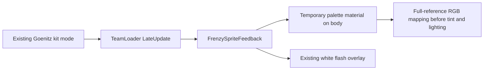

# Goenitz Frenzy Palette Integration

User instruction on 2026-11-04: "make this color mapping to use on Goenitz sprite while within Blood Frenzy Feedback". This authorizes implementing the reviewed full-reference mapping within the existing feedback path. No extra approval is inferred for gameplay, dependencies, build settings or publishing.

Follow-up UI request: expose four optional Inspector-wired sprites on Goenitz's runtime definition and show them as the base NA/Skill/Ult/Dash icons only while Goenitz's own Blood Frenzy gameplay mode is active. Missing assignments keep their current icons. Do not run or extend the character authoring script.

GDD `@tag:visual-audio`: preserve readable silhouettes and economical animation. Existing kit runtime retains all Frenzy gameplay state authority. This is a scoped presentation extension; no new system/ADR is necessary.

| Owner | Responsibility / state |
|---|---|
| Kit runtime | Existing active Frenzy state, unchanged |
| TeamLoader | Pass active renderer plus Goenitz-specific recolor flag; no new mode state |
| FrenzySpriteFeedback | Cache previous shared material; own a temporary palette material and existing flash overlay; restore on flag/source change and dispose |
| GoenitzFrenzyPalette shader | 21 explicit RGB pairs from mapping JSON; preserve alpha, tint, sprite flips, URP 2D lighting, mask/normal and forward paths |
| `GoenitzKitRuntimeDefinition` | Four optional authored Frenzy base-action icon sprites |
| `AbilityUIManager` | Override assigned slot icons only while Goenitz's own runtime reports active Frenzy; preserve resolver/default icons for null slots and all other states |
| PlayerMovement afterimages | Copy the source shared material when each ghost spawns, preserving its appearance while it fades |

Interface change: `Tick(SpriteRenderer source, bool recolorGoenitz = false)`. Default retains the original flash-only behavior. Actor identity uses `GoenitzKitRuntimeDefinition`, not a name/string match or shared ally tag.

Palette matches sampled texture RGB before tint/light. Linear projects convert samples to sRGB bytes for matching and mapped values back to linear. Unmatched/already-red pixels pass through. Shader is under Resources so normal player builds include it without configuration changes.

Mode exit/swap/disable restores the source material only while this feedback owns it. Material is reused across mode entries and swaps; overlay sprite follows animation in LateUpdate. Generated source images, animation clips and import settings stay untouched.

Validation: compile C# and shader in Unity; render all palette pairs plus already-red/unmatched controls; verify alpha/tint; exercise reentry, same-renderer recolor flag changes, renderer swaps, null/destroyed sources and dispose. Isolated preview-scene checks leave the user's active scene unchanged.

Dash follow-up: inspected `goe_Dash.anim`; it only animates sprite and visibility. `SpawnAfterimage` was using a fresh renderer's default material, causing original-blue ghosts. Copy the current source material. Palette material remains alive across ordinary mode exit so existing ghosts retain their red snapshot until their normal fade completes.

Shin follow-up authorized by the user: the configured finisher retains the palette while its owner-matched cast is actively executing, including recovery, even though Frenzy is consumed on cast acceptance. Its visual lifetime does not extend gameplay Frenzy or the white mode pulse. Completion/interruption/swap removes this presentation-only exception. `Tick` accepts a separate optional `flash` flag for that purpose.
