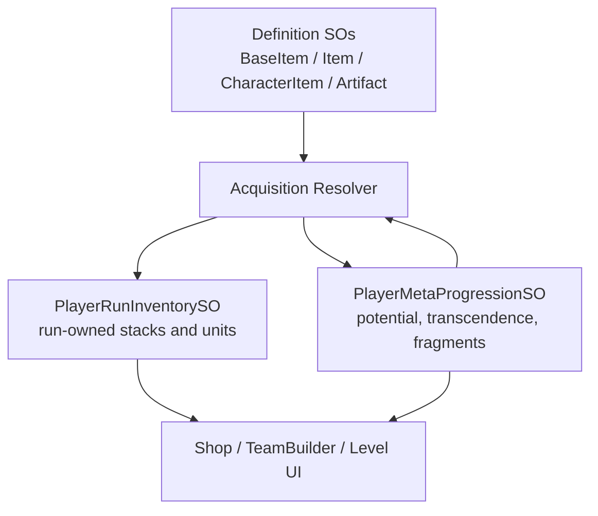

# Impact Analysis: Inventory Stack And Progression Refactor

## Refactor Goal

Split item definitions, run-owned inventory, and permanent progression so stackable consumables and duplicate-to-fragment progression do not depend on repeated `BaseItem` references in one list.

## Current Problem

`PlayerShopInventory` currently stores all player ownership in `List<BaseItem> ownedItems`. `AddItem` refuses duplicates, which blocks stacked consumables. Several callers then count `ownedItems` references directly, so a real stack model cannot be introduced safely without a migration layer.

The same list also mixes different lifetimes:

- Run-scoped consumables such as EXP Potions.
- Run-scoped Character and Artifact availability.
- Permanent upgrade progress such as Character Potential and Artifact Transcendence.
- Future fragment currencies that should survive run loss.

## GDD Constraints

- Character Level, current EXP, and unspent EXP Potions are removed when the run is lost or reset.
- Character Potential is permanent and advances from duplicate Character acquisition.
- Artifact Transcendence is permanent and duplicate Artifacts convert into Artifact-specific fragments.
- Character dupes appear as fragment items; Characters themselves should not be ordinary Backpack items.
- Duplicate Character and Artifact fragments are saved through MetaProgression as unused permanent upgrade materials until spent by Potential or Transcendence.

## Recommended Data Ownership



## Class Responsibility Table

| Class | Responsibility Before | Responsibility After | Owned State |
| --- | --- | --- | --- |
| `BaseItem` | Shared item definition and shop price. | Definition only. No runtime quantity, ownership, level, or upgrade state. | Static authored data. |
| `Item` | Consumable definition with `maxStackSize` and EXP amount. | Stackable consumable definition. | Static authored data. |
| `CharacterItem` | Character shop wrapper and ownership item. | Acquisition/shop definition that points to `CharacterObject`; runtime ownership lives elsewhere. | Static authored data. |
| `Artifact` | Artifact definition and equipped stat payload. | Artifact definition; permanent transcendence level comes from meta progression. | Static authored data. |
| `PlayerShopInventory` | Mixed list of all owned objects plus currency. | Short-term compatibility facade or renamed run inventory owner. Exposes count APIs instead of public list counting. | Run currency, run stacks, run-owned characters/artifacts during transition. |
| `InventoryStack` | Missing. | Serialized `{ BaseItem item, int quantity }` entry for stackable run items. | Per-item quantity. |
| `PlayerRunInventorySO` | Missing. | Final owner for current run: currency, consumable stacks, acquired characters, acquired artifacts, character level/EXP state. | Run-scoped state cleared on run reset/loss. |
| `PlayerMetaProgressionSO` | Missing. | Final owner for permanent character potential, artifact transcendence, fragments, unlock pool, and shop modifiers. | Permanent profile state. |
| `InventoryAcquisitionResolver` | Spread across `ShopManager` and `PlayerShopInventory`. | Single rule point for first acquisition vs duplicate conversion. | No state; writes to run/meta owners. |
| `CharacterLevelPanel` | Counts and removes repeated potion entries from `ownedItems`. | Reads stack quantity and removes confirmed quantity through inventory API. | UI-only simulated consumption. |
| `ShopManager` | Filters owned Characters/Artifacts as sold out. | Lets duplicates resolve into fragment acquisition when the item appears again. | Current shop roll only. |

## Proposed Interfaces

```csharp
public interface IInventoryQuantityStore
{
    int GetItemCount(BaseItem item);
    bool HasItem(BaseItem item);
    bool TryAddItem(BaseItem item, int amount = 1);
    bool TryRemoveItem(BaseItem item, int amount = 1);
}

public interface IProgressionMaterialStore
{
    int GetFragmentCount(BaseItem sourceItem);
    void AddFragments(BaseItem sourceItem, int amount);
}

public enum AcquisitionKind
{
    AddedRunItem,
    AddedRunCharacter,
    AddedRunArtifact,
    ConvertedToFragments,
    Rejected
}
```

## Acquisition Data Flow

```text
Shop purchase or reward
-> InventoryAcquisitionResolver.Acquire(item)
-> if Item consumable: add to PlayerRunInventorySO stack
-> if new Character/Artifact: add run-owned identity
-> if duplicate Character/Artifact: add fragments to PlayerMetaProgressionSO
-> publish inventory/progression changed event
-> UI refreshes counts and preview state
```

## Migration Slices

### Slice 1: Stackable Consumable API

- Implemented: added `InventoryStack` and count/remove/add methods to the run inventory.
- Implemented: `ownedItems` remains as a legacy compatibility view for existing TeamBuilder and Shop callers.
- Implemented: `AddItem`/`TryAddItem` increments stackable `Item` quantities up to `maxStackSize`.
- Implemented: `CharacterLevelPanel` calls `GetItemCount(potion)` and `TryRemoveItem(potion, count)`.

This slice directly supports multi-cancel and multi-consume from the same potion stack.

### Slice 2: Duplicate Conversion

- Implemented: added `InventoryAcquisitionResolver` and `PlayerMetaProgression`.
- Implemented: `ShopManager` routes purchases through the resolver.
- Implemented: owned Characters and Artifacts are only hard sold-out when no MetaProgression asset is assigned.
- Implemented: duplicate Character acquisition converts into Potential fragments.
- Implemented: duplicate Artifact acquisition converts into Transcendence fragments.
- Implemented: converted fragments are stored in MetaProgression as unused upgrade material until the relevant upgrade UI spends them.
- Follow-up: expose fragment amounts/costs as balance data instead of the current default `1` fragment per duplicate.

### Slice 3: Run vs Permanent Split

- Implemented: replaced `PlayerShopInventory` with `PlayerRunInventory` as the forward-facing run inventory asset type.
- Implemented: added `RunCharacterState` to the run inventory for run-scoped Character Level and current EXP.
- Implemented: `CharacterLevelPanel` now mutates the run character upgrade state instead of `CharacterObject.upgrade` when a run inventory is assigned.
- Implemented: run character level state starts at Lv.1/current EXP 0 while copying authored max level and growth tuning from the Character definition.
- Implemented: `ClearInventory()` clears run character level state alongside run items.
- Implemented: TeamBuilder slot labels, character grid labels, inspector panels, and combat stat setup resolve Character Level through run inventory read models.
- Implemented: `PlayerCharacter` accepts effective runtime stats from `TeamLoader`, so combat does not need to mutate Character definitions for level growth.
- Follow-up: introduce `RunArtifactState` for equipped owner and restored Transcendence snapshots.
- Keep ScriptableObject definitions immutable during play.

### Slice 4: UI And Save Integration

- Implemented: moved active TeamBuilder and Inspector character level reads away from `CharacterObject.upgrade` where run inventory context is available.
- Implemented: Level Potion confirmation calls `NotifyRunStateChanged()` after mutating run level state.
- Implemented: canonical `Resources/InventorySO/PlayerRunInventory` persists current-run stacks, currency, run character level/EXP, deployed team slots, and equipped artifact ids through `PlayerPrefs`.
- Follow-up: wire the eventual run loss/reset authority to clear `PlayerRunInventory` while preserving `PlayerMetaProgression`.

## Authority Decisions

| Decision | Choice | Rationale |
| --- | --- | --- |
| Stack ownership | Run inventory owns consumable quantities. | EXP Potions are lost on run reset and should not live in permanent progression. |
| Duplicate ownership | Acquisition resolver owns first-time vs duplicate branching. | Prevents shop, reward, and future drops from each inventing conversion rules. |
| Permanent upgrades | Meta progression owns Potential, Transcendence, and fragments. | GDD says these survive run loss and restore when the item is reacquired. |
| Definitions | ScriptableObjects stay as definitions. | Avoids mutating shared project assets during play. |
| UI state | UI keeps only preview selections. | Level Potion preview can cancel without modifying real inventory until confirmation. |

## Affected Systems

- `Assets/Project/Scripts/Shop/PlayerShopInventory.cs`
- `Assets/Project/Scripts/Shop/ShopManager.cs`
- `Assets/Project/Scripts/Shop/UI/ShopUI.cs`
- `Assets/Project/Scripts/Shop/UI/ShopPreviewPanel.cs`
- `Assets/Project/Scripts/TeamBuilder/UI/Panels/CharacterLevelPanel.cs`
- `Assets/Project/Scripts/TeamBuilder/UI/TeamBuilderUI.cs`
- `Assets/Project/Scripts/TeamBuilder/UI/TeamDraftController.cs`
- `Assets/Project/Scripts/TeamBuilder/UI/InspectScreenUI.cs`
- `Assets/Project/Scripts/Character/CharacterObject.cs`
- `Assets/Project/Scripts/Character/CharacterUpgrade.cs`

## Regression Checklist

- Buy one EXP Potion and confirm count displays as `x1`.
- Buy the same EXP Potion multiple times and confirm it remains one slot with increased count.
- In Character Level Panel, click the same potion repeatedly, cancel repeatedly, and confirm available/simulated counts stay correct.
- Confirm level-up removes exactly the simulated potion quantity.
- Buy a new Character and confirm it appears in TeamBuilder.
- Buy the same Character again and confirm it becomes fragments, not a duplicate selectable character.
- Buy a new Artifact and confirm it can be equipped.
- Buy the same Artifact again and confirm it becomes fragments, not a duplicate equip option.
- Reset/loss flow clears run inventory and character levels, but retains fragments, potential, and transcendence.

## Human Checkpoint

Implementation should pause until the architecture direction is approved, especially the introduction of separate run inventory and meta progression owners.
