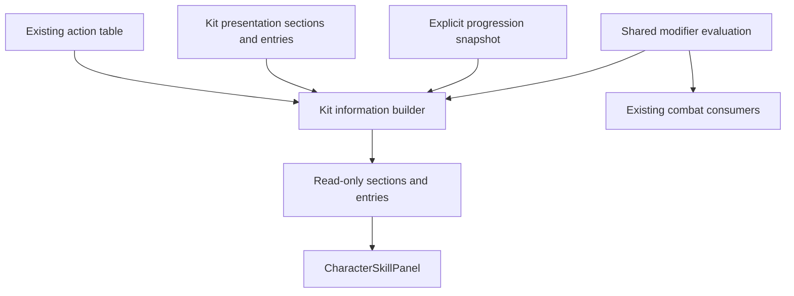

# Character Kit Information: Proposed Architecture and Impact Analysis

Architecture approved by the user ("lgtm"), 2026-11-03. Implemented and verified: 16 native checks passed; see ADR-019 and the test plan. The proposal below records the approved design. References: GDD `@tag: ui`, `@tag:characters`, `@tag:progression`; task card `kit-information-task-card.md`.

## Recommendation

Keep action execution in ActionResolver. Put base action explanation beside each CombatAction in the existing ActionResolverTable. Keep presentation sections and non-action entries in CharacterKitDefinition. Build a read-only presentation model from these definitions and an explicit progression context. Potential nodes supply targeted presentation patches alongside their existing gameplay modifiers.

Retain the five existing action lists. This proposal does not revive withdrawn ADR-017's unified catalog/input/executor design.

## Current Evidence

- CharacterSkillPanel.BuildSkillEntries requests only Skill, Ultimate, and Passive. ResolvePrimaryAction takes actions[0].
- PotentialNodeDefinition.skillPanelDescriptionOverride is a single track-level string. ResolveBestDisplayNode chooses the highest active level, with list order breaking ties.
- CharacterSkillPanel.EnumerateActiveNodes filters by the displayed track. CharacterPassiveController evaluates active nodes across tracks. A Passive-track node can therefore modify a Skill without the panel reflecting it.
- Panel modifier matching uses ignoreRuntimeRequirements: true. This can display a tag/counter-dependent bonus as unconditional.
- The panel duplicates numeric operations, omits dedicated cooldown modifiers, and samples the first damage hitbox/projectile. This does not establish total damage for branching, multiple-hit, or mixed-element actions.
- Main's current table contains Jailbreak Punisher and Execution Breakdown, plus Lightning Plunge in qteActions and Dimension Cut in standaloneActions.
- QTE entries are currently ComboAction objects (Normal category), and QteSwapDefinition can reference existing ordinary actions. QTE is not a new AttackCategory or PotentialTrack.
- CombatAction already has stable actionId, actionName, and icon. Some legacy Basic actions have no ID.

## Ownership: Before and After

| Class/data | Current responsibility | Proposed responsibility |
|---|---|---|
| CombatAction / ActionResolverTable | Execution definitions, names, icons, multiple action lists | Retain execution data; add optional base description and activation explanation per action |
| ActionResolver | Stateful selection and tree traversal | Unchanged; no menu description ownership |
| CharacterKitDefinition | Base effects, three legacy ability labels, Potential nodes | Retain effects/progression; own a small presentation definition for sections, entry references, and passive copy |
| PotentialNodeDefinition | Gameplay modifiers and one whole-track description override | Retain gameplay modifiers; add patches targeting stable presentation entry IDs |
| Shared pure modifier helpers (new/extracted) | Numeric logic currently duplicated across UI/runtime | Evaluate matching active modifiers with explicit conditions, ordering, and runtime-compatible clamps |
| CharacterKitInfoBuilder (new) | Currently embedded in the panel | Resolve entries, progression patches, conditions, numeric bindings, and grouping into immutable display data |
| CharacterSkillPanel | Finds actions, evaluates progression, calculates numbers, creates UI | Bind section and child-entry view data; refresh layout |

## Data Flow



No live player, FSM, or ActionResolver instance is needed to inspect a character. Build when the selected character or progression context changes; rebuild on relevant Training edits. Avoid a per-frame rebuild.

## Small Presentation Model

Use serializable data embedded in CharacterKitDefinition initially; a separate asset per action is unnecessary.

- Section: stable sectionId, label, optional summary, display order.
- Entry: stable entryId, sectionId, optional actionId, kind (Action or Passive), display order, and explicit visibility policy. Optional entry-specific activation explanation supports reused actions.
- Action entries inherit their title/icon/base description from CombatAction. Passive entries use kit-owned copy and effects. Do not fabricate a CombatAction for a passive.
- Section membership is presentation data, independent of AttackCategory, CombatActionType, and PotentialTrack. Explicitly curate visible entries; do not expose every internal route/node automatically.
- A QTE entry references the action selected by qteSwap.introActionKey and, where necessary, introStepName. The same action can have another entry for its ordinary use without duplicating execution data.
- Optional Potential-track associations explain which upgrades affect an entry. QTE and Special do not acquire artificial levels. Tier zero is not synonymous with an inactive base action.

Proposed Main layout (activation wording still needs content review):

```text
Basic Attack
  Ground / Air explanations
Skill
  Dark Chain
  Judgment Cut
Ultimate
  Jailbreak Punisher [Press]
  Execution Breakdown [Hold]
QTE
  Lightning Plunge [Prepared swap]
Special
  Dimension Cut [Context/resource requirement]
Passive
  Shadow Dimension
```

Use a section with child cards. Keep deeper execution-tree structure out of the default reference view; authored subsections can explain follow-ups when useful.

Illustrative API contract, not implementation:

```csharp
CharacterKitViewModel Build(
    CharacterObject character,
    KitInfoContext context);
```

KitInfoContext supplies the actual progression snapshot and view intent (owned-kit information or a preview). Menu/Training context selection belongs at the caller boundary. Resolve active nodes with the existing progression authority, including base/default nodes; do not recreate tier activation rules in the panel.

## Potential Override Rules

Gameplay changes remain in existing action/effect modifiers. A presentation patch changes explanation, never unlocks actions or grants effects by itself.

- Patch target is entryId. Normally an action has a matching action entry; separate entry identity supports one action reused as a QTE.
- Patch operation is explicit: replace description or add a named note. Optional title/icon replacement can be supported only if content needs it.
- Resolve base copy first, then patches from all active nodes, regardless of track. Use runtime modifier semantics separately for actual values/unlock/replacement state.
- Patches carry explicit priority; highest priority wins for replacement. Equal-priority replacements of the same field are authoring errors, rather than implicit list-order behavior. Additive notes have stable ordering and IDs.
- Empty patch means inherit. A full replacement is the complete current explanation, not an assumed incremental fragment.
- Prefer a targeted note for small upgrades. Reserve replacement for materially rewritten behavior, reducing copied descriptions at every tier.
- Potential-panel node.description continues to explain the upgrade. Kit-entry description explains the resulting ability. These serve different readers.
- Runtime replacementActionId/unlocked rules remain gameplay authority. The information builder must reflect permanent replacements/unlocks and describe conditional alternatives; presentation patches cannot contradict them.

## Numeric Reliability

Reuse or extract the current runtime operations and matching semantics. Feed the same ordered active-node set into UI and runtime calculations. Preserve existing runtime behavior while extracting helpers; do not normalize clamps or ordering as incidental cleanup.

Evaluate unconditional learned-kit values for menu reference. Carry modifiers requiring combat tags, counters, targets, or other transient state as conditional notes, unless the caller explicitly supplies a concrete preview scenario. Unknown conditions must not be treated as true. Unlock state and momentary readiness are separate: an ability can belong to the kit while awaiting a combat condition.

Descriptions can use a small set of validated typed bindings for cooldown, AE cost, action multiplier, or a named damage component. Bindings read execution data after applicable modifiers; they do not store duplicate balance numbers. An override remains a template using these same bindings.

Do not label actionDamageMultiplier or the first hit's percentage as guaranteed total action damage. Branches, recurring effects, projectile hits, and conditional follow-ups may need authored component references and separate lines. Start with verified values; expand supported bindings as content requires. No arbitrary expression language or complete combo-graph simulator is proposed.

## Validation and Migration

1. Extract shared modifier evaluation with parity checks against existing combat results. Keep current panel output while moving presentation assembly into the builder.
2. Add optional action copy, embedded presentation definitions, and targeted patches. Preserve legacy serialized fields and fallback reading during migration.
3. Map the legacy Skill/Ultimate copy explicitly to the intended primary entry. A whole-track string cannot safely be copied to every action; secondary actions and Passive text need content review.
4. Give visible legacy actions stable IDs through an explicit reviewed migration. Validate duplicates/missing IDs, broken action/step references, duplicate entry IDs, invalid binding names, and patch conflicts.
5. As a separate approved feature slice, add section/child-card rendering and author Main's multiple actions, QTE, Special, and Basic entries. Update the GDD UI section after approval.
6. Verify other authored characters, Training progression edits, locked alternatives, cross-track upgrades, and unchanged gameplay. Remove legacy fallback only after all content and serialized references are migrated.

High-value checks: Main's two Ultimates stay independent; a Passive upgrade can modify matching Skill values; a tag-gated bonus is labeled conditional; QTE can reuse an existing action; a missing target/patch conflict is reported; inspector refresh never mutates gameplay assets. Compare cooldown, AE, and modifier order/clamps against runtime. Visually verify expanded/collapsed cards and long text in Unity.

## Affected Systems and Risks

- Existing: CharacterSkillPanel.cs, ComboNode.cs (CombatAction), CharacterProgressionDefinition.cs, CharacterPassiveController.cs, relevant action/character authoring inspectors and validation, the skill entry prefab, and authored character/table assets.
- New proposed files: presentation data/view-model definitions, CharacterKitInfoBuilder, and only the shared modifier helpers actually needed.
- Read/retain: ActionResolver.cs, ActionResolverTable.cs list structure, QteSwapDefinition.cs, progression state/context authority, ADR-018 Training overrides, and withdrawn ADR-017 scope boundary.
- Main risk: serialized copy migration and UI/runtime numeric divergence. Incremental fallbacks and parity checks reduce this risk. No save schema, input routing, or dependency change is intended.
- Verification this session: source/asset inspection only; no runtime or prefab changes, no Unity playtest.

## ADR Draft: Kit Presentation Ownership

Status: Proposed, 2026-11-03. Unnumbered until the proposal is approved and promoted to the ADR registry.

Context: one description per Potential track cannot describe multiple executable actions or actions outside the three upgrade tracks.

Decision proposed: action definitions own base action copy; kit definitions own presentation composition/passives; Potential nodes target individual presentation entries; a read-only builder assembles the view using shared gameplay value evaluation.

Alternatives: runtime ActionResolver ownership couples inspection to combat state; track-only nesting retains the existing limitation; a separate duplicated kit database increases synchronization work. The proposed split preserves existing action lists and adds only presentation composition.

Consequences: more explicit content authoring and validation, in exchange for independent action explanations and consistent progression-aware values. Migrate in the stages above; no existing ADR is superseded.

Decision approved by the user on 2026-11-03 and promoted to ADR-019. Explicit entry-level Potential associations are implemented; secondary actions and QTE do not inherit a progression label from their combat category. Named damage-component bindings remain a future content-driven extension; the implemented scalar bindings are documented in ADR-019.

## Implemented User Revision

The user's subsequent request supersedes the earlier Basic Attack section and visible-lock presentation. Ordinary Normal Attack is now excluded, permanent Potential locks/replacements filter cards, and transient combat conditions remain explanatory. Sections own current level labels; action view models expose typed context/cooldown/AE tags for header rendering. An optional presentation minimum supports effect-granted unlocks without changing gameplay. See the updated design spec, ADR-019 revision, and 20-group validation report.
