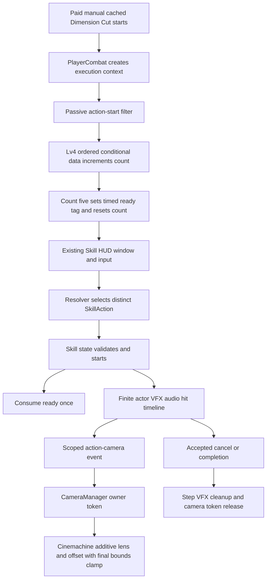

# Main Dimension Slash Architecture

Architecture approved2026-10-27 by the user: “LGTM, arch approval.” Implementation is authorized within this plan; historical proposal wording below records the reviewed decisions.

Prepared and approved 2026-10-27. The user approved the design (“LGTM, Start process”) and architecture (“LGTM, arch approval”), including Passive Lv4, five existing paid Dimension Cuts, and a timed Skill-command Dimension Slash. New generated actor motion preserves New_sprite identity, with actor and VFX separate. The implementation and evidence are recorded in the implementation report; subjective polish remains for human review.

Implementation detail discovered in capture: finite clips normally free-run on Animator time, producing a small pose/contact drift. `AttackStepData.syncAnimationToActionFrames` is an opt-in, default-false presentation setting. Dimension Slash uses a zero-speed Animator state sampled explicitly by `PlayerCombat` at each logic frame; existing actions retain their path. It introduces no resolver or movement authority. The custom editor exposes the setting.

## 1. Decision and Scope

Use a distinct **SkillAction** in Main's existing `skillActions` list. This is a standalone player action, not a replacement for Dark Chain, Jailbreak Punisher, or the existing cached Dimension Cut, and does not require the C# StandaloneAction subtype. Count accepted paid manual executions of `main.dash.dimension_cut`, excluding QTE intros and non-field reuse. Five opens a single timed opportunity. The Skill command selects Dimension Slash while that opportunity is valid, even if Dark Chain is cooling down.

Reuse existing per-character counters, timed tags, Potential rules, resolver, Skill state, and follow-up HUD. Add only (a) opt-in action-start provenance filtering needed to exclude free QTE reuse, (b) a final start-result/consume guard if integration demonstrates that existing void-return start paths can consume readiness after failed entry, and (c) a scoped action-camera event/extension for actual framing motion, which the existing scalar shake request cannot express.

| Decision | Proposed choice | Reason / approval boundary |
| --- | --- | --- |
| Unlock | Existing `main.passive.lv4`, Passive>=4 condition | User requirement; keep current +2-box capacity and Void Area gain effects |
| Count point | Accepted paid Normal cut root-step start; not damage or natural completion | Matches performing an action without crowd/multihit inflation; later interruption does not refund setup |
| Count threshold | Five | User requirement |
| Follow-up window | **Starting value:**1.5 scaled seconds | Uses existing timed tags; pause/hitstop do not consume it; test whether player can deliberately select Skill |
| Ready behavior | One opportunity; ignore further cuts while ready; no refresh or queue | Prevents indefinite banking; count resets when ready is armed |
| Expiry | Opportunity expires unused; five new cuts are then required | Explicit proposed lifecycle; no automatic cast or ordinary Skill consumption |
| Runtime lifetime | Count survives ordinary swap; ready expires off-field on scaled time | Existing TeamLoader per-character runtime record; no new save state |
| Entry/output | Both / MatchInput, same context coverage as existing cut | Preserve air-combo use; no forced floor snap or new displacement |
| Follow-up identity | `main.skill.dimension_slash`, `SkillAction`, priority1 | Current Main skill list has only Dark Chain priority0; new gate wins only while eligible |
| Follow-up cost | cooldown0, resourceCost0, no AE or additional cached-cut spend | Five paid cuts are setup; normal Skill cooldown remains intact and does not block it |
| Motion | Existing state-owned MotionData authority; no new displacement in first slice | Preserve ADR-003 and stable actor registration |
| Camera | New additive action-frame envelope, owned by CameraManager and released by token | Required to deliver framing push/recoil without fighting camera priorities or modifying MainCamera transforms |
| Cancellation | Existing Skill interrupt policy; accepted cancel truncates step VFX and releases scoped camera | Cancel66 does not redefine protection or all prior legal interrupts |

These lifecycle and camera decisions are proposed for architecture approval. Final total damage budget and imported art quality remain content/feel validation; this plan does not invent damage balance or certify generated art.

## 2. System and Data Flow



Authority remains: saved Passive level -> PlayerMetaProgression; transient count/tag -> TeamLoader's character CombatRuntimeState; eligibility -> ActionResolver plus PlayerCharacter availability; execution -> CombatPlayerState/PlayerCombat; movement -> PlayerMovement; damage -> existing shared processor; camera composition -> CameraManager and its Cinemachine extension. No new singleton, manager GameObject, input binding, dependency or build/render configuration is required.

## 3. Content and Gate Contract

### Identifiers and eligibility

Proposed new keys are `main.skill.dimension_slash`, `main.dimension_slash.cut_count`, and `main.dimension_slash.ready`. They never alias `main.shadow` or `main.shadow.cached_cuts`.

New SkillAction conditions:

- `PotentialLevelActionCondition(track=Passive, comparison=GreaterThanOrEqual, level=4)`.
- `RuntimeTagActionCondition(tagType=Custom, tag=main.dimension_slash.ready, shouldExist=true)`.
- Both context; MatchInput output; priority1; cooldown0; resourceCost0; requiresEnemyTarget=false for stable whiff/target-death handling; one finite root, no active loop or self-reselect.

Passive Lv4 also gets an identity-matching `PassiveActionModifierDefinition(category=Skill, actionId=main.skill.dimension_slash, unlocked=true)` requiring the positive ready tag. This exposes the timed tag to existing `TryGetActionAvailabilityWindow`, Skill routing and AbilityUIManager. The explicit Potential/tag conditions remain necessary: `IsActionUnlocked` defaults true when no active modifier matches.

### Ordered Lv4 state rules

Place both threshold entries together in the existing Lv4 conditionalStateEffects list; preserve all other Lv4 data.

| Order | Trigger and exact source | Conditions | Effects |
| --- | --- | --- | --- |
| 1 | OnActionStarted, Normal, `main.dash.dimension_cut`, root step `DimensionCut`, manual on-field provenance | ready absent | Add1 cut_count |
| 2 | Same source/provenance | ready absent, cut_count>=5 | Set ready tag for1.5 scaled seconds; reset cut_count0 |
| 3 | OnActionStarted, Skill, new Dimension Slash ID | Accepted live start | Remove ready tag idempotently; existing Skill state's availability-window clear remains safety cleanup |

`CharacterPassiveController.ApplyConditionalEffects` evaluates entries in order against live runtime state, then applies nested tag effects before counter effects. Entry2 sees Entry1's increment. Ready-absent guards prevent extra cuts from refreshing the tag or accumulating a queued opportunity. New counter identity prevents the existing Shadow Meter multiplier from changing this count.

The existing cut is one root step, so an exact root-step start occurs once per accepted execution. The count requires a test if its authored tree changes later. Do not count OnHitDealt (multiple targets/crit/additional damage) or OnActionEnded (also raised by cancellation/reset). Fifth-cut readiness begins at its accepted start; Skill can be used during a later legal cancel of that same fifth cut, before its completion.

### Provenance gap and minimal proposed API

Current Main QTE intro executes the same cut action/step without paying its manual cached-cut cost. ExecuteStep already creates `CombatExecutionContext` with `isQteIntro` before raising OnActionStarted, but PassiveEventContext/filter does not expose it. Pure data cannot reliably exclude that reuse.

Proposed signatures/fields are contracts, not implementation code:

```csharp
// Add optional originating execution to the existing notification.
void NotifyActionStarted(AttackCategory category, string actionId,
    string actionName, AttackStepData step, CombatExecutionContext execution = null);

// PassiveEventContext: populated from the notification's actual execution only.
CombatExecutionContext actionStartExecution;

// PassiveTriggerFilter: default false preserves every existing filter.
bool requireManualOnFieldActionStart;
```

When opted in, require a non-null originating execution, `execution.IsOnField`, `!execution.isQteIntro`, and matching context source character/owner. Only the new source-count rules opt in. Do not reconstruct provenance from a later current action, globally suppress QTE passives, or add this character rule to the artifact runtime. Existing manual cut hit/QTE-outgoing behavior is unchanged.

### Start transaction and races

Preview/availability/HUD queries are read-only. Re-resolve at live entry with current Passive level, ready tag, context and availability. Consume ready only after a real accepted Dimension Slash start, once; a rejected preview or failed entry leaves it unspent. Existing OnActionStarted occurs only after ExecuteStep begins; tag removal there and `ClearActionAvailabilityWindow` afterward are idempotent.

Test the theoretical expiry/selection race through the real FSM: query just before expiry, attempt entry after it, and ensure no fallback Dark Chain is unintentionally spent as though it were the chosen follow-up. The existing Skill state previews then resolves again; its ExecuteCombatStep returns void. If the integration test exposes an ambiguous failure result, make that helper return a minimal accepted-start bool and clear the selected window only after true; verify the live resolved ActionKey still matches the preview-selected follow-up before mutating readiness. Do not introduce a new token ledger, mutate ready in an availability query, or bypass normal Skill cooldown rules globally.

## 4. Finite Action Timeline

Use existing `AttackStepData` with startup11, active48, recovery25, cancelWindowStartFrame66, loopActivePhase=false, autoChainToNext=false: TotalFrames84. Frame0 is initial presentation; Active is12–59; Recovery begins60; Cancel overrides the remainder from66; Done occurs when the current runtime clock exceeds TotalFrames. Verify exact end sampling in the editor rather than treating illustration labels0–83 as a different timing engine.

| Track | Proposed authored data |
| --- | --- |
| Actor | New clean brace/burst/compression/final-cut/recovery clip; regular New_sprite identity, newly generated reference-inspired motion permitted; no baked slash in actor strip |
| Slash VFX | Separate clips/events for core, edge and residual; no requirement to create VFX Graph or new shader |
| Damage contacts | Absolute12,20,27,33,38,42,54; active-relative offsets0,8,15,21,26,30,42; two-frame non-overlapping NormalHitbox windows |
| Holds | First/last burst authored2-frame confirmed stop, final6; other burst authored0; critical minimum2 remains existing behavior and must be measured |
| Camera | Begin one action-scoped envelope at frame0; final release sample aligns with54; release toward neutral by66; never a full-burst freeze |
| Audio | Frame-aligned short release/impact layers, separate compression cue and final tear; duration metadata is not a runtime fade |
| Tail | Residuals through83 only while the step remains active; accepted cancel/exit truncates tracked step VFX |

Damage uses the existing actionDamageMultiplier and hit-owned damage ratios/types through the shared Primary pipeline; no independent damage path, proc policy or resource grant is added. **Starting prototype value:** total action multiplier5 (the currently authored cached cut multiplier), six burst ratios0.08 each and final ratio0.52, summing to1. This is a finite provisional500% ATK budget, not approved final balance. Test a durable target with fixed stats/noncrit and no unrelated procs: the seven accepted Primary deliveries must equal the expected existing processor output, and final delivery must exceed any single burst. Correct attribution/ratios first on failure; tune the total only after feel/readability and acquisition cadence are evaluated. Do not imply that the count of drawn lines is the damage count. Target death or a whiff must not prevent action/camera cleanup.

The existing cached-cut Passive1 critical/Defense modifiers and Passive3 healing are scoped to `main.dash.dimension_cut`; the new ID must not silently inherit them. Preserve those exact filters. Any new action-specific balance or UI description must name only approved new behavior rather than copying the old cut's bonuses.

All numbers beyond Passive4/count5 are starting values. Rhythm tests compare acceleration to equal spacing, inspect per-target accepted deliveries, and reduce repeated pauses before increasing effect brightness/shake. Both/MatchInput preserves cause-aware support rules; no new floor snap, teleport, armor or invulnerability is proposed.

## 5. New Scoped Camera Architecture

This is **new proposed architecture requiring approval**. Current ScreenImpulse supports scalar pulses and delayed slow motion; it cannot author the requested deliberate framing push and directional recoil. Current Ultimate zoom changes camera priority/blends and is not reused for this standalone path.

### Authoring and owner contract

Append a new `ActionEventType.ActionCameraMotion` enum value after existing values; never renumber serialized event types. Add serializable settings with ordered relative logic-frame keys, orthographic-size multiplier, and horizontal viewport-relative offset. Extend event duration/rescaling to include these relative keys so timeline preview and authored-FPS changes stay aligned. No camera roll, world rotation, autonomous slow motion or world-freeze payload is needed. The action editor exposes this event and uses the same envelope evaluator for preview and runtime.

Proposed API shape:

```csharp
readonly struct ActionCameraToken { public int Generation { get; } }

ActionCameraToken CameraManager.BeginActionCamera(
    CombatExecutionContext execution, ActionCameraMotionSettings settings,
    int eventStartFrame, int capturedFacing);
void CameraManager.SampleActionCamera(ActionCameraToken token, float actionFrame);
void CameraManager.ReleaseActionCamera(ActionCameraToken token);
```

CombatPlayerState stores the returned token and feeds the executing step's action clock. New `ActionCameraMotionExtension : CinemachineExtension` applies only the current token's sampled additive correction to camera state. CameraManager distributes the same envelope to its existing cameras, so ordinary room/combat camera ownership can transition without a separate priority system. Stale generation releases are ignored; a new request replaces its previous action-camera contribution.

| Owner | Responsibility / owned state |
| --- | --- |
| ActionCameraMotionSettings | Immutable authored frame keys and bounded lens/offset values |
| CombatPlayerState | Execution token, sampled step frame, release on step change/Exit; no camera transform ownership |
| CameraManager | One current generation/execution, current sample, camera attachment/cache, room/focus/swap invalidation |
| ActionCameraMotionExtension | Additive orthographic lens/PositionCorrection; actual final viewport bounds enforcement; no timer or gameplay state |

The action clock owns progression: hitstop/pause holds the envelope; ordinary running frames advance it; slow motion advances at the existing scaled action rate. Render interpolation may smooth between valid samples but must not fire the frame54 peak before its confirmed action beat or drift through a frozen step. Do not copy QteIntroCameraImpact's rendered-frame clock for this action.

### Starting envelope and feel tests

- Starting baseline multiplier1/offset0. Modest build-in may approach multiplier0.99 near the late burst, relax for the held beat, then reach multiplier0.96 at final54 (approximately4% push). Recover to1 by66.
- Starting final camera recoil: about0.35% viewport width opposite captured facing at54, about0.1% in the opposite direction at56, zero by60. Use finite smooth interpolation, no roll and no continuous random vibration. These are new tuning values, not extracted BBEEx measurements.
- Test at native pixel scale with no-camera baseline, both facings, normal/crit/whiff, room edges and30/60/120fps. Pass: final beat gains weight while Main/target stay visible and important telegraphs remain legible. Reduce/remove translation or push if shimmer, crop or nausea appears; adjust event alignment before increasing amplitude.
- Use the existing brief confirmed-hit impact system as baseline, without an extra long ScreenImpulse rumble. Its existing unscoped short impact tails are separate from this scoped envelope and must not be mistaken for a stuck new camera owner.

### Bounds and composition

Local Cinemachine3.1.6 source confirms Confiner2D correction runs at Body stage; a new lens/offset at Finalize bypasses that earlier confinement. The new extension must clamp the **final corrected viewport**, using actual enabled axis-aligned BoxCollider2D bounds and the final orthographic size/aspect. Clamp X/Y against viewport half-extents, accounting for existing PositionCorrection, rather than clamping only the requested offset. If the view cannot fit, preserve the valid base composition and suppress the presentation correction.

For unsupported non-Box/rotated bounds or a tilted camera, suppress new presentation offset instead of claiming polygon safety from an AABB. Static rooms retain their authored center; no player recenter/pan is introduced. Optional bounds-safe lens push must pass static-room tests or be suppressed there as well. Do not change confiner assets or room dimensions for this action.

Token release is required on accepted cancel, natural completion, step replacement, death/disable, character switch/QTE handoff, room/scene change, camera-manager disable and superseding camera focus/Ultimate ownership. Release removes only this envelope's contribution. It must not restore Time.timeScale, alter unrelated pause holds, lower another camera's priority, cancel QTE centering or clear another action's current token. Follow the QTE extension's CameraState/Lens pattern, but keep its rendered-frame effect and ownership independent. QTE handoff/special focus invalidates the outgoing action envelope before applying incoming camera feedback; do not rely on extension callback order to resolve conflicts.

## 6. Files and Responsibilities

| File | Proposed modification |
| --- | --- |
| `Assets/Project/Scripts/Character/CharacterProgressionDefinition.cs` | Add opt-in manual on-field start predicate and originating execution field; no default behavior change |
| `Assets/Project/Scripts/Combat/CharacterPassiveController.cs` | Accept/pass exact execution metadata to action-start context; preserve existing trigger ordering |
| `Assets/Project/Scripts/Combat/PlayerCombat.cs` | Supply its freshly created CurrentExecution to notification; no count stored on shared MonoBehaviour |
| `Assets/Project/Character/Hero/test_0_Main/CharacterObject_main.asset` | Extend existing Passive Lv4 effects with count/window rules and availability modifier; preserve all prior effects and QTE configuration |
| `Assets/Project/Character/Hero/test_0_Main/ActionResolverTable_main.asset` | Add distinct SkillAction and authored finite tracks; keep existing action IDs/data intact |
| `Assets/Project/Scripts/Character/ActionEventFrameData.cs` | Append camera event enum value and camera-key settings, duration and relative-key rescaling |
| `Assets/Project/Scripts/Player/States/CombatPlayerState.cs` | Begin/sample/release camera token; only add accepted-start bool propagation if failure-path integration requires it |
| `Assets/Project/Scripts/Player/States/PlayerSkillState.cs` | Guard final selected identity/start success before one-use window clear if existing path proves ambiguous; retain SkillAction typing and Dark Chain cooldown semantics |
| `Assets/Project/Scripts/Cameras/CameraManager.cs` | Own/cache generation and extension dispatch; invalidate on focus/room/QTE/disable boundaries; preserve base camera policy |
| New `Assets/Project/Scripts/Cameras/ActionCameraMotionExtension.cs` | Bounded additive state correction from sampled envelope with no independent clock |
| Existing action authoring UI in `Assets/Project/Scripts/Editor/UI/PropertyCardBuilder.cs` and timeline support | Camera event editing/preview, standard serialized Undo/dirty behavior; no separate authoring framework |
| Main actor/VFX source sheets, imported clips and VFX library entries | New separate assets after final image/pixel/pivot verification; no changes to unrelated sprite direction/import settings |
| Focused new tests and existing relevant test fixtures | New count/provenance/window/real-FSM/camera failures plus imported-data/live-physics validation |

No ActionResolver algorithm change, Skill/Ultimate subtype generalization, new input action, dependency, CI/build/physics/timescale configuration change or asset bulk-normalization is proposed.

## 7. Existing ADR Alignment and Proposed Camera Decision

- [ADR-003](../ADRs/003-deterministic-player-state-owned-movement.md): existing context, motion, cancel and output authority remain intact; camera never moves the actor.
- [ADR-005](../ADRs/005-deployed-character-live-stat-authority.md): count/tag live in TeamLoader's per-character runtime state, not shared actor identity or disk saves.
- [ADR-008](../ADRs/008-unified-player-damage-delivery.md): existing Primary delivery, hit-owned type and unified per-enemy processor remain authoritative.
- [ADR-010](../ADRs/010-artifact-passive-event-and-secondary-effect-authority.md): CharacterPassiveController remains Potential authority; no character setup state is placed in artifact runtime or event hub.

No accepted ADR is superseded. [Accepted ADR-013: Action-Owned Camera Presentation](../ADRs/013-action-owned-camera-presentation.md) records the new authority rule: **action presentation is sampled by the executing action clock and applied as a token-owned, bounds-clamped additive Cinemachine contribution through CameraManager.** Alternatives rejected for this feature are direct MainCamera transform animation, borrowing Ultimate priority zoom, long unowned camera coroutines, or copying QTE's rendered-frame clock. The ADR is accepted following the user architecture approval.

## 8. Validation and Handoff

[Follow-up gate audit](../Reports/MainDimensionSlash/follow-up-gate-audit.md) contains exact source evidence and alternatives. [Resolver audit](../Reports/MainDimensionSlash/resolver-audit.md) records clock/cancel/VFX limitations. [Design](main-dimension-slash-design-spec.md), [sprite evidence](../Reports/MainDimensionSlash/sprite-audit.md), [reference analysis](../Reports/MainDimensionSlash/reference-analysis.md), and [test plan](../TestPlans/main-dimension-slash-test-plan.md) govern the prototype. Post-implementation results are recorded in the implementation report; the list below remains the full intended validation scope.

Fresh pre-implementation baseline: [79 existing tests passed](../Reports/MainDimensionSlash/pre-implementation-baseline.md) on2026-10-27 (61 ShadowMeterTests,18 CombatDamageTypeTests). Protected asset/config hashes and the original scene were preserved. This is not a pass for the proposed feature, new Skill/camera integration, physics timing, or art.

Required evidence after approval:

1. Rules and real FSM: Passive0–3 no count; Lv4 cuts1–4 no ready; fifth accepted paid root opens once; reject/QTE/clone/off-field/multihit paths cannot count. Expiry, duplicate queries, repeated input and preview/live identity disagreement cannot consume/cast incorrectly.
2. Existing kit: ordinary Skill cooldown remains unchanged while special executes, preserves fallback on expiry, no additional cached/AE spend; Passive1/3/4, Ultimate and QTE regressions pass.
3. Physical integration: real prefab, enemy colliders/Physics2D and shared damage processor at30/60/120 rendered fps. Seven intended Primary deliveries at most once per target; timing logs alone do not prove collider contact reliability.
4. Camera: action frame54 peak alignment, held clock during pause/hitstop, no stale-token release of a newer owner, final viewport inside actual bounds, static/unsupported-bound fallback, QTE/focus/Ultimate composition and cancellation cleanup.
5. Art/presentation: generated new actor identity and motion reviewed independently of VFX, no baked duplicate slashes, consistent pivots/body/pixel scale; normal-speed captured rhythm/audio and both camera-off/on comparison pass before polish approval.

Implementation should start with the gate and placeholder finite action, then scoped camera, then validated actor/VFX production. Preserve the existing dirty working tree and use narrow edits. The initial implementation now exists; see the implementation report for evidence and remaining acceptance work.
