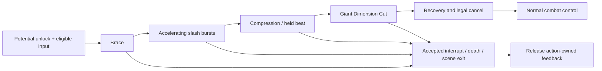

# Main Dimension Slash: Research and Action Design

Prepared 2026-10-27. **Design proposal only. No gameplay, art import, scene, camera configuration, or runtime code was changed.**

Design approval received 2026-10-27: user “LGTM, Start process.” User's activation clarification supersedes the earlier undecided trigger/tier candidates below: **Passive Lv.4; perform five Dimension Cuts, then a timed Skill-command follow-up executes Dimension Slash.** This approves the design direction and starts architecture preparation; it does not represent architecture approval. Remaining duration/counter/cost lifecycle details are explicit proposals in the architecture plan.

## 1. Intended Player Experience

Main braces, a compact flurry tears across the target region in increasingly fast groups, then the visual field briefly contracts. One giant Dimension Cut releases the stored tension. The final cut has the clearest shape, strongest impact, and longest decay. The player can distinguish the barrage, the held breath, and the ending even with camera shake disabled.

This is a **new standalone action unlocked by a Potential**, as clarified by the user. It does not replace `main.ultimate.jailbreak_punisher` or `main.dash.dimension_cut`, and does not silently reuse their costs or triggers. Main's actor art direction comes exclusively from `test_0_Main/sprite/New_sprite`. Actor and slash VFX are separate production assets.

The user subsequently clarified that **new actor sprites may be generated to mimic the BBEEx motion**, with New_sprite used for art consistency rather than mandatory frame reuse. The production plan therefore calls for new clean actor poses and separately generated/authored slash VFX.

The recommended production route is deliberate pixel-animation sheets plus Unity's Sprite/Animation and existing action-authoring tools, operated and verified through Unity MCP. Aseprite is preferred if available; its importer is already declared, but an installed editor executable has not been verified. Final art needs temporal/pixel/pivot inspection. Generating one attractive bitmap would not produce a finished action animation.

### Evidence and design truth

- GDD `@tag:visual-audio`, lines71-82: “Character animation can be short and economical as long as the VFX sells the hit”; “Use large slash arcs, burst circles, impact flashes, hit-stop, and camera shake to sell attacks.”
- GDD `@tag:combat`: authored Startup/Active/Recovery/Cancel, state-owned MotionData, cause-aware ground/air handling, and resource/cooldown gates remain authoritative.
- GDD `@tag:platform-input`: PC keyboard/mouse is authoritative; existing action buffering is 0.15 seconds. Complete controller parity is not currently documented.
- GDD `@tag:inspirations` explicitly includes BlazBlue Entropy Effect.
- [Reference observations](../Reports/MainDimensionSlash/reference-analysis.md), [system evidence](../Reports/MainDimensionSlash/resolver-audit.md), [sprite evidence](../Reports/MainDimensionSlash/sprite-audit.md), and [primary-source research](../Reports/MainDimensionSlash/primary-source-research.md) separate observations, current implementation, and proposed behavior.

## 2. What to Take from the Reference

The supplied recording is approximately 2.1 seconds and begins during an ongoing demonstration. Its first second is preceding combat/setup; it is not evidence for a mandatory one-second charge on the new action.

| Visible evidence | Why it matters | Proposed adaptation |
| --- | --- | --- |
| Thin cyan incisions around 1.15-1.20s, then broad bright wedges | Contrasting thickness and value gives the release scale | Narrow seams and compact strikes prepare the giant cut |
| Broad cuts change direction while old thin lines remain | Snap at the front, overlap at the tail gives continuity | Independently time strong leading edges and dim residuals |
| Actor-like silhouettes/arcs appear at several locations | Body and VFX convey different parts of the movement | Keep Main's real body readable; optional echoes support speed |
| Purple-blue field builds behind brighter cuts | Background contrast strengthens the foreground | Use Main's lavender/purple palette and restrained background darkening |
| Large bands narrow into crossed lines and fade | Removing visual energy restores room readability | Give the final cut a deliberate collapse and clean finish |
| Early background tracking is consistent with a modest push | Camera can amplify scale without dominating it | Start restrained; tune framing before adding larger shakes |

The excerpt does **not** clearly show a separate giant end cut after the barrage. That is the user's requested conclusion for this new action. Exact BBEEx hitstop, damage count, camera curves, clone implementation, and sound layering cannot be established from this recording.

Published techniques support the design inference: brief temporal punctuation ([Sakurai](https://www.youtube.com/watch?v=OdVkEOzdCPw)); strong keys, anticipation and timing with limited animation frames ([Mariel Cartwright / GDC](https://www.youtube.com/watch?v=Mw0h9WmBlsw)); a short, decaying camera response that preserves base framing ([Squirrel Eiserloh / GDC](https://media.gdcvault.com/gdc2016/Presentations/Eiserloh_Squirrel_JuicingYourCameras.pdf)). These sources do not describe BBEEx's implementation.

## 3. Interaction and State Proposal

| State property | Design proposal / decision boundary |
| --- | --- |
| Unlock | Explicit **Passive Potential Lv.4** eligibility, per the user. An inactive Potential's unlock modifier alone does not lock an action in current code. Preserve the existing node's other effects. |
| Input | **Skill command** during the timed opportunity after performing **five Dimension Cuts**, per the user. The earlier contextual Attack candidate is superseded. Consume the opportunity only after an accepted Dimension Slash start; otherwise ordinary Skill remains available under its existing rules. |
| Entry | Potential unlocked, contextual opportunity valid, permitted action state, and authored resource/availability checks pass. Ground-first prototype is proposed; Air behavior must be deliberately chosen before production. |
| Target | Use a stable actor-relative combat region. Whiff still plays the core slash choreography; confirmed-hit effects require actual contact. Do not require a living target just to restore camera/time ownership. |
| Facing and motion | Capture direction at entry. Actor stays registered through the barrage; the final pose may include a short authored lunge. MotionData owns any displacement. No unrequested teleport or root transform animation. |
| Exit | Natural completion, accepted existing cancel, death, disable, team switch when legal, or scene transition. Each releases action-owned visuals/time/camera state. |
| Interruptibility | Preserve legal FSM rules in the initial feel prototype. A protected commitment until the finisher is a separate design choice; merely setting Cancel66 does not enforce it. Normal-trigger actions currently permit some Active interrupts. |
| Follow-on actions | Existing buffered actions may begin at accepted boundaries. Repeated input must not immediately reopen the contextual opportunity or create infinite self-reselection. |
| Cost and cadence | The user-selected Skill follow-up is a distinct independent action. Proposed storage is a new SkillAction in the existing skillActions list, satisfying current Skill FSM subtype checks without changing plain StandaloneAction. The architecture packet defines its proposed gate and cost/cooldown lifecycle; the earlier Normal-input candidate is superseded. |
| Terrain/air | Existing cause-aware context rules remain authoritative. Test ledges, platforms, genuine support loss, walls, and ground output. Ground-only entry must not imply unsafe mid-action snapping. |

**Assumption:** regular New_sprite white jacket, purple trousers, white hair/tuft, and purple blade are the actor baseline. **Impact:** avoids introducing a costume transformation for a standalone action. **If wrong:** the presentation may need the caped Ultimate costume instead. **Validate:** human review of the sprite evidence board before drawing final actor frames.

## 4. Proposed Rhythm and Feedback Tracks

All numbers in this section are **Starting values**, not measurements of BBEEx or approved balance. Frames use the project's 60Hz action clock. They exclude contact hitstop, which adds real elapsed time. Recording frames and sprite exposures are separate concepts.

The first comparison should test this shape: **six accelerating burst contacts, a clear held beat, one dominant finishing contact**. Several decorative VFX lines can belong to one contact; do not turn every drawn line into damage or shake.

| Logic interval | Actor | Separate VFX | Camera / time | Audio and damage |
| --- | --- | --- | --- | --- |
| 0-11, brace | Lower center of mass; blade clearly registered; immediate pose response | Sparse edge spark / short seam cue | Stable framing, no rumble | Short charge/inhale cue; no damage |
| 12-43, burst | Economical release keys and held authoritative pose; hair/jacket follow through | Cuts at changing authored angles; narrow core, broader edge, then dim residual | Small accents at group boundaries; ordinary advancing action time | Contacts12,20,27,33,38,42; short sharp transients and rising cadence |
| 44-53, compression | Distinct held preparation for final cut | Broad burst shapes disappear; remaining seams contract | Quiet camera beat; no added global freeze required | Charge accent contracts or drops in density; no new damage |
| 54-59, Dimension Cut | One unmistakable committed cut silhouette | Largest continuous wedge/seam, local impact core, dark-purple echo | Strongest short camera response; strongest confirmed-contact hold | One finishing contact54; low body impact + tearing transient + short tail |
| 60-65, early recovery | Settle hands/blade and feet | Final blade narrows into segmented residuals | Begin returning framing and contrast | No new damage; release sound tail |
| 66-83, optional tail | Blend toward normal combat pose | Remaining lines/shards dissipate if the action continues | Cancel-window target66; return toward ordinary framing | No new damage; legal cancels may truncate action-owned tail |

Starting contact intervals are 8,7,6,5,4 frames. This gentle acceleration should read as an organized flurry rather than evenly spaced identical swings. The last burst ends before the compression beat. A counter-test with even spacing is required; acceleration is a hypothesis, not an automatic improvement.

Starting damage windows are two logic frames per contact, non-overlapping. Starting authored hitstop is two frames on the first and last burst, zero on other burst contacts, and six on the finisher, all on confirmed contact. Current critical-hit behavior can impose a two-frame minimum even on authored zero, so critical hits may add pauses. Test that case before accepting the rhythm.

The visual timeline is 84 logic frames / 1.4 seconds before hitstop. Target Cancel66 is not a promise of unrestricted control at that instant: category interrupt policy, recovery movement and VFX cleanup must be verified. The initial prototype accepts clean tail truncation on an accepted cancel. Continuing the tail after leaving the action is a later ownership decision, not a currently supported assumption.

### Starting-value test packet

| Starting value | Micro test and pass criterion | Adjustment if it fails |
| --- | --- | --- |
| Six burst contacts then one final contact | Inspect debug contact logs: seven intended samples, each at most once per target; observer can distinguish flurry and final cut | Reduce burst count if density obscures phases; fix delivery before adding hits |
| Burst contacts12,20,27,33,38,42 | Compare accelerating and evenly spaced versions at normal speed; reviewer consistently identifies an intentional build | Increase separation if it sounds/looks like one smear; reduce early spacing if it drags |
| Ten-frame compression44-53 | Reviewer can anticipate a separate ending without interpreting the actor as idle or stalled | Shorten if flow breaks; lengthen only if final release cannot be distinguished |
| Final contact54; visual peak54-59 | Frame inspection places actor release, slash contact, damage, audio onset and principal kick on the same intended beat | Align events before increasing brightness or shake |
| Two-frame damage windows | At 30/60/120 rendered fps, intended targets register each contact once and targets outside the region do not | Repair timing/physics delivery or modestly widen windows; never mask misses with duplicate damage |
| Base hitstop2 / 2 / 6 frames | Compare normal, critical, crowd and whiff captures; flurry flows and ending reads heavier; whiff does not claim hit confirmation | Reduce repeated pauses first if the burst stalls; increase final hold only if impact is still weak after alignment |
| 84-frame visual duration; Cancel target66 | Buffered actions enter at allowed boundaries; no involuntary extra lockout; cancellation leaves no feedback behind | Shorten recovery if it feels delayed; revise interrupt policy explicitly if early interrupts break the intended sequence |
| Burst kick about one fifth of final request strength | Compare shake disabled/enabled; contact hierarchy survives both and the target remains visible | Lower burst strength/count if baseline shake hides the finish; calibrate source/listener gain before increasing values |
| Optional apparent push around four percent at climax | Compare no-zoom/push at actual game resolution, room edge and crowd; no important target/telegraph is cropped or visibly degraded | Remove/reduce push if shimmer or framing loss outweighs scale benefit |

These tests define tuning direction; they do not claim completion. Final damage ratios, resource costs, unlock tier, priority and cooldown remain unset.

## 5. Actor and Pixel VFX Production

The apparent 4x grid in sampled New_sprite sheets is exact repeated pixel blocks. Their PPU, filter settings and pivots vary. Match **apparent body size and logical pixel size in the game camera**, not atlas size alone. Some existing active actor frames bake white slash arcs into the same PNG; clean actor-only exports or redrawing are required before compositing independent effects.

| Track | Production deliverable | Quality target |
| --- | --- | --- |
| Actor | Brace, burst/release, compression hold, decisive final cut, recovery keys; editable layered source and clean transparent sprite strip | Stable feet/body scale/weapon hand; regular costume consistent throughout; economical animation with deliberate exposures |
| Burst core and edge | A family of authored slash angles, exported independently from actor | Hard tapered pixel clusters, readable leading edge, Main's white/lavender/purple vocabulary |
| Residual seams | Thin broken-line flipbooks with their own exposure/decay | Dim enough that the next cut stays dominant; no permanent white lattice |
| Local impact | Compact star/shape at confirmed contact, separate from traversal slash | Indicates contact, not a false hit on empty space |
| Dimension Cut | Narrow anticipation seam, dominant release blade, dark inner split/echo, collapse pieces | Reserve largest bright area and strongest shape for this beat; bright cutting core matches damage region, while any larger non-damaging halo/residual reads as secondary |
| Secondary accents | Optional sparse shards/echoes and restrained aura | Support the main shape without obscuring actor or enemy danger zones |

Author important slash directions in the pixel editor rather than repeatedly rotating a soft high-resolution line. Start with alpha-composited crisp shapes; any soft aura stays behind the core. Do not require new screen-distortion shaders, actual split-screen displacement, VFX Graph, bloom changes, or a new render feature to prove the action.

Unity's official [sprite preparation guidance](https://docs.unity3d.com/6000.0/Documentation/Manual/urp/2d-pixelperfect-prep-sprites.html) supports consistent PPU, Point filtering, compression choices and pixel pivots. The inspected scene has no verified PixelPerfectCamera component. [Cinemachine's pixel-perfect documentation](https://docs.unity3d.com/Packages/com.unity.cinemachine@3.1/manual/CinemachinePixelPerfect.html) also warns that blends temporarily cease to be pixel-perfect. Choose the acceptable camera/pixel tradeoff from captured gameplay; do not silently change the project-wide camera setup or bulk-normalize existing imports.

## 6. Camera, Impact, and Sound Direction

Camera priorities are: keep Main visible, keep the target region readable, respect room bounds, support release scale, then add vibration. Do not chase every decorative slash. Keep the compression beat comparatively still so the final response has contrast.

The first prototype can use current scalar ScreenImpulse events with a short envelope. Exact directional shove/recoil and a per-frame lens path are **not** exposed by the inspected request. A restrained framing push is a design target for evaluation after approval, with the existing CameraManager remaining the owner; it is not authorization to animate MainCamera transforms from an unrelated system.

Contact feedback and choreography must remain distinct. The slash release and a restrained authored accent may occur on a whiff; target flash, blood/sparks and hitstop require confirmed contact. Existing automatic impact feedback can stack with authored events, and Ultimate-category hitboxes can flash on every enemy hit. Test crowds before introducing any full-screen flash. Favor local peaks and background contrast in the first pass.

Audio is required to judge satisfaction, though it was not auditioned from the reference in this pass. Author distinct transient families for burst groups, a contrasting compression cue, and a finishing tear with a lower body impact. Use available variation controls to avoid six identical samples. AudioEntry.duration is not a verified runtime envelope or cancellation mechanism; select short clips or verify tails. Music ducking and controller haptics are later polish decisions, not assumed current hooks.

## 7. Existing-System Fit and Required Cautions

This is a capability assessment for design, not an architecture plan. The detailed audit contains source paths and line anchors.

| Need | Current support | Consequence for the plan |
| --- | --- | --- |
| New Potential action | `standaloneActions`, PotentialLevelActionCondition, resource checks and explicit predicates | Unique action ID; explicit lock before unlock; track/tier/trigger/priority/cost must be selected; Skill/Ultimate subtype checks currently reject plain StandaloneAction in those execution paths |
| Separate actor/effects | AttackStepData actor clip plus VFX, audio, hit, motion and event tracks | Keep one action clock and independent authored tracks |
| Burst damage | Explicit hit entries with active-relative offsets | For contact12, startup is11; tentative offsets are0,8,15,21,26,30,42 for the final54; validate boundaries in tooling |
| Finite barrage and finish | One finite step or explicit auto-chain nodes | Prefer explicit event entries over assuming looped effects all reset identically; exact data layout follows approved design |
| Continuous cinematic freeze | Events/actor can advance unscaled, but PlayerCombat skips normal combat tracks during hitstop | Keep damaging burst on ordinary advancing action time; no full-burst freeze workaround in this phase |
| Freeze duration override | Serialized field exists but executor does not read it | Do not use it as a timing control |
| Camera shake | Scalar start/end strength, duration and pulse interval | Bounded small accents then one larger ending; directional path remains a gap |
| Slow motion | Current ScreenImpulse slow motion begins after its pulse loop and delay | Do not assume it starts simultaneously with the event; not required for the first rhythm prototype |
| Zoom | Existing Ultimate camera blend/restore, default transition0.35s | Not a general frame-authored standalone lens track; ownership and use outside the overlay need review |
| Independent damage windows | Shared hitbox processes entries | Keep windows non-overlapping; simultaneous shapes need explicit verification |
| Effect lifetime | Pooled action effects are stopped on step change/cancel/reset/completion | Tail truncation is accepted for first prototype; no promise of persistent tails after exit |
| Interrupt cleanup | Freeze tokens, overlays, afterimages and zoom have cleanup paths; impulse tails lack per-action cancellation handles | Use short impulse tails; test cancellation, pause, death and scene exit; identify any cleanup gap before final polish |

The latest Skill-input proposal is a distinct SkillAction selected from the existing skillActions list while Passive4 and a timed ready tag are valid. Ordered Lv.4 conditional effects count the exact existing Dimension Cut action, then open and reset the five-count cycle. The architecture packet defines accepted paid starts, QTE exclusion, timer and consumption. Earlier previous-Skill-state/Normal-input suggestions are superseded. `OnActionEnded` also fires on cancel/reset and must not be treated as successful completion.

## 8. Validation and Tuning Order

1. **Actor/VFX separation:** hide each track in turn; inspect both facings at actual gameplay scale. Fix registration, costume mismatch, baked duplicate arcs and core silhouette before adding camera polish.
2. **Rhythm:** compare grouped and even timing with simple shapes and temporary audio. The reviewer should identify burst, compression and finishing cut without explanation.
3. **Delivery:** verify one contact per intended sample and no phantom hits. Check single target, crowd, moving target, target death before finish, whiff, and all-critical case.
4. **Response:** spam trigger, buffer another action, attempt legal/illegal cancels and repeat casts. No replay loop, input theft, duplicate resource spend or resource bypass.
5. **Camera and readability:** compare feedback disabled/enabled, center/edge of room, boss-sized target, and crowded encounter. Actor, target region and danger telegraphs remain locatable; camera restores its prior owner.
6. **Clock and cleanup:** 30/60/120 rendered fps, hitstop, pause/resume at each phase, disable/death/team switch/scene exit. No stuck timescale, lens priority, overlay, trail, grab, UI fade, or lingering action input.
7. **Pixel finish:** inspect dark and bright backgrounds at actual output scale; no distracting shimmer, soft core edges, pose scale changes or incoherent pixel density.
8. **Mastery and abuse:** unlocking gives a readable new opportunity; repeated input cannot chain without its gate or trigger an excessive hit/energy loop. Confirm Aura Energy caps and existing cached-cut behavior stay intact.

Tune in this order: **clarity and response -> event alignment -> spacing and holds -> final-vs-burst hierarchy -> camera -> secondary particles/audio mix**. Increasing brightness, shake or damage must not conceal a timing or delivery defect.

### Five-component review

| Component | Assessment and acceptance question |
| --- | --- |
| Clarity | Distinct thin/broad/final shapes and a quiet pre-cut beat; can an observer identify the finishing attack and its affected region? |
| Motivation | Potential unlock provides a new combat opportunity; exact acquisition tier and build value remain a content decision. |
| Response | Existing inputs/buffer and legal cancels are retained; does the player avoid an unnecessary cinematic lockout? |
| Satisfaction | Synchronized actor, VFX, audio, contact and camera; does the final cut remain strongest with shake disabled? |
| Fit | New_sprite proportions/palette and deliberate pixel clusters; does it belong to Main beside the existing kit? |

## 9. Production Sequence After Design Approval

1. User has selected Passive Lv.4, five performed Dimension Cuts, and Skill-command follow-up. Translate these into explicit count/window/cost lifecycle and entry/commitment rules for the architecture checkpoint.
2. Route the approved spec to the architecture checkpoint. Decide only the actual gaps: standalone camera ownership, any stricter interrupt policy, contact/crit pause handling, and optional post-exit VFX tails. No new dependency is currently justified.
3. Build a rhythm prototype in a separate test action using plain temporary shapes and audio through the existing resolver. Validate delivery and cleanup before final art.
4. Produce clean actor frames and separately authored pixel slash sheets in the approved style; register pivots and apparent scale in Unity.
5. Tune camera/impact on recorded normal-speed gameplay and compare against the supplied clip. Add secondary effects only after the main shapes and cadence pass.
6. Validate the actual Potential gate and regression-test Ultimate, ordinary attacks, Skill and cached Dimension Cut before enabling the action as production content.

## Approval and Next Checkpoint

Design approved by the user on 2026-10-27; architecture preparation is now authorized. The project's `implement-feature.md` requires architecture approval before implementation. No runtime implementation is claimed here.

The user has selected Passive Lv.4, five performed Dimension Cuts, and Skill-command follow-up. The architecture packet makes the proposed timer/count/consumption lifecycle, entry context, cost and camera ownership concrete. The approved regular-costume direction and grouped rhythm are not yet installed behavior.
