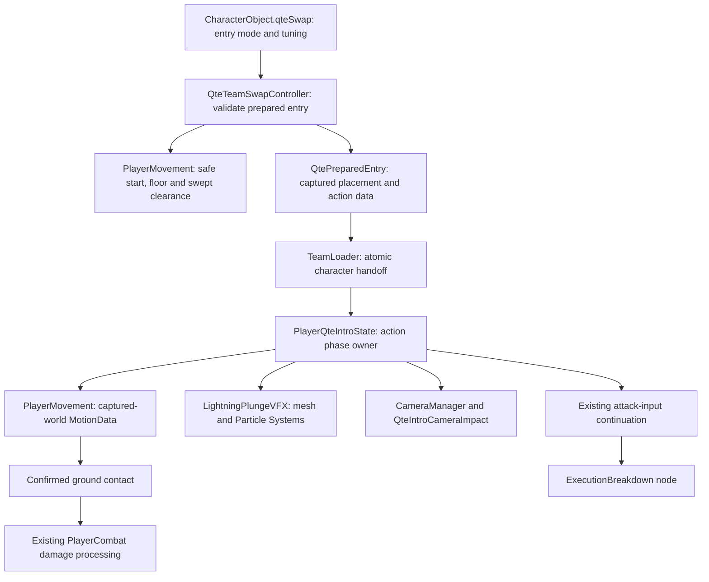

# Main QTE Lightning Plunge — Approved Architecture

## Implemented playtest correction

Apricha's post-implementation request authorizes enemy-relative Y+5 (latest correction), an impact-only scale of 2.5, longer presentation tails, Heavy impact tier and body-following instant midair camera lock. This supersedes the envelope-to-floor camera framing, ground-contact size punch and original Y+3 described in the initial plan below. The camera now preserves its handoff lens and cancels an outgoing blend; it relaxes the vertical camera ceiling during the requested lock, with a floor-safe minimum. The root state no longer requests a plunge zoom punch. The retained API is Begin/Sample/Release for a generation-scoped QTE camera. Ordinary QTE camera impact APIs remain unchanged. No independent movement or damage authority was introduced.

Design authorization: Apricha's first “lgtm” on 2026-10-28 approves the [design spec](main-qte-lightning-plunge-design-spec.md). Architecture authorization: the subsequent “lgtm” explicitly responds to the architecture approval request and authorizes implementation. Workflow: `/implement-feature`. [Task card](main-qte-lightning-plunge-task-card.md). [Accepted ADR-014](../ADRs/014-prepared-qte-plunge-motion-and-presentation.md).

## Decision

Extend the current prepared QTE and authored-motion path. Main receives an opt-in plunge entry profile and a QTE-specific LightningPlunge root step whose existing next node remains ExecutionBreakdown. PlayerMovement owns the actual body descent. PlayerQteIntroState owns phase ordering, actor visibility and its temporary effect/camera claims. A reusable LightningPlungeVFX component renders procedural geometry and particles from supplied points and the same action clock.

The incoming body physically starts above the floor. This is deliberate: the current motor routes ordinary grounded Y motion through a visual offset, so merely authoring a negative Y keyframe cannot reliably implement the approved airborne entry. Add an explicit captured-world-destination motion mode that stays inside PlayerMovement and opts out of that visual-offset path.

## Inspected current behavior

- `QteSwapDefinition.TryResolveIntro` supports an explicit authored combo while retaining the referenced action metadata.
- `QteTeamSwapController.TryPrepare` currently returns one grounded position. `CanHandoffTo` also performs placement checks for HUD/input eligibility.
- `TeamLoader` loads the incoming character, silently resolves the shared body to ground, places the QTE, prepares the state and starts handoff feedback.
- `PlayerQteIntroState` executes the root and accepts the existing authored follow-up during recovery/cancel. Both steps live in one FSM state; state Exit alone is therefore insufficient for plunge cleanup.
- `PlayerCombat.ProcessFrameFromState` processes hit frames before ordinary motion dispatch. A plunge must resolve its body/contact before that hit processing.
- `PlayerMovement` owns Rigidbody placement, clearance casts, target-motion sweeps and grounded visual offsets. It already has explicit warp/ground-output position correction paths.
- `CameraManager.ResetLookAheadForCharacterSwap` and `QteIntroCameraImpact` correct horizontal framing. The separate action-camera path currently rejects QTE provenance, so globally enabling that path for QTEs would broaden unrelated behavior.
- `VFXManager` pools sprite/Animator-based GenericVFXPlayer instances. The gameplay particle behavior pool also carries gameplay responsibilities. Neither requires replacement to support one cached procedural effect instance per player.
- `ExecutionBreakdownAuthoring.Configure` currently reconstructs DimensionCut → ExecutionBreakdown and would overwrite a Main-only asset edit unless updated.

## System diagram



## Data and interface definitions

These names/signatures describe the proposed integration, not APIs already present in the project. Follow the project's namespaces during implementation.

```csharp
public enum QteEntryMode { Grounded = 0, LightningPlunge = 1 }

// Serializable, optional settings on QteSwapDefinition.
public sealed class QtePlungeSettings
{
    public Vector2 targetStartOffset;
    public LightningPlungeVFX prefab;
    public LightningPlungeVfxSettings visuals;
}

// Runtime value: captured once, not written into ScriptableObjects.
public readonly struct QteEntryPlacement
{
    public readonly Vector2 startBodyPosition;
    public readonly Vector2 landingBodyPosition;
    public readonly Vector2 surfacePoint;
    public readonly Vector2 surfaceNormal;
    public readonly Vector2 capturedEnemyPosition;
    public readonly Collider2D support;
    public readonly Vector2 supportLocalPoint;
    public readonly int approachFacing;
    public readonly int landingFacing;
}

public readonly struct QtePreparedEntry
{
    public readonly CombatAction action;
    public readonly AttackStepData step;
    public readonly EnemyController target;
    public readonly QteEntryMode mode;
    public readonly QteEntryPlacement placement;
}

// QteTeamSwapController: validation remains side-effect free.
public bool TryPrepareEntry(int index, out QtePreparedEntry entry);

// PlayerMovement: all physical queries and mutations stay in the motor.
public bool TryFindQtePlungePlacement(Vector2 targetPosition,
    Vector2 startOffset, int approachFacing, out QteEntryPlacement placement);
public void ApplyQteEntryPosition(in QteEntryPlacement placement);
public void PrepareCapturedWorldMotion(in QteEntryPlacement placement);
public bool SampleCapturedWorldMotion(MotionKeyframe motion, int logicFrame);
public bool TryCommitQteGroundContact(out Vector2 surfacePoint);
public void ClearCapturedWorldMotion();

// Renderer-only prefab component: gameplay code supplies its clock.
public sealed class LightningPlungeVFX : MonoBehaviour
{
    public void Begin(LightningPlungeVfxSettings settings,
        Vector3 start, Vector3 contact, Vector2 surfaceNormal, int seed);
    public void Sample(float actionFrame, int impactFrame, int endFrame);
    public void Stop();
}

// Generation-scoped QTE camera claim, owned by CameraManager.
public QteIntroCameraToken BeginQtePlungeCamera(CombatExecutionContext execution,
    Vector3 start, Vector3 contact);
public void SampleQtePlungeCamera(QteIntroCameraToken token, float actionFrame);
public void PlayQtePlungeImpact(QteIntroCameraToken token, float sizeReduction, int frames);
public void ReleaseQtePlungeCamera(QteIntroCameraToken token);
```

Preserve the existing `TryPrepare`/`Prepare` overloads where callers depend on them; delegate to the new prepared-entry path rather than duplicating eligibility logic. New enum values in serialized types are appended. Absent profile data defaults to the current grounded path. The old `entryOffset` retains its existing meaning for grounded entries.

## Responsibilities and authority

| Class/data | Responsibility | Owned state |
| --- | --- | --- |
| QteSwapDefinition / QtePlungeSettings | Opt-in mode, enemy-relative start offset and visual references | Authored data only |
| QtePreparedEntry / QteEntryPlacement | Snapshot the validated handoff | Runtime values, captured facing/target/floor; no global cache |
| QteTeamSwapController | Readiness, target resolution and entry validation | Existing readiness expiry/provenance; no VFX clock |
| TeamLoader | Commit one prepared handoff after character load | Existing team/current-character transaction |
| PlayerQteIntroState | Plunge root lifecycle, contact-before-hit ordering, actor visibility, follow-up cleanup | Prepared entry, root-step identity, effect instance, camera token, cached renderer flags |
| PlayerMovement | Terrain queries and captured-world body motion | Captured path/support, swept movement and contact result |
| LightningPlungeVFX / settings | Procedural lightning/cracks/wind and cosmetic particles | Reusable meshes/buffers, Particle Systems and private random seed |
| CameraManager / QteIntroCameraImpact | Bounded X/Y reset, scoped impact and release | Generation-scoped QTE framing; existing Cinemachine cameras |
| MainLightningPlungeAuthoring | Reproducible Main-only profile/step/clip/prefab authoring | Editor assets; no gameplay state |
| ExecutionBreakdownAuthoring | Keep current follow-up authoring while using the new Main entry builder | Existing Execution Breakdown data |

Follow ADR-003 for motion and output context, ADR-008 for damage delivery and ADR-013 for scoped presentation ownership. Proposed ADR-014 extends these contracts; it does not replace those systems.

## Preparation and descent data flow

1. Resolve the current QTE target using existing readiness/target-radius rules. Capture outgoing approach facing before turning the incoming character.
2. For a plunge profile, compute start from the enemy snapshot plus mirrored X+1/Y+3. Find actual floor contact below the intended X, derive the Rigidbody landing point using the motor's foot offset, and verify body clearance at the start, destination and swept vertical path.
3. Preserve the existing anti-traversal rule: check floor continuity and walls along the outgoing-to-destination horizontal corridor. Do not use `TryFindQteGroundPosition`'s clipped X as an accepted substitute for the requested X. If the exact plunge destination is unsafe, QTE validation fails before readiness/cooldown consumption. Existing ordinary-swap fallback remains conditional on ordinary eligibility.
4. Store the resulting action, step and placement in QtePreparedEntry. The HUD and input use the same side-effect-free placement validation, with cached non-allocating query buffers. Do not allocate or spawn an effect during eligibility checks.
5. TeamLoader preserves outgoing execution, loads Main, performs its existing silent handoff reconciliation, then places the body at the validated airborne start through PlayerMovement. Initialize physical contact as airborne without publishing a synthetic landing; preserve the Ground-owned authored QTE action context.
6. PlayerQteIntroState hides cached actor renderers before the first intro render, starts the authored root, then prepares the captured world destination after existing step initialization/target binding has finished clearing old motion. Frame zero contains no movement/hit event. Begin the VFX at the supplied start/contact points and acquire the QTE camera claim.
7. Append `MotionTaskType.CapturedWorldPoint`. The plunge root has one such authored key spanning its startup. PlayerMovement samples its eased trajectory from the existing action logic frame. This mode moves the actual body, bypasses grounded visual Y offsets, and uses existing collision masks/sweeps. It does not start an independent movement coroutine or change other motion modes.
8. At each plunge root logic tick, PlayerQteIntroState asks PlayerMovement to sample the captured path **before** calling the existing combat frame processor. Skip the ordinary coroutine dispatch for this new mode. The motor commits swept Rigidbody positions, synchronizes transforms and suppresses stale residual velocity for that correction; no state or VFX script writes transforms/velocities directly.
9. At the first Active frame, perform a fresh support/contact check through the motor before PlayerCombat can activate hitboxes. Only then reveal the landing pose, commit grounded support, sample the impact, request the scoped camera accent and run the ordinary active-frame hit pipeline. Contact must not emit a second hit event or independent overlap attack.

The initial timeline comes from the approved design: 12 startup ticks, 3 active ticks and 120 recovery ticks, with the existing landing pose held through the first 8 recovery ticks. Values remain labeled starting values; impact frame is derived from `ActivePhaseStart`, not duplicated as an unrelated timer.

## Collision and support changes

Use the motor's body shapes, collision masks, ignored-collider/one-way-platform policies and wall skin. Saturated non-allocating query buffers reject placement safely. Enemy colliders do not count as terrain clearance blockers, matching existing QTE/target-motion policy. Separate the surface point used by VFX from the body-root landing position.

Capture a floor collider-local contact to account for translating/rotating platform support while leaving the enemy target snapshot fixed. Revalidate the floor and swept path before each physical commit and before damage. If the support is destroyed, moves out of reach, or an obstacle blocks the route, stop the plunge without impact damage, restore presentation and route to the physically appropriate grounded/airborne state. Do not snap through the obstacle or freeze an invisible body waiting for a floor. The motor owns this abort result; the state handles the exit.

## Actor and combo lifecycle

Create a dedicated logic-sampled Main QTE actor clip using sprites already referenced by `main_Land.anim` and the first standing frame of `main_Idle.anim`. Its landing/standing boundaries follow the authored root timeline. Hide the actor with cached renderer flags during startup; revealing the body never changes hurtboxes or grants invulnerability.

Cache and restore prior `forceRenderingOff` values. Stop plunge-specific presentation **before** accepting the authored next-step transition, because Execution Breakdown stays inside PlayerQteIntroState and may acquire its own renderer/camera ownership. Also clean up on any other accepted root cancel, completion, state exit, disable or scene unload. Cleanup is idempotent and does not restore stale transform or camera snapshots.

Keep the existing root action metadata/reference for QTE eligibility and provenance, replace only the explicit QTE root with stepName `LightningPlunge`, and preserve its current next node. Root execution remains marked `isQteIntro` under existing rules. The normal paid Dimension Cut and its resource/counter behavior are not rewritten. Impact inherits the existing QTE damage type/budget; clone hit data before moving contact timing so the source action is not mutated. Execution Breakdown's existing behavior/provenance remains governed by its current code.

Existing input buffers and recovery/cancel gates remain authoritative. A valid normal attack continues once into Execution Breakdown; no-input completion uses current action-output reconciliation with no extra motor Landing-state lock.

## Reusable visual prefab

Proposed asset root: `Assets/Project/Character/Hero/test_0_Main/LightningPlunge/`. Implementation will create the following reusable prefab, not modify a saved gameplay scene for wiring:

```text
LightningPlungeVFX [LightningPlungeVFX]
  Geometry
    BoltCore
    VioletEnvelope
    DarkImpactShards
    GroundCracks
    WindArcs
  Particles
    ImpactSparks
    Debris
    ResidualSparks
```

The visual component uses world-space supplied endpoints, explicit sorting controls, reusable meshes/vertex/index buffers and MaterialPropertyBlocks. Cache particle modules and particle buffers. Geometry generation uses a private repeatable seed and does not alter Unity's global random state. Initialize capacity once; activation reuses it. No per-frame mesh/list/material allocation or per-cast create/destroy loop is planned.

Prefer the verified existing `Resources/EnemyLifecycleParticles.mat` shader path, which already supports project Particle Systems and vertex color, with dedicated material instances as saved assets where different render settings are needed. Verify its appearance on the new geometry before committing visuals. Build white/violet halos from layered geometry so the effect does not depend on enabling a new bloom/render feature. Reuse suitable existing audio. Report missing material/audio compatibility rather than silently installing assets or changing the pipeline.

The state caches one prefab instance per player and stops/clears it between uses; this is sufficient reuse for this single-player QTE. `Begin`/`Sample`/`Stop` are also pool-safe for other callers. VFX owns no target search, physical movement, damage, actor hide flags, camera or global time scale.

Drive both mesh phase parameters and manually simulated Particle Systems from action-frame deltas; auto simulation cannot drift through hitstop or pause. Rewind/reseed explicitly for editor preview. Optional fractional render sampling is presentation-only, clamped at phase boundaries and disabled during hitstop/pause. Residual particles may fade during the root recovery; accepting another step stops them before the new presentation takes ownership.

## Camera integration

Add a small `CameraManager.QtePlunge.cs` partial for generation-scoped Main plunge claims. Extend QteIntroCameraImpact with an opt-in X/Y framing mode; retain the existing horizontal methods for other QTEs. Reset look-ahead and invalidate old camera state at handoff, then center the start/contact envelope with the floor prioritized. Release this contribution after contact or immediately on a newer owner/exit. Size punch occurs on confirmed contact and is canceled only by its matching token.

Use final Cinemachine correction with the existing orthographic lens and supported room confinement. For axis-aligned BoxCollider2D bounds, clamp the whole view after applying the correction. For unsupported/rotated/non-box confinement, retain Cinemachine confinement and reset follow history, suppress unsafe final positional offsets, and report the framing limitation for manual review. Do not claim a collider's AABB is safe inside a concave room. No camera priorities, renderer features or global QTE exclusions change.

Release the plunge token before Execution Breakdown's ordinary action camera begins. Generation checks prevent a delayed plunge cleanup from clearing a later camera owner.

## Affected systems

| Existing path under Assets/Project | Planned edit |
| --- | --- |
| Scripts/Character/QteSwapDefinition.cs | Optional entry mode/plunge settings with backward-compatible defaults |
| Scripts/Character/MotionFrameData.cs | Append captured-world mode; keep existing serialized enum values |
| Scripts/Combat/QteTeamSwapController.cs | Shared prepared-entry validation and Main-specific handoff-feedback routing |
| Scripts/Systems/TeamLoader.cs | Commit the prepared entry without losing it during character-load cleanup |
| Scripts/Combat/PlayerMovement.cs | Safe plunge query/placement, action-frame world sampling, contact commit and abort |
| Scripts/Player/States/PlayerQteIntroState.cs | Root-only descent/contact ordering, renderer ownership, VFX/camera lifetime and pre-continuation cleanup |
| Scripts/Cameras/QteIntroCameraImpact.cs | Scoped optional X/Y correction and contact accent |
| Scripts/Editor/ExecutionBreakdownAuthoring.cs | Delegate entry authoring to the plunge builder while preserving the follow-up |
| Character/Hero/test_0_Main/CharacterObject_main.asset | Opt-in profile and QTE-specific LightningPlunge → existing ExecutionBreakdown |
| Character/Hero/test_0_Main/animation/char-0-mainController.controller | Bind the dedicated logic-sampled QTE actor clip |

New planned scripts: `Scripts/Character/QtePlungeSettings.cs`, `Scripts/Character/QtePreparedEntry.cs`, `Scripts/Character/LightningPlungeVfxSettings.cs`, `Scripts/Combat/LightningPlungeVFX.cs`, `Scripts/Cameras/CameraManager.QtePlunge.cs`, `Scripts/Editor/MainLightningPlungeAuthoring.cs`. Keep the entry enum alongside its profile and the placement value alongside QtePreparedEntry unless existing namespace conventions dictate otherwise.

New planned assets under the LightningPlunge root: reusable prefab, dedicated material assets using existing shader(s), and the logic-sampled actor clip. Main's existing source clips remain reusable. Exact Unity GUIDs and serialized references must be created/read through Unity asset authoring, never invented.

Update `GDD_Neo-JJK.md` only in its Main QTE Entry description after architecture approval to reflect the approved replacement. Update this task's DevLog/implementation report and tuning instructions. Existing test files, packages, build configuration, unrelated scenes/characters/actions and dirty working-tree edits are outside the implementation edit list.

## Implementation order and checks

1. Add backward-compatible profile/value types and the opt-in motor mode; compile through Unity and inspect the console.
2. Wire prepared entry, motor contact and QTE-state lifecycle. Manually check safe placement, actor restoration, no early damage and ordinary QTE fallback.
3. Author the reusable effect prefab, materials and actor clip with Unity/editor authoring. Update ExecutionBreakdownAuthoring so regeneration preserves the new entry and existing next node.
4. Add bounded token-owned camera reset/contact feedback. Check both facings and supported room bounds, including immediate Execution Breakdown continuation.
5. Inspect the actual saved Main profile/prefab/controller and manually preview fall, impact, landing/standing recovery, pause/hitstop, interruption, terrain rejection and repeated use. Verify unrelated QTE and ordinary Main Dimension Cut behavior by manual inspection/play where available.
6. Record what was actually observed, supply screenshots/video if possible, summarize final hierarchy/paths/tuning controls and identify any manual acceptance gaps.

No automated tests will be added or run under the user's explicit constraint. Compilation and manual preview are validation, not evidence of performance budgets or exhaustive playtest coverage. Human remains responsible for subjective final art/game feel.

## Architecture checkpoint

Architecture approved by Apricha's second “lgtm,” 2026-10-28, in response to this checkpoint. Runtime implementation is authorized. Final subjective art/game-feel review remains human-owned; no additional implementation approval is requested.
