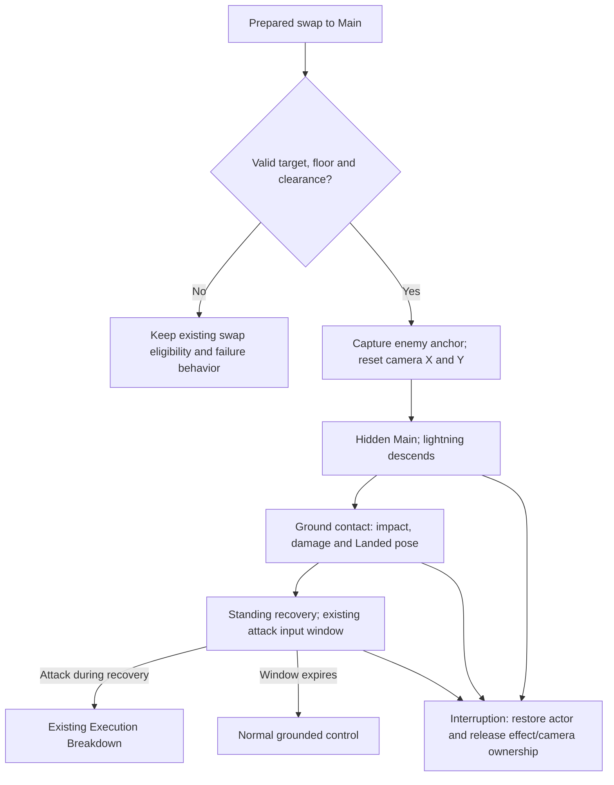

# Main QTE Lightning Plunge — Approved Design

Design approved by Apricha in this chat on 2026-10-28: “lgtm,” responding to the design approval request. This authorizes architecture planning; the selected workflow's architecture checkpoint still applies before runtime implementation.

## Approved playtest corrections — supersede the initial proposal below

Latest exit direction, requested by Apricha after approving the current appearance: preserve the held impact, then let energy wither through actual shape motion. The overhead column contracts toward the ground and thins; spike tips retract at staggered times; small charged chips rotate/drift outward; cracks drain toward contact; wind arcs peel into shorter rotating sections. Fine shader erosion supplies a glowing disintegration front. Final tiny remnants still fade, but the main silhouette does not remain static. Starting values are 12 ticks after the existing hold before breakup, up to 78 ticks of exit motion, scatter 0.65 and 24 chips. Compare mid/late exit poses: pass when their structure/positions visibly change without cutting the initial impact hold short; lengthen Exit Delay if the readable hold feels shortened, or Exit Frames if breakup feels abrupt. These are editable design starting values, not reference-game measurements.

Latest clarification: restore Main's QTE handoff slow motion and let impact/overall visuals remain readable for longer. The quick two-tick physical thunderstrike is retained, but is presented through the saved intro slowdown. The visual impact holds before fading, with a longer column, burst, wind, local light and particle tail. This supersedes the earlier removal of Main-specific slowdown. Damage duration, Heavy tier, actor recovery, saved camera/height tuning and Execution Breakdown routing are unchanged by this pacing correction.

Latest correction: two pre-impact logic ticks, a long near-vertical thunderstrike entering from beyond the camera top, bounded fine kinks/forks instead of a winding body or falling spiral. Direct user approval covers dark-purple aura, smooth low-alpha edges, bright/HDR core and URP shader/material/local-light polish. Main-specific intro slowdown is removed so the short cue reads quickly; impact, pose, motion and audio remain on the shared action clock. Heavy tier and the existing long recovery/Execution Breakdown continuation remain. Current saved user height/camera tuning is preserved.

After implementation, Apricha requested a much larger ground impact, a longer readable tail, Heavy impact tier and instant camera lock on the actor in midair instead of a ground dip/zoom. The latest height correction is **Y+5**, superseding the interim Y+10 and initial Y+3. Mirrored X+1 remains enemy-relative. Current editable starting values are impact-only scale 2.5, flash 6 ticks, burst 54 ticks, wind 84 ticks and electrical remnants 114 ticks. Recovery remains 120 ticks; its attack continuation is unchanged.

The camera follows the incoming body's position, holds the handoff orthographic size and releases position toward ordinary framing after impact. It can lift above the room's vertical camera ceiling to show the requested midair start; supported horizontal box limits remain. The visual impact is deliberately larger than the unchanged damage hitbox. [Current implementation/tuning/limits](../Reports/MainLightningPlunge/implementation-report.md).

This document proposes behavior; it does not describe an implemented effect. Source: Apricha's 2026-10-28 request and explicit enemy-relative offset clarification. Workflow: `/implement-feature`. [Task card](main-qte-lightning-plunge-task-card.md).

## Player experience

A prepared switch to Main produces a sharp violet-white lightning shape above the enemy. The character body is invisible as the lightning falls. On floor contact, a concentrated flash and sharp purple/black energy shapes burst outward, followed by ground cracks, debris, low wind arcs and flickering electrical remnants. Main becomes visible in the existing landing pose, then stands during a deliberate recovery. An attack press during that recovery starts the existing Execution Breakdown.

The bright center and jagged silhouette should read at gameplay zoom. Ground cracks and airborne debris communicate force without hiding nearby enemy tells. The supplied images define visual language, not literal artwork, lettering, or characters to reproduce.

## Confirmed direction and proposed placement

- Confirmed by the user: start offset is measured from the enemy targeted by the prepared QTE.
- Capture the target anchor and outgoing approach facing at the accepted handoff.
- Starting position: captured enemy position + `(approachFacing × 1, +3)` world units. The offsets are user-specified editable values, not benchmarks.
- Proposed trajectory: descend vertically at that X, with a fast accelerating profile. The landing is the valid floor below the start, not the enemy's center or collider origin.
- Determine the floor and body clearance before consuming the prepared QTE. If the exact point is unsafe, reject the plunge rather than silently landing across a gap. An ordinary switch may occur only under existing eligibility rules.
- Face the captured enemy on landing so Execution Breakdown is oriented toward the original engagement.
- Capture the destination at entry. A moving or dying target does not drag the falling bolt sideways.

The last five bullets are proposed resolution rules for details the request did not specify. They are included in this approval checkpoint.

## Interaction flow

## Proposed timeline

All action durations below are **starting values for review**, measured in the project's existing 60 Hz action logic. They are not reference-game measurements. The 120-tick recovery is retained from Main's current QTE-specific entry as the requested long input window.

| Phase | Starting timeline | Actor | Effect and gameplay |
| --- | --- | --- | --- |
| Falling | Logic ticks 1–12, about 0.20 s | Hidden before the first rendered intro frame | Narrow white core, violet jagged envelope, dark trailing energy pieces and short wind streaks; accelerate toward the captured floor. No falling damage. |
| Contact | Logic ticks 13–15, about 0.05 s | Reveal the landing pose on contact | One concentrated impact flash/column; existing QTE damage payload is delivered at this contact. Breakout shapes, crack branches and debris originate at the actual floor. |
| Landed recovery | First 8 recovery ticks, about 0.13 s | Hold the existing `main_Land` pose | Electrical fragments and wind rings begin to disperse. Existing recovery attack continuation is available. |
| Standing recovery | Remaining 112 recovery ticks, about 1.87 s | Existing standing/idle pose | Residual effect fades; the rest of the recovery remains available for Execution Breakdown. |
| Recovery end | After the 120-tick recovery | Return to ordinary grounded presentation | Resume normal control if no follow-up was requested. |

Tune descent first for a clearly visible downward strike. Shorten it if it floats; lengthen it if observers cannot distinguish descent from an instantaneous teleport. Hold the landing pose longer if contact is visually lost, and shorten it if it delays the standing read. Shorten recovery if waiting feels compulsory; lengthen only if deliberate follow-up inputs are consistently missed. Check both facing directions and the actual gameplay camera before accepting values.

Execution Breakdown uses the **existing normal attack command and authored next node**, not a new Skill binding. It is not automatic. Before ground contact, input cannot skip the fall; existing input-buffer policy remains authoritative. During recovery, the first valid attack continuation commits once. Do not add an extra resource charge or change Execution Breakdown's authored damage, masks, timing or sprite sequence as part of this task.

## Feedback specification

| Trigger | Visual | Audio | Timing/ownership |
| --- | --- | --- | --- |
| Accepted Main handoff | VFX origin and destination establish the downward direction; Main is hidden | Existing swap identity cue; suitable existing electrical/air accent if available | Retain existing handoff slowdown as the initial tuning baseline. |
| Falling | Bright tapered jagged core, violet edge and restrained black-purple shards | Brief rising/falling electrical rush using an existing suitable clip | Follow action logic and pause/hitstop consistently. |
| Ground contact | Local white/violet flash, branching bolt, sharp ground splash and body reveal | Existing suitable impact/crack accent on the same contact | Place Main's impact camera accent here rather than at the start of the fall. Retain current damage/feedback budget as the initial baseline. |
| Ground breakup | Angular debris and branching cracks extend along the floor | Restrained existing debris/tail sound if available | Cosmetic; no persistent terrain destruction or extra damage. |
| Wind and residual | Low flattened arcs expand sideways, sparks flicker and decay | Short existing electrical tail if available | Fade without masking the standing actor or upcoming follow-up. |
| Execution continuation | Clean transition into existing Execution Breakdown | Its existing audio track | Falling/impact ownership releases before the next step can hide or frame Main. |

Audio clip choices must be based on actual project assets. Missing electrical recordings are reported as an asset limitation, not replaced by an invented asset reference. No external media, music changes or new haptic behavior are requested.

## Camera direction

Reset both the outgoing horizontal look-ahead and retained vertical framing at the accepted Main QTE handoff. Frame the incoming lightning start and landing region together where the existing room bounds allow it; the camera should not retain the outgoing character's old Y or jerk upward so far that the floor leaves view. The ground contact receives the accent. Release temporary framing into the ordinary camera smoothly after the impact, and immediately release ownership on interruption or scene change.

Honor the existing orthographic camera, confinement and action-camera ownership. If the room is too short to show the full descent, preserve the floor/impact read and crop the upper tail. Exact framing curves belong in the architecture plan after this design checkpoint. No full-screen flash is proposed.

## Reusable VFX direction and tuning contract

Proposed reusable effect: `LightningPlungeVFX`, with independently tunable layers:

- Falling bolt: procedural jagged path, tapered white core, violet edge, dark shard accents.
- Impact burst: concentrated flash, sharp upward/outward energy shards and lightning branches.
- Ground breakup: procedural cracks plus angular debris particles.
- Wind: flattened side-view arcs or ribbons expanding across the ground.
- Residual electricity: short sparks and small flickering bolt fragments.

Use Particle Systems for sparks/debris and lightweight procedural geometry for distinctive bolt/crack/arc shapes. Reuse compatible existing materials and the current rendering pipeline. Expose overall scale, palette, core/edge widths, branch shape, descent and tail duration, spread, wind travel, particle counts, sorting layer/order and optional repeatable seed. Timing must synchronize to the action; attack speed, hitstop and pause cannot leave the impact a frame sequence behind the body.

Create/reuse buffers and geometry outside per-frame rendering work. Repeated use must clear previous particles/geometry and restore actor visibility. A standalone visual invocation supplies start/contact points; the visual effect never owns damage or target selection. The eventual prefab hierarchy and precise script interfaces are implementation outputs after architecture approval, not existing artifacts.

## State and edge-case contract

| Property | Proposed behavior |
| --- | --- |
| Entry | Existing prepared, valid, grounded QTE handoff to Main; reject invalid target/floor/clearance before consumption. |
| Exit | Completed recovery → ordinary grounded control; valid recovery attack → existing Execution Breakdown. |
| Interruption | Preserve existing damage/death/swap permissions; do not add invulnerability. On any legal exit restore actor presentation and release temporary motion/VFX/camera ownership. |
| Chaining | Existing normal attack recovery/cancel continuation. No automatic Execution Breakdown. |
| Cost | Existing prepared QTE rules; no new cached-cut, resource or cooldown cost. |
| Slopes/platforms | Landing point uses physical floor contact and body clearance. Moving-platform support needs validation in architecture; do not invent a new traversal system. |
| Ceiling or wall | Validate clearance for the intended start and vertical body path. Reject unsafe placement; no visible body penetration or movement through a roof. |
| Target moves/dies | Finish at the captured valid destination; do not track the target or retarget damage during flight. |
| Low frame rate/pause | Phase boundaries must execute once when crossed; scaled action time and established pause/hitstop rules remain authoritative. |
| Death/scene reset/reuse | No permanently hidden actor, orphaned particles, lingering camera correction or repeated contact hit. |

## Experience check

- Clarity: a readable bolt path, localized floor contact, landing pose and standing recovery communicate approach, hit and follow-up opportunity.
- Response: recovery input enters the existing continuation promptly; no new input layer or automatic chain is introduced.
- Satisfaction: concentrated geometry, local impact lighting, camera accent and existing audio reinforce one contact.
- Fit: violet/white energy and dark shards support the supernatural 2D action direction.
- Motivation: the existing Execution Breakdown opportunity gives the recovery a combat purpose; no progression or balance system is added.

## Manual playtest plan for the later implementation

No automated tests are authorized by this request, and none have been added or run.

- New-player/readability: an observer identifies fall, floor hit and actor reappearance without explanation. If contact is unclear, increase silhouette contrast or the localized contact accent before increasing particle count.
- Input/skill: press the existing attack command early and late in recovery. Pass when valid presses start Execution Breakdown once, and an expired window returns to normal combat. Compare different input devices under existing mappings.
- Stress/reuse: repeat QTEs in both directions and continue immediately into Execution Breakdown. Pass when actor visibility, particles, camera and input routing restore cleanly without accumulating effect instances.
- Abuse/terrain: attempt target-relative placement at walls, gaps, low ceilings and platform edges. Pass when placement is safe or the QTE is rejected under existing rules, with no bypass through terrain.
- Interruption: exercise supported damage/death/scene transitions and pause. Pass when there is no hidden body, frozen camera offset, extra contact hit or leaked effect.
- Gameplay visibility: preview against bright/dark backgrounds with nearby enemies. Pass when danger silhouettes remain readable and the standing pose is visible after impact.

## GDD alignment and checkpoint

`GDD_Neo-JJK.md @tag:visual-audio` says: “Character animation can be short and economical as long as the VFX sells the hit.” It also directs the project to “Keep enemy danger zones visually clear.” This design uses the existing landing/standing art and concentrates the effect around the floor contact.

`@tag:combat-scope` says: “Authored MotionData is the sole action-motion authority.” The later architecture must follow that contract rather than adding a competing movement coroutine. `@tag:platform-input` and the inspected QTE state motivate using the current attack input for the authored follow-up.

The Main-only QTE entry replacement supersedes that part of the old QTE rule if approved. CameraGirl, normal Main Dimension Cut, prepared-hit provenance and readiness rules remain governed by their existing designs.

**Current next step:** review the [architecture plan](main-qte-lightning-plunge-arch-plan.md) under `Docs_JJK/2_System_Files/Workflows/implement-feature.md`, Step 4. Design approval is recorded above; architecture approval remains required before runtime implementation. No gameplay/VFX implementation is claimed in this document.
