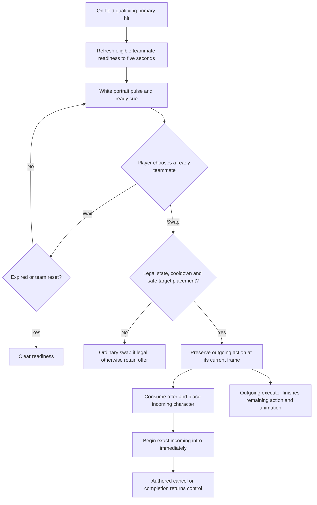

## Implemented revision - 2026-10-27

Apricha approved implementation, then playtested and requested strong slow motion at intro start and spawn offsets relative to the outgoing character. This revision supersedes the historical enemy-relative/no-slow-motion proposal below.

Current rule: spawn X = outgoing X minus outgoing facing times entryOffset (Main 3, CameraGirl 1), collision-limited and grounded. After placement, face the selected enemy and execute the exact referenced attack. Starting handoff slowdown: 0.08x speed for 0.24 real seconds. Settings are saved on Player prefab > TeamManager > QteTeamSwapController; entryOffset and exact action/step references are on each CharacterObject's QTE Team Swap profile. The five-second refresh-only window, accepted-hit triggers and anti-loop rules remain.

Tuning test: try both swaps and ten quick exchanges with a target behind and ahead. Pass when the outgoing body remains readable, the new body appears behind the outgoing facing, and slowdown clarifies control transfer without stalling the exchange. If too sticky, shorten introSlowMotionSeconds first; if too subtle, lower introTimeScale. These are editable starting values, not measurements from the reference games.

# QTE Team Swap — research and proposed game feel

Date: 2026-10-27. Requested by Apricha. Status: concrete design proposal; runtime implementation has not started.

## 1. Player experience

Main lands Dimension Cut. CameraGirl's portrait immediately becomes a readable swap opportunity: a soft white overlay breathes outward and inward, with a brief ready cue. Pressing her swap key brings her in beside the same enemy, already beginning Attack4. Main remains visible finishing the action the player committed. The player sees one continuing exchange rather than an attack, a stop, a character replacement, and another startup.

CameraGirl's successful Skill hit can prepare Main in the same way. Main arrives farther from the enemy and cuts through with his existing Dimension Cut motion. The incoming character owns control; the outgoing body is a finishing executor. Readiness is an optional opportunity, not a forced swap or a separate reaction-button minigame.

The user explicitly confirmed that spawn offsets are relative to the enemy target, not the outgoing character.

## 2. Reference research and its limits

| Reference | Verified material | Design application / inference |
|---|---|---|
| [Kuro: Developer's Notes — Combat System](https://wutheringwaves.kurogames.com/en/main/news/detail/393), 2023-05-10 | Early developer description connects prepared switching to character-specific entry skills, with varied battlefield entry locations. This is a historical design source; its old Concerto Effect terminology is not treated as current release behavior. | Give each incoming character a distinctive approach and attack geometry. The position is part of the skill's identity. |
| [Wuthering Waves team on Xbox Wire](https://news.xbox.com/en-us/2026/04/07/wuthering-waves-xbox/), 2026-04-07 | Describes switching Intro/Outro skills and their contribution to the rhythm of team combat. | Treat a handoff as an offensive beat. Preserve the target and continuous action instead of inserting a neutral reset. |
| [HI3 QTE mechanics and embedded ready-state recording](https://honkaiimpact3.fandom.com/wiki/QTE) | Community-maintained game reference documents condition-based entries and radiating portrait feedback. This is a secondary mechanics reference, despite the site's “Official Wiki” title. | Communicate the opportunity on the teammate the player can select. Keep condition met, readiness and consumption distinct. |
| [HI3 official announcements](https://steamcommunity.com/app/1671200/announcements/), checked 2026-10-27 | Official kit descriptions show QTE hits participating in character resources and team effects. | Reusing the actual attack execution matters: a cosmetic animation cannot reproduce damage attribution or character mechanics. |

The smoothness explanation here is a design inference from documented mechanics and the inspected local game. This pass did not measure reference-game input latency or analyze downloaded video frame by frame. No exact timing, cancel window or camera coefficient is claimed to be copied from WuWa or HI3. The official Valkyrie Gloria tutorial was located, but video retrieval failed; it was not used as evidence for observed motion timing.

### Why the handoff can feel fluid

- **Overlap:** outgoing recovery and incoming startup can occupy the same span. The player keeps acting while the previous commitment resolves.
- **Target continuity:** both actions address the same enemy. The player need not reacquire a target or walk back into range after a valid entry.
- **Distinct silhouettes and trajectories:** Main's farther dash entry and CameraGirl's closer Attack4 communicate who arrived and what they are doing.
- **Anticipation before input:** portrait feedback precedes the swap. The entry is a predictable reward for a successful action.
- **Immediate visible response:** consume a valid swap and begin the entry together, without a visible idle/landing interlude.
- **Impact remains local:** preserve authored hit reactions, SFX, VFX and hitstop. An extra global slowdown on every swap risks stretching the beat into a pause.

These are hypotheses to validate in this game's camera, enemy behavior and action data. They are not guarantees that importing the rules alone reproduces either reference's feel.

## 3. Rules proposed for approval

### Outgoing triggers and readiness

| On-field source | Qualifying hit | Incoming profile | Spawn and intro |
|---|---|---|---|
| Main | Successful primary hit from `main.dash.dimension_cut` | CameraGirl | Enemy-relative X - 1; exact NA Attack4 |
| CameraGirl | Successful primary Skill hit from `cg.skill`; proposal includes `cg.skill.ex` because the request says Skill generally | Main | Enemy-relative X - 3; exact Dimension Cut |

Readiness is granted to living, off-field teammates with an authored intro profile. Other characters continue using ordinary swaps until their profiles are designed.

- User value: **5 seconds of combat time**, with expiry paused when gameplay is paused/frozen. UI motion can use unscaled time; expiry must use the same combat clock everywhere.
- Every qualifying hit sets expiry to now plus five seconds. It does not add duration, charges, stacks or damage.
- A qualifying hit must deal positive accepted damage. Whiffs, rejected damage, DOT ticks, additional/artifact damage and unrelated skills cannot arm readiness.
- Store the struck enemy. Refresh from a later qualifying hit updates the target as well as the expiry.
- Only the real on-field execution may create readiness. Outgoing clone hits and intro-origin hits cannot arm another QTE. This prevents a free Dimension Cut intro from creating an automatic endless relay.
- Successful switching consumes the current handoff opportunity and clears its sibling offers. The next teammate must earn a new opportunity. Rejected switching consumes nothing.
- Team/loadout changes, death recovery and scene/run transitions clear outstanding offers; they are transient combat state.

These ownership, EX Skill, clock and anti-loop details are proposed completion rules rather than already-existing GDD facts.

### Legal input and handoff

Use the normal character swap input and portrait action. Keep the existing shared swap cooldown and swap buffer. QTE readiness does not bypass cooldown, input locks, hitstun, death, cinematic traversal, grab ownership or structural auto-chain protection.

For a ready destination, allow the handoff from grounded idle/move and from a grounded combat step after that executing step has confirmed a damaging hit, including Active. This is a narrow exception to the existing recovery gate. Before that step confirms a hit, retain ordinary legal swap timing; an older ready offer must not permit repeatedly cancelling uncommitted startups. Air actions can earn a ready offer, but the first implementation remains ground-only for consumption, consistent with the GDD.

A successful QTE swap must visibly enter the intro directly. Do not show an idle pose or landing animation between character replacement and intro startup. Clear outgoing queued combat inputs. Fresh inputs during the intro obey its authored cancel boundary; they do not inherit the previous character's combo.

If no QTE offer is valid, retain the existing ordinary swap behavior. If a ready intro cannot find a valid target or safe grounded spawn, fall back to an ordinary swap when that swap is legal; otherwise reject without spending readiness. The HUD must agree with input eligibility.

### Target-relative placement

At swap commitment, use the saved struck target if it is still alive, valid and within the incoming action's authored targeting range. Otherwise reacquire a living target within that range; prefer the attack direction. Do not teleport across an encounter to an enemy that moved far away.

Let `d` be the direction from the outgoing player toward the chosen enemy, using current facing to break an equal-X tie. Incoming X is `enemy.x - d * offset`, where Main uses 3 and CameraGirl uses 1, as requested. Incoming faces `d` toward the target. Left-side and right-side approaches therefore mirror.

Keep the incoming character grounded on the same valid combat surface as the handoff. Probe for terrain and body clearance; do not use an airborne enemy's Y as the player's spawn height. Clamp toward a valid point on the permitted side when obstructed. If a safe attack-ready placement cannot be obtained, use the fallback above. Moving platforms require support-relative placement; gaps and ceilings must never be solved by placing the player inside geometry.

Resolve and capture the target once at commitment, before starting attack motion. The intro's targeted motion must use that captured target instead of immediately selecting a different nearby enemy.

### Actual intro actions

Preserve attack startup, active, recovery, cancel boundary, clip, motion, hitboxes, hit ratios, element, reactions, SFX, VFX and action events. Read the authored data at execution so subsequent authoring changes remain reflected; do not hand-copy a second approximate attack.

Proposal: the readiness opportunity pays for the intro. Main's intro does not require or consume a cached cut, does not generate a cached cut, and does not spend a dash charge. CameraGirl's intro does not spend her Skill cooldown or AE. Their normal manually invoked actions keep existing costs. “Exact data” means the attack payload and presentation are preserved; charging Main's normal cached-cut resource would make a lit ready prompt unusable when his cache is empty.

Keep Main's Dimension Cut action identity for its action-matched passives, while separately tracking execution origin for the anti-loop rule. CameraGirl uses Attack4's current parent Ground-action damage budget. Do not accidentally use the outgoing character's stats or duplicate an action's once-only AE reward.

Entry ends at the authored action end and returns directly to grounded movement, or resolves physical support loss through the normal airborne rules. Fresh normal attacks at/after the legal cancel boundary begin the incoming character's normal chain; the intro does not automatically continue CameraGirl's Attack5.

No extra blanket invulnerability or super armor is proposed. Damage and dodge interruption follow the incoming attack's existing policy. A cancelled intro stays spent; a rejected entry does not.

## 4. Local project findings — current implementation

This is an inspected working tree with extensive pre-existing uncommitted changes; values below reflect current disk contents, not the last Git commit.

| Item | Current finding | Consequence |
|---|---|---|
| `PlayerStateMachine.CanSwitchCharacter` | Ground-only; recovery/near-recovery gate; blocks structural auto-chain | A portrait prompt alone will not make the handoff earlier. Readiness must be reflected in actual transition legality. |
| `TeamLoader.SwitchToIndex` | Spawns the outgoing executor for Attack/Skill/Ultimate, loads incoming character, and snaps to ground | Capture outgoing execution before replacement; intro must start after incoming data and placement are established. |
| Same method | Calls `PlaySlowMotion(0.5f, 0.5f)` for combat swaps | Candidate source of perceived interruption. Proposed QTE path adds no such global slowdown; ordinary behavior is retained. |
| `PlayerTeamSwitchState` | Preserves frame, stats, action identity, motion and animation phase; damage continues on the source character | Reuse the outgoing action model; do not replace it with a stationary visual ghost. |
| Same executor | Contains a hard three-second lifetime safety cap | The “until animation ends” requirement needs verification for longer actions; an arbitrary timeout must not silently truncate a valid outgoing animation. |
| `CharacterSwitchSlot` | Already has AE, cooldown and Ultimate follow-up overlays | QTE needs its own white readiness cue, not reuse of the unrelated Ultimate follow-up timer. |

### Exact attack mapping

**Main:** `Assets/Project/Character/Hero/test_0_Main/ActionResolverTable_main.asset`, standalone action `main.dash.dimension_cut`, root node managed-reference ID `7900270000000000001`, step `DimensionCut`. It currently uses **3 startup / 23 active / 6 recovery frames**, cancel boundary **29**, action multiplier **5**, and `main_attack5.anim` (GUID `2262ddbcd8a219a4c97ebbef0e32b82c`). Its first motion segment is frames 3–11, uses targeted horizontal travel, target radius 15, minimum travel 4 and pass-through distance 1.2. Preserve those current values; the spawn offset is a separate entry-placement rule.

**CameraGirl:** `Assets/Project/Character/Hero/test_1_CameraGirl/ActionResolverTable_cg.asset`, Ground combo node managed-reference ID `1588256193077837988`, step `Attack4`, clip `cg_attack4.anim` (GUID `955b3ad4bd0279645b28d25425c4d14b`). It currently uses **2 startup / 35 active / 11 recovery frames**, cancel boundary **46**, and Ground action multiplier **3.5**. Its motion, six hitbox entries, audio and afterimage action event must travel with the step. Its existing next-node link points toward Attack5; intro completion must not follow that link automatically.

The attack frames are existing authored values, not proposed reference-game timings. Attack4's event label says “Ultimate Sequence,” but its actual enum value is `AfterImage`; the label must not be mistaken for a freeze event.

## 5. Interaction flow and state contract

| State | Entry | Exit / cancellation | Cost and chain |
|---|---|---|---|
| Unready | No offer, expiry, reset or consumed offer | Qualifying on-field hit | No cost |
| Ready | Confirmed trigger; refreshed target/expiry | Expiry, team reset, source switch or successful QTE | One offer; no stacking |
| Intro Startup / Active | Valid grounded swap, target and safe spawn | Existing attack interruption policy, cancel boundary, death or completion | Offer consumed once; no manual cached-cut/Skill/AE cost |
| Intro Recovery / Cancel | Authored attack phase | Fresh legal input or action end | Normal incoming action may begin at legal cancel; no outgoing input inheritance |
| Outgoing executor | Capture current outgoing action on successful swap | Remaining action and animation complete, scene reset, or diagnosed invalid execution | No new inputs; no replay of processed hits; no QTE rearm |

Environment edge cases include slopes, ceilings, gaps, moving platforms, an enemy dying during hit confirmation, and targets changing validity between readiness and swap. Resolve these before consuming the offer. Stop all intro-owned resources and UI motion on disable/scene reset. Paused gameplay must not expire an offer while inputs are unavailable.

## 6. Feedback and tuning

User values: five-second refresh window, white scaling cue, and target-relative entry offsets 3 / 1. Existing attack values remain authored as inspected above. The following are **starting values**, not WuWa/HI3 measurements.

| Feedback | Starting value / behavior | Micro test and pass criterion | Adjustment if it fails |
|---|---|---|---|
| Portrait cue | Scale 1.00–1.10 over a 0.8-second breathing cycle, translucent white alpha 0.15–0.40; portrait and hotkey stay readable | In ten unexpected activations, player identifies the ready teammate in at least nine without looking away from combat for long | Increase cue contrast before increasing scale; decrease scale if distracting |
| Ready sound | Brief existing UI accent on transition from unready to ready; refresh updates expiry silently | Repeated multi-hit refresh sounds like one opportunity, not overlapping alarms | Shorten the cue or reduce gain; choose a different existing sound if confused with damage |
| Expiry communication | Remaining-window edge/ring, independent of the shared cooldown; steady cue when motion reduction is active | At five seconds the ring, cue and valid input all stop together | Fix shared clock/eligibility before tuning appearance |
| Intro acceptance | Start intro in the successful handoff update; no added entry delay, camera cut, extra global slowdown or extra hitstop | Recorded swaps contain no incoming idle/landing flash and show startup immediately | Fix transition order and pose evaluation before speeding up clips |
| Attack impact | Exact authored hit feedback and audio; no additional swap-wide screen shake | Entry stays readable while outgoing attack also resolves | Reduce only additive transition decoration; do not alter damage timing to conceal noise |
| Camera | Keep current combat camera and target continuity; do not add a forced zoom or snap | Target and incoming attack remain visible during left/right and edge-of-screen entries | Adjust framing only after identifying an actual visibility failure |

No new controller haptic pattern or music ducking is required in this PC-first slice. Final audio asset choice and portrait opacity need a live human feel pass.

## 7. Five-component evaluation

- **Response:** prepared swaps can accept after a hit rather than waiting for recovery. Legal cancels and existing input buffer remain meaningful. Verify timing before tuning damage.
- **Clarity:** a specific teammate shows readiness, remaining window and availability. A blocked state must not advertise “swap now” as actionable.
- **Satisfaction:** incoming attack, outgoing continuation, hit VFX/SFX and a ready cue provide visual and audio reinforcement.
- **Fit:** Main retains a cutting dash; CameraGirl retains her existing close-entry attack identity. The game remains a simple rotation system with optional prepared entries.
- **Motivation:** a landed action earns immediate tactical access to another character's damage and position. Balance must verify this does not make every ordinary swap feel like an error.

Tuning priority: transition legality and pose continuity; safe target placement; cue clarity; overlapping VFX/audio; only then damage and frequency.

## 8. Risks and validation

The primary risks are perpetual free intro chains, damaging hits replayed on clone creation, a three-second executor cap cutting off long animations, unsafe teleports, camera jumps, and an “exact” animation that loses its damage budget or passives. Main's free intro must be tested with an empty cached-cut resource. CameraGirl's intro must be compared against the actual Attack4 hit sequence, not just its sprite clip.

See `../TestPlans/qte-team-swap-test-plan.md` for new-player, stress, skill, abuse and readability scenarios. No runtime test has been performed for this proposal; no changed runtime exists yet.

## 9. GDD change proposed after approval

Relevant sections: `@tag:combat`, `@tag:combat-scope`, `@tag:characters`, `@tag:platform-input`, `@tag:visual-audio`.

Keep the rotation-based combat identity and ordinary ground-only swap rules. Extend Swap Rules with:

> Qualifying on-field hits may prepare a five-second, refresh-only QTE handoff to eligible off-field teammates. A legal prepared swap preserves the outgoing action and begins the incoming character's authored intro at a safe target-relative position. Prepared combat handoffs may occur after the current grounded step confirms a hit, while cooldown, structural auto-chain, damage, cinematic and environment restrictions remain authoritative. Intro and off-field continuation hits do not create new QTE offers.

The requested feature explicitly supersedes the old “incoming always begins in locomotion” behavior for QTE swaps only. The canonical GDD has not been silently edited.

## Human checkpoint

Review the outgoing trigger direction, enemy-relative placement, active-phase hit-confirm handoff, no additional global slow motion, free resource-independent intros, inclusion of CameraGirl EX Skill, ground-only consumption and anti-loop behavior as one design proposal. Repository workflow `Docs_JJK/2_System_Files/Workflows/implement-feature.md` requires design/game-feel approval before architecture work, then architecture approval before implementation. This document is the design-stage review artifact.
