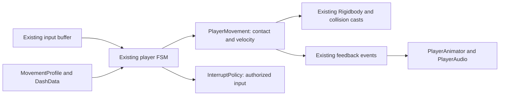

# Responsive Movement Flow: Implementation Plan

## Authorization and Existing Architecture

The user approved the concrete design with "lgtm" on 2026-11-03. This plan uses the already accepted ADR-003 state-owned direct-velocity motor and the ownership constraints explicitly included in the approved design. No new motor, service, dependency, collision solver, or motion writer is introduced. Only the approved movement/control timing changes amend ADR-003's previous behavioral commitments.

## Responsibilities and Data Flow

| Existing owner | Scoped change | Authority retained |
|---|---|---|
| MovementProfile / three assets | Permit and author zero jump startup and landing recovery | Character speed, arc, coyote and resource tuning |
| PlayerJumpState | Launch zero-startup ground/double jumps on entry; guard the existing immediate-launch override against a duplicate commit | One launch and resource consumption per press |
| DashData / character assets | Zero startup; shift absolute Cancel frames by removed startup to preserve the authored recovery-relative boundary | Active duration, speed, recovery duration, cooldown duration |
| PlayerDashState / InterruptPolicy.Dash | Open movement/facing during Recovery and Cancel on ground and in air; initialize zero-startup phase on entry | Burst commitment and discrete action cancel categories |
| PlayerMovement | Remove input-dependent dash-recovery gravity freeze and ordinary facing delay | Single velocity writer, contact truth, resource accounting, cooldown on actual Dash exit |
| PlayerAnimator | Restore locomotion at the same post-burst control boundary | Presentation follows gameplay authority |

## Dash Recovery and Cooldown

Do not end the Dash state early at burst completion. Keep its existing Recovery/Cancel timeline so `dashInProgress` still rejects another dash. `FinishDash()` remains idempotent and starts the unchanged authored cooldown at actual exit, including accepted action interrupts. The motor may write ordinary locomotion during that tail through the existing per-phase input gates. The animator follows that same gate. No new cooldown clock is needed.

For each serialized DashData, set Startup to zero and subtract the previous Startup from an enabled absolute Cancel frame, keeping its offset within Recovery. Preserve disabled Cancel windows. Active curve, recovery duration and cooldown data stay intact. Combat-action dashes that use MotionData retain their own authoring and authority.

## Interfaces and Affected Files

- No new interfaces. Existing `CanJump`, `CanDash`, `FinishDash`, jump events, and frame-phase queries remain authoritative.
- Replace the ground-only dash presentation query with `PlayerMovement.IsDashLocomotionOpen` backed by `PlayerDashState.IsLocomotionOpen` for Recovery/Cancel.
- Edit only the named motor, jump/dash state, interrupt policy, animator, movement profile, DashData, and scoped serialized tuning fields.
- Update GDD/ADR behavioral clauses and record tests/DevLog; preserve unrelated working-tree edits.

## Validation

Compile runtime/editor code in Unity. Verify immediate single/double launch with no duplicate resource/event commit; phase entry with zero dash startup; both recovery input gates and gravity handoff; rejection of repeated dash before exit/cooldown; profile/character asset preservation; and combat cancel/context regression checks. Use isolated behavioral checks where available, then leave subjective E2E feel review explicitly pending for the user. No global physics/build/dependency settings changes.
