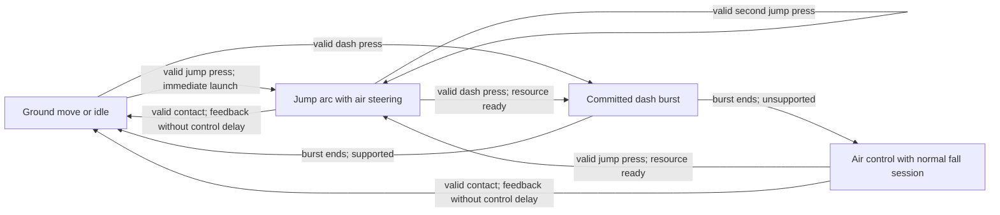

# Design Spec: Responsive Movement Flow

Approved by the user with "lgtm" on 2026-11-03. The values below remain starting values for subjective feel review after implementation.

## 1. Player Experience

A/D feels immediate: the character moves, stops, and faces the intended direction without an added turnaround delay. Space launches the character while preserving horizontal control. Shift commits a brief horizontal burst, then returns control cleanly. Landing supports the next intended movement immediately.

The target is the fast, connected control described by the user, with Hollow Knight as a qualitative reference. No exact Hollow Knight timings or reproduction fidelity are claimed. Jump height comes from one authored arc, independent of tap duration, hold duration, and release. No glide or SlowFalling system is added.

## 2. What Currently Interrupts Flow

All findings below come from inspected project code/assets, not a completed playtest.

| Current behavior | Evidence | Effect on the requested experience |
|---|---|---|
| Horizontal velocity is assigned directly from authorized input and character speed | `PlayerMovement.ApplyMotorVelocity()` | Already suitable for sharp start/stop; adding gradual force acceleration is unnecessary for this first pass |
| Ground and double jumps wait five logic frames and lock horizontal movement | All three MovementProfile assets; `PlayerJumpState.BeginJump()` clamps startup to at least one | Each jump introduces an approximately 83 ms authored pause at 60 Hz |
| Landing recovery lasts three frames | All three profiles; motor `IsMovementLocked()` and Landing state | Adds approximately 50 ms before ordinary walking resumes |
| Ordinary facing changes have a 0.2 s cooldown | `PlayerMovement.SetFacingDirection()` | Rapid A/D changes can move one way while the sprite still faces the other |
| Dash Startup writes zero body velocity | `PlayerMovement.ProcessDashFrame()` | Main currently has five startup frames; CameraGirl four; Goenitz seven |
| Ground Dash returns locomotion at late Cancel; air Dash keeps it locked | `PlayerDashState.IsCancelLocomotionOpen` | Main opens ground locomotion at frame 25; CameraGirl at 29; Goenitz at 43 |
| Neutral A/D freezes vertical velocity during Air Dash Recovery | `PlayerMovement.ResolveVerticalVelocity()` | Post-burst descent changes with horizontal input, producing a float-like interruption |

The existing profiles already provide coyote time of seven logic frames. The central input buffer already retains Jump/Dash for 0.15 s. Preserve these existing values during the first pass.

## 3. Proposed First Pass

Every changed numeric value below is a **Starting value**, not a measured Hollow Knight setting. Solve input-response interruptions before changing traversal distance or jump shape.

| Behavior | Proposed starting value / rule | Micro-test and acceptance | Adjustment if it fails |
|---|---|---|---|
| Move start, stop, and air steering | Retain current direct horizontal output | Input change reaches body velocity by the next authorized physics tick; neutral produces zero locomotion X | Correct state/input gating before adding acceleration settings |
| Locomotion facing cooldown | **0 s** | Rapid authorized A/D reversals update facing with the latest direction; combat-owned facing locks still apply | Fix input noise threshold or state ownership rather than restore a blanket delay |
| Ground/double-jump startup | **0 frames** in the responsive tuning | A valid press launches on entry; horizontal input is not suppressed by jump anticipation | If presentation needs anticipation, keep it visual; do not add an unrequested motion freeze |
| Landing movement recovery | **0 frames** | Hold A/D through landing, or queue a legal jump/dash before contact: control continues at the first valid boundary | Fix the landing/input ordering if a dead frame remains |
| Dash startup freeze | **0 frames** | Valid Shift begins the dash burst on its first authorized motor update | Fix phase initialization if the first update is still stationary |
| Post-burst control lock | **0 additional frames** | At the first post-Active motor tick, A/D steering/facing work in both ground and air contexts | Fix handoff ordering; if an unwanted dash-speed tail remains, correct that tail without adding a lock |
| Air-dash gravity handoff | Resume the existing normal fall session after the burst, for neutral and held A/D alike | Compare neutral and directional dash exits: gravity resumes at the same phase boundary | Remove lingering dash-owned vertical suppression; do not add a hold-to-float path |

Retain existing active dash durations, dash speeds, resource budgets, and authored cooldown durations in the first pass. This retains each character's burst identity while removing the pauses around it. Cooldown start/exit ordering must be inspected before implementation so returning steering does not inadvertently grant an early extra dash or shorten the intended cooldown interval.

Retain the authored dash Active speed curve for the first pass. If its decelerating tail still feels sticky after the response gates are removed, review the curve separately with a measured distance comparison.

Existing movement speed identities stay **Sample 9.5**, **Fast 11**, and **Slow 6.5 units/s**. Existing common jump values stay **launch 20**, **rise deceleration 55**, **jump fall acceleration 95**, **neutral fall acceleration 40**, and **terminal fall speed 28**. These are retained project values, not new proposals. Main, CameraGirl, Kula, and Krizalid currently share Sample; Goenitz, Rugal, Orochi, and Shermie share Slow; Kyo uses Fast. The responsive launch/landing policy therefore needs deliberate coverage of all three profiles.

## 4. Interaction Flow and State Rules

- Entry: existing state authorization, physical/cause-aware context, cooldowns, and resource checks decide whether Jump/Dash can start.
- Jump exit: normal landing, legal dash/combat interruption, or existing damage/death authority. Double jump restarts the same arc and consumes its existing jump resource exactly once.
- Dash exit: the burst commits its existing Active movement; steering returns immediately afterward. Inputs pressed during the committed burst remain governed by the existing short buffer and legal cancel rules.
- Chaining: Move -> Jump -> Dash -> legal Jump and Dash -> Move must not insert an idle/landing commitment solely for presentation.
- Resource cost: preserve existing jump count, air-dash count, cooldown, and combat-meter authority. Earlier control return is not a new resource reset.
- Combat: authored attack/skill/ultimate MotionData remains authoritative. This feel change does not create unrestricted cancels or allow locomotion to overwrite action motion.
- Tap/hold: one press requests one jump; duration/release does not modify the arc. Existing Down+Jump platform drop-through remains available.

## 5. Feedback and Juice

| Trigger | Existing visual feedback | Existing audio feedback | Proposed timing rule |
|---|---|---|---|
| Ground/double jump | Existing startup/launch animation hooks | Existing authored jump sound hooks | Launch presentation follows physical launch; anticipation cannot delay body response |
| Dash | Existing dash animation/afterimages | Existing authored dash sound hooks | Starts with the burst; presentation cannot extend movement lock past burst end |
| Landing | Existing landing/grounded feedback | Existing landing audio hooks where assigned | Feedback may continue visually but cannot impose a locomotion delay |
| Move/turn | Existing locomotion animation | Existing movement audio | Facing and control agree at each authorized input update |

Animation/audio hook assignment and playback still require implementation-stage inspection and runtime verification; this spec does not claim every character has every clip assigned. No new assets, camera effect, screen shake, particles, haptics, or music ducking are proposed. Keep existing effects while checking for duplicate launch/landing events after the timing changes.

## 6. Edge Cases and Validation

- Rapid A/D alternation: body/facing agree without bypassing combat facing ownership.
- Jump -> Dash during ascent, apex, and descent: no startup freeze, extra idle transition, or lost buffered press.
- Dash -> Jump at the legal burst-end boundary: one launch, correct ground/air resource cost, no second anticipation hold.
- Neutral versus held A/D after air dash: identical gravity handoff timing; no input-dependent hovering.
- Jump buffered just before landing: ground jump fires once after genuine contact and does not consume an unintended extra air jump.
- Coyote jump after a ledge: use the existing valid ground-jump allowance; no synthetic landing or resource replenishment.
- Low ceilings, wall-adjacent dashes, slopes, and one-way platform edges: existing collision limits and downward-crossing rules remain authoritative.
- Down+Jump: drop through the supporting platform without converting it into a jump or glide.
- Hitstun, death, pause/hitstop, character swap, and authored action-output snaps: no extra motion writer, duplicate event, or stale buffered action.
- Frame-rate variation: compare state and trajectory traces under different render rates with the project's existing fixed physics settings; do not change global timing/build settings.

Human feel test: traverse a short route with repeated move/jump/dash chains, make precision landings, and reverse direction on ground and in air. Pass when intended actions happen at their legal boundary and an observer can read the motion without visible freezes between movement verbs. If it still feels slow, distinguish a control delay from animation cadence, dash deceleration, movement speed, or arc shape before changing more numbers.

## 7. GDD Alignment and Approval Boundary

The request aligns with responsive PC locomotion and movement-action chaining. It deliberately changes two previously authored commitments: jump anticipation that stops horizontal movement, and delayed Dash recovery control. Those clauses are currently explicit in `@tag:platform-input`, `@tag:combat-scope`, and ADR-003. The implementation should update their behavioral wording after approval rather than silently contradict them.

Continue using the accepted state-owned direct-velocity architecture. The Crimson Orchard reference supplies useful response principles, but its AddForce gains, gravity curve, tap/hold behavior, SlowFalling state, and broken coyote transition are not copied into this project.

Five-component check: Response is the primary change; Clarity requires animation/body agreement; Satisfaction retains existing launch/dash/landing feedback; Fit uses the user's fast-flow direction; Motivation and traversal rewards remain existing content concerns.

Approval requested for: immediate ordinary/double-jump launch, no landing control lock, immediate dash entry, immediate steering/gravity return after the committed burst, and immediate authorized facing reversals. Existing motor ownership, character speed/arc identity, combat rules, and resource authority remain constraints.

Repository workflow checkpoint: `Docs_JJK/2_System_Files/Workflows/implement-feature.md`, Step 3: **"Design/game-feel approval is required before architecture work."** The user passed this checkpoint with "lgtm"; implementation continues within the accepted ADR-003 architecture.
