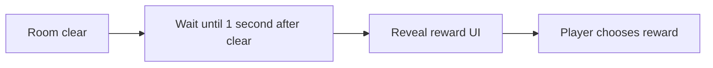

# Reward Reveal Delay and Memory Character Icon — Design Spec

## Player Experience

After a room reward is prepared, the player gets a brief pause before the Artifact or Memory reward panel appears. In the Memory character chooser, character portraits are easy to identify at a glance.

## Interaction Flow

## Presentation

- Wait once until one realtime second has elapsed since room clear, before the first reward panel. Later panels in the same room sequence do not add another delay.
- Keep player input unlocked during the wait; the reward UI acquires its existing pause hold when it appears.
- Use `CharacterItem.icon` for Memory roster entries.
- Arrange the Memory character chooser in three columns with tall cards matching the `Char-Slot` portrait ratio (442.4 × 756.4 UI units), scaling down as needed to fit the viewport. Additional rows remain vertically scrollable.
- Keep the Memory node cards at their current size and layout.
- Keep existing reveal animation, sound, selection, and claim behavior.

## Edge Cases

- Pausing or a zero game time scale must not stop the delay.
- Missing character icons follow the existing empty-image behavior.
- Reward state remains owned by the room visit and no reward is granted during the delay.

## GDD Alignment

- `@tag:ui` emphasizes the character icon in character presentation.
- `@tag:items` and `@tag:progression` define the Artifact draw and permanent Memory choice flows.

## Architecture

No architecture change. The shared reward picker retains presentation control; the room visit continues to own reward resolution per ADR-021.
