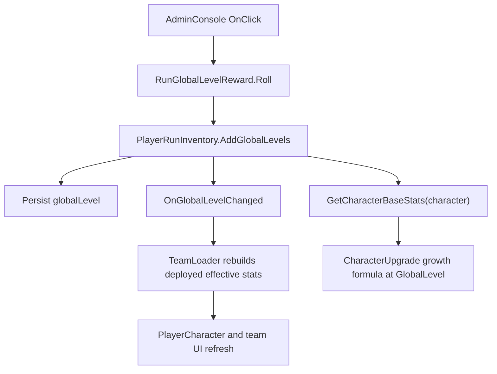

# Architecture Plan: Run-Global Character Level

## 1. Goal

Make one run-scoped level in `PlayerRunInventory` the only active level authority, calculate every character's authored growth from it without requiring run ownership, and refresh deployed runtime stats through the existing `TeamLoader` authority from ADR-005.

## 2. Current and Target State

| Area | Current implementation | Target implementation |
| --- | --- | --- |
| Level state | `RunCharacterState.upgrade.level/currentExp` per owned/deployed character | One serialized `PlayerRunInventory.globalLevel` for the entire roster |
| Gain rule | `CharacterLevelPanel` consumes EXP Potions | `RunGlobalLevelReward` resolves the approved weighted +1/+2/+3 event |
| Stat resolution | `GetCharacterBaseStats()` creates/reads a per-character run upgrade | It calculates the character's growth at `GlobalLevel` without creating run state |
| Runtime refresh | Individual `CharacterEvents.NotifyStatsChanged(character)` | `OnGlobalLevelChanged(previous, current)` triggers a full deployed-stat rebuild |
| Inspector | Per-character level button opens EXP/potion panel | Read-only shared level label; legacy level entry point disabled |
| Persistence | Saves per-character upgrades | Saves `globalLevel`; legacy records remain readable during migration |

## 3. System Diagram



## 4. Public Surface

```csharp
public int GlobalLevel { get; }
public int GlobalMaxLevel { get; }
public event Action<int, int> OnGlobalLevelChanged; // previous, current
public int AddGlobalLevels(int requestedLevels);    // returns applied gain

public static int RunGlobalLevelReward.Roll();
public static int RunGlobalLevelReward.Resolve(float normalizedRoll);
```

No new interface is introduced. `PlayerRunInventory` is already the project's concrete run-state dependency, and adding an abstraction solely for one value would increase migration surface without creating a second implementation.

## 5. Class Responsibility Table

| Class | Responsibility | Depends On | Owned State |
| --- | --- | --- | --- |
| `PlayerRunInventory` | Own, clamp, persist, reset, and announce Run Global Level; resolve any character's base stats at it | `CharacterObject`, `CharacterUpgrade` growth data | `globalLevel`, `globalMaxLevel` |
| `RunGlobalLevelReward` | Resolve the approved 65/25/10 roll; reusable by admin prototype and future Level room | `UnityEngine.Random` only in `Roll()` | No mutable state |
| `TeamLoader` | React to global-level changes and rebuild ADR-005 deployed stat records | `PlayerRunInventory` | Existing runtime stat cache |
| `AdminConsole` | Provide the public prototype `OnClick` entry point and trace result | `PlayerRunInventory`, reward roller | No progression state |
| `CharacterInfoPanel` | Display the shared level and keep legacy level-panel button inactive | `InspectScreenUI` | No level state |
| `InspectScreenUI` | Expose shared level read models and prevent navigation to the legacy level page | `PlayerRunInventory` | Existing page state |
| `CharacterUpgrade` | Continue to own character-authored max/growth formulas; retain individual level/EXP fields as legacy | `CharacterStats` | Legacy per-character mutable fields plus authored growth values |
| `CharacterLevelPanel` / `LevelingPotionSlotUI` | Remain serialized-code compatible during migration | Legacy inventory APIs | Legacy preview state only |

## 6. Data Flow

```text
Admin OnClick
  -> RunGlobalLevelReward.Roll()
  -> PlayerRunInventory.AddGlobalLevels(rolled)
  -> clamp [1, GlobalMaxLevel], save, emit previous/current
  -> TeamLoader.RefreshRuntimeStatsAndResources()
  -> every deployed BuildRuntimeStats() reads GetCharacterBaseStats()
  -> GetCharacterBaseStats() calculates the character's authored growth at GlobalLevel
  -> active player and UI observers receive refreshed stats
```

For a character not owned in the run:

```text
GetCharacterBaseStats(unownedCharacter)
  -> read character identity/base/growth data only
  -> calculate at GlobalLevel
  -> do not create RunCharacterState or grant inventory ownership
```

## 7. Persistence and Migration

- Add `globalLevel` to `SavedPlayerRunInventoryData`; missing legacy JSON values deserialize as 0 and normalize to Lv.1.
- Keep the existing save key because the additive JSON field is backward compatible.
- `ClearInventory()` / `ResetRunProgress()` reset `globalLevel` to Lv.1 and emit a change if needed.
- Keep `SavedRunCharacterRecord.upgrade` and `RunCharacterState.upgrade` for backward compatibility; they are no longer read by active base-stat resolution.
- Do not migrate a legacy per-character value into the global level. There is no unambiguous rule for selecting among different character levels, and a new/legacy save safely starts the new system at Lv.1.
- The canonical `PlayerRunInventory.asset` explicitly authors Lv.1 and Lv.30 defaults.

## 8. Runtime Refresh and HP Policy

- `TeamLoader` subscribes and unsubscribes alongside its existing run-inventory runtime-effect event.
- A level event rebuilds all deployed records because every character is affected.
- `PlayerCharacter.RefreshRuntimeStats()` keeps current HP as an absolute value and clamps only if the new max is lower; leveling therefore increases capacity without silently healing.
- Inactive run-character HP/AE snapshots remain unchanged.
- This policy is an implementation default pending the human feel decision recorded in the design spec.

## 9. UI Legacy Boundary

- `CharacterInfoPanel` displays the concise player-facing label `Lv.X/Y` and never enables the legacy Level button; "Global" remains an internal system term rather than UI copy.
- `InspectScreenUI.ShowLevelPage()` routes back to the Info page so stale prefab/button bindings cannot reopen the legacy interaction.
- `CharacterLevelPanel`, `LevelingPotionSlotUI`, `CharacterUpgrade.currentExp`, `RunCharacterState.upgrade`, and `ConsumableType.LevelingPotion` receive explicit legacy comments/tooltips but are not deleted.
- Existing prefab/scene assets are not rewritten in this slice, avoiding overlap with current user changes and preserving serialized references.

## 10. Authority Decisions

| Decision | Choice | Rationale |
| --- | --- | --- |
| Persistent state owner | `PlayerRunInventory` | Extends existing run-state ownership and reset/save path |
| Runtime effective-stat owner | `TeamLoader` | Required by accepted ADR-005 |
| Character growth data | Existing `CharacterUpgrade` authored values | Preserves tuned per-character ATK/DEF/Max HP growth |
| Roll logic | Stateless domain utility | Future Level room and admin prototype share one tested rule |
| UI behavior | Event/read-model consumer | Presentation does not mutate progression state |
| Legacy migration | Retain, disable active routes | Avoids serialized-reference breakage and supports incremental removal |

## 11. Affected Files

### Create

- `Assets/Project/Scripts/Progression/RunGlobalLevelReward.cs`
- `Assets/Project/Scripts/Editor/Tests/RunGlobalLevelTests.cs`
- `Docs_JJK/3_Outputs/ADRs/009-run-global-character-level-authority.md`

### Modify

- `Assets/Project/Scripts/Shop/PlayerRunInventory.cs`
- `Assets/Project/Scripts/Systems/TeamLoader.cs`
- `Assets/Project/Scripts/UI/AdminConsole.cs`
- `Assets/Project/Scripts/Character/CharacterUpgrade.cs`
- `Assets/Project/Scripts/Inventory/Items/Item.cs`
- `Assets/Project/Scripts/TeamBuilder/UI/InspectScreenUI.cs`
- `Assets/Project/Scripts/TeamBuilder/UI/Panels/CharacterInfoPanel.cs`
- `Assets/Project/Scripts/TeamBuilder/UI/Panels/CharacterLevelPanel.cs`
- `Assets/Project/Scripts/TeamBuilder/UI/Panels/LevelingPotionSlotUI.cs`
- `Assets/Project/Resources/InventorySO/PlayerRunInventory.asset`

## 12. Regression Surface

- Run save/load and authored bootstrap fallback
- Run reset/loss behavior
- Team deploy/switch and ADR-005 live source stats
- Potential modifiers that read base stats
- Artifact percentage bonuses based on leveled values
- Character Inspector and Team Builder readouts
- Legacy serialized prefab references
- Runtime effects on deployed and off-field characters

## 13. Verification

- EditMode tests for roll boundaries, add/clamp/reset, unowned-character stat resolution, and event emission.
- Compile with Unity 6 and confirm no new console errors or warnings.
- Manual prototype: invoke admin button at Lv.1, Lv.29, and Lv.30 while watching active/off-field effective stats and current HP.
- Confirm the legacy Character Level page cannot be opened from the active inspector flow.

## 14. ADR

ADR-009 records the run-global persistent authority and extends ADR-005 without changing its deployed runtime-stat authority.
