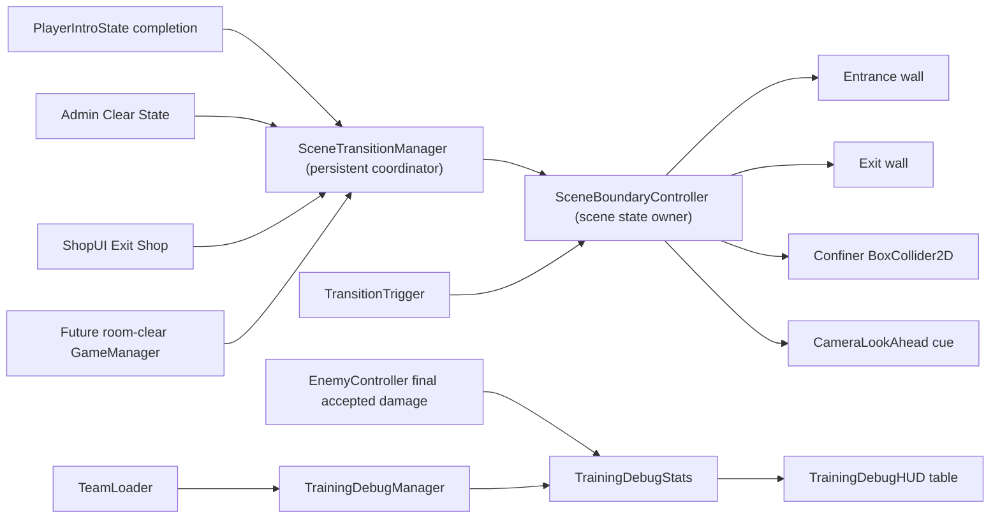

# Architecture Plan: Room Boundary Transitions and Training Damage Metrics

## Current Implementation

- `SceneTransitionManager` is persistent and owns load/fade/input orchestration.
- `PlayerIntroState` walks to `EntrancePoint.StopPosition`, then returns to Idle.
- `Test_Playground` and `Test_Shop` author entrance/exit colliders and a CameraSetUp
  prefab with a `BoxCollider2D` used by four `CinemachineConfiner2D` components.
- The physical walls and camera bounds do not share runtime state.
- `TransitionTrigger` is always enabled and has no room-clear gate.
- `EnemyController` receives `reactionData.sourceCharacter`, but calls
  `TrainingDebugStats.RecordHit(enemy, damage)` and discards character identity.
- `TeamLoader.GetTeamSnapshot()` is the existing runtime roster authority.

## Target System Diagram



## Interfaces

```csharp
public interface IRoomExitGate
{
    bool IsExitAvailable { get; }
    void SetExitAvailable(bool available, bool playFeedback = true);
}
```

`SceneTransitionManager` exposes a stable facade for callers that must not know
which scene controller is active:

```csharp
public bool SetCurrentRoomExitAvailable(bool available, bool playFeedback = true);
public bool IsCurrentRoomExitAvailable { get; }
```

`TrainingDebugStats.RecordHit` becomes source-aware:

```csharp
public void RecordHit(EnemyController enemy, CharacterObject sourceCharacter, float damage);
```

## Class Responsibilities

| Class | Responsibility | Depends On | Owned State |
| --- | --- | --- | --- |
| `SceneTransitionManager` | Coordinate scene load/intro and forward exit availability | Active scene controller | Current transition only |
| `SceneBoundaryController` (new) | Own entrance/exit availability and synchronize walls with camera bounds | Scene colliders, confiners, trigger, camera cue | Locked bounds, entrance state, exit state |
| `TransitionTrigger` | Start transition only when the scene exit gate allows it | `IRoomExitGate` | One-shot trigger flag |
| `CameraLookAhead` | Add a temporary directional cue independently from facing look-ahead | Player rigidbody | Temporary cue offset/tween |
| `AdminConsole` | Debug-only request to mark current room clear | `SceneTransitionManager` | None |
| `ShopUI` | Close shop UI and request exit availability | `SceneTransitionManager` | Existing shop panel state |
| `TrainingDebugManager` | Resolve/subscribe to `TeamLoader` and expose ordered active roster | `TeamLoader` | Cached team snapshot |
| `TrainingDebugStats` | Aggregate target-scoped overall and per-character metrics | Training manager roster | Totals, max hits, DPS, timeout |
| `TrainingDebugHUD` | Render the existing target data plus ordered team table | Training stats | Presentation cache only |

## Boundary Data Flow

```text
Scene loaded
  -> SceneBoundaryController captures the authored BoxCollider2D left edge
  -> locked right edge resolves from exitTrigger.bounds.min.x
  -> entrance and exit initialize sealed
  -> SceneTransitionManager resolves EntrancePoint + SceneBoundaryController
  -> PrepareIntro sets left edge to Min(authored left, entrance spawn X - padding)
  -> entrance wall moves so its room-facing edge matches the temporary left edge
  -> player teleports and PlayerIntroState runs
  -> Intro leaves state (arrival, timeout, or forced cleanup)
  -> CompleteIntro restores authored left edge and aligns entrance wall to it
```

```text
SetCurrentRoomExitAvailable(true)
  -> SceneBoundaryController sets right edge to exitTrigger.bounds.max.x + padding
  -> exit wall moves so its room-facing edge matches the expanded right edge
  -> every CinemachineConfiner2D using the collider invalidates its cache
  -> CameraLookAhead plays one additive rightward cue
  -> TransitionTrigger now accepts the player
```

The locked right edge uses the trigger's near edge instead of preserving the
authored confiner right edge. This is necessary because `Test_Shop` currently
authors its confiner through part of the trigger while its wall correctly starts
at the trigger's near edge.

The controller changes a `BoxCollider2D` by recomputing `size.x` and `offset.x`
from desired world-space left/right edges. It does not scale the camera prefab or
move the whole camera rig. Physical walls move by the delta between their
room-facing collider edge and the desired boundary edge, preserving authored
wall size.

## Current Scene Wiring Evidence

Values below are calculated from the current serialized transforms, collider
offsets, and collider sizes. They are evidence for the derivation rules, not
hard-coded runtime coordinates.

| Scene | Authored confiner left/right | Entrance spawn/stop X | Entrance wall inner edge | Exit trigger min/max X | Exit wall inner edge |
| --- | ---: | ---: | ---: | ---: | ---: |
| `Test_Playground` | `-27.40 / 28.95` | `-30.00 / -21.77` | `-30.87` | `30.04 / 40.17` | `35.25` |
| `Test_Shop` | `-27.57 / 29.17` | `-25.53 / -18.79` | `-26.73` | `23.58 / 33.71` | `23.55` |

Consequences:

- `Test_Playground` needs temporary left expansion for its outside spawn.
- `Test_Shop` does not need left expansion for its current spawn, but still
  seals the wall to the authored left edge after Intro.
- Both scenes lock the right confiner and wall at the trigger's near edge.
- Both scenes unlock far enough to include the trigger's far edge plus padding.

## Training Data Flow

```text
TeamLoader.OnTeamChanged
  -> TrainingDebugManager refreshes occupied team slots in stable slot order
  -> TrainingDebugStats removes stale character buckets and creates zero rows

EnemyController accepts final incoming damage
  -> RecordHit(enemy, reactionData.sourceCharacter, finalIncomingDamage)
  -> target change or expired sample clears all metrics first
  -> overall total/DPS update
  -> source row total += hit
  -> source row max = Max(previous max, hit)
  -> share is queried as row total / overall total * 100
```

All existing and new sample fields reset through one `ClearSample()` path after
6.7 seconds without a hit. The roster remains visible with zero values.

## Authority Decisions

| Decision | Choice | Rationale |
| --- | --- | --- |
| Boundary state owner | Scene-scoped `SceneBoundaryController` | Walls, trigger, and confiner are destroyed/recreated with each scene |
| Persistent facade | `SceneTransitionManager` | Existing future callers already depend on transition authority; no stale scene references are serialized |
| Exit safety | Physical wall plus logical trigger gate | Collider mistakes cannot skip room-clear progression |
| Locked left bound | Capture authored confiner left edge at scene start | Preserves per-scene camera tuning without hard-coded world coordinates |
| Locked right bound | Derive from `exitTrigger.bounds.min.x` | Makes camera edge, wall, and logical trigger gate agree in both current scenes |
| Open bounds | Derive from entrance spawn / exit trigger far edge plus serialized padding | Reuses existing scene authoring and supports different room widths |
| Camera feedback | Additive cue in `CameraLookAhead` | Does not mutate player facing or permanent look-ahead settings |
| Team roster | `TeamLoader.GetTeamSnapshot()` | Existing runtime authority; no duplicate team model |
| Damage attribution | `reactionData.sourceCharacter` at accepted-damage point | Preserves projectile/background/passive source identity through character swaps |
| Percentage | Character total divided by current team total | Matches requested contribution percentage; zero-safe |

## Affected Files

Create:

- `Assets/Project/Scripts/Core/ZoneState/IRoomExitGate.cs`
- `Assets/Project/Scripts/Core/ZoneState/SceneBoundaryController.cs`

Modify:

- `Assets/Project/Scripts/Core/ZoneState/SceneTransitionManager.cs`
- `Assets/Project/Scripts/Core/ZoneState/TransitionTrigger.cs`
- `Assets/Project/Scripts/Combat/CameraLookAhead.cs`
- `Assets/Project/Scripts/Combat/TrainingDebugManager.cs`
- `Assets/Project/Scripts/Combat/TrainingDebugStats.cs`
- `Assets/Project/Scripts/AIBehaviour/EnemyController.cs`
- `Assets/Project/Scripts/UI/TrainingDebugHUD.cs`
- `Assets/Project/Scripts/UI/AdminConsole.cs`
- `Assets/Project/Scripts/Shop/UI/ShopUI.cs`
- `Assets/Project/Prefab/UI/AdminCanvas.prefab`
- `Assets/Project/Prefab/UI/ShopCanvas.prefab`
- `Assets/Project/Scenes/Test_Playground.unity`
- `Assets/Project/Scenes/Test_Shop.unity`

The canonical `Manager.prefab` needs no new scene references; its existing
training components resolve `TeamLoader` at runtime.

## Compatibility and Failure Policy

- If a loaded scene has no `SceneBoundaryController`, transition behavior falls
  back to the existing intro/fade flow and logs one warning.
- Missing optional camera cue wiring never blocks exit availability.
- Missing entrance/exit wall wiring logs a warning but the logical gate remains authoritative.
- `SetExitAvailable` is idempotent.
- No build settings, dependencies, save data, or combat formulas change.

## Human Architecture Checkpoint

Approved by the user on 2026-07-12. Implementation may proceed with the
scene-local boundary state behind the persistent `SceneTransitionManager`
facade. PR merge and final game-feel tuning remain separate human checkpoints.
