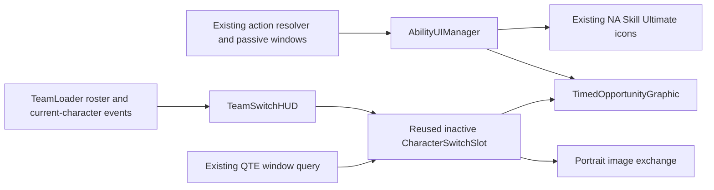

# Timed-opportunity HUD architecture

Target implementation for the approved `timed-opportunity-ui-design-spec.md`.
Apricha approved the design/motion preview on 2026-10-31 with "LGTM".
This is the approved implementation plan. Implemented and verified; see `timed-opportunity-ui-review.md`.

## System diagram



## Responsibilities and owned state

All script paths are under `Assets/Project/Scripts/`.

| Class | Change / responsibility | Owned state |
| --- | --- | --- |
| New `Player/UI/TimedOpportunityGraphic.cs` | Canvas-compatible procedural square outlines shared by ability and team UI; alpha-gradient glow and outward pulse | Presentation flags, mesh colors/widths, pulse phase and editable starting values |
| `Player/UI/AbilityUIManager.cs` | Continue resolving action art and eligibility; drive one shared-effect instance per NA/Skill/Ultimate icon; remove follow-up-fill path | Existing cached fallback art/readiness, plus cached effect references |
| `Player/UI/TeamSwitchHUD.cs` | Reconcile slots against inactive roster entries and rebind after a successful current-character event | Reused view instances and their represented roster indices |
| `Player/UI/CharacterSwitchSlot.cs` | Preserve character stats/cooldowns; query QTE; drive shared effect and interruptible portrait exchange | Bound character/index, portrait animation phase, rest transform and old portrait snapshot |
| TeamLoader / QteTeamSwapController / resolver / passive controller | Existing read-only authorities; no new responsibilities | All gameplay state stays here |

No new manager, gameplay service, ScriptableObject, material, package, renderer
feature or animation dependency. No significant gameplay architecture change or
new ADR is needed. The approved action-window-icons architecture remains the
selection/ownership baseline; this replaces its follow-up overlay rendering.
The ADR registry contains no competing HUD-effect or roster-view ownership rule.

## Effect interface and rendering

Proposed component API (interface contract, not implemented code):

```csharp
public sealed class TimedOpportunityGraphic : UnityEngine.UI.MaskableGraphic
{
    public static TimedOpportunityGraphic GetOrCreate(UnityEngine.UI.Image anchor);
    public void SetPresentation(bool visible, bool reduceMotion, bool paused);
    public void Clear();
}
```

`GetOrCreate` is idempotent. Cache results during setup/binding, never create or
search for graphics each frame. One non-raycast child Graphic per anchor emits
quads for a thin stationary square core and an expanding square wave. Layered
vertex alpha fades from core to transparent edges, producing soft glow in the
existing UI material without requiring bloom. Use UI masking/clipping behavior
and padded mesh bounds; verify no parent mask crops the intended outward effect.
Do not change the Image's own scale, sprite, fill, material or raycast behavior.

Expose pulse period, maximum scale, core width, feather width, padding and colors
as serialized component settings. Initialize to the approved starting values:
1.2-second pulse, 1.24 maximum scale, wave alpha 0.55 to zero. Keep one common
default implementation for ability and QTE; no independent hardcoded versions.
Rebuild only the active graphic's small mesh while animating or on state/size
changes. Emit vertices directly through VertexHelper; no per-frame GameObject,
Material, Texture, List or array allocation. Disabled/hidden effects stop ticking.

Use unscaled delta time for presentation, freezing phase at a true pause
(`Time.timeScale <= 0`); authored QTE slowdown still permits the slower real-time
visual. Pause state never decrements a UI-owned opportunity timer because none
exists. Reduced motion disables the expanding wave and keeps the static core.
Read the existing `TeamLoader.QteSwaps.reduceUiMotion` flag for both ability and
team effects and portrait motion. If that controller is absent, use normal motion;
do not create a new settings system.

## Ability state flow

1. Preserve ResolveActionDisplay and gameplay-owned GetFollowUpWindowState selection.
2. Resolve the ordinary/current temporary art through the existing Icon Image.
   Keep full icon fill (`Simple`, or equivalent full-fill state) and authored art.
3. Feed the selected eligible temporary-window flag to the matching graphic.
   No normalized remaining-time fill is sent to the image or graphic.
4. Remove UpdateFollowUpOverlay and replace its visual role with window-effect
   updates. Retain the existing once-per-window readiness transition semantics;
   do not add repeated audio, glints or bursts on every refresh.
5. On consumption/expiry/context or availability loss, existing resolver selection
   restores normal art and the effect clears during that same refresh. Character
   change, disable and silent rebind also clear/reconstruct the view coherently.
6. Preserve normal cooldown rushes/fills/countdowns, AE and rejected-input feedback.
   Dash remains movement-owned with no fabricated timed-window effect.

Remove the dedicated normalAttack/skill/ultFollowUpOverlay fields and their
follow-up sprite-cache calls. In the authored prefab remove only the exact Image
objects referenced by those fields, after inspecting the hierarchy. Do not remove
unrelated similarly named backgrounds, AE or cooldown images. Inspect scene and
prefab overrides before changing serialized data; disable legacy window overlays
in any verified remaining instances rather than leaving active orphan visuals.

## Inactive roster reconciliation and portrait exchange

Use TeamLoader's actual roster indices. Build visible slots from non-null entries
whose index differs from CurrentIndex. Two valid members therefore create exactly
one slot. With no inactive member, display none. If more members are deployed,
retain all inactive destinations; do not alter loadout capacity.

Cache/reuse view instances across current-character changes. Reconcile actual
roster changes separately from OnTeamChanged stat/HP refreshes so ordinary state
updates cannot recreate slots or restart animation. Preserve null-index gaps.
Never instantiate an active-character slot just to hide it.

On committed OnCurrentCharacterChanged, bind each affected view to its current
inactive destination immediately. CharacterSwitchSlot.Setup (or a small explicit
rebind method) updates BoundCharacter, SlotIndex, fixed `1` hotkey label, stats, cooldowns and
unavailable state before the next click. Keep slot root/layout/click target fixed.
Render exchange through the portrait only:

- Save the old portrait sprite/color in one cached, non-interactive Image snapshot.
  This is visual content, not a cloned CharacterSwitchSlot or input target.
- Exit that snapshot left by 0.6 portrait width and alpha-fade over 0.12 real seconds.
- Show the newly bound portrait from 0.6 width to the right, easing to rest/alpha one
  over 0.18 real seconds. Snapshot is hidden after exit and reused on later swaps.
- Clear outgoing QTE graphics immediately on commit; refresh new eligibility from
  the new binding. QTE consumption is exclusively owned by gameplay.
- Use an explicit local animation phase in Update, not stacked coroutines or a
  clone of the slot. Repeated swaps cancel/rebase the previous visual transition
  and always converge to the latest bound character and resting transform.
- Rejected swaps, health-only refreshes, initial HUD construction and re-enabling
  do not start portrait exchange. Reduced motion exchanges instantly. Disable,
  scene teardown and roster rebuild restore transforms/alpha and hide snapshots.

Keep the existing OnSlotClicked legality/dispatch path. Keyboard `1` (top-row or
numpad) buffers the next living deployed teammate as its target; the visual label
is always `1`. Do not delay gameplay or relax cooldowns.

## Prefab and source impact

| Asset | Planned action |
| --- | --- |
| `Assets/Project/Prefab/CombatUI/Player_UI.prefab` | Remove verified dedicated ability follow-up overlay objects/references; preserve live icon/cooldown/AE wiring; author or initialize the shared graphics |
| `Assets/Project/Prefab/UI/Hero_TeamSwitchPanel.prefab` | Actual slotPrefab referenced by Player_UI (GUID ffa1711f80043cd43bf1e34fdeb517ec); replace QTE overlay/bar presentation with the shared graphic and cached portrait-only transition content |
| Other scene/prefab instances | Inspect references/overrides; update only verified affected instances, preserving existing dirty edits |
| `Editor/Tests/AbilityUIFeedbackTests.cs` | Replace obsolete required-overlay wiring assertion with actual icon/effect requirements |
| `Editor/Tests/ActionWindowIconTests.cs`, `Editor/Tests/QteTeamSwapTests.cs` | Preserve resolver/window/gameplay regression baseline; adapt only assertions specifically changed by the approved presentation |
| Focused HUD regression tests | Cover inactive slot count/index identity, no clone on swaps, rebind/re-enable, expiry/consumption and stale visual cleanup |
| GDD, test plan, review and DevLog | Record approved final behavior and actual verification results after implementation |

## Verification and acceptance

Compile in Unity and check the console after source import. Run the focused
existing action-window/ability/QTE tests plus meaningful roster lifecycle tests.
Verify the real canvas visually in training: open/consume/expire action and QTE
windows; normal and rejected swaps; rapid swaps; resource and Ground/Air changes;
pause/re-enable; dead/null/one/two/three-member rosters; reduced motion.

Check that a two-member roster has one CharacterSwitchSlot at rest and during
transitions, the old portrait snapshot is never interactive, and gameplay and
the displayed click destination agree immediately. Confirm glow renders beyond
the icon without mask clipping, filled rectangles or motion-driven layout drift.
No gameplay timer or cost changes. Report any verification that cannot run.

## Checkpoint

Architecture approval is recorded below. Proceed with the scoped implementation.

Architecture approved by Apricha in chat on 2026-10-31 ("LGTM"). Additional
request: use the existing InactiveCanvasGroup alpha during swap cooldown instead
of toggling the old unavailable panel. Preserve its authored inactive alpha,
restore alpha to 1 when available, and keep the group object active.

Final wiring detail: each opportunity graphic is anchored under its Icon and
opts out of sprite-mask clipping so the outward wave stays visible. Cooldown
opacity is preserved in editable CharacterSwitchSlot.inactiveAlpha (0.34 from the
latest intake snapshot); the live InactiveCanvasGroup rests at alpha 1.
