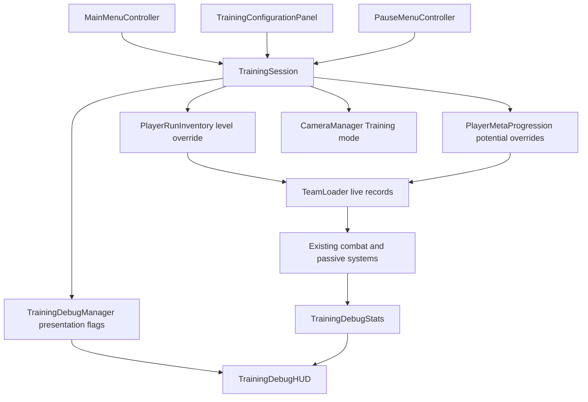

# Training Scene Architecture Plan

## Approved Behavior and Current State

The user approved `training-scene-design-spec.md` on 2026-10-30 and clarified **Hide visuals; keep damage and DPS**. Implement MainMenu -> Test_Playground, an in-game level/potential panel, passive dummy, dedicated wider camera and existing statistics without collider drawings.

This is a proposed implementation plan. No gameplay changes or runtime verification have been performed.

## Authority Decisions

1. **Preserve existing stat authorities.** PlayerRunInventory resolves shared level; PlayerMetaProgression resolves potential unlocks; TeamLoader remains the deployed live-stat authority. Add temporary nonserialized overrides to the existing data owners rather than modifying CharacterObject assets or duplicating combat formulas.
2. **Scope overrides to a Training session.** A TrainingSession coordinator owns the lifetime and owner token. Changes apply only to its bound inventory/meta objects in the Training scene. Underlying progression fields and save-slot selection remain unchanged.
3. **Keep presentation separate.** TrainingConfigurationPanel edits a draft and submits it to the session. The panel cannot call permanent upgrade, reset, reward, or save APIs.
4. **Separate stats from drawings.** Existing debug mode remains available; a Training session requests statistics with collider drawing disabled. Per the user follow-up, HUD visibility is separately controlled by a Stats button and starts hidden. No physical collider component is disabled for this feature.
5. **Use one AI permission.** EnemyBehaviorBrain's existing permission remains the configuration authority. EnemyController must honor that permission and the brain's enabled state on every activation path.
6. **Select Training as a base camera mode.** CameraManager owns priority, target registration and return behavior; the scene supplies an explicit Training camera reference. Action/ultimate camera behavior retains its existing ownership and returns to the Training base camera.

## System Diagram



## Responsibilities and State

| Class | Responsibility | Owned state |
| --- | --- | --- |
| TrainingSession (new) | Enter/apply/end Training, own temporary overrides and cleanup; coordinate camera and stats | Session token, scene handle, bound owners, active configuration; entry state needed for restoration |
| TrainingConfigurationPanel (new) | Show deployed character selector, Team Level, potential tracks, Apply/Cancel and Reset Damage | Draft UI values, selected character and modal input/time lease |
| PlayerRunInventory (existing) | Resolve shared level through an optional Training override; notify level/stat consumers | Existing persistent level plus separately stored runtime override |
| PlayerMetaProgression (existing) | Resolve potential levels through optional Training overrides; invalidate potential caches | Existing persistent progression plus separately stored runtime overrides |
| TeamLoader (existing) | Rebuild all affected deployed stat records and reconcile potential/passive effects | Existing runtime caches; no new progression ownership |
| CameraManager (existing) | Training base-camera routing and restoration after temporary overrides | Explicit Training camera reference, current mode and target registration |
| EnemyBehaviorBrain / EnemyController (existing) | Consistent AI permission across spawn/recovery | Existing serialized permission and cached brain reference |
| TrainingDebugManager (existing) | Independent stats, HUD and collider drawing activation | Existing debug flag plus explicit Training presentation policy |
| TrainingDebugStats / TrainingDebugHUD (existing) | Reuse calculations and display with independent visibility | Existing samples, attribution and panel visibility |

Keep session/data operations in `Assets/Project/Scripts/Training/`, panel presentation in `Assets/Project/Scripts/UI/Training/`, and any camera-specific extension in a CameraManager partial. Avoid adding a generic configuration framework or replacing the production progression model.

## Proposed API Contracts

These are target signatures, not current implementation:

```csharp
// TrainingSession
bool TryApply(TrainingConfiguration draft, out string validationError);
void ResetDamageSample();
void EndSession(); // idempotent; restores session-owned temporary state

// Existing data owners: internal, owner-scoped, non-persisting operations.
// Notifications occur after the whole draft is staged consistently.
// Inventory
void SetTrainingLevelOverride(object owner, int level);
void ClearTrainingLevelOverride(object owner);
// Meta progression
void SetTrainingPotentialOverrides(object owner, TrainingPotentialOverrides values);
void ClearTrainingPotentialOverrides(object owner);

// CameraManager
void SetTrainingMode(bool active, CinemachineCamera camera);
```

Use existing events (`OnGlobalLevelChanged`, `OnPotentialChanged`, CharacterEvents) for consumers where their semantics fit. Owner APIs must invalidate caches before notifying. No duplicate per-hit stat lookup or persistent save is permitted merely because a Training value changed.

## Entry and Persistence Isolation

1. MainMenu's serialized Training button calls a guarded OnTrainingClicked, completes the existing intro presentation and begins loading Test_Playground. Do not call StartLobby/BeginSaveSlot, clear progression, publish a save header or choose a save slot.
2. A scene-local Training entry component establishes the session before TeamLoader stat initialization. Resolve the actual inventory/meta owners used by TeamLoader, including their fallback Resources paths; do not create independently configured duplicate progression authorities.
3. Stage temporary overrides without altering serialized progression fields. Exports/checkpoints must serialize the underlying persistent values, never effective Training getters. Suppress Training-triggered progression writes/reward application; keep GameSettings preferences outside this suppression.
4. The normal pause return path calls RestoreBossLobbyMeta/RevertToCommitted, both capable of writing progression. Add a Training branch that ends the session and loads MainMenu without those run teardown/save/rollback operations. Normal run branches remain unchanged.
5. EndSession removes only its own overrides, invalidates caches, restores its presentation/input/time state and unregisters targets/events. Also clean up on scene unload, play-mode reset and component destruction. Scope reads by scene/session so the new scene cannot observe stale Training overrides while unload callbacks run.
6. Review mutations caused by dummy death and room progression. Training must bypass run rewards and route progression. Do not solve isolation by overwriting the user's save with a restored snapshot after Training.

## Configuration Apply Flow

```text
Open panel -> capture active values into draft -> acquire scoped practice pause/input lock
Edit -> validate shared level and per-character track bounds
Apply -> stage all overrides -> invalidate caches -> publish change events
      -> refresh active/off-field deployed stats and reconcile passives
      -> clear damage sample -> release panel-owned locks -> resume
Cancel -> discard draft -> release panel-owned locks -> resume
```

- Respect PlayerRunInventory.GlobalMaxLevel and authored potential nodes/CharacterKitDefinition limits. Permit decreases and zero potential; do not invoke permanent upgrade/reset helpers.
- Reconcile removal as well as addition of passive effects when a tier is reduced. Audit TeamLoader potential caches and CharacterPassiveController refresh before marking complete.
- Existing ADR-005 SnapshotOnApply/LiveOnResolve rules govern effects already in flight. This feature does not change those rules.
- Configuration UI uses uGUI/TMP and existing menu feedback/navigation conventions. Keep references editable on the scene Canvas. Pause ownership must compose with PauseMenu/InputLockManager; never reset all locks on panel close.

## Camera and Scene Wiring

- Bind the intended scene CinemachineCamera_Training explicitly. Both the scene and CameraSetUp prefab currently contain one; keep the unbound copy inactive at camera priority level to avoid ambiguous selection.
- Add Training to all ordinary base-camera selection and restore paths: initial mode, room-state changes, static-camera requests, combat presence changes, action motion return and ultimate return. Existing temporary presentation overrides retain precedence.
- Training works before any hit or enemy detection. Register player/dummy framing targets from the scene rather than relying on the disabled AI graph.
- Preserve the authored Training size 10 as its base view; resolve the copied GroupFraming range 6.8–8 so it cannot shrink the Training view. Validate confiner behavior against room edges; no new zoom timing is proposed.
- Ordinary stages keep the Training camera at inactive priority. Training selection is session-scoped, not a global increase of that camera's prefab priority.

## Passive Dummy

- Set Enemy_Dummy's inherited EnemyBehaviorBrain permission false. Prefer retaining a disabled BehaviorGraphAgent when the retained brain requires it; do not remove the dependency from normal enemies to configure one dummy.
- Consolidate activation permission in EnemyController.SetBehaviorAgentActive/EnemyBehaviorBrain so spawn, hitstun, grab release and room traversal cannot enable a disabled/opted-out brain. Preserve the explicit boss-driver exclusion and no-brain legacy fallback.
- Keep lifecycle, health, physics, hit reactions and feedback active. Do not rewrite EnemyController or add dummy immortality/respawn in this slice.

## Stats and Collider Drawing Separation

- Preserve serialized `showDebugVisualization` and existing ToggleDebugMode behavior for developer use.
- Expose separate effective reads for collecting stats, displaying HUD and drawing colliders. Training explicitly requests stats/HUD true and collider drawings false.
- Update EnemyController's RecordHit guard and TrainingDebugHUD visibility to use their specific reads. Update ColliderDebugDrawer and HitBoxController drawing guards to use only the drawing read; audit other drawing paths.
- Toggling individual HUD panels never disables sample collection. Reuse TrainingDebugStats.ClearSample for Apply and Reset Damage. Keep its DPS formula/timeout unchanged.

## Affected Files and Assets

- New: TrainingSession, configuration data/panel scripts, focused EditMode tests, scoped Training camera partial if needed.
- Modify: MainMenuController and MainMenu scene (button, navigation, presentation groups), CameraManager and relevant action-camera restore paths, Test_Playground scene, Enemy_Dummy prefab, EnemyController, EnemyBehaviorBrain, TrainingDebugManager, TrainingDebugHUD, ColliderDebugDrawer, HitBoxController, PlayerRunInventory, PlayerMetaProgression, PauseMenuController.
- Audit/adapt only if necessary: TeamLoader, CharacterPassiveController, SceneTransitionManager/GameRunManager reward/route handling and scene-local room controls.
- No new packages, CI/build settings or save schema. Test_Playground is already enabled in the build.
- Preserve unrelated working-tree edits, especially existing scene, camera prefab, dummy prefab and character/combat changes.

## Validation Before Completion

1. Unit-test override ownership, bounds, decreases, cache invalidation, end-session cleanup and unchanged persistent exports.
2. Unit-test stats/HUD/drawing flag combinations and AI activation permission across normal, opted-out, disabled-brain, no-brain and boss-driver cases.
3. Compile in Unity and inspect errors. Run focused relevant EditMode tests, then playtest the actual MainMenu -> Training -> MainMenu flow.
4. In Training, hit/grab/recover dummy; verify damage/DPS and no collider drawings; change level/potentials for active/off-field characters; Apply/Cancel/Reset; run action/ultimate camera sequences.
5. Compare save-slot data before/after normal exit and interrupted unload; test entry with no active save. Check normal combat/boss AI and camera behavior afterwards.

## Required Decision

Approved with **lgtm** in chat on 2026-10-30. See accepted `018-training-session-progression-overrides.md`. The subsequent Stats-button request refines presentation without changing progression/stat ownership.
