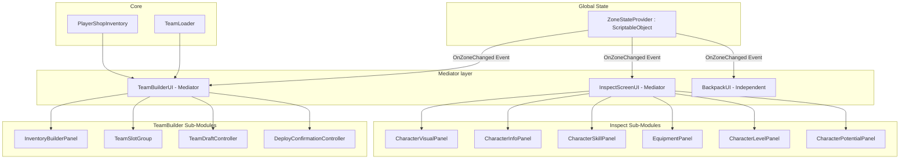

# UI System Refactor: TeamBuilder & Inspector Architecture Plan

## 1. System Diagram



## 2. Interface Definitions

```csharp
public interface IInspectSubPanel
{
    // Called when the inspector opens or switches the inspected character
    void PopulateData(CharacterObject data, Artifact[] equippedArtifacts);
    
    // Lifecycle
    void Show();
    void Hide();
}

public interface IZoneStateListener
{
    // Called globally when the zone transitions between SafeZone and CombatZone
    void OnZoneChanged(ZoneMode newMode);
}
```

## 3. Class Responsibility Table

| Class | Responsibility | Depends On | Owned State |
|-------|---------------|------------|-------------|
| `ZoneStateProvider` | ScriptableObject acting as the global source of truth for the current Zone Mode. Broadcasts events. | None | `ZoneMode` |
| `InspectScreenUI` | Central mediator for the inspection view. Manages the lifecycle and distribution of data to sub-panels. Subscribes to global zone events. | `IInspectSubPanel`, `ZoneStateProvider` | Currently inspected character & artifacts |
| `CharacterVisualPanel` | Renders Character Portrait, Name, Element, and Role. | `CharacterObject` data | None |
| `CharacterInfoPanel` | Renders Combat stats (HP, ATK, DEF, SPD, etc.) | `CharacterObject`, `Artifact[]` | None |
| `CharacterSkillPanel` | Renders skills (Basic, Skill, Ultimate, Passive) descriptions. | `CharacterObject` | None |
| `EquipmentPanel` | Renders the 3 Artifact slots equipped on the character. Handles Switch/Ascend requests. | `Artifact[]` | Selected Artifact |
| `CharacterLevelPanel` | Renders EXP bar, Level, and handles EXP potion consumption. | `CharacterObject`, `PlayerShopInventory` | None |
| `CharacterPotentialPanel` | Renders constellation/potential nodes and handles fragment consumption. | `CharacterObject`, `PlayerShopInventory` | None |
| `TeamBuilderUI` | Core state machine for Team Builder. Handles mode transitions and UI locking. | `TeamDraftController`, sub-panels | `TeamBuilderMode` |
| `TeamSlotGroup` | Manages the rendering and click/drag events of the 3 active team slots. | `TeamSlotUI[]` | None |

## 4. Data Flow

### Inspect Data Flow
```
InspectScreenUI.Open(CharacterItem, Artifact[]) 
  → InspectScreenUI sets target data
  → InspectScreenUI calls IInspectSubPanel.PopulateData() on all registered sub-panels
  → CharacterInfoPanel recalculates runtime stats including Artifact bonuses
  → CharacterSkillPanel formats localized text based on progression definition
```

### Global Zone Mode Flow
```
Game Flow Manager / Scene Loader
  → Sets ZoneStateProvider.CurrentMode = SafeZone
  → ZoneStateProvider fires OnZoneChanged(SafeZone)
  → TeamBuilderUI, InspectScreenUI, and BackpackUI receive event globally
  → UI locks/unlocks independent of each other
```

## 5. Authority Decisions

| Decision | Choice | Rationale |
|----------|--------|-----------|
| State ownership | `TeamDraftController` & `TeamLoader` | `TeamBuilderUI` should not hold team logic. `TeamDraftController` manages uncommitted changes (draft), and `TeamLoader` holds the single-source-of-truth active loadout. |
| Sub-panel instantiation | Scene Hierarchy (Serialized Fields) | Pre-wiring the panels in the Inspector is cheaper and easier to design visually than instantiating them dynamically, as their layout is static. |
| Data-driven vs hardcoded | Data-Driven via `ScriptableObject` definitions | Sub-panels like `CharacterSkillPanel` and `CharacterPotentialPanel` will pull descriptions from `ProgressionNodeDefinition` instead of building strings manually in a monolithic script. |
| Combat vs Safe Zone Mode | Global `ScriptableObject` Event (`ZoneStateProvider`) | As independent UI systems (Backpack, Inspector, TeamBuilder) need to enforce the GDD SafeZone/CombatZone rules, tying the event to a global ScriptableObject ensures decoupling. UI systems subscribe individually rather than depending on a single root UI. |

## 6. Affected Systems

### Scripts to Modify:
- `Assets/Project/Scripts/TeamBuilder/UI/InspectScreenUI.cs`: Strip out string-building logic. Add `IZoneStateListener` to automatically hide or disable editing in Combat Zones.
- `Assets/Project/Scripts/TeamBuilder/UI/TeamBuilderUI.cs`: Remove internal local Mode checks and rely on `ZoneStateProvider` global events instead. Delegate grid management entirely to `InventoryBuilderPanel`.
- `Assets/Project/Scripts/UI/TeamUI.cs`: Remove local scene parsing logic; let it defer to the global zone state.

### Scripts to Create:
- `Assets/Project/Scripts/TeamBuilder/UI/Panels/CharacterVisualPanel.cs`
- `Assets/Project/Scripts/TeamBuilder/UI/Panels/CharacterInfoPanel.cs`
- `Assets/Project/Scripts/TeamBuilder/UI/Panels/CharacterSkillPanel.cs`
- `Assets/Project/Scripts/TeamBuilder/UI/Panels/EquipmentPanel.cs`
- `Assets/Project/Scripts/TeamBuilder/UI/Panels/CharacterLevelPanel.cs`
- `Assets/Project/Scripts/TeamBuilder/UI/Panels/CharacterPotentialPanel.cs`
- `Assets/Project/Scripts/TeamBuilder/UI/Interfaces/IInspectSubPanel.cs`
- `Assets/Project/Scripts/TeamBuilder/UI/Interfaces/IZoneStateListener.cs`
- `Assets/Project/Scripts/Core/ZoneStateProvider.cs` (Global ScriptableObject)

### ADRs:
- No new ADR is required as this simply implements the structural breakdown explicitly mandated by the GDD's `Character Inspector System` section.

## 7. Next Steps
The Implementation Agent should proceed by creating the `IInspectSubPanel` interface, the 6 new sub-panels, and then refactoring `InspectScreenUI` and `TeamBuilderUI` prefabs/scripts to map to these new components.
