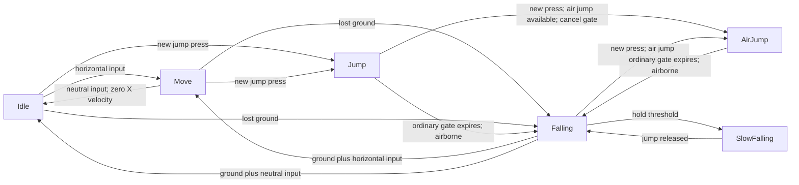

# Crimson Orchard: walk and jump motion analysis

Analyzed 3 November 2026. Target: the supplied **Crimson Orchard - Build September 2026** folder. This is an analysis of that shipped build, not a specification for Neo-JJK.

The movement signature is **fast acceleration, an immediate ground stop, strong air steering, an impulse jump, and a separate float mode when jump is held**. The impression of weight comes from gravity, poses, landing feedback, and camera damping more than from a slow movement response. This description is inferred from recovered code and serialized settings; it is not a subjective playtest verdict.

## Evidence and confidence

- **Observed in build:** compiled C# control flow, serialized player/state assets, physics settings, input bindings, animation timings, and camera settings.
- **Derived:** how those pieces interact, including disabled jump cutting and the coyote-time transition mismatch.
- **Unverified:** exact input-to-screen latency, actual jump height/duration, collision behavior in individual rooms, live camera behavior, and subjective feel.

The build launched and its player log identified Unity **6000.3.9f1**. Windows screen capture failed after window recovery (`FrameArrived timed out` / `window capture timed out`). No controlled walk/jump recording or runtime position trace was obtained. No game-control inputs were sent. Launching the game did produce ordinary scene-load/save log activity; live saved state was not characterized.

The gameplay assembly SHA-256 is `93dccc21e9f046974a3729be256aa775b53daa711e99d5dcdd167a0fceefca38`, MVID `2d5b672a-4dcf-4f0d-b1dc-77935ff3049f`. REA reported complete assembly/member metadata coverage: 488 types and 3,057 methods. Its complete call-edge inventory contains no direct calls to the jump-cut or wall-slide condition setters. Reflection/native changes remain outside that static claim.

Supporting files:

- [Compact tuning and animation data](movement-tuning.json)
- [Extracted serialized objects and input-file hashes](serialized-assets.json)
- [Portable REA evidence bundle](rea-evidence-bundle.json)
- [Recovered controller](decompiled/PlayerController.cs), [player data](decompiled/PlayerData.cs), and [input reader](decompiled/MovementInputReaderSo.cs)

## 1. Actual tuning in this build

Numbers below are recovered values, not suggested starting values. Unity world units are abbreviated `u`.

| Property | Recovered value | Consequence |
|---|---:|---|
| Base target horizontal speed | **11 u/s** | `FirstChar.Speed`; runtime setup replaces PlayerData's serialized speed of 10 |
| Horizontal acceleration/deceleration gain | **40 / 40** | Force is proportional to the difference between target and current velocity |
| Air acceleration/deceleration multipliers | **1 / 1** | Ordinary jump/fall steering is as strong as ground steering |
| Preserve extra same-direction air momentum | **Enabled** | Active acceleration/braking is disabled for qualifying overspeed motion; body damping still acts |
| Rigidbody mass / linear damping | **1 / 1** | Both launch velocity and movement response depend on these |
| Physics step | **1/60 s** | Saved rational timestep is 2,352,000 / 141,120,000 |
| Ground jump impulse | **25** | Sets vertical velocity to zero, then applies the impulse |
| Air-jump impulse | **20** | 25 multiplied by serialized `airJumpReducer = 0.8` |
| Available air jumps | **1** | Ground resets replenish the counter; an upgrade can change it |
| World gravity / normal gravity scale | **-9.81 / 6** | Runtime initialization replaces the Rigidbody's saved gravity scale of 2 |
| Falling gravity ceiling / curve duration | **9 / 0.5 s** | Gravity ramps according to a saved curve, clamped between 6 and 9 |
| Jump / air-jump ordinary state duration | **0.4 s / 0.4 s** | Ordinary fall/ground transitions are gated; horizontal steering continues |
| Jump cancel window | **Starts at 0 s, lasts 99 s** | Eligible cancel actions can bypass that ordinary transition gate |
| Jump cutting | **Disabled in both assets** | Releasing jump does not cut upward velocity through the inspected path |
| Coyote timer reset / setting | **+0.1 s / 0.1 s** | Boolean can persist about 0.2 s after ground detection is lost, but see transition mismatch below |
| Slow-fall hold threshold | **0.25 s after coyote flag clears** | Holding jump can eventually enter a different movement mode |
| Slow-fall gravity / force multiplier | **0.6 / 0.2** | Much lighter gravity and weaker horizontal steering |
| Ground / air material friction | **0.5 / 0** | Air contact material removes friction; both have zero bounce |

Player identity chain: `sharedassets1.assets` Player GameObject **230** → PlayerData **646**, PlayerController **640**, Rigidbody2D **401**, BoxCollider2D **418**. PlayerData references CharacterStatSO **595**, named `FirstChar`. Runtime speed is `FirstChar.Speed * carriedSpeedPercent / 100`; the C# default carried percentage is 100. Buffs or carried state can change the eventual speed.

State assets are in `resources.assets`: Jump **2112**, AirJump **2106**, Falling **2109**, SlowFalling **2114**, Move **2113**, Idle **2110**. These saved values override several C# initializers, including the air-jump ratio (0.8 rather than 0.9), jump state duration (0.4 rather than 0.5), and SlowFalling entry delay (0 rather than 0.5).

## 2. Walking: why the body should respond sharply

The state is named Move, but it plays an animation named **Running**. There is one horizontal locomotion target in this path; no separate walk/run speed tier was found here.

The core law in `PlayerController.Move()` is:

```csharp
targetSpeed = horizontalInput * playerData.Speed;
gain = inputIsNonzero ? runAccelAmount : runDeccelAmount;
// Select ground/air gains; both air multipliers are 1 in this build.
// Under qualifying same-direction airborne overspeed, gain becomes zero.
forceX = (targetSpeed - velocityX) * gain * movementMultiplier;
rb.AddForce(forceX * Vector2.right, ForceMode2D.Force);
```

At base settings, starting from rest with full right input requests **440 units of force** before integration, damping, and contact effects. That is a high-gain approach to the target rather than a leisurely acceleration ramp. Reversing input creates a larger velocity error and strong opposite force. Facing flips directly with input sign beyond ±0.1; it does not wait for velocity to reverse or for a turnaround animation.

**Ground release is a special case:** Idle becomes eligible when horizontal input equals zero and ground is detected. `PState_Idle.StateStart()` directly writes `linearVelocityX = 0`. In an ordinary Move → Idle release, that overrides the gradual braking implied by the deceleration field. Airborne neutral input instead uses `Move()` and its force-based deceleration.

The gains are cached fields. `OnValidate()` computes them using `50 * acceleration / Speed`, but the player initializes runtime Speed from its character asset afterward. A recreation must preserve the shipped gain **40** alongside runtime target **11**; blindly recalculating from 11 changes the response.

**Feel implication:** sharp ground placement and reversals, with a small physics-driven acceleration transient. Strong air control makes landing corrections relatively easy. A recreation that uses a long acceleration ramp or gradual ground-release slide would differ from this build.

Sources: [Move](decompiled/PlayerController.cs), [Idle](decompiled/PState_Idle.cs), [Move condition](decompiled/PlayerStateCondition.MoveCon.cs), [Idle condition](decompiled/PlayerStateCondition.IdleCon.cs), [speed initialization](decompiled/PlayerData.cs).

## 3. Jumping: launch, steering, descent, and hold

### Launch and ordinary descent

A valid ground jump switches state, starts its animation/audio, clears vertical velocity, and applies an upward impulse in the same state-entry method. There is no authored takeoff delay in that method. With mass 1, the impulse creates a vertical velocity change of **25 u/s** before the next physics integration.

Jump and AirJump both call the same horizontal `Move()` each physics tick. AirJump clears vertical velocity before applying its **20** impulse, so it can rescue a fast fall with a predictable upward restart. It consumes one air jump and resets the air-attack counter.

**Falling is timer-gated, not apex-triggered.** Its condition checks airborne status, not `velocityY < 0`. Without another action, Jump can enter Falling after its 0.4-second ordinary state gate. Changing gravity earlier at the geometric apex would produce a different motion profile. Animation and physics are controlled separately.

Once in Falling, gravity is:

```csharp
fallTime += fixedDeltaTime;
gravityScale = Clamp(gravityCurve.Evaluate(fallTime / 0.5f) * 9f, 6f, 9f);
```

The curve starts at zero, so clamping holds gravity at 6 initially. It then rises toward 9. The saved seven curve keys, tangents, and weights are in `movement-tuning.json`; using a straight line would approximate rather than reproduce it. Exiting Falling restores gravity scale 6. Linear damping 1 also affects vertical velocity, so the simple undamped parabola formulas do not give exact jump height/time.

### Tap versus hold

This build does **not** implement an active short-hop jump cut through the inspected path. Both Jump and AirJump assets have `canJumpCut = false`; additionally, the controller's `jumpCutCon` setter has no direct callers in the assembly-wide call inventory. The presence of `DecreaseYVelocity()` is not evidence that a released jump actually uses it. AirJump's update override also omits the base jump-cut check.

Holding jump can still change airtime through **SlowFalling**:

1. The hold counter accumulates only while jump is held and `isCoyoteTime` is false.
2. SlowFalling becomes eligible at a counter of 0.25 seconds, when the current state's transition list allows it. Falling allows it; Jump and AirJump do not.
3. Entry resets **both horizontal and vertical velocity** to zero.
4. It sets gravity to zero, then restores slow gravity **0.6** after a serialized delay of **0**. The coroutine can still cross a frame boundary.
5. Horizontal movement uses a **0.2 force multiplier**. This scales the force, not the target speed. Air deceleration is temporarily reduced to 0.3 as well.
6. Releasing jump clears the hold counter and makes Falling eligible again.

The nominal eligibility is roughly 0.2 + 0.25 = **0.45 seconds after loss of ground detection**, subject to render-frame timing, state gates, and other inputs. This is a derived timing, not a recording measurement. SlowFalling's saved transitions omit AirJump, so a second jump is unavailable through that state's normal transition list until it is exited.

**Feel implication:** tapping produces an impulse arc; holding can produce a later braking/float event with a noticeable loss of horizontal momentum. Calling this conventional variable-height jumping would miss that distinction.

Sources: [Jump](decompiled/PState_Jump.cs), [AirJump](decompiled/PState_AirJump.cs), [Falling](decompiled/PState_Falling.cs), [SlowFalling](decompiled/PState_SlowFalling.cs), [hold condition](decompiled/PlayerStateCondition.SlowFallCon.cs).

## 4. Input forgiveness: intended logic versus reachable behavior

### Coyote-time mismatch

`GroudCheck()` resets `LastOnGroundTime` to **0.1**. That value decreases each Update, and the coyote boolean clears only below **-0.1**, giving about **0.2 seconds** of boolean lifetime after the last ground overlap.

However, on walking off a ledge, Move/Idle can immediately transition to Falling. **Falling's saved transition list contains AirJump but not Jump.** The condition manager checks only allowed transitions. The ground Jump condition therefore stops being considered after that change, even while the coyote boolean remains true.

Consequently, a later ledge press can consume an air jump instead of using a free coyote jump. With the air jump exhausted it can fail entirely. A Jump press on the same condition evaluation that detects the ledge can still win over Falling by priority. The timer alone is insufficient to promise a working 0.2-second coyote jump window.

### Buffering and cancel windows

The input reader uses `WasPressedThisFrame()` for jump. No explicit stored jump request or pre-landing jump buffer was found in the inspected controller/condition path. A jump pressed before landing or outside an allowed state/window is not retained by that path.

The **0.4-second Jump state duration is not a universal input lockout**. Its cancel timer starts immediately and lasts 99 seconds. The condition manager checks eligible cancel actions while `canCancle` is true, including AirJump, Dash, and some attacks. Horizontal motion continues independently of this gate.

Ground checks use an overlap box **0.63 × 0.05 u**, positioned **1.86 u below the player origin**, with ground layer mask **8**. The body collider is about **0.703 × 2.843 u**. Ground detection has no upward-velocity filter in this method. Head collisions, slopes, and platform edges need runtime tests before assigning exact responsiveness guarantees.

Sources: [condition routing](decompiled/PlayerStateCondition.PlayerStateConditionManager.cs), [Jump condition](decompiled/PlayerStateCondition.JumpCon.cs), [AirJump condition](decompiled/PlayerStateCondition.AirJumpCon.cs), [Fall condition](decompiled/PlayerStateCondition.FallCon.cs), [ground check and timers](decompiled/PlayerController.cs).

## 5. Animation, sound, and camera contribute to the feel

| Animation | Saved clip length | Presentation detail |
|---|---:|---|
| Running | 0.683 s, looped | Ten distinct sprite references; changes about every 0.0667 s |
| Jump | 0.317 s, non-looped | Initial sprite holds about 0.2 s, then another pose; not continuously driven by vertical velocity |
| AirJump | 0.350 s, non-looped | Several quicker pose changes in its first 0.2 s |
| Falling | 0.217 s, looped | Separate falling pose sequence |
| Falling_OnGround | 0.217 s, non-looped | Code requests a 0.2 s animation hold when ground is detected |
| BeginSlowFalling | 0.283 s | Animator has an exit-time transition to SlowFalling |
| SlowFalling | 0.817 s, looped | Slower visual rhythm than Running |

The relevant Animator states have speed **1**, and the player Animator has **ApplyRootMotion = false**. Gameplay code calls `Animator.Play`; the body moves through Rigidbody forces. The 60 Hz clip sample rate is not 60 distinct drawn sprites per second.

Walking starts a footstep sound immediately and repeats every **0.33 s**. Leaf, stone, and wood have separate clip lists; pitch varies **0.9–1.1**. This timer is independent of animation events or actual distance travelled. Jump plays a sound at volume **0.8**, and SlowFalling plays one at **0.5**. The inspected locomotion clips have no animation events. A dedicated landing sound was not established by this scoped analysis.

The scene camera composer assets in levels **1 through 9** use damping **X 1.5 / Y 0.75**, horizontal lookahead time **0.4**, smoothing **0.2**, and IgnoreY enabled. Orthographic size is **8**. These are camera parameters, not exact delays in seconds. They suggest that the camera can soften a sharp body response while anticipating horizontal movement. Live target assignment, blending, and confiner interaction were not measured.

**Recreation implication:** body motion, sprite cadence, footsteps, and camera response all matter. Copying only Speed and JumpForce will not reproduce the full presentation.

## 6. Movement state map



This map omits combat, dash, crouch, and special transitions. Jump → Idle/Move is also possible on landing after the ordinary state gate. SlowFalling has grounded Idle/Move exits. There is no saved Falling → ground Jump edge.

## 7. Design assessment and reproduction priorities

| Feel criterion | What the evidence supports | Remaining test |
|---|---|---|
| Response | High movement gain, hard ground stop, full air steering, immediate jump entry | Measure displayed response; check missing input buffering and ledge presses |
| Clarity | Separate run, rise, fall, float, and landing presentation | Check whether hold-to-float and its momentum reset are understandable |
| Satisfaction | Running/jumping have visual and audio feedback | Listen to footsteps, landing, and transition timing in play |
| Fit | Sharp action control combined with a distinct float mode and damped camera | Judge against the intended character weight; target design intent was not supplied |
| Motivation | Air jump/float can support traversal decisions | Room layouts and traversal rewards were outside scope |

To reproduce this build, preserve the **runtime speed and cached force gain**, **Idle velocity reset**, **mass/damping/60 Hz physics**, **25/20 impulses**, **full air steering**, **timer-based Falling entry**, **saved gravity curve**, and **hold-triggered SlowFalling reset**. Then match sprite timings, footsteps, and camera behavior.

Treat adding a jump buffer, enabling jump cut, adding the missing coyote transition, or smoothing ground stops as deliberate design changes. They should be evaluated separately from fidelity to this build. No such changes were made to the user's game project or the supplied build.

## 8. Focused runtime validation plan

These are proposed validation tests, not completed playtests. The offsets below are test probes, not tuning recommendations.

| Test | Evidence to record | Pass criterion for fidelity |
|---|---|---|
| Start, release, and reverse A/D | Input edge and world X velocity each frame | Fast approach to target; Move → Idle zeros X; facing follows input |
| Tap jump versus hold | State, Y velocity, hold counter, and airtime | Same initial launch; no release cut; long hold later enters SlowFalling and zeros both velocities |
| Second jump during ascent and descent | Air-jump count and immediate Y velocity | Counter decrements once; Y resets before the 20 impulse |
| Ledge press with and without remaining air jump | Repeat after 1, 3, 6, and 9 render frames at a fixed capture rate | Determine when state has already become Falling; distinguish free Jump from consumed AirJump |
| Press just before landing | JumpPressed, grounded state, executed state | Determine whether a pre-landing press is lost; distinguish it from a press sampled on the grounded frame |
| Low ceiling and sloped/platform edges | Collider contacts, ground overlap, current state | Establish the effect of ground-check geometry and the 0.4 s ordinary transition gate |
| Hold/release/repress in SlowFalling | Allowed transitions and air-jump count | Verify the missing SlowFalling → AirJump route and the return to Falling on release |
| Walk at different controller deflections | Actual input X, body speed, animation and footstep cadence | Establish composite-input behavior and any mismatch with fixed-rate footsteps |
| Camera and feedback capture | Body world position, camera world position, video and audio | Separate body response from camera smoothing; assess animation and sound alignment |

For subjective validation, use an uninstructed new player to test discoverability, rapid alternating inputs for stress, small landing targets for mastery, repeated air-jump/float sequences for traversal abuse, and a silent observer for pose readability. No subjective acceptance score can be assigned from static extraction alone.

## Extraction notes

Analysis used REA managed metadata/CIL inspection, the locally cached ICSharpCode.Decompiler **11.0.0.9375**, UnityPy **1.25.4**, and TypeTreeGeneratorAPI **0.0.10**. The latter tools were installed in a temporary analysis-only directory; project dependency/build configuration was not changed. Script layouts were reconstructed from the shipped Managed folder. Engine MonoBehaviour headers use UnityPy's native header parser to avoid generated-header alignment differences.

The final extraction contains **6,319 selected object reads with zero reported read errors**. Other MonoBehaviours and object classes are intentionally outside that selected scope. `inspect_assets.py` and `summarize.py` document how the local data was produced. Decompiled C# is a reconstruction of the compiled assembly, not the original authoring source.
